# 「纸间座标」座位预约体验重设计

> 学生端 + 管理端 · 设计规格与高保真原型 · v1.4 · 2026-11-07  
> 关键词：移动端优先、空间可读、状态不歧义、冲突可恢复、管理可审计

**交付物**

| 文件 | 用途 |
| --- | --- |
| [`prototype/index.html`](prototype/index.html) | 可直接打开的学生端 / 管理端高保真可交互原型（原生 HTML/CSS/JS，无构建步骤） |
| [`tokens.json`](tokens.json) | 机器可读设计令牌（色彩、状态、字体、间距、地图参数） |
| [`ai-codegen-prompt.md`](ai-codegen-prompt.md) | 可直接交给 AI 生成 Vue 3 前端代码的完整 Prompt |
| [`screenshots/`](screenshots/) | 桌面端、管理端、移动端、冲突 / 成功 / 异常态截图 |

> **边界说明**：本目录 v1.0 / v1.1 是设计交付；v1.2 已将**学生预约页的地图部分**落地到现有 `frontend/`（见 §12）。未改 `backend/`，未声称新增后端接口或数据库结构已经实现。落地路径、接口缺口和数据库改造建议见 §8。  
> **v1.1 修订（2026-11-06）**：地图从「28 张座位卡片」升级为「10 张桌子 + 28 把椅子」的家具模型；占用态降饱和；时间轴增加小时刻度与当前时间指针；规则栏收起；移动端摘要改为半屏抽屉；图例改为常驻迷你态。详见 §11。  
> **v1.2 落地（2026-11-07）**：`SeatMapCanvas` / `SeatMapToolbar` / `SeatMapList` / `seatMapLayout` 接入现有 `useSeatBooking`；桌面与窄屏 smoke test 通过。详见 §12。

---

## 0. 一句话方案

**把「选座」从一张表单变成一张能读懂的房间：先定时间，再看空间，最后只在一个摘要里确认。**

三个设计判断：

1. **时间先行，座位随后。** 日期、时段、可约数量始终在座位图上方；改时间即时刷新座位状态，不把用户推回表单。
2. **状态分层，而不是堆颜色。** `资源状态`（可用 / 维修中 / 停用）× `时段占用`（空闲 / 他人 / 我的 / 保留 / 关闭）共同派生 6 个地图状态；颜色、边框线型、图标、文字四通道同时表达。
3. **先有家具，才有座位。** 地图不是 28 张同质卡片，而是 10 张桌子：四人长桌、对坐双人桌、两人桌、长条电源桌、圆桌、无障碍宽桌。**桌子是空间对象，椅子才是可预约对象**；点击椅子，桌子不可点，但 hover 桌子会轻亮整桌。

视觉概念叫 **「纸间座标 / Paper Coordinates」**：暖白纸面、杉木桌沿、松石绿表示可约、琥珀表示我的预约、朱砂表示维修与冲突，衬线标题负责「图书馆的秩序感」，等宽字负责「座位号 / 时间 / 编号」的精确感。只借鉴订座产品的动线和图书馆地图的信息层级，不使用任何第三方商标、Logo、插画或素材。

---

## 1. 项目约束与本方案的取舍

### 1.1 硬约束对齐

本方案以仓库现有需求与 `AGENTS.md` 的业务口径为准。2026-11-07 业务确认：BR-001 预约粒度由 30 分钟调整为 **5 分钟**，已同步实现；看板仍按 30 分钟统计块展示。

| 约束 | 固定口径 | 界面响应 |
| --- | --- | --- |
| 时间区间 | 左闭右开 `[s, e)` | 时间带以 5 分钟格显示，主刻度 30 分钟，结束时间显示为下一格边界 |
| 预约粒度 | 5 分钟 | 所有时间选择吸附 5 分钟，不出现 10:03；已开始时段只读查看 |
| 提前预约 | 最多 7 天 | 日期带固定 7 个自然日；第 8 天起不渲染 |
| 单次时长 | 最长 4 小时 | 拖动 / 点击结束时间时自动收敛，并给出提示 |
| 每人每日 | 最多 2 条 | 摘要中显示「今日已约 1 / 2」；达到上限时 CTA 禁用并解释原因 |
| 签到窗口 | 开始前 15 分钟至开始后 15 分钟 | 成功页 / 摘要显示具体窗口；地图不提供签到按钮 |
| 违约阈值 | 累计 3 次 | 仅显示规则入口；不在选座页做惩罚性弹窗 |
| 黑名单 | 7 天 | 受限用户进入页面时显示只读提示，不阻塞浏览 |
| 座位资源状态 | 可用 / 维修中 / 停用 | 只作为 `resourceStatus`，不写入「已预约」 |
| 支付 | 本期不实现 | 统一显示「免费」，不出现价格输入、支付、押金入口 |
| 代他人预约 | 本期不实现 | 不出现「为他人预约」「同行人」入口 |
| 系统管理员 | 当前 BR-018 下无业务操作权限 | 管理端默认面向「自习室管理员」；系统管理员进入同一页面时为只读预览，服务端仍二次校验 |

### 1.2 与原始需求措辞的差异（需要产品确认）

原始需求里出现了几项与当前定稿业务边界不完全一致的能力。本方案不静默扩权，而是显式标记：

| 原始要求 | 本方案处理 | 原因 |
| --- | --- | --- |
| 系统管理员端维护座位 / 处理冲突 | 管理端能力面向「自习室管理员」；系统管理员只读 | 现有路由 `meta.roles` 与 BR-018 权限矩阵；若要让系统管理员操作，必须先改服务端权限与路由，不是前端放开按钮 |
| 显示价格或免费标识 | 当前版本只显示「免费」；`price` 字段仅保留数据位，不提供支付 | 本期明确排除支付 / 押金 / 付费预约 |
| 单人 / 双人 / 连座规则 | 地图保留「双人桌」座位类型与筛选；预约仍按单人单座；`seatIds[]` 多座预约列为 P1 | 当前预约模型是单 `seat_id`，且禁止代他人预约；多座预约需要业务重新评审 |
| 锁定 / 未开放 / 临时保留 | 地图用派生的 `locked` / `held` 状态表达；不写入 `seat.status` | 现有座位状态只有三态；临时保留属于时段级资源，应独立建模 |
| 实时占用 | P0 用 10 秒轮询 + 手动刷新（与看板周期一致）；P1 可切 SSE | 不在前端伪造实时数据；页面明确显示「最后同步」 |

### 1.3 范围

**P0（本设计覆盖，可拆分为多轮开发）**

- 学生端：空间地图、日期 / 时段、筛选、地图 / 列表切换、座位详情、Booking Summary、提交、409 冲突、成功 / 超时 / 上限状态。
- 管理端：占用监控、座位选择 / 框选（设计规格）、批量状态、整区锁定、影响清单 + 二次确认、布局编辑器、JSON/CSV 导入、操作日志、只读权限态。
- 移动端：390px 可用，底部摘要栏 + 底部 Sheet；双指缩放、单指平移、键盘操作。
- 无障碍：键盘、焦点、aria-label、列表兜底、对比度、减少动效。

**P1（需要业务 / 后端确认后启用）**

- 1000 座位 Canvas 渲染与大房间虚拟化。
- 多座连座 `seatIds[]`、双人同行。
- 临时保留 TTL、冲突订单自动比对、SSE 实时推送。
- 深色模式全站化、主题切换持久化。

### 1.4 数据模型映射

现有后端 `Seat` 只有资源状态和基础属性，没有坐标；现有 `Reservation` 是单座位。设计采用「**展示模型与持久模型分离**」：

```ts
// 现有业务模型（保持）
type ResourceStatus = '可用' | '维修中' | '停用'

interface Seat {
  id: number
  room_id: number
  area_id: number | null
  seat_no: string
  seat_type: string
  has_power: boolean
  near_window: boolean
  status: ResourceStatus
}

interface Reservation {
  id: number
  user_id: number
  seat_id: number
  reserve_date: string
  start_time: string
  end_time: string
  status: '待使用' | '使用中' | '已取消' | '已完成' | '已违约'
}
```

```ts
// 新增布局字段（建议落在 seats 表或 room_layouts JSON）
interface TableLayout {
  tableId: number
  areaId: number
  label: string                 // W1 / C2 / PWR / Q1
  shape: 'rect' | 'capsule' | 'round'
  x: number
  y: number
  w: number
  h: number
  rotation: number              // 0–345，15° 步进
  zIndex: number
  seatIds: number[]             // 该桌配套的椅子
  updatedAt: string
}

interface SeatLayout {
  seatId: number
  tableId: number               // 椅子必须挂在一张桌子下
  x: number                     // 房间逻辑坐标，1 单位 ≈ 1cm
  y: number
  w: number
  h: number
  rotation: number              // 0–345，15° 步进
  orientation: 'n' | 's' | 'e' | 'w'  // 椅子靠背方向，开口朝向桌面
  updatedAt: string
}

// 前端派生状态，不落库
type SeatSlotState =
  | 'free'       // 资源可用 + 时段空闲
  | 'taken'      // 资源可用 + 他人占用
  | 'mine'       // 资源可用 + 当前用户占用
  | 'held'       // 管理员临时保留（P1）
  | 'locked'     // 停用 / 区域锁定 / 未开放
  | 'fix'        // 维修中
```

```ts
interface TableView extends TableLayout {
  area: Area
  seats: SeatView[]
}

interface SeatView extends Seat {
  layout: SeatLayout
  table: TableView
  area: Area
  slotState: SeatSlotState
  price: 0                 // 本期恒为 0；未来接入价格时再启用
  tags: string[]           // window / quiet / power / accessible / vip / pair
}
```

**关键规则：** `seat.status` 只允许三态；「已预约」「我的预约」「临时保留」永远来自 `Reservation` / 时段窗口的派生结果。这样管理员改资源状态时不会误改预约，统计口径也不会把「已预约」当成座位状态。

---

## 2. 信息架构与页面流程

### 2.1 学生端 IA

```text
/student/booking 预约座位
├─ 页头
│  ├─ 当前自习室卡片（名称 / 容量 / 开放时间 / 换一间）
│  └─ 规则入口
├─ 日期带（7 天，含余位）
├─ 时间带（08:00–22:00，5 分钟格，30 分钟主刻度）
│  ├─ 开始 / 结束
│  ├─ 可约数量条
│  └─ 已过 / 紧张 / 满
├─ 筛选条
│  ├─ 全部 / 靠窗 / 带电源 / 安静 / 无障碍 / 双人桌 / 长时段
│  └─ 地图 / 列表切换
├─ 座位地图
│  ├─ 房间外壳：墙、窗、门、前台、主通道、比例尺
│  ├─ 区域：窗边静区 / 双人研习舱 / 中央开放区 / 电源长桌 / 静音角 / 无障碍位
│  ├─ 家具：10 张桌（桌号 / 桌型 / 属性）+ 28 把椅子（编号 / 状态 / 朝向）
│  ├─ 工具条：放大 / 缩小 / 适配 / 复位 / 图例
│  └─ 列表兜底
├─ 预约摘要（桌面右栏 / 移动端底部栏）
│  ├─ 座位、区域、日期、时段、时长、状态、费用
│  ├─ 规则检查
│  └─ 「确认预约」→ ReservationSheet
├─ 底部 Sheet
│  ├─ 确认预约
│  ├─ 冲突：改座 / 改时间 / 附近空位
│  ├─ 成功：预约号 + 签到窗口
│  └─ 规则说明
└─ 异步状态：骨架 / 空 / 失败 / 满 / 上限 / 过期
```

**学生端主流程**

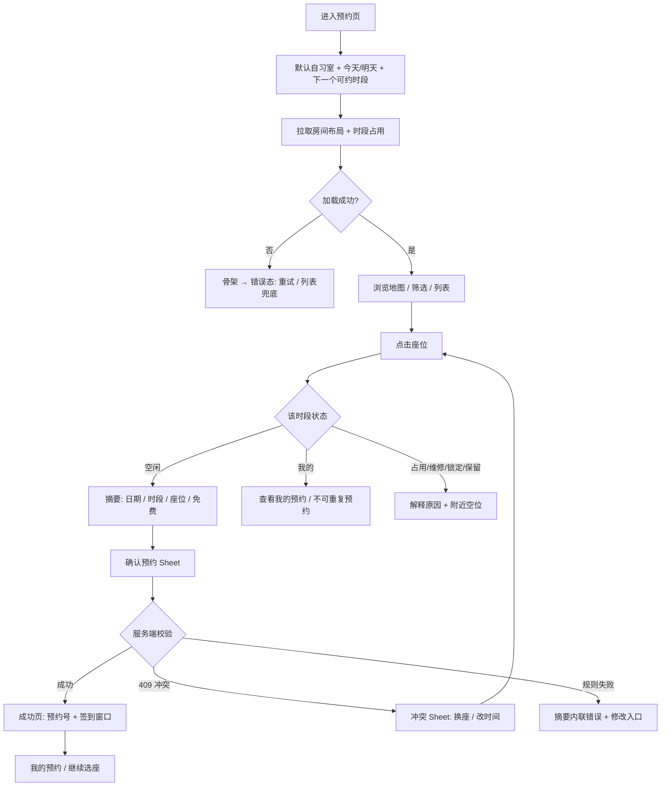

**关键动线**

- 页面加载后默认落在「可预约的第一个时段」，而不是 08:00。今天已无可约时段时自动顺延到明天，并给出轻提示。
- 选择座位不弹模态框，只更新右侧 / 底部摘要；**只有点「确认预约」才进入提交 Sheet**，减少误提交。
- 冲突时不自动改选、不丢失时间；用户保留日期 + 时段，只换座位。

### 2.2 管理端 IA

```text
/admin/seats 座位管理
├─ 顶栏
│  ├─ 自习室切换
│  ├─ 权限角色（自习室管理员 / 系统管理员只读）
│  ├─ 实时同步时间
│  └─ 刷新
├─ KPI 带
│  ├─ 上座率 / 当前空闲 / 占用中 / 需关注 / 冲突队列
├─ 标签
│  ├─ 占用监控
│  ├─ 布局编辑
│  └─ 运营与日志
├─ 工具条
│  ├─ 监控：选择 / 批量 / 锁区 / 维修 / 冲突
│  ├─ 布局：选择 / 新增 / 旋转 / 删除 / 撤销 / 重做 / 保存 / 导入
│  └─ 运营：刷新 / 释放 / 权限 / 日志
├─ 地图（同一空间对象）
│  ├─ 座位点击 → 检查器
│  ├─ Shift 多选 → 批量检查器
│  ├─ 布局编辑：网格 10px、吸附、对齐线、拖拽
│  └─ 缩放 / 适配 / 复位
├─ 检查器
│  ├─ 单座：资源状态 / 类型 / 坐标 / 预约摘要 / 锁定 / 维修 / 停用
│  ├─ 多座：批量锁定 / 维修 / 停用
│  ├─ 监控概览：冲突订单 / 临时保留 / 最近操作
│  ├─ 布局设置：版本 / 网格 / 保存 / 发布 / 导入
│  └─ 运营：自动释放 / 操作日志
└─ 二次确认
   ├─ 影响座位数 + 受影响预约
   ├─ 操作原因（必填）
   ├─ 执行人 / 时间
   └─ 「确认后不自动取消预约」说明
```

**管理端主流程**

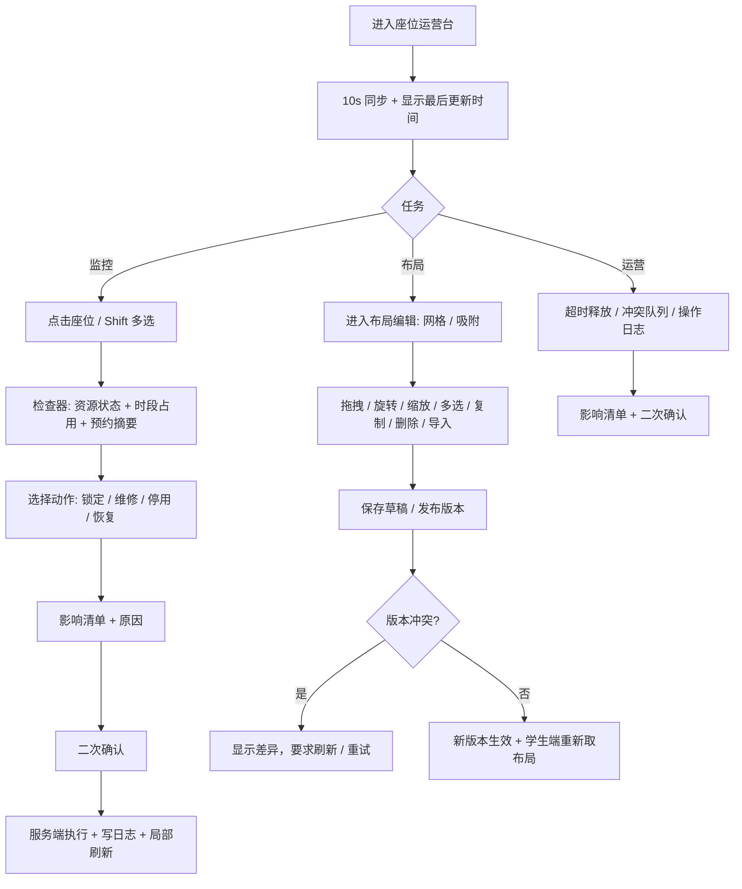

### 2.3 双人桌 / 连座规则（P1，需业务确认）

当前版本的预约模型是「一笔预约一个座位」，且禁止代他人预约。因此：

- 「双人桌 / 双人研习舱」是**桌面布局类型**，不是「一次预约两个人」。P-01 和 P-02 仍然由两位同学分别预约。
- 地图筛选器中的「双人桌」只过滤桌面类型；不会出现「同行人」「第二座位」入口。
- 若后续开放多座预约，需先支持 `reservation.seatIds[]`，并满足：同一房间、同一区域、相同时段、座位相邻、同一用户、总座位数 ≤ 2，且不得绕过每人每日 2 条的限制。
- 多座预约成功 / 取消 / 冲突都必须是原子操作；任一座位不可用则整体失败，不产生半笔预约。

### 2.4 页面结构（桌面 / 移动）

**学生端桌面（≥1280）**

```text
┌──────────────────────────────────────────────────────────────────────────────┐
│ 品牌 / 学生端·管理端切换 / 深色 / 规则 / 用户                                 │
├──────────────────────────────────────────────────────────────────────────────┤
│ ROOM A-201 · EAST WING                         ┌──────────────────────────┐  │
│ 预约座位。                                      │ 静园自习室 A-201          │  │
│ 选一段时间，挑一个坐得住的位置。                 │ 28 座 · 08:00–22:00      │  │
│                                                └──────────────────────────┘  │
├──────────────────────────────────────────────────────────────────────────────┤
│ 日期   [今天][明天][周日][周一] ... [周四]                                   │
├──────────────────────────────────────────────────────────────────────────────┤
│ 时间   [08][09][10][11][12][13]... [21]   08/10/12…刻度 · 17 空 · 2h · 免费  │
├──────────────────────────────────────────────────────────────────────────────┤
│ [全部 17][靠窗 4][带电源 9][安静 6][无障碍 2][双人桌 2][长时段 2] 找空位 规则 地图|列表│
├───────────────────────────────────────────────────────┬──────────────────────┤
│ A-201 平面图 · 28 座 / 10 桌                           │ 预约摘要             │
│ ┌──── 北窗 ─────────────────────────────────────────┐ │ C-03 · C2 桌         │
│ │ 窗边静区  W1/W2 四人长桌（各 4 椅）                │ │ 中央开放区           │
│ │ 中央开放区 C1–C4 两人桌（各 2 椅）                 │ │ 11/07 周六           │
│ │ 双人研习舱 P1 对坐双人桌                            │ │ 10:00–12:00          │
│ │ 电源长桌 PWR 长条桌（两侧各 2 椅）                 │ │ 免费 · 确认预约       │
│ │ 静音角 Q1 圆桌 · 无障碍 A1 宽桌                    │ │                      │
│ │ 图例（迷你） · 缩放 / 适配 / 复位                  │ │                      │
│ └──── 主入口 ────────────────────────────────────────┘ │                      │
└───────────────────────────────────────────────────────┴──────────────────────┘
```

**学生端移动端（390px）**

```text
┌─────────────────────────────┐
│ 静园  [学生端|管理端]  ☾ 林 │
├─────────────────────────────┤
│ ROOM A-201 · EAST WING      │
│ 预约座位。                   │
│ [静园自习室 A-201   换一间]  │
├─────────────────────────────┤
│ 日期  [今天][明天][周日] →   │
│ 时间  [08 09 10 ...] →       │
│       10:00–12:00 · 2h      │
├─────────────────────────────┤
│ [全部][靠窗][电源] →  地图|列表│
├─────────────────────────────┤
│ A-201 平面图      17 空位    │
│ ┌─────────────────────────┐ │
│ │ 窗边静区                 │ │
│ │ W1 ▭ [01][02]            │ │
│ │    [03][04]              │ │
│ │ 中央开放区               │ │
│ │ C1 ▭ [01][02] …          │ │
│ └─────────────────────────┘ │
├─────────────────────────────┤
│ C-03 · C2 桌 · 空闲          │
│ 11/07 · 10:00–12:00 · 免费   │
│                  [确认预约]  │
└─────────────────────────────┘
         ↑ 点击摘要栏
┌─────────────────────────────┐
│        ═══ 半屏抽屉 ═══      │
│ C-03 / C2 桌 / 中央开放区    │
│ 11/07 · 10:00–12:00 · 2h     │
│ 免费                         │
│ [查看详情并确认]             │
└─────────────────────────────┘
```

- 移动端地图默认 fit 全图；由于 28 座在 390px 宽度下椅子较小，顶部提供「找空位」；点击椅子后可直接在底部栏确认，点击摘要栏展开半屏抽屉。
- 地图手势区域使用 `touch-action: none`，但页面其余区域正常滚动；不把整页锁死。

**管理端桌面（≥1280）**

```text
┌──────────────────────────────────────────────────────────────────────────────┐
│ 品牌 / 学生端·管理端切换 / 主题 / 规则 / 用户                                 │
├──────────────────────────────────────────────────────────────────────────────┤
│ OPERATIONS / A-201                        [自习室][权限][实时·10s 10:24:03]   │
│ 座位运营台。                                                                  │
├──────────────────────────────────────────────────────────────────────────────┤
│ [上座率 25%][空闲 17][占用中 7][需关注 4][冲突 2]                           │
├──────────────────────────────────────────────────────────────────────────────┤
│ 占用监控 | 布局编辑 | 运营与日志                        最后同步 10:24:03      │
├────┬──────────────────────────────────────────────────┬──────────────────────┤
│选择│ A-201 · 座位图                      [监控模式][刷新]│ 运营概览             │
│批量│ ┌──────────────────────────────────────────────┐ │ 冲突订单 C-05 / P-02 │
│锁区│ │ 墙 / 窗 / 门 / 前台 / 主通道 / 座位          │ │ 临时保留 Q-03        │
│维修│ │ 缩放 / 适配 / 复位                           │ │ 最近操作             │
│冲突│ └──────────────────────────────────────────────┘ │                      │
└────┴──────────────────────────────────────────────────┴──────────────────────┘
```

---

## 3. 设计令牌

> 完整机器可读版本见 [`tokens.json`](tokens.json)。以下数值与原型 CSS 一致。  
> 作用域建议：`.seat-experience` 局部主题，先不改全站品牌紫；等业务确认后再提升为全局令牌。这样不会破坏其他 15 个页面的现有视觉。

### 3.1 色彩

| 令牌 | 浅色 | 深色 | 用途 | 实测对比度 |
| --- | --- | --- | --- | --- |
| `--paper` | `#F3EFE5` | `#151713` | 页面底色 / 纸面 | ink 13.75:1（浅） |
| `--surface` | `#FFFCF5` | `#20241E` | 卡片 / 浮层 | — |
| `--surface-2` | `#FAF6EC` | `#262B24` | 次级底 / 地图外框 | — |
| `--ink` | `#1F241F` | `#F3EFE3` | 主文字 | 13.75:1（浅） |
| `--ink-2` | `#555D53` | `#C4C1B4` | 正文 / 次说明 | 5.18:1（浅） |
| `--ink-3` | `#6B7268` | `#9B9A8C` | 元信息（仅 surface 上） | 4.84:1（surface） |
| `--line` | `#DFD8C8` | `#3A4036` | 1px 分隔 / 网格 | 非文本 |
| `--line-strong` | `#C4BAA7` | `#50584B` | 悬停描边 / 墙体 | 非文本 |
| `--brand` | `#0E7164` | `#68C7B7` | 可约 / 主操作 / 实时 | 5.13:1（paper），5.75:1（surface） |
| `--brand-hover` | `#0A5C52` | `#8AD8CA` | 主按钮 hover | — |
| `--brand-soft` | `#DDEEE8` | `#1B3D36` | 可约浅底 / 选中底 | — |
| `--brand-wash` | `#EDF5F1` | `#1A2E29` | 大面积浅底 | — |
| `--amber` | `#A8610A` | `#F0B45A` | 已占用强调 / 我的 | 非文本 |
| `--amber-ink` | `#7A4504` | `#F6D39A` | 琥珀底上的文字 | 6.93:1（浅） |
| `--amber-soft` | `#FBF0D9` | `#3A2E19` | 占用浅底 / 提醒 | — |
| `--danger` | `#B93A2B` | `#F08A78` | 维修 / 冲突 / 高风险 | 4.71:1（danger-soft） |
| `--danger-ink` | `#8E2A1F` | `#FFC4B8` | 危险底上的文字 | — |
| `--danger-soft` | `#F9E6E1` | `#3E2520` | 维修浅底 / 错误条 | — |
| `--slate` | `#5F665D` | `#B8B5A8` | 锁定 / 中性 | 4.88:1 |
| `--focus` | `#0E7164` | `#F0B45A` | 焦点环 | 3:1+（非文本） |

**使用约束**

- 正文只用 `ink` / `ink-2`；`ink-3` 在 `paper` 上只有 4.32:1，**不能承载小号正文**，只用于 surface 上的元信息或 ≥14px 次要文字。
- 状态不能只靠色：每个座位状态必须同时有 **色 + 线型 + 图标 + 文本 / 图例** 四通道。
- 暖色阴影使用 `rgb(62 49 29 / …)`，不使用纯黑投影；深色模式以 1px 描边和底色层次为主。

### 3.2 座位状态矩阵

| 状态 | 语义 | 颜色 | 线型 | 图标 | 地图标签 | 可点击结果 |
| --- | --- | --- | --- | --- | --- | --- |
| 空闲 `free` | 资源可用，时段未被占 | 松石浅底 `#E7F3EE` / 深绿线 | 实线 | 无（以空白 + 实线为基线） | — | 选中 → 摘要 |
| 已被预约 `taken` | 他人有效预约 | 红色 `--ssr-seat-taken-bg` / `--ssr-seat-taken-line` | 虚线 + 浅红斜纹 | 时钟 | — | 解释 + 附近空位 |
| 我的预约 `mine` | 当前用户有效预约 | 金琥珀 `#F5C86A` / 深棕线 | 双线 2.4px | 勾 | 「我的」 | 查看 / 不可重复预约 |
| 临时保留 `held` | 管理员短时保留 | 沙灰 `#E7E1D3` / 褐线 | 实线 + 斜纹 | 沙漏 | 「保留」 | 解释 + 到期时间 |
| 未开放 / 锁定 `locked` | 停用 / 区域锁定 | 石灰 `#EAE7DE` / 灰线 | 点线 | 锁 | 「锁定」 | 解释 + 联系管理员 |
| 维修中 `fix` | 资源状态维修 | 灰色 `--ssr-seat-fix-bg` / `--ssr-seat-fix-line` | 实线 + 斜纹 | 扳手 | 「维修」 | 解释 + 报修信息 |

**特殊属性标签**：靠窗（窗图标）、带电源（闪电）、安静（月牙）、无障碍（轮椅）、长时段（星）、双人桌（双圆点）。属性图标优先放在**桌子中心**，不贴到每把椅子上；状态图标保留在椅子坐垫上。低倍率隐藏桌型 / 属性细节，桌号与椅号仍保留；椅号退化为末两位，保证不重叠。

### 3.3 字体

| 角色 | 字体 | 用法 |
| --- | --- | --- |
| 展示 / 房间标题 | `Fraunces` + `Noto Serif SC` / `Songti SC` | 页面主标题、房间名、座位号大数字 |
| 界面正文 | `Noto Sans SC` / `HarmonyOS Sans SC` / `PingFang SC` | 所有正文、按钮、表单 |
| 数据 / 编号 | `IBM Plex Mono` | 座位号、时间、预约号、坐标、日志时间 |

```css
--font-display: 'Fraunces', 'Noto Serif SC', 'Songti SC', 'STSong', serif;
--font-ui: 'Noto Sans SC', 'HarmonyOS Sans SC', 'PingFang SC', 'Microsoft YaHei', sans-serif;
--font-mono: 'IBM Plex Mono', 'SFMono-Regular', Consolas, monospace;
```

**字号阶梯**：9 / 10 / 11 / 13 / 15 / 18 / 22 / 28 / 36 / 52。  
**行高**：1.1（展示）、1.35（标题）、1.6（正文）、1.75（说明）。  
**数字**：`font-variant-numeric: tabular-nums`，时间与价格右对齐。  
**字体加载**：生产环境自托管 WOFF2 子集；不要依赖 Google Fonts 在中国大陆的可用性；`font-display: swap`，首屏先回落到系统黑体 / 宋体。

### 3.4 间距、圆角、阴影、动效

- **间距**：4px 基准；4 / 8 / 12 / 16 / 20 / 24 / 32 / 40 / 56 / 72。地图内部使用房间逻辑单位，网格 10 单位。
- **圆角**：4（标签）/ 6（小控件）/ 7（桌子）/ 13（椅子坐垫靠背侧）/ 14（卡片）/ 18（地图卡）/ 24（Sheet / 房间轮廓）/ 999（胶囊桌 / 圆桌）。
- **阴影**：
  - `sm: 0 1px 0 rgb(62 49 29 / 6%)` — 纸面卡片
  - `md: 0 14px 30px -20px rgb(62 49 29 / 28%)` — 浮层 / 工具条
  - `lg: 0 30px 70px -36px rgb(62 49 29 / 36%)` — Sheet / 确认框
  - 深色禁用大阴影，改用 `1px` 描边 + 更亮一档的 surface。
- **动效**：120ms（按压）/ 180–200ms（hover、Sheet）/ 320ms（页面进入）；缓动 `cubic-bezier(.22,.61,.36,1)`；地图手势只改 `transform`；`prefers-reduced-motion` 下全部降级为 0.001ms。
- **层级**：页面 1 → 地图工具 20 → Sheet 110 → 确认框 200 → Toast 300。

### 3.5 断点

| 断点 | 行为 |
| --- | --- |
| `< 720px` | 单栏；底部摘要栏 + 半屏摘要抽屉；筛选横向滚动；地图全宽；检查器下移 |
| `720–920px` | 地图 + 摘要单栏；桌面右栏隐藏 |
| `920–1280px` | 双栏（地图 + 摘要）；规则入口为工具栏按钮 / Sheet |
| `≥ 1280px` | 双栏（地图 + 摘要）；管理端三栏 |
| `≥ 1440px` | 内容最大 1520px，地图留白增加 |

---

## 4. 组件树、Props 与状态机

### 4.1 学生端组件树

```text
SeatBookingPage
├─ BookingTopBar
│  ├─ RoomSwitcher
│  ├─ ThemeSwitch
│  └─ RulesEntry
├─ PageHead
│  └─ RoomSummaryCard
├─ DateRail
│  └─ DateChip[]
├─ TimeRail
│  ├─ SlotCell[]（小时刻度 + 当前时间指针）
│  ├─ RangeHandle
│  └─ TimeSummary
├─ FilterBar
│  ├─ FilterChip[]
│  ├─ RulesButton
│  └─ ViewSwitch
├─ SeatMapPanel
│  ├─ MapToolbar (zoom / fit / reset / list)
│  ├─ SeatMapCanvas
│  │  ├─ RoomShell (wall / window / door / aisle / front desk)
│  │  ├─ AreaLayer
│  │  │  └─ AreaLabel[]
│  │  ├─ TableFurniture[]（桌号 + 属性图标 + 座数）
│  │  ├─ SeatItem[]（椅子：编号 + 状态 + 靠背方向）
│  │  └─ A11yOverlay
│  ├─ Legend（迷你三态 + 可展开完整图例）
│  ├─ MapHint
│  └─ SeatListFallback（按区域 + 桌号分组）
├─ BookingSummary
│  ├─ SelectedSeatCard（含桌号）
│  ├─ SummaryRows
│  ├─ RuleChecklist
│  └─ PrimaryCTA
├─ MobileActionBar → MobileSummarySheet（半屏抽屉）
└─ ReservationSheet / ConflictSheet / SuccessSheet / RulesSheet
```

### 4.2 管理端组件树

```text
SeatAdminPage
├─ AdminTopBar (room / role / live / refresh)
├─ AdminKpiStrip
├─ AdminTabs
├─ AdminWorkspace
│  ├─ AdminToolRail
│  ├─ SeatMapCanvas (editable)
│  │  ├─ RoomShell
│  │  ├─ AreaLayer
│  │  ├─ TableFurniture[]（整桌拖拽）
│  │  ├─ SeatItem[]（单椅拖拽）
│  │  ├─ EditorGrid
│  │  ├─ AlignmentGuides
│  │  └─ MarqueeSelection
│  └─ InspectorPanel
│     ├─ SeatInspector
│     ├─ BatchInspector
│     ├─ MonitorOverview
│     ├─ LayoutSettings
│     └─ OpsLog
├─ ImpactConfirmDialog
├─ ImportDialog
├─ ConflictQueueDrawer
└─ ToastRegion
```

### 4.3 关键 Props

| 组件 | Props | Emits | 说明 |
| --- | --- | --- | --- |
| `SeatMapCanvas` | `room`, `tables: TableView[]`, `seats: SeatView[]`, `areas`, `selection: number[]`, `hoveredId`, `mode: 'student' \| 'admin' \| 'editor'`, `viewport`, `lod`, `readOnly` | `select`, `hover`, `table-hover`, `viewport-change`, `seat-drag`, `table-drag`, `seat-resize`, `context-menu` | 纯展示 + 交互；不直接发请求 |
| `TableFurniture` | `table: TableView`, `selected`, `hovered`, `mode`, `lod`, `editable` | `hover`, `dragstart` | 桌子不可选座；点击桌子只平移地图；编辑模式可整桌拖拽 |
| `SeatItem` | `seat`, `table`, `state`, `selected`, `mine`, `dimmed`, `lod`, `editable`, `orientation` | `select`, `dragstart` | 椅子按钮语义；`aria-pressed`；状态不可用时仍可查看说明 |
| `MapToolbar` | `zoom`, `min`, `max`, `canFit`, `canReset`, `view` | `zoom-in`, `zoom-out`, `fit`, `reset`, `toggle-view`, `toggle-legend` | 按钮有 `aria-label`；键盘可达 |
| `DateRail` | `dates`, `value`, `counts` | `change` | 7 天，过去日期禁用 |
| `TimeRail` | `open`, `close`, `step`, `range`, `availability[]`, `disabledRanges` | `change` | 点击 / 拖动；5 分钟吸附；最大 4h |
| `BookingSummary` | `seat`, `date`, `range`, `price`, `rules`, `status`, `submitting` | `submit`, `find-alternative`, `view-rules` | 桌面右栏 / 移动底部栏共用 |
| `ReservationSheet` | `open`, `summary`, `state: 'confirm' \| 'submitting' \| 'conflict' \| 'success' \| 'error'`, `alternatives` | `confirm`, `close`, `pick-alternative`, `change-time` | 焦点陷阱 + Esc |
| `AdminLayoutEditor` | `seats`, `grid=10`, `snap`, `selectedIds`, `history`, `readOnly` | `update`, `select`, `undo`, `redo`, `save`, `publish`, `import` | 拖拽 / 旋转 / 缩放 / 复制 / 删除 |
| `StatusBadge` | `state`, `label?`, `count?` | — | 颜色 + 图标 + 文案；不只颜色 |
| `ImpactConfirmDialog` | `title`, `affectedSeats`, `affectedReservations`, `requireReason`, `danger` | `confirm(reason)`, `cancel` | 高风险操作必须二次确认 |

### 4.4 类型与 API 契约

```ts
type Viewport = { x: number; y: number; z: number }
type DateKey = `${number}-${number}-${number}`

interface TimeRange {
  start: string   // 'HH:mm'，5 分钟对齐
  end: string     // 'HH:mm'，左闭右开
}

interface BookingIntent {
  roomId: number
  seatId: number
  date: DateKey
  range: TimeRange
  idempotencyKey: string
}

interface ConflictResponse {
  code: 'SEAT_TAKEN' | 'RULE_CONFLICT' | 'DAILY_LIMIT' | 'ACCOUNT_RESTRICTED'
  message: string
  serverTime: string
  conflictSeatIds: number[]
  alternatives?: SeatView[]
  canChangeTime: boolean
}

interface LayoutPayload {
  roomId: number
  version: number
  grid: 10
  tables: Array<Pick<TableLayout, 'tableId' | 'label' | 'shape' | 'x' | 'y' | 'w' | 'h' | 'rotation' | 'seatIds'>>
  seats: Array<Pick<SeatLayout, 'seatId' | 'tableId' | 'x' | 'y' | 'w' | 'h' | 'rotation' | 'orientation'>>
}

interface LayoutSaveResult {
  version: number
  updatedAt: string
  warnings?: Array<{ code: string; seatId?: number; message: string }>
}
```

**现有接口缺口（重要）**

- `GET /api/v1/reservations/available-seats` 只返回「可预约座位」，学生端无法从它拿到「哪些座位被占」来画完整地图。
- 建议新增 `GET /api/v1/rooms/{room_id}/seat-map?reserve_date&start_time&end_time`，返回 **全部桌子 + 全部椅子** + 派生 `slotState` + `mine` + 可选预约摘要（不泄露他人身份）。
- 布局：`GET /api/v1/rooms/{room_id}/layout`（登录可见，返回 tables + seats + version）；`PUT /api/v1/admin/rooms/{room_id}/layout`（管理员，带 `version` / `If-Match`）。
- 导入：`POST /api/v1/admin/rooms/{room_id}/layout/import?dry_run=true|false`，返回逐行错误。
- 管理端占用：可复用 `GET /api/v1/seats/occupancy`，但需支持 `room_id + date + range` 与分页 / 全量。
- 冲突处理：服务端返回 `409` + `code` + `alternatives`；不要前端猜测。

### 4.5 状态机

**预约状态**

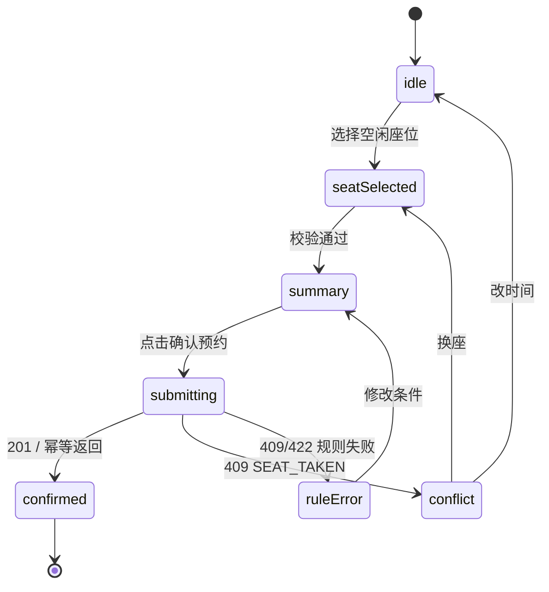

守卫：

- `seat.status === 'free'` 且 `slotState === 'free'` 才允许 `summary → submitting`。
- 提交时按钮立即锁定，同一个 `BookingIntent` 复用同一个幂等键；请求期间不允许再次点击。
- 成功后不整页重拉「可预约座位」（会把本人冲突算进去导致全空），只把该座位局部标记为 `mine` 并更新摘要。
- 冲突时保留 `date + range + selectedSeat`，不自动换座、不自动清空。

**地图视口状态**

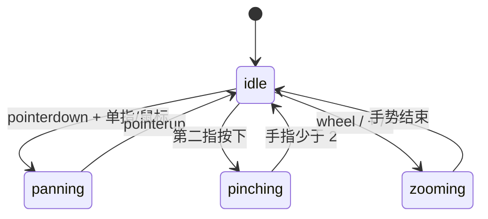

- 视口变换 `{x, y, z}` 是唯一来源；缩放中心锚定光标 / 双指中点。
- `z ∈ [0.5, 2.5]`；`fit` 后 `z = min((vw-pad)/roomW, (vh-pad)/roomH)`。
- 平移边界：当内容大于容器时，至少保留 120px（或容器 26%）内容可见；内容小于容器时居中，不抖动。

**布局编辑状态**

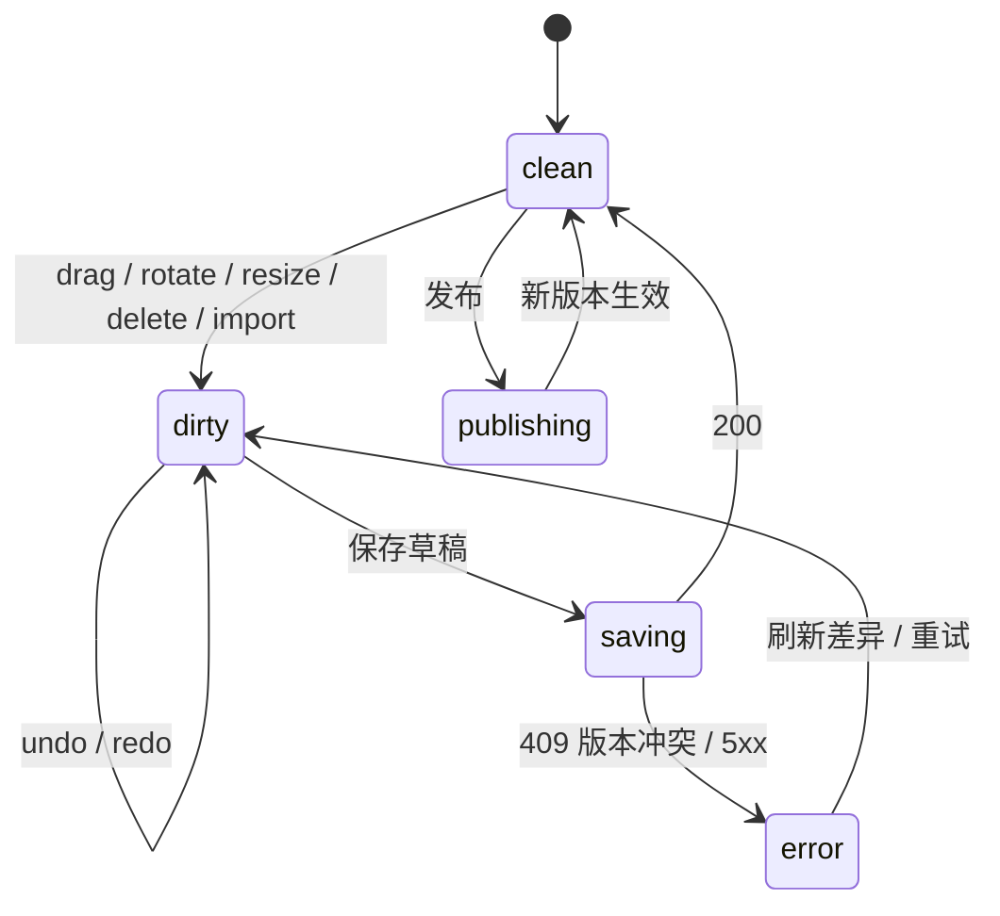

- 撤销 / 重做 50 步；所有变更先进入本地事务快照。
- 发布使用乐观锁 `version`；服务端版本不一致时返回 409，**不覆盖**，展示「布局已被其他管理员修改」。
- 未保存离开页面触发 `beforeunload` 确认；发布前二次确认。

**管理操作状态**

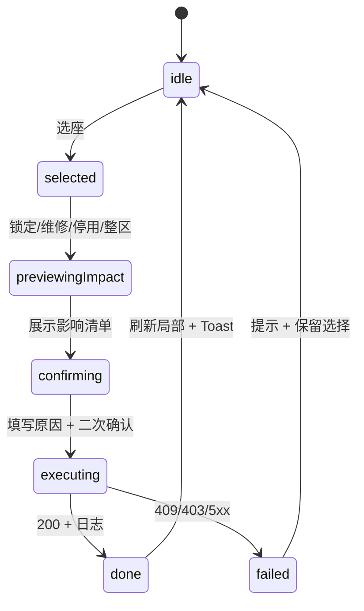

---

## 5. 地图交互规格

### 5.0 家具模型与点击语义

**数据关系**

```text
Room
├─ Area × 6
├─ Table × 10
│  ├─ W1  四人长桌   seatIds: W-01..W-04
│  ├─ W2  四人长桌   seatIds: W-05..W-08
│  ├─ P1  对坐双人桌 seatIds: P-01..P-02
│  ├─ C1..C4 两人桌  seatIds: C-01..C-08
│  ├─ PWR 长条电源桌 seatIds: PWR-01..PWR-04
│  ├─ Q1  四人圆桌   seatIds: Q-01..Q-04
│  └─ A1  无障碍宽桌 seatIds: A-01..A-02
└─ Seat × 28（每把椅子属于且只属于一张桌子）
```

**视觉规则**

| 元素 | 表现 | 交互 |
| --- | --- | --- |
| 桌子 | 杉木色桌面 + 1px 深木描边 + 向下 4px 挤出阴影；桌心放桌号（W1 / C2 / PWR / Q1）与电源 / 靠窗 / 无障碍小图标 | **不可选座**；hover 时整桌轻亮；编辑模式下可拖动整桌，连带椅子移动 |
| 椅子 | 半圆托件 + 坐垫；靠背在远离桌面的一侧，开口朝向桌面；座号在坐垫上 | **唯一可预约点击目标**；hover 只抬升该椅；选中时椅子双环 + 桌面描边点亮 + 柔和外发光 |
| 状态 | 只作用在椅子坐垫，桌子保持木材本色 | 颜色 + 线型 + 图标 + 图例；地图 / 列表 / 图例共用 `--ssr-seat-*` token，已预约为红色，维修为灰色 |
| 座位号 | 椅面上显示 `W-01` / `C-03`；低倍率退化为末两位 | 完整编号在 aria-label、摘要和列表视图中 |
| 桌椅关系 | 椅子围绕桌边，不重叠；同一桌的椅子共享桌号 | 列表视图按区域 + 桌号分组；冲突替代座位优先同区域 / 同类型 |

**点击 / 悬停测试**

- 点击椅子：进入摘要；点击桌子：只平移地图，不会选中任何座位。
- hover 桌子：整桌和该桌所有椅子轻微提亮；hover 椅子：只有该椅子抬升。
- 选中 C-03：C-03 椅子出现双环 + 勾，C2 桌子描边点亮；其他桌不变。
- 编辑模式拖桌子：桌号、椅子、座位坐标一起移动；拖动单椅只移动该椅。

### 5.1 坐标系与变换

- 房间逻辑坐标：`x ∈ [0, 760]`，`y ∈ [0, 580]`，1 单位约等于 1cm；真实房间可按比例缩放，但保持宽高比。
- 座位布局：`x, y, w, h, rotation`；旋转围绕座位中心，15° 步进。
- 视口：`transform: translate(x, y) scale(z)`，`transform-origin: 0 0`。
- 屏幕 ↔ 世界：

```text
screenX = worldX * z + tx
worldX  = (screenX - tx) / z
```

- 以光标为焦点缩放：

```text
wx = (px - tx) / z
wy = (py - ty) / z
z' = clamp(z * factor, 0.5, 2.5)
tx' = px - wx * z'
ty' = py - wy * z'
```

- 双指缩放锚定双指中点：记录起始距离、中点和该点世界坐标；移动时按 `distance / startDistance` 更新 `z`，保持中点世界坐标不动。

### 5.2 缩放与平移

| 操作 | 规格 |
| --- | --- |
| 最小 / 最大缩放 | `0.5×` / `2.5×` |
| 按钮 | `＋` / `－`，每次 `1.2×`，以视口中心为焦点 |
| 滚轮 | `factor = exp(-deltaY * 0.0016)`，以光标为焦点；阻止页面滚动 |
| 双指 | 以双指中点为焦点；缩放与平移同时生效 |
| 双击 | 以双击点为焦点，放大 `1.35×` |
| 适配全图 | 包含 24–30px 内边距；不改变最小缩放限制 |
| 复位 | `z=1`，房间居中；不重置筛选 / 选择 |
| 平移 | 单指拖拽 / 鼠标拖拽；移动超过 4px 才视为拖拽，避免点击误判 |
| 平移边界 | 内容大于视口：至少保留 `min(120px, 26%)` 可见；内容小于视口：居中锁定 |
| 缩放标签 | 字号反向补偿：`fontSize = clamp(8, 10 / z, 18)`（房间单位），保证屏幕字号约 8–10px 以上；`z < 0.62` 隐藏次要图标、只留状态图标与末两位座号 |

### 5.3 LOD（细节层级）

| 缩放 | 椅号 | 桌号 / 桌型 | 状态图标 | 类型图标 | 区域英文名 | 操作 |
| --- | --- | --- | --- | --- | --- | --- |
| `z < 0.62` | 末两位（如 `03`） | 桌号保留，桌型 / 座数隐藏 | 保留 | 隐藏 | 隐藏 | 点击 / 键盘仍可用 |
| `0.62 ≤ z < 1.12` | 完整（`C-03`） | 桌号 + 座数 | 保留 | 桌子保留最多 2 个 | 显示 | 正常 |
| `z ≥ 1.12` | 完整 | 桌号 + 座数 + 桌型 | 保留 | 显示 | 显示 | 显示「我的 / 保留 / 维修」旗标 |

> 关键：缩小地图时**不把标签一起缩到不可读**；标签尺寸做反向补偿，并在低倍率下减少信息，而不是把全部文字挤在一起。桌子标签和椅子标签分别做 LOD，桌子始终可辨认「这是一张什么桌」。

### 5.3.1 时间轴刻度与当前时间

- 每小时一条浅灰刻度线；每 2 小时显示 `08:00 / 10:00 / 12:00 …` 标签。
- 今天且当前时间在开放区间内时，显示琥珀色「现在」指针和 5px 圆点。
- 拖动时间范围时，跟随指针显示 `10:00 — 12:00 · 2 小时` tooltip；松手吸附 5 分钟。
- 时间轴不可用时（历史 / 关闭）刻度保留，色块与指针隐藏。

### 5.4 手势与键盘

| 输入 | 行为 |
| --- | --- |
| 单指拖拽 / 鼠标拖拽 | 平移地图 |
| 双指捏合 | 缩放 + 平移，锚定中点 |
| 滚轮 / 触控板双指 | 缩放（阻止页面滚动） |
| `+` / `-` | 以视口中心缩放 |
| `0` | 复位到 100% |
| `F` | 适配全图 |
| 方向键（地图聚焦） | 平移 32px / 按住 Shift 80px |
| 方向键（座位聚焦） | 按空间方向移动到最近座位 |
| `Tab` | 依次到工具栏、座位、底部摘要 |
| `Enter` / `Space` | 选择当前座位 |
| `Esc` | 关闭 Sheet / 取消当前浮层 |

- 所有按钮使用真实 `<button>`；座位是按钮，不是 div。
- 焦点环：`outline: 2px solid var(--focus); outline-offset: 3px`，深色下用琥珀；地图容器自身也有可见焦点。
- 触控目标：座位推荐 ≥44×44 CSS px；低倍率时用透明命中区域扩展（至少 8px）。
- 屏幕阅读器：地图区域 `aria-label` 说明「可拖拽 / 滚轮缩放 / 可切换列表」；每个座位 `aria-label` 含座号、区域、类型、状态、操作；状态变化通过 `aria-live="polite"` 宣告；列表视图与地图同源。

### 5.5 性能：28 座与 1000 座

**28 座（默认）**

- DOM/SVG 座位即可；目标首屏可交互 < 600ms（本地缓存），< 1.5s（4G）。
- 平移 / 缩放只更新一个 `transform`，不重排座位。
- 座位 hover 只改变 transform / box-shadow，不改变宽高。

**1000 座**

当 `seats.length > 300` 时切换到 Canvas 2D 基础层 + DOM 覆盖层：

1. **静态层**：房间墙 / 区域 / 桌面 / 椅子绘制到离屏 Canvas；布局变化时重绘。
2. **动态层**：状态色、选中环、hover 座号绘制到主 Canvas；每帧只重绘脏矩形。
3. **DOM 覆盖**：只保留当前 focus / hover / selected / 正在拖拽的座位为 DOM 元素，保证焦点与 aria；其余座位在 Canvas 中。
4. **空间索引**：座位按 128×128 房间单位分桶；视口裁剪只遍历可见桶；命中测试在桶内做矩形检测。
5. **标签 LOD**：只绘制屏幕字号 ≥ 8px 的座号；缩小时合并为区域计数徽标（如「窗边静区 17 空」）。
6. **渲染循环**：手势期间只发 `requestAnimationFrame`，不读取 layout；`devicePixelRatio` 上限 2；使用 `will-change: transform` 仅在手势期间。
7. **列表视图**：虚拟滚动，DOM 始终 ≤ 40 行；键盘 / 读屏使用虚拟列表 + `aria-setsize`。

**可量化指标**

| 指标 | 目标 |
| --- | --- |
| 1000 座首次可交互 | ≤ 1.5s（中端移动设备，4G） |
| 平移 / 缩放帧率 | ≥ 55fps，p95 frame ≤ 18ms |
| 命中测试 | ≤ 2ms |
| 单次更新（10s 轮询） | 只 patch 变化座位，≤ 16ms |
| 内存 | ≤ 80MB（1000 座 + 纹理） |
| 标签更新 | 缩放结束后 ≤ 50ms 内完成 LOD 切换 |
| 长任务 | 无 > 50ms 的阻塞任务 |

**降级**

- Canvas 不可用 / 上下文丢失 → 自动回退 DOM 列表，不白屏。
- 地图接口失败 → 保留日期 / 时段 / 筛选，显示错误卡 + 重试 + 列表兜底。
- 1000 座下如果设备 `deviceMemory <= 2GB`，默认进入「区域概览」模式，按区域聚合，不绘制全部座位。

### 5.6 实时更新与一致性

- P0：**10 秒轮询**，与看板一致；页面隐藏时暂停，恢复时立即刷新；显示「最后同步 HH:mm:ss」。
- 使用 `ETag` / `If-None-Match` 或 `updatedAt` 做增量；只更新变化的座位，保留当前缩放、平移、选择和焦点。
- 超过 30 秒未成功同步：显示「数据可能已过期」黄条，不静默使用旧数据提交。
- 提交前服务端重新校验；409 时以服务端结果为准，前端只负责提供恢复路径。
- P1：SSE 推送 `seat.updated` / `reservation.released` 事件；断线回退轮询。
- 超时释放由服务端调度器执行；前端只显示倒计时和「已释放」通知，不自行释放。

---

## 6. 高保真界面说明

> 以下截图均由本目录原型直接渲染；可打开 `prototype/index.html` 交互。

### 6.1 学生端桌面

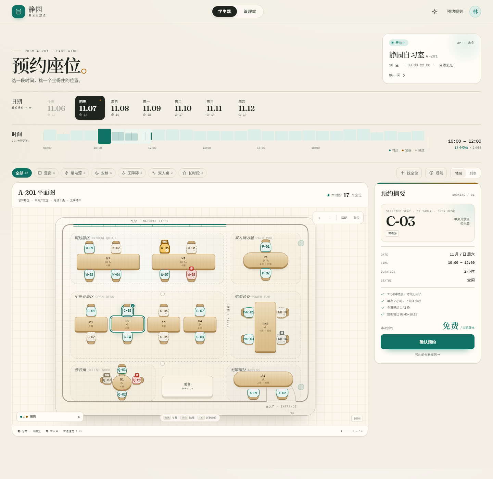

- 顶栏是展示用壳层；实际落地可保留现有学生端壳层，只在 `.seat-experience` 内应用本主题。
- 日期带：7 天，选中态深墨底 + 琥珀小点；今天已过最后一个时段时禁用，并自动落到明天。
- 时间带：5 分钟格（08:00–22:00 共 168 格），主刻度仍为每小时 + 08/10/12… 小时标签；今天且当前时刻在开放区间时显示琥珀「现在」指针。选中范围用松石浅底，起点深色块，终点为结束边界细线；拖动时跟随显示范围 tooltip。
- 筛选条：数字是「该类型在当前时段的可约数」；不重排地图，只降低不匹配座位的透明度，保留空间记忆。
- 地图：墙 / 窗 / 门 / 前台 / 主通道 / 六个区域 + **10 张桌子 / 28 把椅子**。桌子是杉木家具，桌心为桌号（W1 / C2 / PWR / Q1）和属性图标；椅子围绕桌边，座号在椅面。**点击椅子才选中**；选中 C-03 时椅子双环 + 桌面描边点亮。
- 规则 rail 已收起，入口位于筛选行右侧「规则」按钮 / 顶栏规则 Sheet，横向空间还给地图。
- 图例常驻迷你三色点 + 可展开完整图例；地图 / 列表 / 图例使用同一套 `--ssr-seat-*` 状态 token，已预约为红色，维修为灰色。
- 摘要：座位号用展示衬线大数字；桌号、区域、日期、时段、时长、状态、费用、规则检查；提交前只在这里确认。

### 6.2 学生端移动端

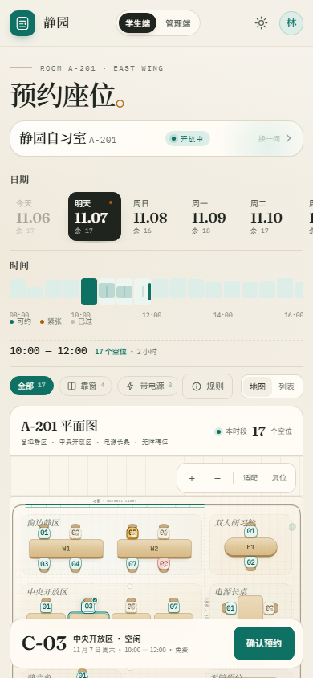

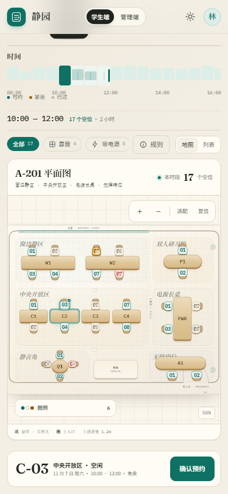


- 首屏保留房间上下文、日期、时间、筛选和地图标题；地图在下方，依靠单指平移 / 双指缩放浏览。
- 底部固定摘要栏：点击左侧座位信息打开**半屏摘要抽屉**，显示桌号、座位、时间、时长、免费和「查看详情并确认」；确认后才进入完整预约 Sheet，不遮挡地图手势。
- 地图本身 `touch-action: none`，页面其他区域正常滚动；点击椅子不弹模态，避免遮挡地图。
- 低倍率下椅号退化为末两位、桌型 / 座数 / 区域英文名隐藏；桌子标签仍保留，保证「这是一张什么桌」可读。

**深色模式**：令牌已覆盖全部状态与地图材质，原型右上角可切换：[深色截图](screenshots/student-dark.png)。

### 6.3 管理端占用监控

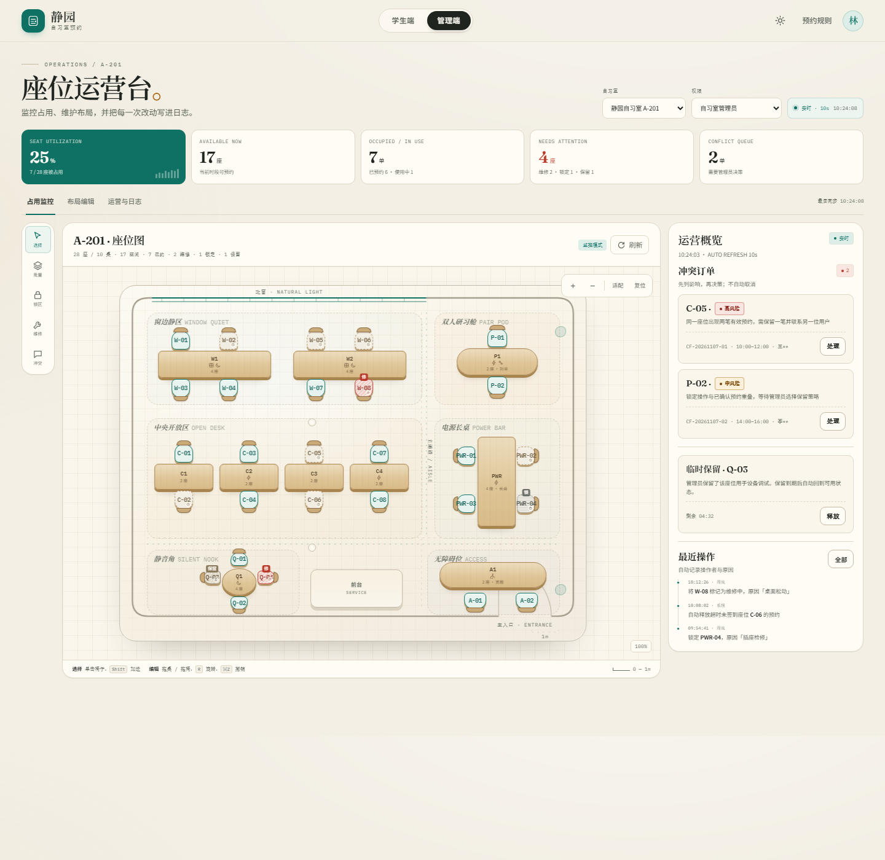

- 上座率、空闲、占用、需关注、冲突五个 KPI；右上角实时时间。
- 地图与检查器同屏；右侧冲突订单、临时保留、最近操作形成运营闭环。
- 地图上「已约 / 维修 / 锁定 / 保留」在视觉上可区分，且不把「已预约」写成座位资源状态。桌子标签保留桌型与属性，椅子承载座位状态。

### 6.4 管理端布局编辑

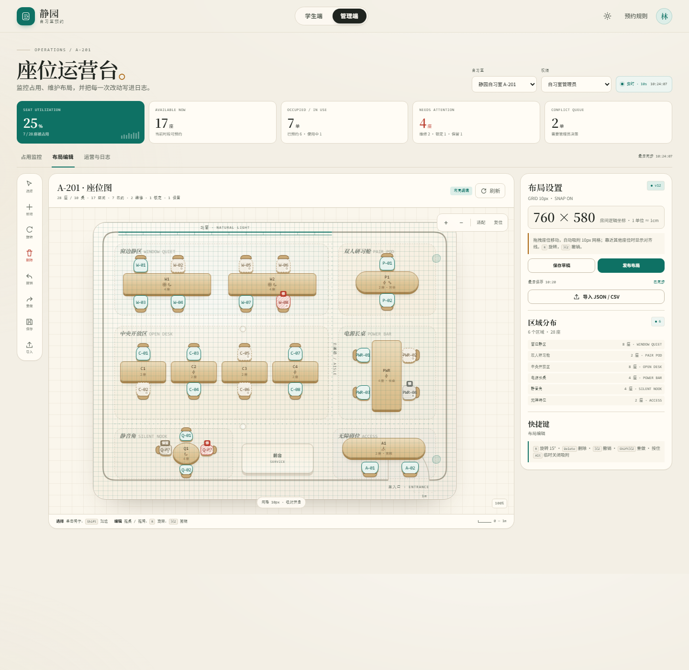

- 工具栏：选择、新增、旋转、删除、撤销、重做、保存、导入。
- 地图：10px 网格、吸附、对齐线；**拖动桌子会连带椅子整体移动**，拖动单椅只移动该椅；右侧检查器可改 X/Y/W/H/旋转 / 类型，并显示所属桌号。
- 布局设置：版本号、草稿状态、保存 / 发布、导入 JSON/CSV；区域分布与快捷键卡片。
- 发布是高风险操作：版本冲突不覆盖，保留本地未保存状态，提示刷新差异。

### 6.5 权限只读态

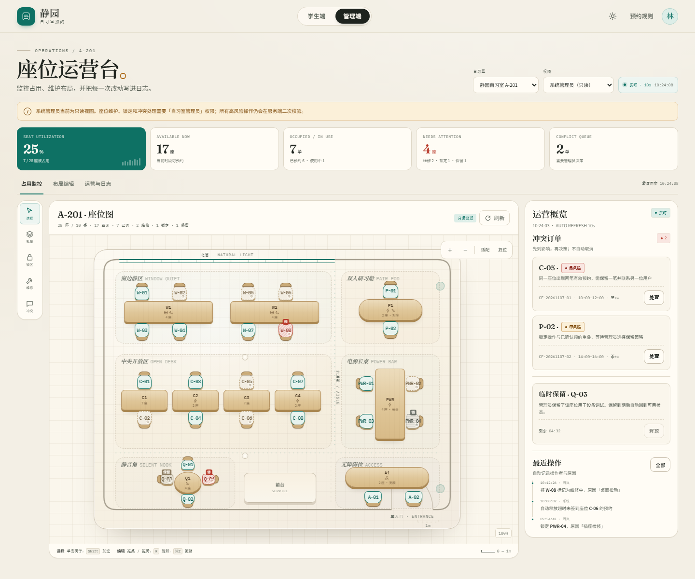

- 系统管理员进入时显示只读横幅；操作按钮禁用；服务端仍会校验权限。
- 学生端不显示任何编辑入口；前端隐藏不是安全边界，服务端必须拒绝。

### 6.6 冲突态

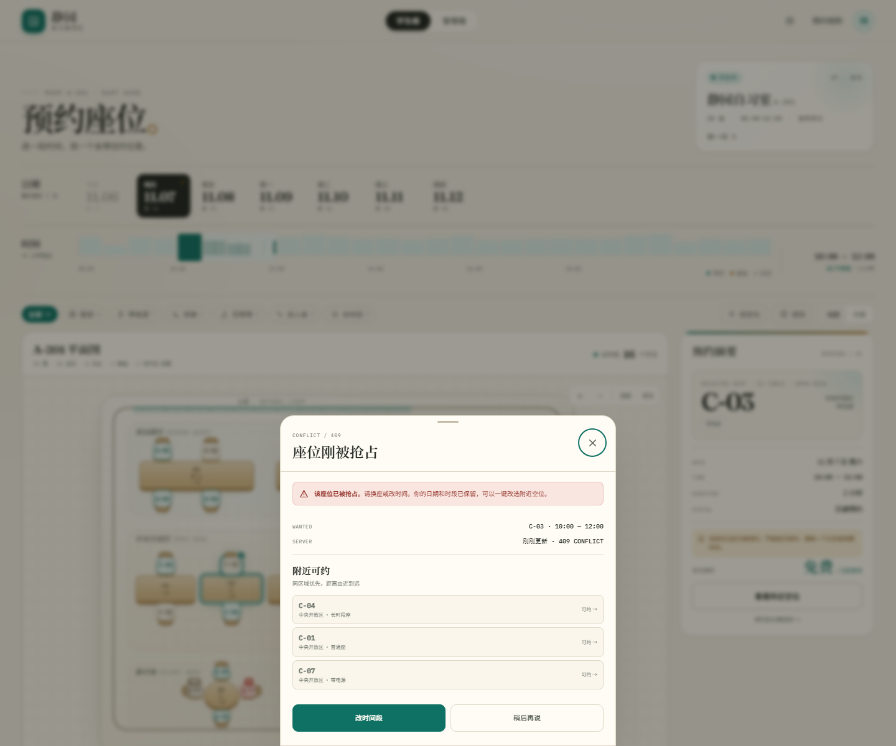

- 标题使用明确文案「座位刚被抢占」；正文说明「请换座或改时间」；保留日期 / 时段；给出同区域优先的附近空位。
- 不自动改选，不静默清空，不丢失用户已选时间。

### 6.7 成功态

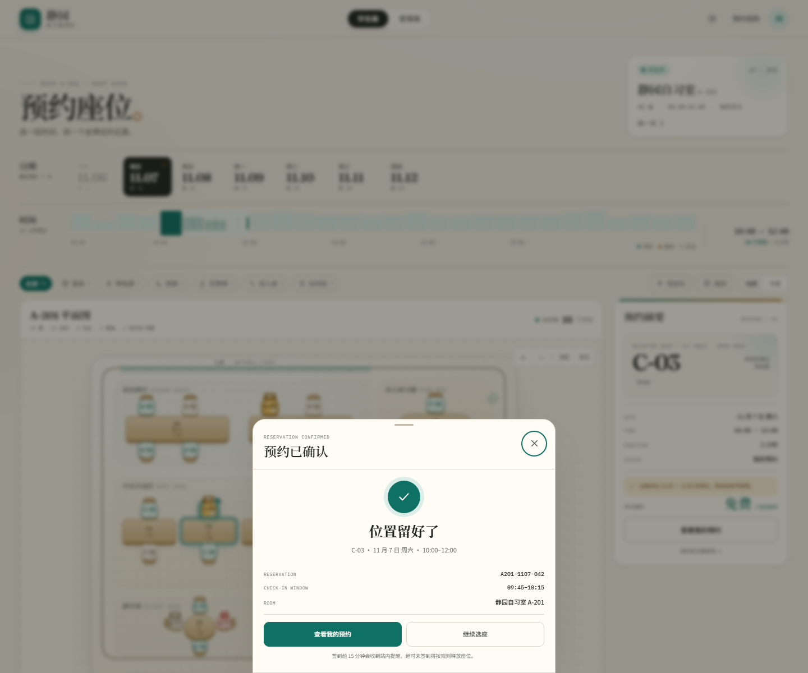

- 预约号、座位、日期、时段、签到窗口；主按钮「查看我的预约」；次按钮「继续选座」。
- 成功后局部把座位标记为「我的」，不整页重拉导致座位图变空。

### 6.8 异常 / 空态

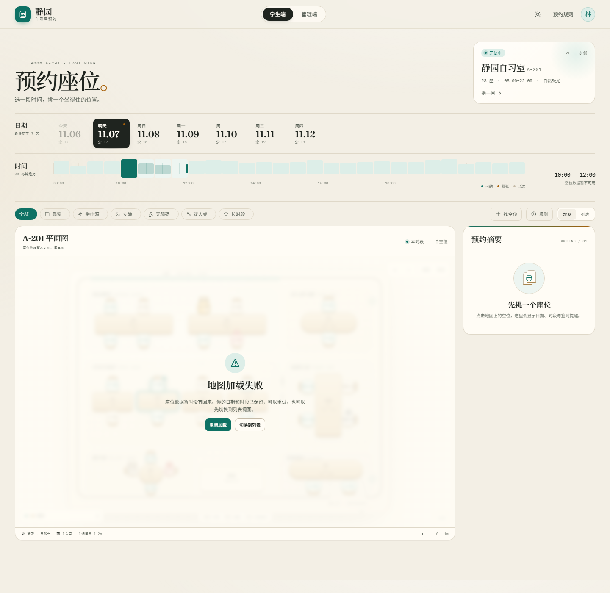

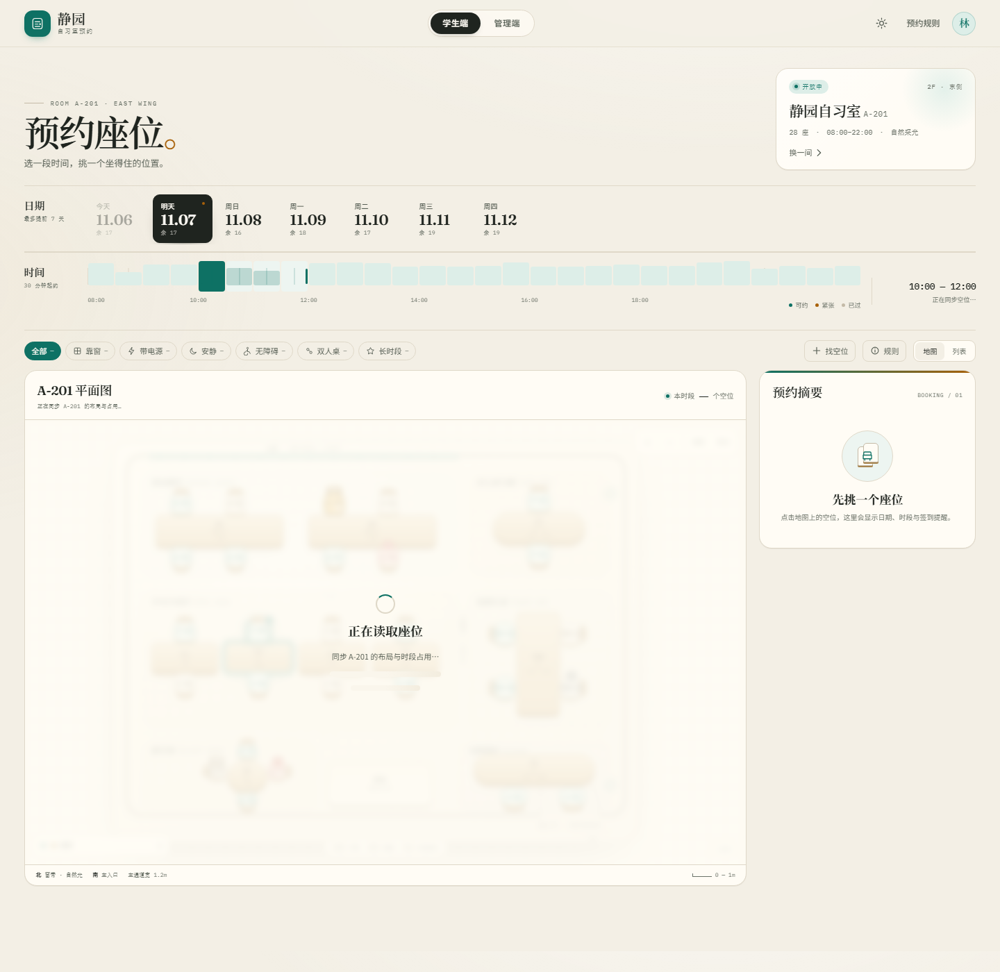

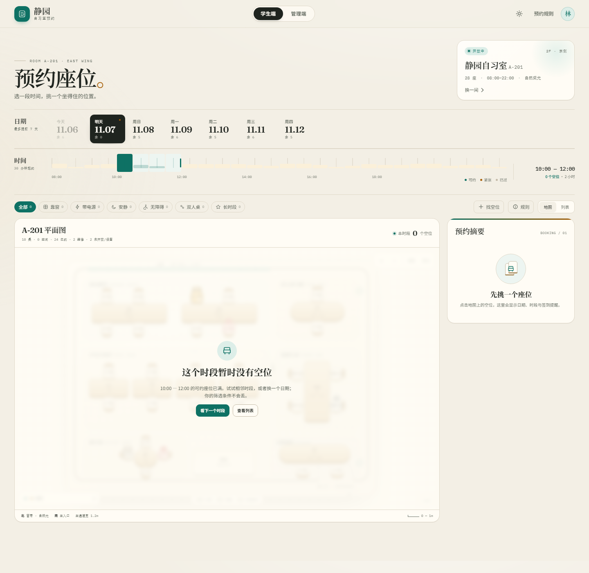

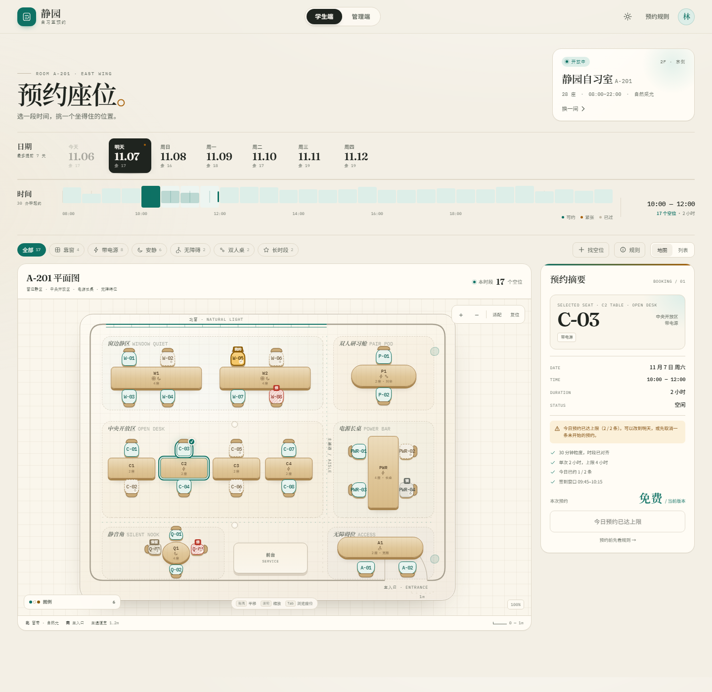

| 状态 | 触发 | UI | 恢复路径 |
| --- | --- | --- | --- |
| 加载 | 首次进入 / 切房间 / 切时段 | 地图轮廓骨架 +「正在读取座位与时段占用…」；保留日期、时间、筛选 | 自动完成；超时 8s 转失败 |
| 失败 | 网络 / 5xx / 布局解析失败 | 地图区域错误卡；摘要为空；提交 CTA 不存在 | 重新加载 / 切换到列表；保留条件 |
| 筛选无结果 | 当前筛选没有匹配座 | 地图保留，非匹配座位淡化；空提示 | 清除筛选 / 换区域 |
| 时段已满 | 当前时段 0 空位 | 地图仍可见但全部占用；时间带 0 空位 | 看下一个时段 / 换日期 |
| 空房间 | 房间没有座位 | 房间轮廓 +「这间自习室还没有录入座位」 | 换房间 / 联系管理员 |
| 每日上限 | 用户当天已有 2 条有效预约 | 摘要黄色条；CTA 禁用 | 明天 / 取消未开始预约 |
| 账号受限 | 黑名单 / 受限账户 | 只读浏览；提交 CTA 禁用并说明解除时间 | 到期 / 管理员解除 |
| 并发冲突 | 提交返回 409 | 「座位刚被抢占」Sheet；保留时间；附近空位 | 换座 / 改时间 / 稍后 |
| 超时释放 | 服务端自动违约 / 释放 | 站内消息 + 页面 Toast；座位变为空闲 | 重新选择 |
| 登录过期 | 401 | 跳转登录并保留 returnUrl | 登录后回到原页面 |
| 布局版本冲突 | 管理端发布 409 | 不覆盖；提示已被其他管理员修改 | 刷新对比 / 重试 |

### 6.9 文案建议

| 场景 | 建议文案 |
| --- | --- |
| 页头副标题 | 选一段时间，挑一个坐得住的位置。 |
| 加载 | 正在读取座位与时段占用… |
| 地图失败 | 地图加载失败。你的日期和时段已保留，可以重试，或切换到列表视图。 |
| 筛选无结果 | 没有符合筛选的座位。试试「全部」，或换一个区域 / 时段。 |
| 时段已满 | 这个时段暂时没有空位。试试相邻时段，或换一个日期。 |
| 冲突 | 该座位已被抢占。请换座或改时间。你的日期和时段已保留。 |
| 并发冲突（标题） | 座位刚被抢占 |
| 我的预约 | 这是你在 10:00–12:00 的预约，签到后即可使用。 |
| 每日上限 | 今日预约已达上限（2 / 2 条）。可以改到明天，或先取消一条未开始的预约。 |
| 签到提示 | 请在 09:45–10:15 内签到。超时未签到将释放座位。 |
| 成功 | 位置留好了。预约号 A201-1107-042。 |
| 管理员确认 | 将 N 个座位调整为「维修中」。以下预约不会被自动取消；执行后会进入冲突队列。 |
| 布局版本冲突 | 布局已被其他管理员修改。请刷新查看差异后再发布，当前未保存更改已保留。 |
| 只读权限 | 系统管理员当前为只读视图。座位维护、锁定和冲突处理需要「自习室管理员」权限。 |
| 导入失败 | 第 3 行：座位编号重复 / 第 7 行：坐标超出房间范围。修正后可重试。 |

语气原则：**具体、克制、给下一步**。不使用「手慢了」「抢不到」等游戏化或责备性表达；不使用「亲」等客服口癖。

### 6.10 边界规则

| 规则 | 处理 |
| --- | --- |
| 座位数 | 默认 28，最少 24；布局坐标可配置；单房间最多 1000（P0 支持 28，1000 需 Canvas） |
| 座号 | 同房间唯一；导入重复即整批失败 |
| 坐标 | 0 ≤ x ≤ roomW - seatW；0 ≤ y ≤ roomH - seatH；旋转 0–345，15° 步进 |
| 网格 | 10 单位；吸附可关闭（按住 Alt 临时关闭） |
| 区域 | 座位必须属于一个区域；未知区域导入失败 |
| 时间 | 08:00–22:00；5 分钟；结束 > 开始；最长 4 小时；不跨天 |
| 日期 | 今天起 7 天；今天已开始时段只读查看，不可提交 |
| 每日上限 | 2 条有效预约；达到上限时 CTA 禁用并说明 |
| 同用户重叠 | 同一时段只能 1 个座位；冲突时提示已有时段，不自动取消 |
| 并发 | 服务端行锁 / 唯一约束 / 幂等键；409 返回具体座位 + alternatives |
| 状态修改 | 资源状态变更不自动取消预约；先影响清单，再二次确认 |
| 整区锁定 | 影响清单 + 原因 + 二次确认；保留已有预约，进入冲突队列 |
| 临时保留 | P1；TTL 5–120 分钟；到期自动释放；不写入 seat.status |
| 布局发布 | 版本号 + 乐观锁；冲突不覆盖；发布后学生端重新拉布局 |
| 权限 | 学生不可见编辑入口；管理员高风险动作二次确认；系统管理员只读；服务端校验 |

---

## 7. 验收标准

### 7.1 地图与布局（A）

- [ ] **A1** 默认房间 28 把椅子分布在 10 张桌上（W1/W2 四人长桌、P1 对坐双人桌、C1–C4 两人桌、PWR 长条电源桌、Q1 圆桌、A1 无障碍宽桌）；墙、窗、门、前台、主通道、6 个区域标签齐全；24 座房间也能完整渲染。
- [ ] **A1a** 椅子围绕桌边、靠背朝外、开口朝向桌面；点击椅子选中，点击桌子不选中；hover 桌子整桌轻亮，hover 椅子只亮该椅。
- [ ] **A1b** 选中 C-03 时椅子双环 + 勾、C2 桌子描边点亮；其他桌保持原状；管理端拖动桌子时整桌椅子一起移动。
- [ ] **A2** 截图转灰度后，空闲 / 已约 / 我的 / 保留 / 锁定 / 维修仍可通过线型、图标或文字区分（不依赖颜色）；地图、列表、图例使用同一套状态 token，已预约为红色。
- [ ] **A3** 缩放范围 0.5–2.5；滚轮、双指、按钮均以光标 / 双指中点为锚点；缩放后座位位置不漂移。
- [ ] **A4** 适配全图、复位、放大、缩小四个动作可用；复位不改变筛选与已选座位。
- [ ] **A5** 平移有边界；内容小于视口时居中；不出现整图拖出屏幕。
- [ ] **A6** 标签在最小缩放仍可读；`z<0.62` 时退化为末两位座号并隐藏次要图标，不重叠。
- [ ] **A7** 1000 座基准测试：首屏可交互 ≤1.5s，平移/缩放 ≥55fps，p95 frame ≤18ms，命中 ≤2ms（Canvas 版本实现后按此验收；原型阶段不声称已通过）。
- [ ] **A8** 地图加载失败有重试与列表兜底；不出现白屏。

### 7.2 状态与预约（B）

- [ ] **B1** 日期带 7 天；过去日期 / 已过时段禁用；不可用时段置灰，不可选。
- [ ] **B2** 5 分钟吸附；可跨时段连续选择；结束时间不超过 4 小时；超出时自动收敛并提示。
- [ ] **B3** 点击空闲座位 → 摘要显示座位、区域、日期、时段、时长、状态、免费；点击「确认预约」才出现提交 Sheet。
- [ ] **B4** 摘要正确显示「今日已约 1 / 2」「签到窗口 09:45–10:15」。
- [ ] **B5** 重复点击提交只产生 1 笔预约；同一意图重试返回同一结果；按钮提交中禁用。
- [ ] **B6** 并发冲突返回 409 时，显示「该座位已被抢占。请换座或改时间。」；保留日期 / 时段；提供至少 3 个附近空位。
- [ ] **B7** 冲突后不自动改选；用户点选替代座位后才更新摘要。
- [ ] **B8** 每日上限 / 账号受限 / 规则失败在提交前或提交时明确解释，并给出下一步。
- [ ] **B9** 成功后显示预约号与签到窗口；地图仅局部把座位标为我的，不整页变空。
- [ ] **B10** 当前版本无支付、押金、代他人预约入口；价格统一显示「免费」。

### 7.3 管理端（C）

- [ ] **C1** 管理端显示监控 / 布局编辑 / 运营与日志三个视图；KPI、检查器、地图联动。
- [ ] **C2** 拖拽桌子整桌移动，拖拽单椅只移动该椅；10px 吸附；靠近其他对象出现对齐线；支持旋转、缩放、多选、复制、删除。
- [ ] **C3** 撤销 / 重做至少 50 步；未保存离开有确认。
- [ ] **C4** 导入 JSON / CSV：合法数据成功；重复编号、越界、未知区域整批失败并给出逐行错误。
- [ ] **C5** 批量锁定 / 维修 / 停用先展示影响清单与受影响预约，要求填写原因并二次确认；不自动取消预约。
- [ ] **C6** 一键锁定整区可执行；锁定后地图立即更新；操作日志记录操作者 / 时间 / 原因 / 结果。
- [ ] **C7** 实时占用 10 秒刷新；显示最后同步时间；30 秒未同步显示过期提示；保留当前选择。
- [ ] **C8** 超时释放显示倒计时与释放结果；释放动作来自服务端，不由前端直接改状态。
- [ ] **C9** 冲突订单可处理；处理动作写入日志；不泄露手机号 / 邮箱；姓名学号脱敏。
- [ ] **C10** 系统管理员只读；学生端无编辑入口；直接访问管理 API 返回 403。

### 7.4 移动端与无障碍（D）

- [ ] **D1** 390×844 下无横向溢出；地图可双指缩放、单指平移；页面其他区域可正常滚动。
- [ ] **D2** 椅子触控目标 ≥44px（或通过命中扩展达到）；点击底部摘要栏展开半屏抽屉；底部栏不遮挡地图控件。
- [ ] **D3** 全部交互可键盘完成；焦点可见；按空间方向键可在椅子间移动。
- [ ] **D4** 每把椅子有完整 `aria-label`（座号、桌号、区域、类型、状态、操作）；Sheet 有焦点陷阱与 Esc 关闭。
- [ ] **D5** 正文 ≥4.5:1，UI 图形 ≥3:1；200% 缩放不丢失功能；不依赖颜色。
- [ ] **D6** `prefers-reduced-motion` 下关闭动画；`prefers-contrast: more` 下加粗状态描边。
- [ ] **D7** 列表视图与地图状态同源，可用键盘完成选座与提交。

### 7.5 异常与一致性（E）

- [ ] **E1** 首屏骨架、地图失败、筛选无结果、时段已满、空房间、每日上限、401、超时释放均有独立状态与恢复路径。
- [ ] **E2** 地图失败 / 数据未同步时禁止提交，避免使用旧数据。
- [ ] **E3** 布局版本冲突返回 409 时不覆盖；展示「已被其他管理员修改」，可刷新对比。
- [ ] **E4** 同一座位同一时段最多一笔有效预约；重复请求不产生多笔；事务失败回滚。
- [ ] **E5** 统计口径不把「已预约」计入座位资源状态；管理员改状态不会静默取消预约。

### 7.6 建议验收步骤（手工）

1. 打开 `prototype/index.html`，确认 28 把椅子 / 10 张桌与 6 个区域；hover 桌子与椅子，确认整桌 / 单椅反馈不同；滚轮缩放、拖拽平移、适配 / 复位。
2. 点击 C-04，确认摘要；点「确认预约」→ 提交 → 成功页；刷新页面确认无重复。
3. 打开 `?state=conflict`，确认冲突文案、保留时间和 3 个替代座位。
4. 打开 `?mode=admin`，切到「布局编辑」，拖拽 C2 桌子确认整桌椅子跟随，拖拽单椅确认只移动该椅；撤销，发布；确认提示与日志。
5. 打开 `?mode=admin&role=system`，确认只读横幅与禁用按钮。
6. 以 390px 宽打开，确认单指平移、双指缩放、点击底部摘要栏展开半屏抽屉。
7. 用键盘 Tab 到椅子，方向键移动，Enter 选中，Esc 关闭 Sheet。
8. 用灰度模式截图，确认六种状态仍可区分；检查时间轴刻度 / 当前时间指针 / 拖动 tooltip。

---

## 8. 落地到现有 Vue 项目

### 8.1 建议目录

```text
frontend/src/
├─ views/student/SeatBookingView.vue            # 重写视图层
├─ views/admin/SeatManageView.vue               # 管理端重写
├─ components/seat-map/
│  ├─ SeatMapCanvas.vue
│  ├─ TableFurniture.vue              # 桌子：不可选座
│  ├─ SeatItem.vue                    # 椅子：唯一可选座
│  ├─ MapToolbar.vue
│  ├─ AreaLabel.vue
│  ├─ LegendPanel.vue
│  ├─ RoomShell.vue
│  └─ SeatListFallback.vue
├─ components/booking/
│  ├─ DateRail.vue
│  ├─ TimeRail.vue
│  ├─ BookingSummary.vue
│  ├─ MobileSummarySheet.vue
│  ├─ ReservationSheet.vue
│  ├─ ConflictSheet.vue
│  └─ SuccessSheet.vue
├─ components/admin/
│  ├─ AdminLayoutEditor.vue
│  ├─ AdminInspector.vue
│  ├─ ImpactConfirmDialog.vue
│  └─ LayoutImportDialog.vue
├─ composables/
│  ├─ useSeatMapViewport.ts
│  ├─ useSeatLayout.ts
│  └─ useSeatSelection.ts
├─ styles/seat-experience.scss
└─ types/seat-map.ts
```

**复用原则**

- 保留现有 `useSeatBooking` 的取数、规则校验、幂等键、C-4 冲突处理；只替换渲染层和布局数据。
- 现有 `seatCellState` 的五态映射可以扩展为 `SeatSlotState`；不要复制业务规则到新组件。
- 现有 `SeatMatrix` 作为列表兜底的基础，保留其 aria 工具函数 `seatAriaLabel`。
- 把 `SeatItem` 的 tooltip / aria 逻辑抽成 composable，地图与列表共用。

### 8.2 后端与数据库改造（建议）

1. **桌椅坐标**：新增 `room_tables`（桌号 / 形状 / 坐标 / 区域 / 版本）与 `seat_layouts`（椅子坐标 / 朝向 / 所属 table_id）；或在 `rooms` 增加 `layout_json`。推荐独立表，便于版本化和多房间。
2. **布局版本**：`rooms.layout_version`；发布时 `If-Match` / `version` 乐观锁。
3. **学生地图接口**：`GET /rooms/{id}/seat-map` 返回全部座位 + 派生状态；不要复用只返回可约座位的 `available-seats`。
4. **导入**：服务端 dry-run 返回逐行错误；正式导入事务化，全成全败。
5. **临时保留（P1）**：`seat_holds`（seat_id, start_at, end_at, reason, operator_id, released_at）。
6. **操作日志**：复用现有 audit 能力；记录 before/after、原因、操作者、影响预约。
7. **超时释放**：保持服务端调度器为唯一执行者；前端只轮询状态。
8. **多自习室**：所有接口以 `room_id` 为第一参数；布局坐标与区域均挂在 room 下；不允许跨房间复用 seat_id。

### 8.3 兼容与风险

| 风险 | 处理 |
| --- | --- |
| 全局主题冲突 | 先以 `.seat-experience` 局部令牌落地，不直接改现有紫色全局令牌；验收后再决定是否全站迁移 |
| `available-seats` 只有可约座位 | 必须新增全量 seat-map 接口；否则地图只能画空位，无法表达占用 |
| 单座预约模型 | 「双人 / 连座」仅作为 P1 设计；不偷偷用两个请求模拟多座 |
| 桌椅数据迁移 | 旧 `seats` 默认每椅生成一张 1 座桌；新布局再合并 / 调整；预约外键仍指向 `seat_id`，不需要改历史预约 |
| 系统管理员权限 | 保持只读；若要放开，先改 BR-018 与服务端权限，再改路由 |
| 1000 座性能 | 先做 28 座 DOM 版本；>300 座切 Canvas，独立性能基准，不把 1000 座作为首版硬指标 |
| 字体加载 | 自托管子集；首屏可接受系统字体回落 |
| 深色模式 | 令牌已准备；需全站检查既有页面，不在本轮强行切换 |

### 8.4 测试建议

- `npm run type-check` / `npm run build`。
- 单元：时间边界（4h、30min、闭馆、跨天）、状态派生、视口 clamp、LOD 判断。
- 组件：时间带拖动、座位 aria、Sheet 焦点陷阱、列表同源。
- E2E（Playwright）：选座 → 摘要 → 提交 → 成功；冲突；管理端批量确认；只读权限。
- 性能：1000 座 synthetic data，使用 PerformanceObserver 记录长任务与帧率；Chrome DevTools Performance 录制。
- 无障碍：axe-core + 键盘走查 + 灰度截图 + 200% zoom。

---

## 9. AI 代码生成 Prompt

完整可复制 Prompt 见 [`ai-codegen-prompt.md`](ai-codegen-prompt.md)。建议分两轮：

1. 先生成共享层：`types/seat-map.ts`、`useSeatMapViewport`、`SeatMapCanvas`、`SeatItem`、`MapToolbar`、`StatusBadge`、`tokens.scss`。
2. 再分别生成学生端与管理端页面，最后接现有 `useSeatBooking` / API。

Prompt 已内嵌：业务约束、令牌、组件 Props、状态机、地图数学、1000 座策略、空 / 错 / 冲突态、WCAG 验收。生成后仍需人工 review：接口字段、权限、真实数据、`type-check` 与构建。

---

## 10. 设计决策与待确认

**已决定**

- 采用精致扁平平面图 + 家具挤出阴影，而不是等距 2.5D 变换：桌椅关系更清楚，命中测试更简单，1000 座 Canvas 更可控。
- 地图采用 **Table / Seat 分离**：桌子承载空间语义，椅子承载可预约语义；桌子点击只平移地图，椅子点击才选中。
- 筛选不重排座位，只淡化不匹配项：保留空间记忆，用户不会「地图突然变了」。
- 座位选择不直接提交；摘要 + 二次确认。
- 管理员布局编辑与学生地图共用同一坐标与渲染器；只是模式不同。
- 高风险操作统一「影响清单 → 原因 → 二次确认 → 日志」。
- 当前版本只做免费预约，不做支付。

**需要产品 / 后端确认**

1. 是否允许系统管理员操作座位？若要，先改 BR-018 与服务端权限矩阵。
2. 是否开放「双人 / 连座」多座预约？需支持 `reservation.seatIds[]` 与新的限制规则。
3. 是否引入「临时保留 / 区域锁定」作为正式资源时段状态？需要 `seat_holds` / `room_closures` 的接口与自动释放。
4. 是否把 1000 座设为验收硬指标？建议先以 28 座交付，1000 座单独性能里程碑。
5. 全站是否从现有紫色主题迁移到「纸间座标」？建议先局部，验收后再决定。

---

## 11. 变更记录

### 11.1 v1.1 评审反馈闭环

| 反馈 | 处理 |
| --- | --- |
| 桌子只是标签背景，地图像 28 张卡片 | 新增 `TableFurniture` 家具层：10 张桌（四人长桌 / 对坐双人桌 / 两人桌 / 长条电源桌 / 圆桌 / 无障碍宽桌），28 把椅子围绕桌边；桌号在桌心，椅号在椅面 |
| 点击对象语义模糊 | 点击椅子才选中；桌子不可点，只 hover 轻亮；学生端点击桌子只平移地图 |
| 选中态黑框偏硬 | 改为椅子双环 + 勾、桌面描边点亮 + 柔和外发光；管理端整桌拖动 |
| 占用态嘈杂 | 已预约降饱和为浅米底 + 浅棕虚线 + 时钟；我的预约保留琥珀；维修保持高对比 |
| 时间轴没有刻度 | 每小时细刻度 + 08/10/12… 标签；今天显示琥珀「现在」指针；拖动显示范围 / 时长 tooltip |
| “纸间”主题不够 | 区域底色再降一档，铅笔灰细线，区域名改衬线斜体小注；桌面木纹 / 挤出阴影加强 |
| 左栏规则占宽度 | 收起为工具栏「规则」按钮 / Sheet，地图横向加宽 |
| 移动端摘要固定右栏 | 改为底部摘要栏 + 半屏摘要抽屉 + 「查看详情并确认」 |
| 图例展开时遮挡地图 | summary 常驻迷你三态点，展开才显示完整六态 |

| 版本 | 日期 | 内容 |
| --- | --- | --- |
| v1.0 | 2026-11-06 | 学生端 / 管理端重设计；设计令牌、组件与状态机、地图交互、性能、验收标准、可交互原型 |
| v1.1 | 2026-11-06 | 基于评审反馈：28 张座位卡片 → 10 张桌子 + 28 把椅子；桌子不可点、椅子可选、整桌 hover；占用态降饱和；时间轴小时刻度 / 当前时间 / 拖动 tooltip；规则栏收起；移动端半屏摘要；图例常驻迷你态；管理端整桌拖拽 |
| v1.2 | 2026-11-07 | **落地现有 Vue 学生预约页的地图部分**：新增 `SeatMapCanvas` / `SeatMapToolbar` / `SeatMapList` / `seatMapLayout`；保留 `useSeatBooking` 与全部预约规则；地图按真实分区与座位属性自适应生成桌椅；Zoom / Pan / Pinch / Fit / 列表兜底；桌面与窄屏 smoke test 通过 |
| v1.3 | 2026-11-07 | 业务确认预约粒度 30 分钟 → **5 分钟**：后端配置/校验/Slot 物化、前端时间选择器、Mock、测试与迁移同步；已开始时段保留地图只读查看，C6 拦截提交；看板统计块仍为 30 分钟 |
| v1.4 | 2026-11-07 | 状态色与图例统一：地图椅子直接使用 `--ssr-seat-*` token；`taken` 红色、`fix` 灰色、`off` 灰色，列表同步；不再使用自定义降饱和色 |

---

## 12. 现有 Vue 预约页落地（v1.2–v1.3）

### 12.1 范围

本轮只改**学生端「预约座位」页面的地图渲染与交互**，不改：

- 后端、数据库、Alembic；
- 预约规则、提交逻辑、权限；
- 学生端其它页面 / 管理端页面；
- 原有筛选器、时间段选择器、座位详情抽屉、底部操作条。

### 12.2 文件

| 文件 | 说明 |
| --- | --- |
| `frontend/src/components/booking/SeatMapCanvas.vue` | 新地图：桌椅家具、区域、缩放 / 平移 / 双指 / 空格、选中态 |
| `frontend/src/components/booking/SeatMapToolbar.vue` | 状态计数、图例、缩放 / 适配 / 复位、地图 / 列表切换 |
| `frontend/src/components/booking/SeatMapList.vue` | 无障碍 / 窄屏列表兜底，与地图共享同一 `MatrixCell` |
| `frontend/src/utils/seatMapLayout.ts` | 只读数据 → 桌椅几何布局；区域类型推断与 2/4 人桌分组 |
| `frontend/src/components/booking/BookingResultPanel.vue` | 用 `SeatMapCanvas` 替换旧 `SeatMatrix`，保留加载 / 空 / 错误态 |
| `frontend/src/utils/bookingData.ts` | `loadSlotAvailability` 并行读取既有的 `GET /rooms/{id}/areas`，用于分区名称 |
| `frontend/src/utils/useSeatBooking.ts` | 暴露只读 `areas`；预约判定逻辑不变 |
| `frontend/src/views/student/SeatBookingView.vue` | 把 `areas` 传入 `BookingResultPanel` |
| 删除 `SeatMatrix.vue` / `SeatZone.vue` / `SeatCell.vue` / `SeatToolbar.vue` | 旧卡片式地图，已被新地图替换 |

### 12.3 布局适配

真实后端座位目前只有 `area_id / seat_no / seat_type / has_power / near_window`，没有 x/y，因此：

1. `area_id` 对应既有分区；分区名称通过既有 `GET /rooms/{id}/areas` 读取。
2. 按分区名称与座位属性推断区域类型：`靠窗 → window`、`静音 → quiet`、`电源 → power`、`标准 / 开放 → central`，其余按靠窗 / 插座比例兜底。
3. 每区按类型和座位数拆成 2/4 人桌：长桌、对坐双人桌、电源长桌、圆桌、无障碍宽桌。
4. 布局在 `seatMapLayout.ts` 内按区域行列、桌位 footprint、行内 / 垂直居中自动排布；真实库 8～30 座、6 区以内可直接适配。
5. 这是可替换 adapter：后续后端提供 layout 接口时，只需替换 `buildSeatMapLayout` 的数据源，无需改地图组件或预约逻辑。

### 12.4 交互

- 桌子：`aria-hidden`，点击不选中；仅 hover 时整桌与同桌椅子轻亮。
- 椅子：唯一可点击单元；点击后仍调用原 `openSeat(cell.seat)`，打开原座位详情抽屉。
- 选中：椅子双环 + 勾，所在桌子描边点亮 + 柔光；`我的预约` 为琥珀描边 + 「我的」角标。
- 地图：滚轮 / 双指缩放、拖拽平移、`适配`、`100% 复位`、`F` / `0` 键盘；缩放范围 50%～250%。
- 列表：地图 / 列表切换；窄容器（<520px）默认列表，避免 50% 地图裁切；仍可切回地图。
- 状态：仍使用 `MatrixCell.state` 的 `free / taken / unknown / closed / fix / off`，图标与线型来自既有 `seatState.ts`；`mineIds` 是额外用户态，不混入资源状态。

### 12.5 v1.3：5 分钟粒度与开始后只读

- 后端 `reservation_granularity_minutes` 改为 **5**；`reservation_slots` 改为每 5 分钟物化一行。
- 新增 Alembic 迁移 `f4b2d8c6a1e0`：将「待使用 / 使用中」预约的旧 30 分钟 Slot 重建为 5 分钟 Slot；终态预约原本已释放，不重建。
- 看板占用率的统计块与预约粒度解耦：新增 `dashboard_block_minutes=30`，图表仍显示 30 分钟座位块，口径不变。
- 前端 `BOOKING_RULES.granularity = 5`；开始 / 结束时间选择 `step="00:05"`；默认时段、`ceilToStep`、C6 文案、Mock 规则同步。
- 今天已开始的时段不再把地图替换成错误块：查询仍返回占用并渲染地图；`buildJudgements` 的 C6 增加「已开始」失败，提交被拦截，顶部显示「只读查看」提示。
- C6 条件为：粒度对齐 + 尚未开始 + 提前天数 + 时长 + 每日次数；开始后仍可看自己的预约和他人占用。
- 演示资源补足：`seed_demo` 将每间演示自习室补齐到至少 12 座（第二自习室由 8 座补到 12 座）；地图按真实座位自动生成更多桌椅，不再出现 8 座房间。
- 状态色与图例统一：地图 / 列表直接复用全局 `--ssr-seat-*` token；`taken` 为红色虚线 + 浅红斜纹，`fix` 为灰色，避免图例红、地图黄的错位。

### 12.6 验证与边界

已执行：

```text
npm run type-check：通过
npm run build：通过
pytest（backend）：通过（104 项）
Alembic heads：仅 f4b2d8c6a1e0 一个 head
浏览器 smoke test（v1.2 地图，Mock 30 座 / 3 区）：30 把椅子、9 张桌、3 个区域；5 分钟选择器已由 type-check/build + 规则单测覆盖，未重新跑完整浏览器流程
点击椅子 → 打开原抽屉并选中；点击桌子 → 选择不变
地图 / 列表切换正常；列表 30 行
无新增浏览器 JS exception
```

未执行 / 未改：

- 未运行真实后端联调；Mock 下既有 `messages/unread-count`、`rooms/{id}/closures` 的 500 是 Mock 缺口，与本轮地图改动无关。
- 未实现管理端地图 / 布局编辑器（超出「只改预约地图」范围）。
- 未实现时间轴、规则侧栏收起、移动端半屏摘要（保留在 v1.1 原型，本轮不改页面其它区域）。
- 当前筛选仍沿用原行为（筛选即隐藏不匹配座位）；设计稿中的「淡化不重排」未在 Vue 层实施。
- 1000 座未做性能实测；当前是 DOM 版地图，后续大数据量需切 Canvas / LOD。
- 窄屏受现有 AppShell 左侧栏宽度影响，地图容器只有约 296px；已用列表兜底，未改全局 AppShell。

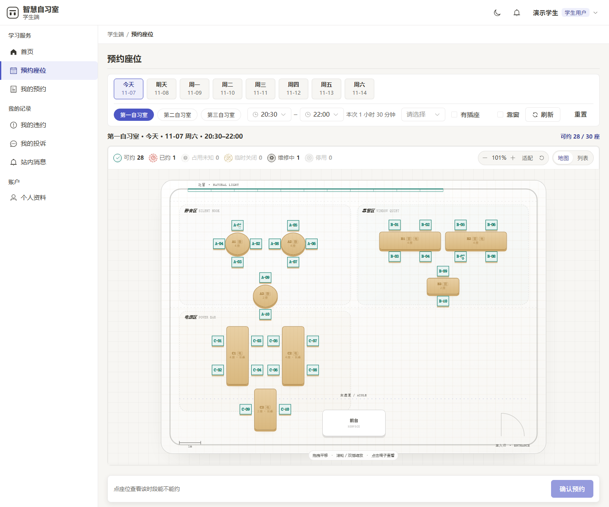
