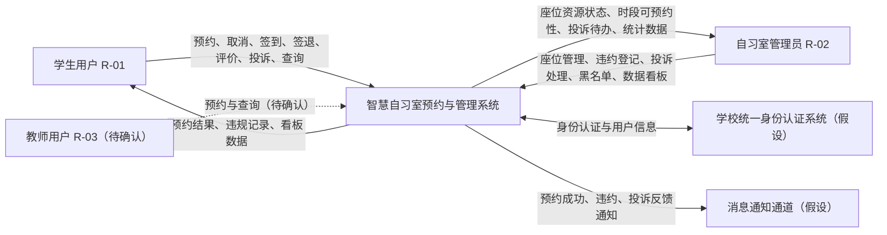
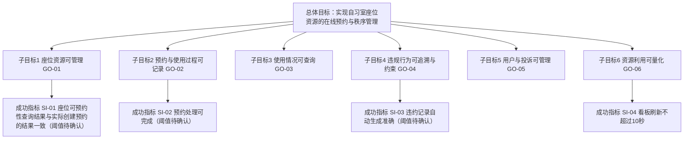
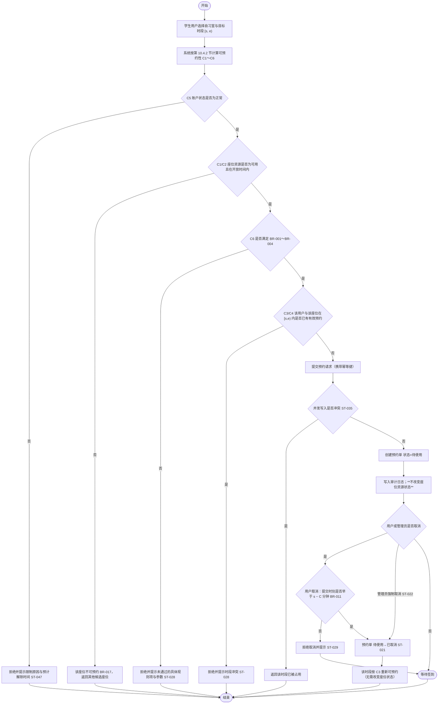
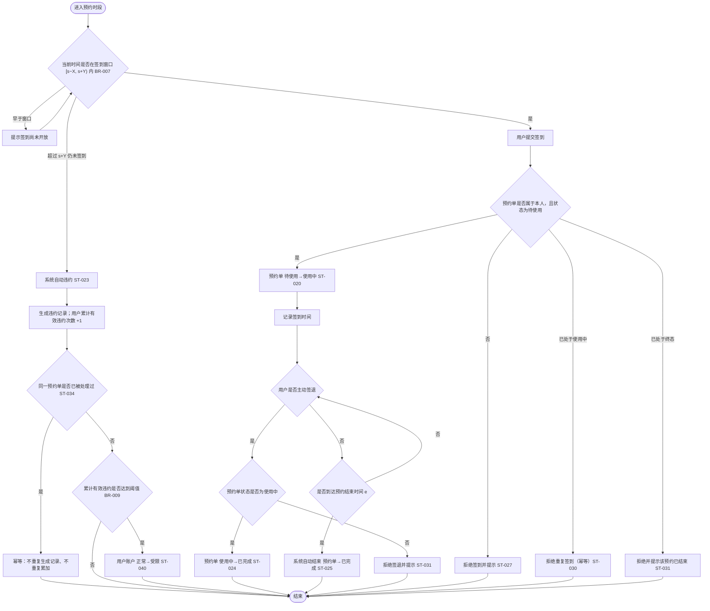
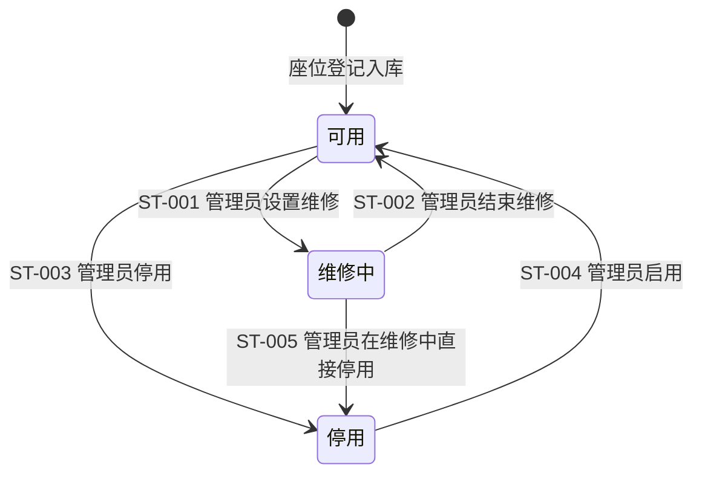
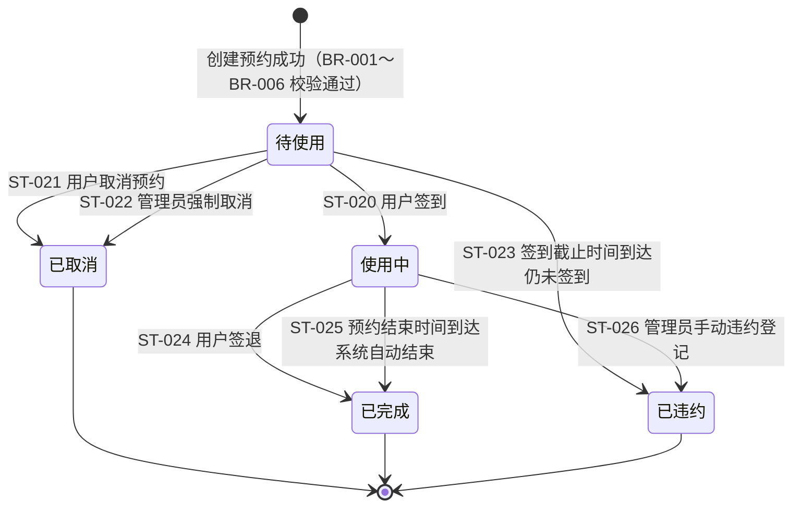
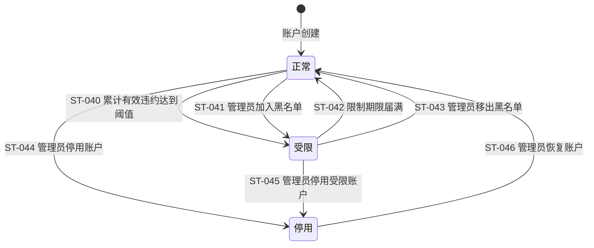
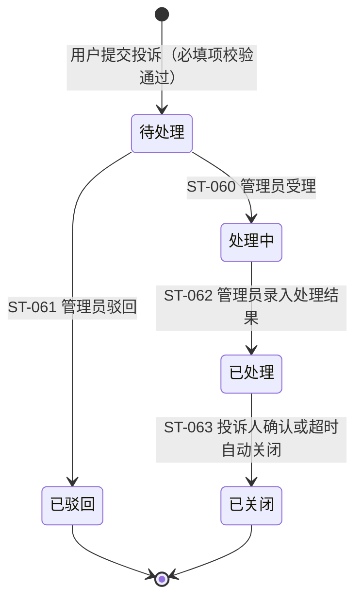

# 智慧自习室预约与管理系统 需求规格说明书

> **本文件性质提示**
> 本说明书中，除来源标注为【原始资料】的内容外，其余业务规则、参数、权限细则与状态定义均由 AI 提出，标注为【AI 候选】或【分析推导】，确认状态一律为「待确认」。
> 截至目前，本组**未开展**任何业务方访谈、教学模拟确认、场景走查、原型走查或功能测试。文中出现的所有"预期行为"均为设计意图，**不代表已执行或已验证**。

---

## 1. 文档基本信息

| 项目 | 内容 |
|---|---|
| 文档名称 | 智慧自习室预约与管理系统 需求规格说明书 |
| 项目名称 | 智慧自习室预约与管理系统 |
| 文档版本 | V0.4（评审修订版） |
| 编写日期 | 2026-10-15 |
| 编写人员 | 郭学毅、梅智杰、徐温骄、蔡善文 |
| 小组编号 | 惊蛰破阵曲 |
| 当前状态 | **草稿**（未经评审，未经业务方确认） |
| 建模工具 | Mermaid（目标树、上下文图、活动图、状态图）；PlantUML（用例图、领域类图） |

### 1.1 版本变更记录

| 版本 | 日期 | 变更内容 | 变更人 | 审核状态 |
|---|---|---|---|---|
| V0.1 | 2026-10-15 | 初稿建立：项目概述、角色、业务流程、功能与非功能需求、业务规则、状态模型、术语表、追踪矩阵 | 待填写 | 未评审 |
| V0.2 | 2026-10-15 | 依评审意见补充：①范围决策表（第 2.5.2 节，SCOPE-01～SCOPE-12）；②权限矩阵增加资源范围维度（第 3.3.1 节）；③待确认问题清单（附录 A，Q-001～Q-017）；④需求冲突登记（第 11.8 节，CF-01～CF-04）与 AI 风险分析（第 11.9 节，RK-01～RK-08） | 待填写 | 未评审 |
| V0.2 勘误 | 2026-10-15 | **撤回过度声明**：本行原记载"并发预约冲突与幂等（FR-014、NFR-011、NFR-012、ST-045～ST-048、AD-03、BS-08）、时间边界判定（BR-019～BR-021、第 4.8 节、Q-019）、跨对象状态联动表（第 10.4 节，含 LK-09、LK-10）、场地临时关闭（FR-016、BR-022）、新增 Q-018～Q-027"等 6 项。经复核，**上述编号与章节在 V0.2 正文中并不存在**，属修订记录在被中断的编辑过程中先行写入而正文未落地。该记载已作废，相关事项全部转入 V0.3 修订清单，不得据 V0.2 追溯这些内容 | 待填写 | 未评审 |
| V0.3 | 2026-10-15 | 依评审意见按优先级修订：①**修正文档一致性**——统一版本标记、撤回 V0.2 过度声明（见上一行勘误）、新增第 1.3 节**编号体系说明**、修正交叉引用与追踪矩阵、清除正文残留的旧座位状态表述（BS-01～BS-04、BS-07、FR-002、FR-041、FR-052、GT-01、SCD-01）；②**重建座位与预约模型**——座位资源状态改为"可用/维修中/停用"，"已预约""使用中"不再作为座位状态，可预约性改为按时间段判定的派生结论（新增第 10.4 节），状态转换表按建模对象重新分块编号并附旧编号对照表（第 10.2.5 节）；③时间区间统一为**左闭右开 [s, e)**（新增第 4.8 节，TB-01～TB-13）；④规则与权限冲突处理（BR-018 与 FR-040、管理员分级、强制取消与手动违约的适用边界，新增 Q-030～Q-033）；⑤补齐关键业务流程闭环（**新增第 4.9 节 FLW-01～FLW-06**）与验证场景设计（第 12.3 节 VS-01～VS-06）；⑥范围与非功能需求收敛（第 6.1 节 A/B/C 分级、第 2.5.2 节）；⑦新增 BR-019～BR-022、FR-014～FR-016、NFR-011～NFR-012、ST-030～ST-035、ST-049、ST-065、LK-01～LK-08 | 待填写 | 未评审 |
| V0.4 | 2026-10-15 | 依图模型提交要求与 A 报告（V1.0）核查结果修订：①**补建第 4.7 节领域类图（CD-01）**——正文以类清单、状态枚举、关联与数量关系表转述 PlantUML 模型，并在第 1.3 节补登记 `CD-nn` 前缀；②**统一图模型源文件路径**——`模型/` 全部改为仓库实际目录 `models/`（第 1.2 节 REF-03/REF-04、第 1.3 节、第 4.3 节）；③**补齐图模型关联清单**——UCD-01 关联需求由 UC-01～UC-11 更正为 UC-01～UC-12；AD-01 补列图内引用的 BR-017、ST-047；AD-02 补列图内引用的 ST-027、ST-040；④**补入 SVG 导出版本**——`models/UCD-01.svg`、`models/CD-01.svg`（PlantUML 渲染），REF-03/REF-04 访问状态改为"已提交仓库"；⑤附录 B TODO-A3 按实际更新（PlantUML 部分已完成，6 张 Mermaid 图仍待导出）。**本次修订只补齐定位、路径与口径，不新增任何未确认的业务结论**；⑥**补齐提交信息**——按 A.1 已提供的信息填写小组编号（惊蛰破阵曲）与编写人员名单（郭学毅、梅智杰、徐温骄、蔡善文），REF-05 访问状态更新为"已提供"，附录 A Q-014 与附录 B TODO-D1 同步更新 | 待填写 | 未评审 |

### 1.2 关联文件与附件

| 编号 | 文件 | 用途 | 访问状态 |
|---|---|---|---|
| REF-01 | 《实践项目说明.pdf》 | 课程项目选题与功能范围来源 | 可访问（扫描件，无可靠页码，按章节标题定位） |
| REF-02 | 《学生需求分析与AI智能体使用验证报告.md》 | 课程提交材料与验证要求来源 | 可访问 |
| REF-03 | `models/UCD-01-用例图.puml`、`models/UCD-01.svg` | 用例图可编辑源文件与 SVG 导出版本 | 已提交仓库（V0.4） |
| REF-04 | `models/CD-01-领域类图.puml`、`models/CD-01.svg` | 领域类图可编辑源文件与 SVG 导出版本 | 已提交仓库（V0.4） |
| REF-05 | 小组成员名单、小组编号 | A.1 / A.8 / B.1 必填信息 | **已提供**（小组编号：惊蛰破阵曲；成员：郭学毅、梅智杰、徐温骄、蔡善文） |
| REF-06 | 学校现行自习室管理规定 | 业务规则原始依据 | **未提供** |
| REF-07 | 原型、走查记录、AI 对话记录 | A / B 报告证据 | **未开展** |

> **说明**：REF-05 至 REF-07 当前不可用。本说明书不声称已阅读这些材料。

### 1.3 编号体系说明

> **本节性质**：V0.3 新增。因 V0.2 曾出现修订记录与正文编号不符、以及同一前缀被两处表格复用的问题，此处集中登记全部编号前缀，供交叉引用时核对。**本表只登记前缀含义，不代表任何编号对应的内容已确认。**

| 前缀 | 含义 | 所在位置 |
|---|---|---|
| `REF-nn` | 关联文件与附件 | 第 1.2 节 |
| `SCOPE-nn` | 范围决策项 | 第 2.5.2 节 |
| `SI-nn` | 成功指标（全部无阈值，【待确认】） | 第 2.8.1 节 |
| `AS-nn` / `DEP-nn` / `CON-nn` | 假设 / 依赖 / 约束 | 第 11 节 |
| `SCD-nn` / `GT-nn` / `UCD-nn` / `AD-nn` | 上下文图 / 目标树 / 用例图 / 活动图 | 第 4.1～4.5 节 |
| `CD-nn` | 领域类图（**V0.4 补登记**） | 第 4.7 节、`models/CD-01-领域类图.puml` |
| `UC-nn` | 用例（图内编号） | 第 4.3 节、`models/UCD-01-用例图.puml` |
| `BS-nn` | 业务场景 | 第 4.6 节 |
| `TB-nn` | 时间边界判定项 | 第 4.8 节 |
| `FLW-nn` | 关键业务流程闭环检查项 | 第 4.9 节 |
| `FR-nnn` | 功能需求 | 第 5 节 |
| `NFR-nnn` | 非功能需求 | 第 6 节 |
| `DR-nnn` | 数据需求 | 第 7 节 |
| `IR-nnn` | 接口需求 | 第 8 节 |
| `BR-nnn` | 业务规则 | 第 9 节 |
| `SM-nn` / `ST-nnn` | 状态图 / 状态转换记录 | 第 10.1 / 10.2 节 |
| `C1～C6` | 可预约性判定项（**非编号实体**，仅为判定顺序） | 第 10.4.2 节 |
| `MD-nn` | 原模型缺陷记录 | 第 10.0 节 |
| `LK-nn` | 跨对象联动项 | 第 10.4.3 节 |
| `BC-nn` | 业务约束 | 第 11.2 节 |
| `CF-nn` | **需求冲突记录**（注意：仅指第 11.8 节，附录 C 无编号条目） | 第 11.8 节 |
| `RK-nn` | AI 生成内容风险项 | 第 11.9 节 |
| `VS-nn` | 验证场景设计项（**设计，非执行结果**） | 第 12.3 节 |
| `TM-nn` | 术语 | 第 13 节 |
| `Q-nnn` | 待确认问题 | 附录 A |
| `E-nn` / `AI-nn` | 证据 / AI 任务（属于课程报告，不在本说明书内） | 《学生需求分析与AI智能体使用验证报告》 |

> **易混淆提示**：`CF-nn` 只用于第 11.8 节的需求冲突记录；`C1～C6` 只用于第 10.4.2 节的可预约性判定项，两者**不是同一组**，且 `C1～C6` 不是可被引用的编号实体。

---

## 2. 项目概述

### 2.1 项目背景

高校自习室座位资源紧张，学生寻找空座位耗时长，占座、闲置占位等现象缺乏可追溯的管理手段。本系统面向校园自习室场景，提供座位资源的统一管理、在线预约、签到签退、违约记录与数据分析能力，替代人工登记与口头管理的现状。

- **来源性质**：【分析推导】。依据 REF-01 中"智慧自习室预约与管理系统"的功能清单推导其业务问题。
- **确认状态**：待确认。REF-01 未直接给出项目背景表述。

### 2.2 业务问题

| 编号 | 问题描述 | 来源性质 | 确认状态 |
|---|---|---|---|
| PB-01 | 座位占用状态不透明，学生无法预先判断是否有空座 | 分析推导 | 待确认 |
| PB-02 | 预约与占用缺少记录，违约行为无法追溯与约束 | 分析推导 | 待确认 |
| PB-03 | 座位资源使用情况缺乏量化分析依据 | 分析推导 | 待确认 |

### 2.3 项目目标

| 编号 | 目标 | 来源性质 | 确认状态 |
|---|---|---|---|
| GO-01 | 提供自习室座位资源的统一登记与状态管理能力 | 原始资料（REF-01 · 第 1 项） | 待确认 |
| GO-02 | 提供用户与管理员两侧的座位预约、取消、签到、签退能力 | 原始资料（REF-01 · 第 2、3 项） | 待确认 |
| GO-03 | 提供预约、座位、违规记录的查询能力 | 原始资料（REF-01 · 第 4 项） | 待确认 |
| GO-04 | 提供管理员实时座位管理与手动违约登记能力 | 原始资料（REF-01 · 第 5 项） | 待确认 |
| GO-05 | 提供用户信息、评价、投诉与黑名单管理能力 | 原始资料（REF-01 · 第 6 项） | 待确认 |
| GO-06 | 提供柱状图、折线图与统计数据，并每 10 秒自动刷新 | 原始资料（REF-01 · 第 7 项） | 待确认 |

### 2.4 预期价值

- **来源性质**：【AI 候选】。REF-01 未提供价值论述。
- 候选表述：减少学生寻找座位的时间成本；为管理者提供可追溯的违规记录与可量化的资源利用数据。
- **确认状态**：待确认。

### 2.5 系统范围

#### 2.5.1 包含范围

| 编号 | 范围项 | 来源 |
|---|---|---|
| SC-IN-01 | 自习室与座位的资源登记与状态管理 | REF-01 · 第 1 项 |
| SC-IN-02 | 用户侧预约、取消预约、签到、签退 | REF-01 · 第 2、3 项 |
| SC-IN-03 | 自动违约记录与管理员手动违约登记 | REF-01 · 第 3、5 项 |
| SC-IN-04 | 预约查询、座位查询、违规记录查询 | REF-01 · 第 4 项 |
| SC-IN-05 | 用户信息、评价、投诉、投诉反馈、黑名单管理 | REF-01 · 第 6 项 |
| SC-IN-06 | 柱状图、折线图与统计数据，10 秒自动刷新 | REF-01 · 第 7 项 |

#### 2.5.2 范围决策表

> **本节性质说明**：REF-01 只给出了功能清单，**未对任何功能做纳入/排除决策**。下表的作用不是宣称这些功能已排除，而是把"文档没提到因此默认不需要"的隐性假设**显式化**，逐项标出决策、理由与待确认状态。
> **决策为「排除」或「待确认」的项目，当前一律不实现、不写入验收标准。** 表中所有决策均为【AI 候选】或【分析推导】，**未经业务方或教师确认**。

| 编号 | 范围项 | 候选决策 | 理由 | 若纳入范围的影响 | 状态 |
|---|---|---|---|---|---|
| SCOPE-01 | **修改预约**（更换座位、延长时间、修改日期） | 待确认（候选：本期不实现） | REF-01 仅列"预约及取消预约"，未提修改 | 需新增预约单变更状态与冲突复核逻辑，并定义"修改失败后原预约是否保留" | 待确认 |
| SCOPE-02 | **暂时离座 / 离座保留座位** | 待确认（候选：本期不实现） | REF-01 未提及 | 需在座位资源状态之外引入"暂离"占用概念，并定义超时释放规则 | 待确认 |
| SCOPE-03 | **候补排队与取消后自动分配** | 待确认（候选：排除） | REF-01 未提及；实现成本高 | 需新增候补队列、分配顺序与通知 | 待确认 |
| SCOPE-04 | **代他人预约** | 待确认（候选：排除） | REF-01 未提及；存在越权与冒用风险 | 权限矩阵与审计要求需重写 | 待确认 |
| SCOPE-05 | **场地临时关闭与受影响预约批量取消** | 待确认（候选：**纳入**） | 已预约用户必须被正确处理，属业务正确性范畴，非可选功能 | 见 FR-016、BR-019、BR-022、ST-006、ST-033、LK-01 | 待确认 |
| SCOPE-06 | **校区 / 楼宇 / 楼层多层资源** | 待确认（候选：本期仅到"自习室"） | REF-01 仅提"自习室" | 领域类图与数据字典需增加层级，权限矩阵需增加资源范围 | 待确认 |
| SCOPE-07 | **消息通知**（预约成功、即将开始、违约、场地关闭） | 待确认（候选：仅站内提示） | REF-01 未提及 | 见 FR-060（候选）；若纳入需定义失败重试与失败是否影响预约结果 | 待确认 |
| SCOPE-08 | **违约申诉** | 待确认（候选：排除） | REF-01 未提及 | 见 FR-024（候选） | 待确认 |
| SCOPE-09 | **记录导出** | 待确认（候选：排除） | REF-01 未提及 | 见 FR-033（候选）；涉及个人信息导出合规 | 待确认 |
| SCOPE-10 | **门禁闸机、人脸识别等硬件联动** | 待确认（候选：**排除**） | REF-01 未提及；超出软件系统边界 | 系统边界与上下文图需重写 | 待确认 |
| SCOPE-11 | **费用结算、押金、付费预约** | 待确认（候选：排除） | REF-01 未提及 | 需引入支付与对账模块 | 待确认 |
| SCOPE-12 | **线下保洁、设备维修工单流转** | 待确认（候选：排除） | REF-01 未提及 | 座位"维修中"状态需扩展为工单流程 | 待确认 |

> **填写说明**：本表由团队在 A 报告 A.2 节确认过程中逐项落实决策，并在"状态"列改为"已纳入（教学模拟）"或"已排除（教学模拟）"，同时记录参与学生、模拟角色与日期。在决策落定前，SCOPE-01～SCOPE-12 **均按"不实现"处理**，相关需求不进入开发与验收。

### 2.6 系统边界与上下文

见 **SCD-01 系统上下文图**（第 4.1 节）。系统边界为"智慧自习室预约与管理系统"本体，外部对象包括学生用户、自习室管理员，以及候选的外部系统（统一身份认证、消息通知）。

> **边界表述修正（V0.3）**：本系统的边界是**软件系统**。系统能够记录的只有"预约占用"与"用户签到/签退操作"，**无法感知座位的实际物理占用**（本说明书第 11.6 节 AS-01 已排除门禁、闸机等硬件）。因此全文不再使用"实时反映实际占用"这类表述，相关承诺已改为"展示系统记录的座位资源状态与预约占用情况"。详见第 2.8.1 节与 FR-003。

### 2.7 项目约束与依赖

| 编号 | 类型 | 内容 | 来源性质 | 确认状态 |
|---|---|---|---|---|
| CON-01 | 运行约束 | 数据看板每 10 秒自动刷新 | 原始资料（REF-01 · 第 7 项） | 待确认 |
| CON-02 | 技术约束 | 技术栈、部署环境、并发规模 | **未提供** | 待确认 |
| CON-03 | 依赖 | 学校统一身份认证系统 | 假设 | 待确认 |
| CON-04 | 依赖 | 消息通知通道 | 假设 | 待确认 |
| CON-05 | 合规 | 学生个人信息与违约记录的存储、展示与保留期限 | **未提供** | 待确认 |

### 2.8 成功指标

> **分层说明（V0.3）**：业务成功指标与系统技术指标**分表维护**。不得以"看板刷新速度合格"这类技术指标替代业务目标的达成评价。

#### 2.8.1 业务成功指标

| 编号 | 指标 | 可测量定义（候选） | 来源性质 | 确认状态 |
|---|---|---|---|---|
| SI-01 | 座位可预约性查询结果与预约记录的一致性 | 对同一座位同一时段，查询返回"可预约"与创建预约实际成功的结果一致；**以系统记录的预约占用为准**，不涉及物理占用 | AI 候选 | 待确认（无来源，未设定阈值） |
| SI-02 | 预约请求一次处理成功率 | 提交的预约请求中，成功创建预约单的比例 | AI 候选 | 待确认（无来源，未设定阈值） |
| SI-03 | 违约判定与人工复核的一致率 | 抽取的违约记录中，经人工复核判定为正确的比例 | AI 候选 | 待确认（无来源，未设定阈值） |
| SI-04 | 黑名单限制的生效及时性 | 累计违约达阈值后，账户被限制的时延 | AI 候选 | 待确认（无来源，未设定阈值） |

#### 2.8.2 系统技术指标

| 编号 | 指标 | 来源性质 | 关联非功能需求 | 确认状态 |
|---|---|---|---|---|
| SI-T-01 | 数据看板刷新间隔不超过 10 秒 | 原始资料（REF-01 · 第 7 项） | NFR-001 | 待确认 |

> **指标可用性声明**：SI-01～SI-04 的**指标名称与测量定义为【AI 候选】，目标值一律留空**。当前**没有任何一条指标具备可执行的验收阈值与测量方法**，不得作为验收依据。仅 SI-T-01 有 REF-01 作为来源。
>
> **术语更正**：SI-01 原表述为"与实际占用情况的一致性"，该表述超出系统能力边界（见第 2.6 节边界表述修正），已改为"与预约记录的一致性"。

---

## 3. 干系人与角色

### 3.1 现实干系人

| 编号 | 干系人 | 关注点 | 来源性质 | 确认状态 |
|---|---|---|---|---|
| SH-01 | 学生（座位使用者） | 能否方便地找到并预约到座位 | 分析推导 | 待确认 |
| SH-02 | 自习室管理员 | 座位秩序维护、违约处理、投诉处理 | 原始资料（REF-01 · 第 5 项） | 待确认 |
| SH-03 | 学校后勤或教务管理部门 | 资源利用数据、管理制度落地 | 假设 | 待确认 |
| SH-04 | 系统运维人员 | 数据安全、账号与系统可用性 | 假设 | 待确认 |

### 3.2 系统用户角色

| 角色编号 | 角色名称 | 角色职责 | 主要目标 | 使用场景 | 可执行操作 | 权限边界 | 相关需求 | 来源性质 | 确认状态 |
|---|---|---|---|---|---|---|---|---|---|
| R-01 | 学生用户 | 作为座位使用者发起预约与使用 | 找到并成功使用座位 | 预约、签到、签退、查询、评价、投诉 | 创建/取消本人预约、签到、签退、查询本人记录、提交评价与投诉 | 仅能操作本人预约单；不能修改座位资源、不能登记他人违约、不能查看他人信息 | FR-010～013、FR-020、021、FR-030～033、FR-041、042 | 原始资料（"用户"）+ 分析推导（具体边界） | 待确认 |
| R-02 | 自习室管理员 | 维护座位资源与使用秩序 | 保障座位资源可用与秩序可追溯 | 座位管理、违约登记、投诉处理、黑名单、数据看板 | 维护自习室与座位、调整座位资源状态、手动违约登记、处理投诉、维护黑名单、查看数据看板 | 不能修改用户本人的密码与身份信息；手动违约登记须记录原因 | FR-001～004、FR-016、FR-023、FR-040、FR-043、FR-044、FR-050～053 | 原始资料（"管理员"）+ 分析推导（具体边界） | 待确认 |
| R-03 | 教师用户 | （若需要）享有与 R-01 相同或更高的预约优先级 | 使用座位 | 同 R-01 | 待确认 | 待确认 | 待确认 | **待确认**（REF-01 未提及教师角色） | 待确认 |
| R-04 | 系统管理员 | 账号、权限、系统参数配置 | 系统可运行可维护 | 权限配置、参数配置 | 待确认 | 待确认 | 待确认 | **假设**（为推进分析暂设定，REF-01 未提及） | 待确认 |

> **角色识别风险**：REF-01 仅明确提及"用户"和"管理员"两类角色。R-03、R-04 属于为推进分析而**暂时采用的前提**，一旦确认不存在，应删除对应条目及其关联需求。
> **分析过程中的模拟角色**：目前**未开展**任何学生扮演业务角色的模拟确认。后续 A 报告中的模拟角色（如"模拟自习室管理员"）应与上表的系统角色**分别说明**，不得混写。

### 3.3 角色权限矩阵

| 操作 | R-01 学生用户 | R-02 管理员 | R-03/R-04 |
|---|---|---|---|
| 创建预约 | ✔（仅本人） | 待确认 | 待确认 |
| 取消预约 | ✔（仅本人预约） | ✔（强制取消，须填原因） | 待确认 |
| 签到 / 签退 | ✔（仅本人预约） | ✘ | 待确认 |
| 查看座位实时状态 | ✔ | ✔ | 待确认 |
| 查看本人预约与违规记录 | ✔ | — | 待确认 |
| 查看全部用户预约与违规记录 | ✘ | ✔ | 待确认 |
| 维护自习室与座位资源 | ✘ | ✔ | 待确认 |
| 调整座位资源状态（可用 / 维修中 / 停用） | ✘ | ✔ | 待确认 |
| 手动违约登记 | ✘ | ✔ | 待确认 |
| 用户信息管理 | 仅查看/修改本人资料【待确认】 | ✔ | 待确认 |
| 评价管理 | 提交评价（仅本人已完成预约） | ✔（查看与处理） | 待确认 |
| 投诉提交 | ✔ | ✘ | 待确认 |
| 投诉处理与反馈 | 查看本人投诉处理结果 | ✔ | 待确认 |
| 黑名单管理 | ✘ | ✔ | 待确认 |
| 查看数据看板 | 待确认 | ✔ | 待确认 |

> 本矩阵为【分析推导】结果，**全部权限边界均待确认**。权限规则的具体编号见 BR-018（权限类业务规则）。

#### 3.3.1 资源范围维度

> **说明**：上表只回答了"谁能做什么操作"，没有回答"能对**哪些资源**做"。若存在多个自习室或跨校区管理，仅凭操作级权限会出现"管理员 A 改动了管理员 B 负责楼层的座位"这类越权。REF-01 未提供资源范围信息，本节为【分析推导】补齐，**全部待确认**。

| 角色 | 操作 | 资源范围（候选） | 未确认的影响 | 状态 |
|---|---|---|---|---|
| R-01 学生用户 | 创建/取消/签到/签退/评价 | **仅本人**预约单；不可指定他人用户标识 | 若允许代他人预约，须重新定义归属校验（SCOPE-04） | 待确认 |
| R-01 学生用户 | 查询预约与违规记录 | **仅本人**；响应中不得包含他人姓名、学号 | 跨用户查询是权限走查的重点场景（见附录 B） | 待确认 |
| R-02 管理员 | 座位管理、状态调整、手动违约登记 | 候选：**其被授权的自习室范围内**；是否分级（区域管理员 / 总管理员）**未定义** | 见 CF-02；若不分级，则任一管理员可操作全部资源 | 待确认 |
| R-02 管理员 | 投诉处理 | 候选：全部投诉；是否按自习室分工**未定义** | 投诉可能牵涉跨区域用户 | 待确认 |
| R-02 管理员 | 黑名单管理 | 候选：**仅总管理员**；区域管理员是否可解除限制**未定义** | 解除限制是高影响操作，需明确授权层级 | 待确认 |
| R-02 管理员 | 批量操作（批量关闭场地、批量取消预约） | 候选：仅其被授权范围内；**须二次确认并列出影响范围**（BR-022） | 批量操作影响范围大，须留痕 | 待确认 |
| R-04 系统管理员 | 参数配置（预约规则、开放时间、黑名单阈值） | 候选：全局 | 谁能改规则会直接影响所有用户 | 待确认 |

> **权限走查要求**：A.5 节场景走查须至少覆盖以下越权情形——①学生查询他人预约记录；②学生取消他人预约；③学生调用管理员的座位资源状态调整或手动违约登记；④管理员 A 操作管理员 B 授权范围外的座位；⑤无相应授权者执行黑名单解除。以上场景在本阶段**均未开展走查**。

---

## 4. 业务流程与用户场景

> **编号说明**：本节业务场景使用 **BS-xx** 编号（Business Scenario）；A 报告 A.5 节的场景走查使用 **SC-xx** 编号，两者不得混用。BS 与 SC 的对应关系在后续验证阶段建立，本阶段尚未建立。

### 4.1 系统上下文图（SCD-01）

- **图编号**：SCD-01
- **图名称**：智慧自习室预约与管理系统 系统上下文图
- **建模对象**：系统边界与外部交互
- **关联需求**：GO-01～GO-06、R-01～R-04、IR-001、IR-002

> 虚线表示【待确认】或【假设】关系。E1、E2 为【假设】的外部系统，REF-01 未提及。

### 4.2 目标树（GT-01）

- **图编号**：GT-01
- **图名称**：智慧自习室预约与管理系统 目标树
- **建模对象**：业务目标层级
- **关联需求**：GO-01～GO-06、SI-01～SI-04

### 4.3 用例图（UCD-01）

- **图编号**：UCD-01
- **图名称**：智慧自习室预约与管理系统 用例图
- **建模对象**：参与者与用例
- **关联需求**：UC-01～UC-12（**V0.4 更正**：原写 UC-01～UC-11，与下表所列 UC-12 不符），对应 FR 见追踪矩阵
- **源文件**：`models/UCD-01-用例图.puml`（PlantUML）；**SVG 导出版本**：`models/UCD-01.svg`（**V0.4 补充**）

| 用例编号 | 用例名称 | 主要参与者 | 关联需求 |
|---|---|---|---|
| UC-01 | 预约座位 | 学生用户 | FR-010、012、013 |
| UC-02 | 取消预约 | 学生用户、管理员 | FR-011 |
| UC-03 | 签到 | 学生用户 | FR-020 |
| UC-04 | 签退 | 学生用户 | FR-021 |
| UC-05 | 查询预约记录 | 学生用户、管理员 | FR-030（FR-033 记录导出为候选功能，**范围未定，不纳入本用例**） |
| UC-06 | 查询座位实时状态 | 学生用户、管理员 | FR-003、031 |
| UC-07 | 查询违规记录 | 学生用户、管理员 | FR-032 |
| UC-08 | 管理座位资源 | 管理员 | FR-001、002、004 |
| UC-09 | 手动违约登记 | 管理员 | FR-023 |
| UC-10 | 投诉提交与处理 | 学生用户、管理员 | FR-042、043 |
| UC-11 | 用户与黑名单管理 | 管理员、学生用户（仅本人资料） | FR-040、044 |
| UC-12 | 查看数据看板 | 管理员 | FR-050～053 |

### 4.4 活动图（AD-01）：预约与取消流程

- **图编号**：AD-01
- **建模对象**：预约创建与取消的业务流程
- **关联需求**：FR-010、FR-011、FR-012、FR-013、FR-014、FR-015；关联规则 BR-001～BR-006、BR-011、BR-018，**另含图内引用的 BR-017（V0.4 补列）**；关联转换 ST-021、ST-022、ST-028、ST-035，**另含图内引用的 ST-047（V0.4 补列）**
- **修订说明（V0.3）**：本图已按第 10 节重建后的模型改写——**预约流程不再改变座位资源状态**，"可否预约"改为按第 10.4.2 节实时计算。

> **幂等说明**：FR-015 要求同一用户对同一"座位 + 时段"的重复提交返回同一结果，不得因网络重试产生第二张预约单。

### 4.5 活动图（AD-02）：签到、签退与自动违约流程

- **图编号**：AD-02
- **建模对象**：座位使用阶段的状态推进与违约判定
- **关联需求**：FR-016、FR-020、FR-021、FR-022、FR-023；关联规则 BR-007、BR-008、BR-009、BR-019；关联转换 ST-020、ST-023、ST-024、ST-025、ST-026、ST-030、ST-031、ST-033、ST-034，**另含图内引用的 ST-027、ST-040（V0.4 补列）**
- **修订说明（V0.3）**：本图已按第 10 节重建后的模型改写——**签到、签退、违约均不再写入座位资源状态**。

> **未纳入本图的流程**："座位被转为『维修中』或『停用』后，其已排定预约如何处置"（ST-033、FR-016）当前**业务规则尚未确认**，存在两种候选分支，因此**不绘制为确定流程**，仅在 ST-033 与第 12.3 节 VS-05 中列为待确认场景。

### 4.6 业务场景（BS）

#### BS-01 正常预约并完成使用

| 项目 | 内容 |
|---|---|
| 场景编号 | BS-01 |
| 场景名称 | 正常预约并完成使用 |
| 场景类型 | 正常主流程 |
| 场景目标 | 学生用户成功预约座位并完成签到与签退 |
| 参与角色 | 学生用户（主）、系统（自动违约判定） |
| 前置条件 | 用户账户状态为"正常"；目标座位资源状态为"可用"；目标时段 `[14:00,16:00)` 按第 10.4.2 节 C1～C6 判定为可预约；系统时间在可预约范围内 |
| 初始数据与状态 | 座位 S-001 资源状态=可用；该座位在目标时段无有效预约；用户 U-001 累计违约次数=0；预约单不存在 |
| 触发事件 | 用户提交预约请求（携带幂等键，BR-021） |
| 主成功流程 | 1. 用户选择自习室、座位、日期与时段；2. 提交请求并携带幂等键；3. 系统校验账户状态（ST-047）与预约规则（BR-001～BR-004）；4. 系统按第 10.4.2 节 C1～C6 判定该时段可预约性，并校验时段冲突（BR-005、BR-006、BR-020）；5. 系统创建预约单（待使用）——**座位资源状态不发生任何变更**；6. 用户在签到窗口内签到（ST-024）；7. 预约单转为使用中；8. 用户签退（ST-025）；9. 预约单转为已完成，该时段重新变为可预约 |
| 替代流程 | 用户在可取消时限内取消预约 → 预约单转已取消（ST-022）；该时段重新变为可预约（座位资源状态自始至终不变） |
| 异常流程 | 超时未签到 → 自动违约（见 BS-03）；并发写入同一座位同一时段 → 见 ST-035【待确认】 |
| 权限限制 | 用户仅能对本人预约单执行签到与签退 |
| 数据变化 | 新增预约单（含占用区间 `[s, e)` 与幂等键）；生成签到/签退时间戳；**座位资源状态字段不变** |
| 结果状态 | 预约单=已完成；座位资源状态=可用（全程未变）；该时段恢复可预约 |
| 关联需求与规则 | FR-010、FR-020、FR-021；BR-001～BR-007；UC-01、UC-03、UC-04 |
| 关联状态转换 | ST-020、ST-024、ST-025 |
| 验收条件 | 见 FR-010、FR-020、FR-021 的验收标准 |
| 走查状态 | **未开展**（A.5 节场景走查尚未进行） |

#### BS-02 用户在可取消时限内取消预约

| 项目 | 内容 |
|---|---|
| 场景编号 | BS-02 |
| 场景名称 | 取消预约 |
| 场景类型 | 状态转换流程 |
| 场景目标 | 用户主动取消尚未开始的预约 |
| 参与角色 | 学生用户 |
| 前置条件 | 预约单状态为"待使用" |
| 初始数据与状态 | 预约单 R-20261015-0001 状态=待使用，占用区间 `[14:00,16:00)`；座位 S-001 资源状态=可用；距离预约开始时间 60 分钟 |
| 触发事件 | 用户提交取消请求 |
| 主成功流程 | 1. 用户发起取消；2. 系统校验预约单归属与状态；3. 系统校验是否在可取消时限内（BR-011）；4. 预约单转已取消（ST-022）；5. 该预约单不再计入有效预约，时段 `[14:00,16:00)` 重新变为可预约（**座位资源状态不变**） |
| 替代流程 | 超过可取消时限 → 拒绝取消（ST-029），预约单保持待使用 |
| 异常流程 | 预约单已进入使用中 → 不允许取消，提示改用签退 |
| 权限限制 | 仅本人；管理员可强制取消但须填写原因（与手动违约登记的区别见 FR-011、FR-023） |
| 数据变化 | 预约单状态变更、取消时间与操作者记录；**座位资源状态字段不变** |
| 结果状态 | 预约单=已取消；座位资源状态=可用（未变）；时段 `[14:00,16:00)` 恢复可预约 |
| 关联需求与规则 | FR-011；BR-011；UC-02 |
| 关联状态转换 | ST-021、ST-022、ST-029 |
| 验收条件 | 见 FR-011 的验收标准 |
| 走查状态 | **未开展** |

#### BS-03 超时未签到触发自动违约

| 项目 | 内容 |
|---|---|
| 场景编号 | BS-03 |
| 场景名称 | 超时未签到自动违约 |
| 场景类型 | 异常流程 |
| 场景目标 | 验证系统在用户未签到时自动登记违约并释放该时段 |
| 参与角色 | 系统（自动）；学生用户（被影响方） |
| 前置条件 | 预约单状态为"待使用"；已超过签到截止时间（BR-007、BR-008，判定规则见第 4.8 节 TB-05） |
| 初始数据与状态 | 预约单 R-20261015-0002 状态=待使用，占用区间 `[14:00,16:00)`；座位 S-002 资源状态=可用；用户 U-002 累计违约次数=2 |
| 触发事件 | 签到截止时间到达 |
| 主成功流程 | 1. 系统扫描超时未签到的预约单；2. 预约单转已违约（ST-023）；3. 生成违约记录；4. 该预约单不再计入有效预约，时段 `[14:00,16:00)` 重新变为可预约（**座位资源状态不变**）；5. 累计违约次数加 1；6. 达到阈值（BR-009）则账户转受限（ST-040） |
| 替代流程 | 无 |
| 异常流程 | 系统任务重复执行 → 由幂等约束阻断（ST-034、BR-021）；系统任务执行失败 → 记录错误日志，**具体的重试与告警策略待确认（Q-029）** |
| 权限限制 | 不适用（系统自动执行）；管理员可在生效前手动违约登记 |
| 数据变化 | 预约单状态变更；新增违约记录；**座位资源状态字段不变**；用户累计违约次数 +1（本例 2→3，达到阈值则触发 ST-040） |
| 结果状态 | 预约单=已违约；座位资源状态=可用（未变）；时段 `[14:00,16:00)` 恢复可预约；用户账户=受限（本例达到阈值）或保持正常 |
| 关联需求与规则 | FR-022；BR-007、BR-008、BR-009；自动违约登记由系统自动执行，**无直接参与者用例**，见 UCD-01 图注 |
| 关联状态转换 | ST-023、ST-034、ST-040 |
| 验收条件 | 见 FR-022 的验收标准；重复执行场景见 VS-04 |
| 走查状态 | **未开展** |

#### BS-04 管理员手动违约登记

| 项目 | 内容 |
|---|---|
| 场景编号 | BS-04 |
| 场景名称 | 管理员手动违约登记 |
| 场景类型 | 权限流程 |
| 场景目标 | 验证只有管理员可登记违约，且登记必须留痕 |
| 参与角色 | 管理员（主）、学生用户（被影响方） |
| 前置条件 | 管理员已登录且具备违约登记权限 |
| 初始数据与状态 | 预约单 R-20261015-0003 状态=使用中，占用区间 `[14:00,16:00)`；座位 S-003 资源状态=可用 |
| 触发事件 | 管理员提交手动违约登记 |
| 主成功流程 | 1. 管理员选定预约单（当事人已签到但未正常签退等情形）；2. 填写违约原因；3. 系统校验操作者为管理员；4. 预约单转已违约（ST-026）；5. 该预约单不再计入有效预约（**座位资源状态不变**）；6. 生成违约记录并记录操作者 |
| 替代流程 | 无 |
| 异常流程 | 原因未填写 → 拒绝提交，预约单保持原状态（ST-032） |
| 权限限制 | 学生用户调用该操作 → 拒绝并记录越权尝试（ST-048） |
| 数据变化 | 预约单状态变更；新增违约记录（含操作者与原因）；**座位资源状态字段不变** |
| 结果状态 | 预约单=已违约；座位资源状态=可用（未变） |
| 关联需求与规则 | FR-023；BR-015、BR-018；UC-09 |
| 关联状态转换 | ST-026、ST-032、ST-048 |
| 验收条件 | 见 FR-023 的验收标准 |
| 走查状态 | **未开展** |

#### BS-05 违约累积进入黑名单

| 项目 | 内容 |
|---|---|
| 场景编号 | BS-05 |
| 场景名称 | 违约累积触发账户受限 |
| 场景类型 | 状态转换流程 |
| 场景目标 | 验证累计违约达到阈值后账户被限制预约 |
| 参与角色 | 系统（自动）、管理员（可手动调整）、学生用户 |
| 前置条件 | 用户累计违约次数达到 BR-009 阈值 |
| 初始数据与状态 | 用户 U-002 累计违约次数=3；账户状态=正常 |
| 触发事件 | 新增一次违约记录后触发阈值判定 |
| 主成功流程 | 1. 系统累加违约次数；2. 判定达到阈值；3. 账户转受限；4. 记录限制生效时间与预计解除时间 |
| 替代流程 | 受限期间用户发起预约 → 拒绝并提示（ST-047） |
| 异常流程 | 限制期满 → 自动解除（ST-042）；管理员提前解除（ST-043）；账户转受限时名下已有未来预约如何处置 → **【待确认】（ST-049，Q-027）**，定义前系统只提示与记录、不自动取消 |
| 权限限制 | 仅管理员可手动加入（ST-041）或移出黑名单（ST-043） |
| 数据变化 | 用户账户状态变更；黑名单记录新增/更新；**已有未来预约单不受影响**（ST-049 未确认前） |
| 结果状态 | 账户=受限 |
| 关联需求与规则 | FR-044、FR-010；BR-009、BR-010、BR-012；UC-11 |
| 关联状态转换 | ST-040、ST-041、ST-042、ST-043、ST-047 |
| 验收条件 | 见 FR-044 的验收标准 |
| 走查状态 | **未开展** |

#### BS-06 用户提交投诉与管理员反馈

| 项目 | 内容 |
|---|---|
| 场景编号 | BS-06 |
| 场景名称 | 投诉提交与反馈 |
| 场景类型 | 异常流程 |
| 场景目标 | 验证投诉可提交、可受理、可反馈且状态可追溯 |
| 参与角色 | 学生用户、管理员 |
| 前置条件 | 用户已登录 |
| 初始数据与状态 | 投诉不存在 |
| 触发事件 | 用户提交投诉 |
| 主成功流程 | 1. 用户填写投诉内容与对象；2. 系统创建投诉（待处理）；3. 管理员受理（处理中）；4. 管理员录入处理结果（已处理）；5. 用户查看反馈（已关闭） |
| 替代流程 | 管理员驳回投诉（待处理→已驳回） |
| 异常流程 | 投诉对象为空 → 拒绝提交；投诉处理超过时限（BR-014）→ **处理时限的告警与升级策略待确认** |
| 权限限制 | 用户仅能查看本人提交的投诉；管理员可查看全部 |
| 数据变化 | 投诉记录新增与状态变更；处理意见与处理人记录 |
| 结果状态 | 投诉=已处理或已驳回或已关闭 |
| 关联需求与规则 | FR-042、FR-043；BR-014；UC-10 |
| 关联状态转换 | ST-060、ST-061、ST-062、ST-063 |
| 验收条件 | 见 FR-042、FR-043 的验收标准 |
| 走查状态 | **未开展** |

#### BS-07 管理员将座位设置为维修

| 项目 | 内容 |
|---|---|
| 场景编号 | BS-07 |
| 场景名称 | 座位维修状态管理 |
| 场景类型 | 状态转换流程 + 权限流程 |
| 场景目标 | 验证座位资源状态可人工调整，且不破坏已存在的预约 |
| 参与角色 | 管理员 |
| 前置条件 | 管理员已登录并具备座位管理权限 |
| 初始数据与状态 | 座位 S-004 资源状态=可用；该座位无未来有效预约 |
| 触发事件 | 管理员设置座位资源状态为"维修中" |
| 主成功流程 | 1. 管理员选择座位并设置"维修中"；2. 系统校验该座位不存在未来有效预约；3. 座位资源状态转为"维修中"（ST-002）；4. 该座位自当前时刻起不再通过第 10.4.2 节 C1 判定，不出现在可预约结果中 |
| 替代流程 | 该座位存在未来有效预约 → 处置方式【待确认】（ST-006）：候选①拒绝该操作、状态保持；候选②允许操作并批量取消受影响预约并通知。**本说明书不预设结论（Q-026）** |
| 异常流程 | 非管理员调用 → 拒绝并记录越权尝试（ST-048）；超出授权自习室范围 → 状态保持并记录（ST-007） |
| 权限限制 | 仅管理员，且仅限其被授权的自习室范围（见 Q-021） |
| 数据变化 | 座位资源状态字段变更；维修原因与操作者是否记录【待确认】 |
| 结果状态 | 座位资源状态=维修中（若替代流程②成立则为维修中 + 受影响预约已取消） |
| 关联需求与规则 | FR-004；BR-017、BR-019；UC-08 |
| 关联状态转换 | ST-002、ST-005、ST-006、ST-007、ST-048 |
| 验收条件 | 见 FR-004 的验收标准 |
| 走查状态 | **未开展** |

### 4.7 领域类图（CD-01）

> **本节性质**：V0.4 新增。此前 CD-01 被第 1.2 节 REF-04、第 2.5.2 节 SCOPE-06 与第 14 节追踪矩阵（FR-001、FR-002、FR-030、FR-032、FR-050、FR-051）引用，但**正文没有对应章节、第 1.3 节也未登记 `CD-nn` 前缀**（原记录见 A 报告 V-06）。本节补建该章节，**只补齐定位与口径，不新增任何未确认的业务结论**。

- **图编号**：CD-01
- **图名称**：智慧自习室预约与管理系统 领域类图
- **建模对象**：核心业务实体及其关联（对应第 7 节数据需求 DR-001～DR-009）
- **关联需求**：DR-001～DR-009；FR-001、FR-002、FR-030、FR-032、FR-050、FR-051；关联状态模型 SM-01～SM-04（第 10.1 节）
- **源文件与导出**：`models/CD-01-领域类图.puml`（PlantUML 可编辑源文件）；**SVG 导出版本** `models/CD-01.svg`
- **渲染方式**：`plantuml -tsvg models/CD-01-领域类图.puml`
- **来源性质**：全部实体、属性、类型与取值为【AI 候选】/【分析推导】；REF-01 未提供数据字典

#### 4.7.1 核心类与属性

| 类 | 对应数据需求 | 关键属性（候选） | 说明 |
|---|---|---|---|
| User 用户 | DR-001 | userId(PK)、name、studentNo(UNIQUE)、role(Role)、accountStatus(AccountStatus)、violationCount、contact | 角色取值 R-01～R-04；R-03【待确认】、R-04【假设】 |
| Room 自习室 | DR-002 | roomId(PK)、name、location、openTime、capacity、enabled | 座位资源的顶层组织单位（TM-01） |
| Area 分区 | DR-003、AS-05 | areaId(PK)、name | **来自假设 AS-05，REF-01 未提及分区**；与 SCOPE-06 未决项相关，若本期不纳入应删除本类 |
| Seat 座位 | DR-003 | seatId(PK)、seatNo（自习室内唯一）、seatType、hasPower、status(SeatStatus) | **不含任何"占用"字段**；"可否预约"由第 10.4.2 节 C1～C6 实时计算（第 10.0 节 MD-01、MD-03） |
| Reservation 预约单 | DR-004 | reservationId(PK)、reserveDate、startTime(`s`)、endTime(`e`)、status(ReservationStatus)、checkInTime、checkOutTime、cancelTime、cancelReason、idempotencyKey | 占用区间为左闭右开 `[s, e)`（BR-020）；"有效预约"定义见 TM-18 |
| ViolationRecord 违约记录 | DR-005 | violationId(PK)、type(ViolationType)、time、reason、operatorId | 与预约单的基数：自动违约一对一、【手动登记一对多待确认】 |
| Review 评价 | DR-006 | reviewId(PK)、score、content、submitTime | **评价对象与维度未定义**（Q-008） |
| Complaint 投诉 | DR-007 | complaintId(PK)、targetType、targetId、content、status(ComplaintStatus)、handleNote、handleTime | **投诉对象类型未定义**（Q-008） |
| BlacklistEntry 黑名单记录 | DR-008 | entryId(PK)、joinReason、joinMode(自动/手动)、joinTime、limitUntil、releaseTime、operatorId | 用户可有多条历史记录，任一有效记录即使账户受限 |
| AuditLog 审计日志 | DR-009 | logId(PK)、operatorId、actionType、targetObject、actionTime、reason、beforeValue、afterValue | **只允许追加，不允许修改或删除**（NFR-009） |

#### 4.7.2 状态枚举（与第 10.1 节状态图一致）

| 枚举 | 取值 | 对应状态图 | 备注 |
|---|---|---|---|
| SeatStatus 座位资源状态 | 可用、维修中、停用 | SM-01 | **不含"已预约""使用中"**（第 10.0 节 MD-01）；与"账户停用"**同名不同义** |
| ReservationStatus 预约状态 | 待使用、使用中、已完成、已取消、已违约 | SM-02 | "使用中"只属于预约单，不属于座位（第 10.3 节） |
| AccountStatus 账户状态 | 正常、受限、停用 | SM-03 | "受限"与"停用"不同；解除路径见 ST-042（期满）、ST-043（管理员解除） |
| ComplaintStatus 投诉状态 | 待处理、处理中、已处理、已驳回、已关闭 | SM-04 | 超时自动关闭的时限未定义（Q-007） |
| Role 用户角色 | R-01 学生用户、R-02 自习室管理员、R-03 教师用户【待确认】、R-04 系统管理员【假设】 | — | R-03、R-04 为推进分析暂设的前提 |
| ViolationType 违约类型 | 自动违约、手动违约登记 | — | 两者适用边界见 FR-011 与 FR-023 的"适用边界"段、Q-033 |

#### 4.7.3 关联与数量关系

| 关联 | 数量关系 | 说明 |
|---|---|---|
| Room — Area | 1 — 1..\* | 组合：自习室包含分区 |
| Area — Seat | 1 — 0..\* | 组合 |
| Room — Seat | 1 — 0..\* | 直接组织（未使用分区层级的自习室） |
| User — Reservation | 1 — 0..\* | 发起 |
| Seat — Reservation | 1 — 0..\* | 被预约；**同一座位同一时段至多一条有效预约**（BR-006） |
| Reservation — ViolationRecord | 1 — 0..\* | 产生 |
| User — ViolationRecord | 1 — 0..\* | 承担 |
| Seat — ViolationRecord | 1 — 0..\* | 涉及 |
| Reservation — Review | 1 — 0..1 | 评价；同一预约单仅一条（BR-013） |
| User — Complaint | 1 — 0..\* | 提交；**"被投诉"关联【待确认】**（Q-008） |
| User — BlacklistEntry | 1 — 0..\* | 受限记录 |
| User — AuditLog | 1 — 0..\* | 产生操作 |
| User — Reservation | 1 — 0..\* | 管理操作（R-02） |

#### 4.7.4 图注与未确认事项（与源文件图注一致）

- 座位只含资源状态，**"可否预约"不是图上的状态**，由第 10.4.2 节实时计算（对应第 10.0 节 MD-01～MD-03 的重建）。
- 原 CF-04（座位状态与预约单状态不一致时以谁为准）**已在 V0.3 消解**：座位不再存储占用状态，预约单是占用关系的唯一权威数据源；残余问题为"同一时段出现两条有效预约"，由 ST-035 与 Q-023 跟踪。
- 尚未定义：违约申诉（FR-024）撤销后累计违约次数是否回退、账户受限/停用后其已有未来预约如何处置（ST-049、Q-027）、投诉对象类型与评价维度（Q-008）、数据看板统计口径（Q-009）。
- **本图与本节均未经评审、未经业务确认，且未经任何走查或原型验证**；与第 7 节数据需求、第 13 节术语表保持同一口径，但与第 10.2 节状态转换说明表的一致性**尚未复核**（附录 B TODO-A4）。

### 4.8 时间边界判定表

> **来源性质**：【分析推导】。REF-01 **未定义**任何时间区间的开闭与边界判定方式。本节为 V0.3 新增，用于把"边界怎么算"这一隐性约定显式化。
> **确认状态：全部待确认**（Q-018）。**本表必须在编码前确认**，否则 BR-006 的冲突校验实现必然出错。

**统一约定：所有时间区间为左闭右开 `[s, e)`**，即包含 `s`，不包含 `e`。

| 编号 | 边界情形 | 候选判定 | 容易出错的直觉写法 | 来源性质 | 状态 |
|---|---|---|---|---|---|
| TB-01 | 已有 `[14:00, 16:00)`，请求 `[16:00, 18:00)` | **不冲突**，允许创建 | 若误用闭区间，会判为在 16:00 重叠而错误拒绝 | 分析推导 | 待确认 |
| TB-02 | 已有 `[14:00, 16:00)`，请求 `[15:00, 17:00)` | 冲突，拒绝 | — | 分析推导 | 待确认 |
| TB-03 | 已有 `[14:00, 16:00)`，请求 `[13:00, 14:00)` | **不冲突**，允许创建 | — | 分析推导 | 待确认 |
| TB-04 | 已有 `[14:00, 15:00)` 与 `[15:00, 16:00)` 两张，请求 `[14:00, 16:00)` | 与两单分别重叠，冲突，拒绝 | — | 分析推导 | 待确认 |
| TB-05 | 已取消的 `[14:00, 16:00)` 预约单 | **不占用**该时段（TM-18），新请求可创建 | 若把"已取消"也算占用，会永久锁死时段 | 分析推导 | 待确认 |
| TB-06 | 已违约的 `[14:00, 16:00)` 预约单 | **不占用**该时段（TM-18） | 同上 | 分析推导 | 待确认 |
| TB-07 | "使用中"的预约单，其结束时间 `e` 已过但系统尚未执行 ST-025 | **仍占用**（仍为"使用中"，属有效预约） | — | 分析推导 | 待确认 |
| TB-08 | 签到窗口边界：预约 `s = 14:00`，候选 X=15、Y=15 | 窗口为 `[13:45, 14:15)`；13:45 整**可签到**，14:15 整**不可签到** | — | AI 候选（BR-007 取值） | 待确认 |
| TB-09 | 取消时限边界：`s = 14:00`，候选 C=30 | 提交时刻 `< 13:30` 可无损取消；`≥ 13:30` 拒绝（ST-029） | — | AI 候选（BR-011 取值） | 待确认 |
| TB-10 | 自动违约触发点：`s = 14:00`，候选 Y=15 | 当前时间 `≥ 14:15` 触发 ST-023 | — | AI 候选（BR-007 取值） | 待确认 |
| TB-11 | 跨日预约（如 `23:00–01:00` 次日） | **是否允许未定义** | 若不定义，跨日时段的日期归属会产生歧义 | **待确认** | 待确认（Q-019） |
| TB-12 | 夏令时、时区 | **未定义** | — | **未提供** | 待确认 |
| TB-13 | 预约粒度对齐（BR-001 候选 30 分钟）：`14:10` 提交 | 应对齐到 `14:00` 或 `14:30`，**具体对齐方式（向下/向上/拒绝）未定义** | — | **待确认** | 待确认（Q-020） |

> **本表与哪些需求相关**：FR-010、FR-012、FR-013（创建与校验）、FR-020、FR-022（签到与违约）、FR-011（取消时限）、BR-001、BR-006、BR-007、BR-011、BR-020。
> **本表未开展任何验证**：以上判定**均为设计意图**，未经走查、未经原型验证、未经业务确认。

### 4.9 关键业务流程闭环检查

> **本节性质**：V0.3 新增，用于回应评审意见"闭合关键业务流程"。下表逐条检查六条关键流程在**文档层面**是否已定义到"可据以编码"的程度。
> **重要说明**：下表的"闭环状态"是对**本说明书内容完整性**的检查结论，**不是**系统运行结果、**不是**走查结论、**不是**验证结论。标注"已闭合"仅指"规则已被明确写出且无待确认项"，**不代表该规则已经业务确认或已经实现**。

| 编号 | 关键流程 | 已覆盖的需求 / 状态转换 | 闭环状态 | 尚未闭合的缺口 | 关联问题 |
|---|---|---|---|---|---|
| FLW-01 | **身份认证与登录** | IR-001、IR-002、DR-001、AS-02、FR-040、SCD-01 外部实体 E1 | **未闭合** | 登录凭证形式、角色（R-01/R-02）从何取得、登录失败次数限制、会话有效期与登出、令牌刷新方式、外部认证不可用时的降级方案——**全部未定义**；且整个依赖建立在【假设】AS-02 之上，REF-01 未提及统一身份认证 | Q-002；DEP-01；AS-02 |
| FLW-02 | **预约时间边界** | 第 4.8 节 TB-01～TB-13、第 10.4 节 C1～C6、BR-020、FR-012、FR-013 | **部分闭合** | TB-01～TB-10 的判定已明确写出（但取值与约定均为【待确认】）；**TB-11（跨日）、TB-12（时区）、TB-13（粒度对齐方式）的判定本身尚未确定**，无法编码 | Q-018（最高）、Q-019、Q-020 |
| FLW-03 | **场地临时关闭** | BR-019、ST-006、ST-033、FR-016、BS-07 | **未闭合** | 存在冲突的未来预约时如何处置未定（拒绝 / 批量取消）；是否支持改约、是否计违约、是否补偿——**四个待确认点全部悬空**，导致 FR-016 **当前无验收标准** | Q-026（最高）；ST-006、ST-033 |
| FLW-04 | **签到失败** | ST-027（校验未通过）、ST-030（重复签到）、ST-031（对终态预约签到） | **已闭合（设计层面）** | 三条失败路径的拒绝行为、状态保持与提示文案均已明确，**无待确认项**。**注意**：这仅表示规则已写清，未做任何走查或测试 | — |
| FLW-05 | **自动违约任务故障** | ST-023 的失败处理、ST-034（幂等）、BR-021、FR-014、FR-022、§12.3 VS-04 | **部分闭合** | 幂等要求（去重键、不重复记违约、不重复累加）已明确；但**任务失败后的重试次数、退避策略、告警渠道与责任人、长时间未执行如何补算**——均未定义 | Q-029 |
| FLW-06 | **黑名单解除** | ST-040（进入）、ST-041（手动加入）、ST-042（期满自动解除）、ST-043（管理员解除）、ST-047（受限后拒绝预约）、BR-010、BR-012 | **部分闭合** | 两条解除路径已定义，且已明确"存在管理员手动限制时系统不得自动解除"；**但账户受限/停用后其已有未来预约如何处置未定义（ST-049）**；违约申诉 FR-024 与解除之间的关系（申诉成功后是否立即解除、累计次数是否回退）亦未定义 | Q-027；FR-024 |

**汇总：6 条关键流程中，0 条经业务确认；1 条（FLW-04）在文档层面已闭合，3 条（FLW-02、FLW-05、FLW-06）部分闭合，2 条（FLW-01、FLW-03）完全未闭合。**

> **对后续工作的要求**：FLW-01 与 FLW-03 在闭合前**不得进入编码**；FLW-02 的 TB-11～TB-13 必须在数据表设计前确认。以上判断均为**分析推导**，需由业务方或教师复核。

---

## 5. 功能需求

> **通用说明**
> - 「需求来源」列中，"REF-01 · 第 N 项"指《实践项目说明.pdf》「2. 熟悉业务系统项目 → 智慧自习室预约与管理系统」下的第 N 条功能。
> - 所有功能需求的**具体交互细节与业务参数均为【AI 候选】**，确认状态一律为「待确认」。
> - 优先级：REF-01 未提供优先级依据，故统一为「待定」，仅给出【分析推导】的候选建议。
> - **编号方式**：功能需求按模块分块编号，**块内预留空位**，因此编号**存在空缺**（如 FR-005～FR-009、FR-017～FR-019、FR-025～FR-029、FR-034～FR-039、FR-045～FR-049、FR-054～FR-059 当前无对应需求）。空缺是**预留**，不是遗漏，也不代表存在未写出的隐藏需求。当前已定义的编号为：FR-001～004、FR-010～016、FR-020～024、FR-030～033、FR-040～044、FR-050～053、FR-060。引用时以本节实际存在的表格为准。

### M1 座位资源管理

#### FR-001 自习室与区域管理

| 字段 | 内容 |
|---|---|
| 需求编号 | FR-001 |
| 需求名称 | 自习室与区域管理 |
| 需求描述 | 管理员可新增、修改、停用自习室及其内部分区（如 A 区、B 区），维护自习室名称、位置、开放时间与容量。 |
| 需求来源 | REF-01 · 第 1 项（"自习室（座位）资源（属性）管理"） |
| 来源性质 | 原始资料（资源管理功能存在）+ AI 候选（分区、开放时间等具体属性） |
| 范围提示 | REF-01 只提到"自习室"，**未提到"分区"**。分区来自假设 AS-05，与 SCOPE-06"本期是否扩展到多层资源"直接相关。若 SCOPE-06 决策为"本期仅到自习室"，则应删除本需求中的分区维度 |
| 优先级 | 待定（分析推导：资源基础数据，候选高） |
| 前置条件 | 操作者已登录且角色为管理员 |
| 业务规则 | BR-017、BR-018 |
| 权限要求 | 允许：R-02 管理员。拒绝：R-01 学生用户调用 → 返回无权限提示，数据不变化 |
| 输入 | 自习室名称、位置、开放时间、分区名称 |
| 输出 | 自习室与分区记录；操作结果提示 |
| 状态与数据影响 | 新增或更新自习室、分区数据；不影响座位与预约状态 |
| 验收标准 | Given 管理员已登录、When 提交合法的新自习室信息、Then 系统创建该自习室并可在座位管理中选用；Given 学生用户调用该接口、When 提交新增请求、Then 系统拒绝并提示无权限，数据不变化 |
| 关联场景 | UC-08、BS-07；图 SCD-01 |
| 确认状态 | 待确认 |

#### FR-002 座位信息维护

| 字段 | 内容 |
|---|---|
| 需求编号 | FR-002 |
| 需求名称 | 座位信息维护 |
| 需求描述 | 管理员可在自习室分区下新增、修改、停用座位，维护座位编号、座位类型、是否靠窗/有电源等属性。 |
| 需求来源 | REF-01 · 第 1 项 |
| 来源性质 | 原始资料（座位管理功能存在）+ AI 候选（座位类型、属性项） |
| 优先级 | 待定（分析推导：候选高） |
| 前置条件 | 操作者为管理员；所属自习室已存在 |
| 业务规则 | BR-017、BR-018 |
| 权限要求 | 允许：R-02。拒绝：R-01 → 提示无权限，数据不变化 |
| 输入 | 座位编号、所属分区、座位类型、属性标记 |
| 输出 | 座位记录 |
| 状态与数据影响 | 新增座位的**资源状态**默认为"可用"；删除与停用的处置见 BR-022（批量操作保护）。**存在未来有效预约的座位能否删除【待确认】（Q-032）**——本说明书不预设结论 |
| 验收标准 | Given 管理员已登录且分区存在、When 新增座位并提交、Then 座位创建成功且**资源状态为"可用"**（不含任何占用含义）；Given 座位存在未来有效预约单、When 管理员请求删除该座位、Then **处置规则待确认**——本需求**当前无验收标准**，须先闭合 Q-032 |
| 关联场景 | UC-08；图 CD-01、SM-01 |
| 确认状态 | 待确认 |

#### FR-003 座位资源状态与预约占用展示

| 字段 | 内容 |
|---|---|
| 需求编号 | FR-003 |
| 需求名称 | 座位资源状态与预约占用展示 |
| 需求描述 | 系统以图形化布局展示指定自习室各座位的**资源状态**（可用、维修中、停用），并在选定日期与时段下展示每个座位的**预约占用情况**（是否已存在有效预约）。支持按自习室、分区、资源状态筛选。 |
| 需求来源 | REF-01 · 第 4、5 项（座位查询、实时座位管理） |
| 来源性质 | 原始资料（座位查询与实时管理存在）+ AI 候选（展示形式、筛选维度） |
| 优先级 | 待定（分析推导：候选高） |
| 前置条件 | 操作者已登录 |
| 业务规则 | BR-017、BR-019 |
| 权限要求 | 允许：R-01、R-02。学生用户仅可查看，不可修改资源状态 |
| 输入 | 自习室、分区、日期、时段、资源状态筛选条件 |
| 输出 | 座位布局、各座位**资源状态**与**该时段的预约占用标记** |
| 状态与数据影响 | 只读；不改变任何状态 |
| 验收标准 | Given 座位 S-001 资源状态为"可用"且其在 `[14:00,16:00)` 存在一张"待使用"预约单、When 用户查询该时段座位情况、Then 界面显示 S-001 资源状态为"可用"**且**该时段标记为"已被预约"；Given 座位 S-005 资源状态为"维修中"、When 用户查询、Then 界面显示 S-005 为"维修中"并标记为不可预约；Given 学生用户、When 尝试通过该功能修改座位资源状态、Then 系统不提供该操作入口且接口拒绝 |
| 关联场景 | UC-06、BS-01；图 SM-01、第 10.4.2 节 |
| 边界声明 | 本功能展示的是**系统记录的预约占用**，**不能**反映座位是否真的有人坐着（见第 2.6 节边界表述修正与 TM-13） |
| 确认状态 | 待确认 |

#### FR-004 座位资源状态人工调整

| 字段 | 内容 |
|---|---|
| 需求编号 | FR-004 |
| 需求名称 | 座位资源状态人工调整 |
| 需求描述 | 管理员可将座位资源状态在"可用 / 维修中 / 停用"之间调整。当该座位存在与操作时段冲突的有效预约时，系统须先提示冲突（详见 FR-016）。 |
| 需求来源 | REF-01 · 第 5 项（实时座位管理） |
| 来源性质 | 原始资料（实时座位管理存在）+ AI 候选（具体状态与限制） |
| 优先级 | 待定（分析推导：候选中） |
| 前置条件 | 操作者为管理员，且目标座位在其被授权的自习室范围内（第 3.3.1 节，**分级方式待确认**） |
| 业务规则 | BR-017、BR-018、BR-019 |
| 权限要求 | 允许：R-02（限授权范围）。拒绝：R-01，或超出授权范围的管理员 → 提示无权限（ST-007） |
| 输入 | 座位编号、目标资源状态、原因说明 |
| 输出 | 更新后的座位资源状态；存在冲突预约时输出冲突清单 |
| 状态与数据影响 | 座位资源状态在 **可用 / 维修中 / 停用** 之间转换（ST-001～ST-005）；**不改变任何预约单状态** |
| 验收标准 | Given 座位 S-004 资源状态为"可用"且无冲突预约、When 管理员设置为"维修中"、Then 资源状态变为"维修中"且其可预约性立即变为否（第 10.4.2 节 C1）；Given 座位 S-002 资源状态为"可用"但其在明日 14:00–16:00 有一张"待使用"预约单、When 管理员将其设置为"维修中"、Then 系统**列出该冲突预约单并要求管理员确认**，在 ST-006 的处置方案确认前**不自动取消**该预约（结果待确认）；Given 学生用户、When 调用该操作、Then 系统拒绝并记录越权尝试（ST-007） |
| 关联场景 | UC-08、BS-07；图 SM-01 |
| 确认状态 | 待确认 |

### M2 预约管理

#### FR-010 创建预约

| 字段 | 内容 |
|---|---|
| 需求编号 | FR-010 |
| 需求名称 | 创建预约 |
| 需求描述 | 学生用户选择自习室、座位、日期与时段，系统依据预约规则与冲突校验后创建预约单。 |
| 需求来源 | REF-01 · 第 2、3 项 |
| 来源性质 | 原始资料（预约功能存在）+ AI 候选（全部具体规则与交互） |
| 优先级 | 待定（分析推导：核心流程，候选高） |
| 前置条件 | 用户已登录；账户状态为"正常"；目标座位资源状态为"可用"；请求时段在允许预约范围内 |
| 业务规则 | BR-001、BR-002、BR-003、BR-004、BR-005、BR-006、BR-017、BR-018 |
| 权限要求 | 允许：R-01（仅本人）。R-02 是否可代客预约**待确认**（SCOPE-04）。受限或停用状态的账户一律拒绝（ST-047） |
| 输入 | 自习室、座位编号、日期、开始时间 `s`、结束时间 `e`（区间按 `[s, e)` 解释）、幂等键 |
| 输出 | 预约单（状态=待使用） |
| 状态与数据影响 | 新增预约单；用户当日预约次数 +1；**不改变座位资源状态**（第 10.0 节 MD-01、MD-02）；该座位该时段的可预约性按第 10.4.2 节 C3 自动变为"否" |
| 验收标准 | Given 用户账户为"正常"、目标座位资源状态为"可用"、请求时段满足 BR-001～BR-004 且与该用户及该座位的既有有效预约均不重叠（`s_new < e_old ∧ s_old < e_new` 均不成立）、When 用户提交预约、Then 系统创建一张"待使用"预约单、座位资源状态保持"可用"、该时段对他人变为不可预约；Given 用户账户为"受限"、When 提交预约、Then 系统拒绝、不创建预约单、提示限制原因与预计解除时间（ST-047）；Given 同一用户对同一"座位+时段"重复提交、When 第二次提交携带同一幂等键、Then 系统返回**同一张**预约单、不产生第二条记录（FR-015） |
| 关联场景 | UC-01、BS-01；图 AD-01、SM-02、第 10.4.2 节 |
| 确认状态 | 待确认 |

#### FR-011 取消预约

| 字段 | 内容 |
|---|---|
| 需求编号 | FR-011 |
| 需求名称 | 取消预约 |
| 需求描述 | 学生用户可取消本人状态为"待使用"的预约单；管理员可强制取消预约单并须填写原因。 |
| 需求来源 | REF-01 · 第 3 项 |
| 来源性质 | 原始资料（取消预约功能存在）+ AI 候选（可取消时限、管理员强制取消规则） |
| 优先级 | 待定（分析推导：候选高） |
| 前置条件 | 预约单状态为"待使用" |
| 业务规则 | BR-011、BR-018 |
| 权限要求 | 允许：R-01（仅本人预约单）、R-02（强制取消，须填原因）。预约单状态为"使用中""已完成""已违约""已取消"时一律拒绝 |
| **与 FR-023 的适用边界**（V0.3 新增） | **强制取消（ST-022）**适用于"预约尚未开始"（`当前时刻 < s`，预约单为"待使用"）：结果是把时段**释放**给他人，**不产生**违约记录、**不累加**用户违约次数。**手动违约登记（ST-026）**适用于"用户已签到但未正常签退""实际未到场使用"等**当事人存在过错**的情形（预约单为"使用中"，见 FR-023）：结果是**登记违约**并累加次数。**同一预约单不得同时走两条路径**；若预约尚未开始而管理员希望追究当事人责任，须先按本条取消、再由管理员**另行**判断是否登记违约——**该追加判定是否允许由管理员自由决定【待确认】（Q-033）** |
| 输入 | 预约单编号、取消原因（管理员必填） |
| 输出 | 取消结果提示 |
| 状态与数据影响 | 预约单 待使用→已取消（ST-021 用户取消 / ST-022 管理员强制取消）；记录取消时间与操作者；**座位资源状态不发生任何变化**，该时段按第 10.4.2 节判定项 C3 自动重新可预约（LK-03） |
| 验收标准 | Given 预约单为"待使用"、当前时刻早于 `s − C 分钟`（BR-011 候选 C=30）、When 用户取消、Then 预约单变为"已取消"、座位资源状态**保持"可用"不变**、该时段对其他用户重新变为可预约；Given 预约单为"待使用"、当前时刻已不早于 `s − C 分钟`、When 用户取消、Then 系统拒绝、预约单保持"待使用"（ST-029）；Given 管理员强制取消、When 未填写取消原因、Then 系统拒绝并提示原因必填 |
| 关联场景 | UC-02、BS-02；图 AD-01、SM-02 |
| 确认状态 | 待确认 |

#### FR-012 预约冲突与规则校验

| 字段 | 内容 |
|---|---|
| 需求编号 | FR-012 |
| 需求名称 | 预约冲突与规则校验 |
| 需求描述 | 系统在创建预约时按第 10.4.2 节 C1～C6 逐项校验：座位在该时段是否已被占用、用户在该时段是否已有其他有效预约、座位资源是否可用、是否超出提前预约天数与时长上限、是否超出每日次数、时间是否对齐粒度，并在不通过时**给出未通过的具体判定项与其参数值**。 |
| 需求来源 | REF-01 · 第 2、3 项（推导：预约功能必然涉及冲突控制） |
| 来源性质 | 分析推导 + AI 候选 |
| 优先级 | 待定（分析推导：候选高） |
| 前置条件 | 已收到预约请求 |
| 业务规则 | BR-001、BR-002、BR-003、BR-004、BR-005、BR-006、BR-017 |
| 权限要求 | 不适用（系统内部校验） |
| 输入 | 预约请求参数（座位、`[s, e)`） |
| 输出 | 校验通过，或拒绝原因（含未通过的判定项编号 C1～C6、规则编号与冲突明细） |
| 状态与数据影响 | 校验失败时**不产生任何状态变化**（不创建预约单，座位资源状态本就与预约无关） |
| 验收标准 | Given 座位 S-001 在 `[14:00,16:00)` 已存在一张"待使用"预约单、When 另一用户请求预约 `[14:00,16:00)`、Then 系统拒绝并提示时段冲突（判定项 C3、BR-006），不创建预约单；Given 座位 S-001 在 `[14:00,16:00)` 已存在有效预约、When 另一用户请求预约 `[16:00,18:00)`、Then 系统**不判为冲突**并创建预约单（左闭右开，BR-001、第 10.4.1 节）；Given 用户当日预约次数已达 BR-004 上限、When 提交新预约、Then 系统拒绝并提示已超出每日预约次数上限（参数值一并返回） |
| 关联场景 | UC-01、BS-01；图 AD-01、第 10.4.2 节 |
| 确认状态 | 待确认 |

#### FR-013 可预约座位与时段查询

| 字段 | 内容 |
|---|---|
| 需求编号 | FR-013 |
| 需求名称 | 可预约座位与时段查询 |
| 需求描述 | 用户按自习室、日期、时段查询可预约的座位列表。 |
| 需求来源 | REF-01 · 第 4 项（座位查询） |
| 来源性质 | 原始资料（座位查询存在）+ 分析推导 |
| 优先级 | 待定（分析推导：候选中） |
| 前置条件 | 用户已登录 |
| 业务规则 | BR-001、BR-006、BR-017 |
| 权限要求 | 允许：R-01、R-02 |
| 输入 | 自习室、日期、开始时间、结束时间 |
| 输出 | 可预约座位列表 |
| 状态与数据影响 | 只读 |
| 验收标准 | Given 座位 S-001 资源状态为"可用"但在 `[14:00,16:00)` 已有有效预约、When 用户查询该时段可预约座位、Then 结果中不包含 S-001（判定项 C3）；Given 同上座位 S-001、When 用户查询 `[16:00,18:00)`、Then 结果中**包含** S-001（左闭右开，BR-001）；Given 座位 S-005 资源状态为"维修中"、When 用户查询、Then 结果中不包含 S-005（判定项 C1、BR-017）；Given 该用户自己已在某时段有有效预约、When 查询重叠时段、Then 结果中排除其自身冲突的座位（判定项 C4） |
| 关联场景 | UC-01、UC-06；图 AD-01、SM-01、第 10.4.2 节 |
| 确认状态 | 待确认 |

#### FR-014 预约并发冲突控制

| 字段 | 内容 |
|---|---|
| 需求编号 | FR-014 |
| 需求名称 | 预约并发冲突控制 |
| 需求描述 | 当两个预约请求在同一时刻针对同一座位的重叠时段通过校验时，系统须保证**最多只有一条**预约单创建成功，另一条被明确拒绝。 |
| 需求来源 | **【分析推导】**（REF-01 未提及并发）。由"同一座位同一时段不得存在两条有效预约"（BR-006）这一候选规则的**正确性要求**推导而来：仅靠"先查后写"无法保证该规则。 |
| 来源性质 | 分析推导 |
| 优先级 | 待定（分析推导：候选高） |
| 前置条件 | 已收到两个或以上针对同一座位重叠时段的预约请求 |
| 业务规则 | BR-006 |
| 权限要求 | 不适用（系统内部一致性要求） |
| 输入 | 并发到达的预约请求 |
| 输出 | 其中至多一条返回"创建成功"，其余返回"该时段已被占用" |
| 状态与数据影响 | 成功一条产生预约单；失败请求**不产生任何数据**（ST-035） |
| 验收标准 | Given 座位 S-001 在 `[14:00,16:00)` 无有效预约、When 用户 A 与用户 B 的预约请求在同一时刻通过校验并提交、Then 系统**恰好创建一条**"待使用"预约单、另一请求返回"该时段已被占用"、且数据库中**不存在**两条时段重叠的有效预约；Given 上述场景重复执行 N 次（N 待定），Then 每次结果均满足"恰好一条成功" |
| **实现手段** | **待确认**（候选：数据库唯一约束 / 乐观锁 / 串行化事务），本说明书**不指定**技术方案 |
| 关联场景 | UC-01；第 10.2.2 节 ST-035；**§12.3 VS-01** |
| 确认状态 | 待确认 |

#### FR-015 预约请求幂等性

| 字段 | 内容 |
|---|---|
| 需求编号 | FR-015 |
| 需求名称 | 预约请求幂等性（重复提交） |
| 需求描述 | 同一用户的同一"座位 + 时段"预约请求，在携带同一幂等键重复提交时，系统须返回**同一张**预约单，不得创建第二条；对同一预约单的重复签到、重复签退，同样须幂等处理。 |
| 需求来源 | **【分析推导】**（REF-01 未提及）。由用户在弱网环境下重复点击、网络重试等常见情形推导。 |
| 来源性质 | 分析推导 |
| 优先级 | 待定（分析推导：候选中） |
| 前置条件 | 请求携带幂等键（键的生成方式**待确认**） |
| 业务规则 | BR-006、BR-007 |
| 权限要求 | 允许：R-01（仅本人） |
| 输入 | 预约请求 + 幂等键；或预约单编号（签到/签退） |
| 输出 | 与首次请求**完全相同**的响应 |
| 状态与数据影响 | 不产生额外预约单；重复签到**不覆盖**原签到时间（ST-030） |
| 验收标准 | Given 用户提交预约并获得预约单 R-01、When 以同一幂等键再次提交同一座位同一时段、Then 系统返回 R-01 本身、**不产生**第二条预约单、不重复计入当日预约次数；Given 预约单已签到、When 用户再次签到、Then 系统拒绝重复签到（ST-030）且原签到时间**不变** |
| 关联场景 | UC-01、UC-03；ST-030；**§12.3 VS-02** |
| 确认状态 | 待确认 |

#### FR-016 场地临时关闭与受影响预约处置

| 字段 | 内容 |
|---|---|
| 需求编号 | FR-016 |
| 需求名称 | 场地临时关闭与受影响预约处置 |
| 需求描述 | 当管理员将座位（或整个自习室）转为"维修中""停用"，或临时关闭场地时，系统须识别受影响的未来有效预约，并按下述**待确认**的规则之一处置。 |
| 需求来源 | **【分析推导】**（REF-01 未直接提及，仅"实时座位管理"间接相关）。 |
| 来源性质 | 分析推导 |
| 优先级 | 待定（分析推导：候选高，因涉及已排定用户预约） |
| 前置条件 | 操作者为管理员且在其授权范围内；目标座位在该时段存在"待使用"或"使用中"预约单 |
| 业务规则 | BR-019、BR-022 |
| 权限要求 | 允许：R-02（限授权范围，批量操作须二次确认） |
| 输入 | 座位/自习室、起止时间、关闭原因 |
| 输出 | 受影响预约清单；按所选方案执行的结果 |
| 状态与数据影响 | **方案未定**：候选①保留"待使用"并持续提示；候选②自动转为"已取消"并通知用户（ST-033、LK-01） |
| 验收标准 | **本需求当前无验收标准**——ST-006 与 ST-033 的处置方案（是否自动取消、是否改约、是否计违约、是否补偿）均**未确认**。在确认前，系统仅**提示冲突并记录**，不自动改变任何预约单状态 |
| 关联场景 | UC-08、BS-07；ST-006、ST-033；**§12.3 VS-05** |
| 确认状态 | **待确认（含业务规则本身）** |

### M3 签到、签退与违约

#### FR-020 签到

| 字段 | 内容 |
|---|---|
| 需求编号 | FR-020 |
| 需求名称 | 座位签到 |
| 需求描述 | 学生在签到窗口内对本人"待使用"的预约单执行签到，系统记录签到时间并推进状态。 |
| 需求来源 | REF-01 · 第 3 项 |
| 来源性质 | 原始资料（签到功能存在）+ AI 候选（签到方式、签到窗口） |
| 优先级 | 待定（分析推导：核心流程，候选高） |
| 前置条件 | 预约单存在且状态为"待使用"；当前时间处于签到窗口内 |
| 业务规则 | BR-007 |
| 权限要求 | 允许：R-01（仅本人预约单）。拒绝：非本人预约单（ST-027）；状态非"待使用"的预约单 |
| 输入 | 预约单编号或座位编号 |
| 输出 | 签到结果提示与签到时间 |
| 状态与数据影响 | 预约单 待使用→使用中（ST-020）；记录签到时间；**座位资源状态不发生变化**（座位资源状态仅由 FR-004 的管理员操作改变，见第 10.0 节 MD-02） |
| 验收标准 | Given 预约单为"待使用"、当前时间处于 `[s−X, s+Y)` 签到窗口内、When 用户签到、Then 预约单变为"使用中"、记录签到时间、**座位资源状态保持不变**；Given 同一预约单已签到、When 再次签到、Then 系统拒绝、状态保持"使用中"且原签到时间不变（ST-030）；Given 用户对他人预约单签到、When 提交、Then 系统拒绝、状态保持"待使用"（ST-027）；Given 当前时间早于 `s−X`、When 用户签到、Then 系统拒绝并提示签到尚未开放（ST-027） |
| 关联场景 | UC-03、BS-01；图 AD-02、SM-01、SM-02 |
| 确认状态 | 待确认 |

#### FR-021 签退

| 字段 | 内容 |
|---|---|
| 需求编号 | FR-021 |
| 需求名称 | 座位签退 |
| 需求描述 | 学生对本人"使用中"的预约单执行签退，系统记录签退时间、结束预约并释放座位。 |
| 需求来源 | REF-01 · 第 3 项 |
| 来源性质 | 原始资料（签退功能存在）+ AI 候选（是否允许提前签退等细则） |
| 优先级 | 待定（分析推导：候选高） |
| 前置条件 | 预约单状态为"使用中" |
| 业务规则 | BR-007 |
| 权限要求 | 允许：R-01（仅本人）。拒绝：非本人或状态非"使用中"的预约单 |
| 输入 | 预约单编号或座位编号 |
| 输出 | 签退结果提示与签退时间 |
| 状态与数据影响 | 预约单 使用中→已完成（ST-024）；记录签退时间；**座位资源状态不发生变化** |
| 验收标准 | Given 预约单状态为"使用中"、When 用户签退、Then 预约单变为"已完成"、记录签退时间、**座位资源状态不变**；Given 预约单状态为"待使用"（未签到）、When 用户签退、Then 系统拒绝并提示需先签到，状态保持"待使用"（ST-031）；Given 用户对已处于"已完成/已取消/已违约"的预约单签退、When 提交、Then 系统拒绝（ST-031） |
| 关联场景 | UC-04、BS-01；图 AD-02、SM-02 |
| 确认状态 | 待确认 |

#### FR-022 自动违约登记

| 字段 | 内容 |
|---|---|
| 需求编号 | FR-022 |
| 需求名称 | 自动违约登记 |
| 需求描述 | 系统在签到截止时间到达后，将仍未签到的"待使用"预约单自动判定为违约，生成违约记录、释放座位并累加用户违约次数。 |
| 需求来源 | REF-01 · 第 3 项（"自动违约记录"） |
| 来源性质 | 原始资料（自动违约存在）+ AI 候选（判定时点、违约后果） |
| 优先级 | 待定（分析推导：核心约束机制，候选高） |
| 前置条件 | 预约单状态为"待使用"且已超过签到截止时间 |
| 业务规则 | BR-007、BR-008、BR-009、BR-010、BR-012 |
| 权限要求 | 系统自动执行，无用户角色。管理员可在同一预约单上提前手动登记（FR-023） |
| 输入 | 系统定时扫描或事件触发的预约单集合 |
| 输出 | 违约记录；用户违约次数更新 |
| 状态与数据影响 | 预约单 待使用→已违约（ST-023）；新增违约记录；用户累计**有效**违约次数 +1；达到阈值时账户 正常→受限（ST-040）；**座位资源状态不发生变化**；任务重复执行须幂等（ST-034、LK-07） |
| 验收标准 | Given 预约单为"待使用"且当前时间已不早于 `s + Y 分钟`、When 系统执行违约判定、Then 预约单变为"已违约"、生成**一条**违约记录、用户累计有效违约次数 +1、**座位资源状态不变**；Given 同一预约单被扫描任务**重复**处理、When 第二次执行、Then 系统幂等跳过、**不新增**违约记录、**不重复累加**次数（ST-034）；Given 用户累计有效违约次数已达 BR-009 阈值、When 新增一次违约、Then 用户账户状态变为"受限"（ST-040） |
| 关联场景 | —（自动违约登记由系统自动执行，无直接参与者用例）、BS-03、BS-05；图 AD-02、SM-02、SM-03 |
| 确认状态 | 待确认 |

#### FR-023 管理员手动违约登记

| 字段 | 内容 |
|---|---|
| 需求编号 | FR-023 |
| 需求名称 | 管理员手动违约登记 |
| 需求描述 | 管理员可对指定预约单或座位手动登记违约，须填写违约原因，系统记录操作者并生成违约记录。 |
| 需求来源 | REF-01 · 第 5 项（"手动违约登记"） |
| 来源性质 | 原始资料（手动违约登记存在）+ AI 候选（必填项、可操作性范围） |
| 优先级 | 待定（分析推导：候选中） |
| 前置条件 | 操作者为管理员；目标预约单状态为**"使用中"**（即当事人已签到但未正常签退等情形）。**注**：本版原写"待使用或使用中"，与 ST-026 的 from 状态不一致，V0.3 已按 ST-026 收敛为"使用中" |
| 业务规则 | BR-015、BR-018 |
| 权限要求 | 允许：R-02（限授权范围）。拒绝：R-01，或超出授权范围的管理员 → 提示无权限并记录越权尝试（ST-048） |
| **与 FR-011 的适用边界**（V0.3 新增） | 预约**尚未开始**（"待使用"）时，管理员应走**强制取消**（FR-011 / ST-022），该路径**不登记违约**；只有当事人**已实际占用时段**（"使用中"）时才走本条**手动违约登记**。两者**互斥**，同一预约单不得同时适用。**该边界为暂定，须确认**（Q-033） |
| 输入 | 预约单编号或座位编号、违约原因 |
| 输出 | 违约登记结果 |
| 状态与数据影响 | 预约单 使用中→已违约（ST-026）；新增违约记录（含操作者、原因、时间）；用户累计有效违约次数 +1；**座位资源状态不发生变化** |
| 验收标准 | Given 管理员已登录且目标预约单在其授权范围内、预约单状态为"使用中"、When 提交手动违约登记并填写原因、Then 预约单变为"已违约"、**座位资源状态不变**、生成含操作者与原因的违约记录、用户累计有效违约次数 +1；Given 违约原因为空、When 提交、Then 系统拒绝、预约单保持"使用中"（ST-032）；Given 学生用户、When 调用该操作、Then 系统拒绝并记录越权尝试（ST-048）；Given 预约单状态为"待使用"、When 管理员提交手动违约登记、Then **处置规则待确认**（Q-033）——界线确认前本项**不纳入验收** |
| 关联场景 | UC-09、BS-04；图 AD-02、SM-02 |
| 确认状态 | 待确认 |

#### FR-024 违约申诉

| 字段 | 内容 |
|---|---|
| 需求编号 | FR-024 |
| 需求名称 | 违约申诉 |
| 需求描述 | 学生对被登记的违约记录提出申诉，管理员复核后可撤销该条违约记录。 |
| 需求来源 | REF-01 **未提及** |
| 来源性质 | **AI 候选**（可能属于范围外功能） |
| 优先级 | 待定（分析推导：候选低；**是否纳入范围待确认**） |
| 前置条件 | 学生本人存在违约记录 |
| 业务规则 | BR-013（待建立） |
| 权限要求 | 待确认 |
| 输入 | 违约记录编号、申诉理由 |
| 输出 | 申诉受理结果 |
| 状态与数据影响 | **待确认**：撤销违约后，用户累计违约次数是否回退、账户是否解除受限，均未确定 |
| 验收标准 | **待确认**：本需求是否纳入范围尚未确定，暂不编写验收标准 |
| 关联场景 | 待建立 |
| 确认状态 | **待确认（是否纳入范围未定）** |

> **风险提示**：FR-024 是【AI 候选】提出的功能扩展，REF-01 未列出。在未确认前**不得**将其写入范围说明或验收计划。同类候选还有 FR-033、FR-060。

### M4 查询

#### FR-030 个人预约记录查询

| 字段 | 内容 |
|---|---|
| 需求编号 | FR-030 |
| 需求名称 | 个人预约记录查询 |
| 需求描述 | 用户按日期范围与状态查询本人的历史与当前预约记录。 |
| 需求来源 | REF-01 · 第 4 项（"预约查询"） |
| 来源性质 | 原始资料（预约查询存在）+ AI 候选（筛选维度） |
| 优先级 | 待定（分析推导：候选高） |
| 前置条件 | 用户已登录 |
| 业务规则 | BR-018 |
| 权限要求 | 允许：R-01（仅本人数据）、R-02（全部数据，见 FR-032 相关约定） |
| 输入 | 日期范围、预约单状态、自习室 |
| 输出 | 预约记录列表（含座位、时段、状态、签到与签退时间） |
| 状态与数据影响 | 只读 |
| 验收标准 | Given 用户 U-001 存在 3 条预约记录、When 查询本人记录、Then 返回 3 条记录且不包含其他用户的记录；Given 用户 U-001、When 尝试查询 U-002 的预约记录、Then 系统拒绝并仅返回 U-001 的可见数据 |
| 关联场景 | UC-05；图 CD-01 |
| 确认状态 | 待确认 |

#### FR-031 座位实时占用查询

| 字段 | 内容 |
|---|---|
| 需求编号 | FR-031 |
| 需求名称 | 座位实时占用查询 |
| 需求描述 | 管理员按自习室与时间点查询座位占用情况，并支持查看某座位的当前预约单信息。 |
| 需求来源 | REF-01 · 第 4、5 项 |
| 来源性质 | 原始资料（座位查询存在）+ AI 候选 |
| 优先级 | 待定（分析推导：候选中） |
| 前置条件 | 操作者为管理员 |
| 业务规则 | BR-018 |
| 权限要求 | 允许：R-02。R-01 可查看聚合后的占用状态（FR-003），不可查看他人预约单明细 |
| 输入 | 自习室、时间点 |
| 输出 | 座位占用列表与对应预约单摘要 |
| 状态与数据影响 | 只读 |
| 验收标准 | Given 座位 S-001 在 14:00 存在预约单、When 管理员查询 14:00 座位占用、Then 结果中包含 S-001 及其预约单摘要；Given 学生用户、When 查询他人预约单明细、Then 系统拒绝或隐藏他人个人信息 |
| 关联场景 | UC-06；图 SM-01 |
| 确认状态 | 待确认 |

#### FR-032 违规记录查询

| 字段 | 内容 |
|---|---|
| 需求编号 | FR-032 |
| 需求名称 | 违规记录查询 |
| 需求描述 | 学生可查询本人的违规记录；管理员可查询全部违规记录并按用户、时间范围、违约类型筛选。 |
| 需求来源 | REF-01 · 第 4 项（"违规记录查询"） |
| 来源性质 | 原始资料（违规记录查询存在）+ AI 候选（筛选维度） |
| 优先级 | 待定（分析推导：候选中） |
| 前置条件 | 用户已登录 |
| 业务规则 | BR-012、BR-018 |
| 权限要求 | 允许：R-01（仅本人）、R-02（全部）。拒绝：R-01 查询他人记录 |
| 输入 | 用户标识（管理员）、日期范围、违约类型 |
| 输出 | 违规记录列表（含违约时间、原因、来源：自动/手动、操作者） |
| 状态与数据影响 | 只读 |
| 验收标准 | Given 用户 U-001 存在 2 条违约记录、When 查询本人违规记录、Then 返回 2 条；Given 管理员、When 按时间范围查询、Then 返回范围内全部用户的违约记录；Given 学生用户、When 请求他人违约记录、Then 系统拒绝 |
| 关联场景 | UC-07、BS-03、BS-04；图 CD-01 |
| 确认状态 | 待确认 |

#### FR-033 预约记录导出

| 字段 | 内容 |
|---|---|
| 需求编号 | FR-033 |
| 需求名称 | 预约与违规记录导出 |
| 需求描述 | 管理员将预约或违规记录导出为表格文件。 |
| 需求来源 | REF-01 **未提及** |
| 来源性质 | **AI 候选** |
| 优先级 | 待定（**是否纳入范围待确认**） |
| 前置条件 | 操作者为管理员 |
| 业务规则 | 待建立 |
| 权限要求 | 待确认 |
| 输入 | 查询条件、导出格式 |
| 输出 | 导出文件 |
| 状态与数据影响 | 只读；导出文件含有个人信息，需按 NFR-006 处理 |
| 验收标准 | **待确认**：纳入范围后再编写 |
| 关联场景 | 待建立 |
| 确认状态 | **待确认（是否纳入范围未定）** |

### M5 用户管理与投诉

#### FR-040 用户信息管理

| 字段 | 内容 |
|---|---|
| 需求编号 | FR-040 |
| 需求名称 | 用户信息管理 |
| 需求描述 | 管理员可**查询**用户基本信息与账户状态，并在授权范围内**调整账户状态**（走 FR-044）；用户可查看本人资料。**管理员能否编辑用户的基本身份信息（姓名、学号等），本条与 BR-018 存在冲突，见下方"规则冲突"。** |
| 需求来源 | REF-01 · 第 6 项（"用户信息管理"） |
| 来源性质 | 原始资料（用户信息管理存在）+ AI 候选（可编辑字段范围） |
| 优先级 | 待定（分析推导：候选高） |
| 前置条件 | 用户已登录 |
| 业务规则 | BR-018（**与本条存在冲突，见下方**） |
| 权限要求 | 允许：R-02（**查询**全部用户；调整账户状态须具备相应授权）、R-01（仅查看本人；资料修改规则**待确认**）。拒绝：R-01 查看或修改他人信息、修改本人账户状态字段 |
| 输入 | 用户标识、查询条件；账户状态变更原因（走 FR-044） |
| 输出 | 用户信息与账户状态 |
| 状态与数据影响 | **本需求不直接修改"账户状态"字段**，账户状态一律经 FR-044 的黑名单/停用流程变更（ST-041、ST-044、ST-045、ST-046） |
| 验收标准 | Given 管理员已登录、When 查询用户 U-002 的信息、Then 返回其基本信息与账户状态；Given 学生用户 U-001、When 尝试将本人账户状态改为"正常"、Then 系统拒绝，账户状态保持原值；Given 学生用户 U-001、When 查询他人 U-002 的预约记录、Then 系统拒绝（BR-018） |
| **规则冲突（V0.3 显式登记）** | **冲突内容**：BR-018 声明"管理员……**不可修改用户身份信息**与口令"，但 FR-040 的需求描述与验收标准中出现"管理员修改用户姓名"。两者不可能同时成立。 **来源**：BR-018 为【分析推导】；FR-040 的可编辑范围原为【AI 候选】。 **影响**：FR-040 的权限要求与验收标准、BR-018 的表述、权限矩阵（第 3.3 节"用户信息管理"行）。 **候选处理方式**：①管理员仅可**查询**，不可编辑身份信息（推荐，与 BR-018 一致）；②管理员可编辑，但须留痕并限定字段范围。 **当前处理**：本版**按候选①建模**——FR-040 改为"管理员查询 + 走 FR-044 调整账户状态"，**不包含**编辑姓名/学号。该暂定**本身待确认**（Q-030）。 |
| 关联场景 | UC-11；图 CD-01、SM-03 |
| 确认状态 | **待确认（含 BR-018 与 FR-040 的冲突，见上）** |

#### FR-041 用户评价管理

| 字段 | 内容 |
|---|---|
| 需求编号 | FR-041 |
| 需求名称 | 用户评价管理 |
| 需求描述 | 完成预约的用户可对本次使用提交评价；管理员可查看评价并进行处理（如删除违规内容）。 |
| 需求来源 | REF-01 · 第 6 项（"评价管理"） |
| 来源性质 | 原始资料（评价管理存在）+ AI 候选（评价对象、维度、资格） |
| 优先级 | 待定（分析推导：候选中） |
| 前置条件 | 用户本人存在状态为"已完成"的预约单 |
| 业务规则 | BR-013 |
| 权限要求 | 允许：R-01（提交本人评价）、R-02（查看与处理）。拒绝：无可评价预约单的用户提交评价 |
| 输入 | 预约单编号、评分、评价内容 |
| 输出 | 评价记录 |
| 状态与数据影响 | 新增评价记录；不改变预约单状态，亦不影响座位资源状态与时段可预约性 |
| 验收标准 | Given 用户存在状态为"已完成"的预约单且尚未评价、When 提交评价、Then 系统创建评价记录；Given 用户无任何"已完成"预约单、When 提交评价、Then 系统拒绝；Given 用户对同一预约单重复评价、When 提交、Then 系统拒绝 |
| 关联场景 | —（评价功能暂未建立独立用例；待评价对象与维度确认后再补充）；图 CD-01 |
| 确认状态 | 待确认（**评价对象与评价维度尚未确认**） |

#### FR-042 投诉提交

| 字段 | 内容 |
|---|---|
| 需求编号 | FR-042 |
| 需求名称 | 投诉提交 |
| 需求描述 | 用户提交投诉，填写投诉对象（座位、自习室、预约单或被投诉用户）与投诉内容，系统创建投诉记录。 |
| 需求来源 | REF-01 · 第 6 项（"用户投诉管理"） |
| 来源性质 | 原始资料（投诉功能存在）+ AI 候选（投诉对象类型、必填项） |
| 优先级 | 待定（分析推导：候选中） |
| 前置条件 | 用户已登录 |
| 业务规则 | BR-014 |
| 权限要求 | 允许：R-01。拒绝：R-02 以管理员身份提交投诉（**待确认**管理员是否需要） |
| 输入 | 投诉对象类型与标识、投诉内容、可选附件 |
| 输出 | 投诉记录（状态=待处理） |
| 状态与数据影响 | 新增投诉记录（ST-060 的初始状态） |
| 验收标准 | Given 用户已登录且填写了投诉对象与内容、When 提交投诉、Then 创建状态为"待处理"的投诉记录；Given 投诉对象为空、When 提交、Then 系统拒绝，不创建记录 |
| 关联场景 | UC-10、BS-06；图 SM-04 |
| 确认状态 | 待确认（**投诉对象类型尚未确认**） |

#### FR-043 投诉处理与反馈

| 字段 | 内容 |
|---|---|
| 需求编号 | FR-043 |
| 需求名称 | 投诉处理与反馈 |
| 需求描述 | 管理员受理、处理或驳回投诉，录入处理结果；用户可查看本人投诉的处理进度与反馈内容。 |
| 需求来源 | REF-01 · 第 6 项（"投诉反馈信息"） |
| 来源性质 | 原始资料（投诉反馈存在）+ AI 候选（处理流程与时限） |
| 优先级 | 待定（分析推导：候选中） |
| 前置条件 | 操作者为管理员；投诉状态为"待处理"或"处理中" |
| 业务规则 | BR-014、BR-018 |
| 权限要求 | 允许：R-02（处理）、R-01（仅查看本人投诉）。拒绝：R-01 调用处理操作 |
| 输入 | 投诉编号、处理决定、处理说明 |
| 输出 | 更新后的投诉状态与反馈内容 |
| 状态与数据影响 | 投诉 待处理→处理中（ST-060）→已处理（ST-062）→已关闭（ST-063）；或 待处理→已驳回（ST-061）。记录处理人与处理时间 |
| 验收标准 | Given 投诉状态为"待处理"、When 管理员受理、Then 状态变为"处理中"；Given 投诉状态为"处理中"、When 管理员录入处理结果、Then 状态变为"已处理"并记录处理人与时间；Given 用户 U-001 的投诉、When U-002 查看该投诉、Then 系统拒绝 |
| 关联场景 | UC-10、BS-06；图 SM-04 |
| 确认状态 | 待确认 |

#### FR-044 黑名单管理

| 字段 | 内容 |
|---|---|
| 需求编号 | FR-044 |
| 需求名称 | 黑名单管理 |
| 需求描述 | 系统在用户累计违约达到阈值时自动将账户置为受限；管理员可手动加入或移出黑名单，并设定或解除限制期限。 |
| 需求来源 | REF-01 · 第 6 项（"黑名单管理"） |
| 来源性质 | 原始资料（黑名单管理存在）+ AI 候选（阈值、限制后果与期限） |
| 优先级 | 待定（分析推导：候选高） |
| 前置条件 | 操作者为管理员（手动操作）；或累计违约次数达到阈值（自动） |
| 业务规则 | BR-009、BR-010、BR-018 |
| 权限要求 | 允许：R-02。拒绝：R-01 调用黑名单管理操作 |
| 输入 | 用户标识、限制原因、限制期限 |
| 输出 | 黑名单记录与用户账户状态 |
| 状态与数据影响 | 用户账户 正常→受限（ST-040 自动 / ST-041 手动）；受限→正常（ST-042 期满 / ST-043 手动解除）；受限期间预约一律拒绝（ST-047，状态保持） |
| 验收标准 | Given 用户累计违约达 BR-009 阈值、When 系统执行阈值判定、Then 账户状态变为"受限"；Given 账户状态为"受限"、When 用户提交预约、Then 系统拒绝并提示限制原因与预计解除时间，不创建预约单；Given 管理员、When 手动移出黑名单、Then 账户状态恢复为"正常" |
| 关联场景 | UC-11、BS-05；图 SM-03 |
| 确认状态 | 待确认 |

### M6 数据分析

#### FR-050 柱状图分析

| 字段 | 内容 |
|---|---|
| 需求编号 | FR-050 |
| 需求名称 | 柱状图分析 |
| 需求描述 | 以柱状图展示统计数据，**具体统计维度与口径待确认**。 |
| 需求来源 | REF-01 · 第 7 项（"柱状图分析"） |
| 来源性质 | 原始资料（柱状图存在）+ **AI 候选**（统计维度、口径、粒度） |
| 优先级 | 待定（分析推导：候选中） |
| 前置条件 | 操作者有数据看板访问权限（待确认是否仅管理员） |
| 业务规则 | BR-016、BR-018 |
| 权限要求 | 待确认 |
| 输入 | 时间范围、自习室、统计维度 |
| 输出 | 柱状图与对应数值 |
| 状态与数据影响 | 只读 |
| 验收标准 | Given 存在指定时间范围内的预约与违约数据、When 打开柱状图、Then 图表数值与按同一口径的查询结果一致；**具体口径核对方法待统计维度确认后补充** |
| 关联场景 | UC-12；图 CD-01 |
| 确认状态 | **待确认（统计口径未定义）** |

#### FR-051 折线图分析

| 字段 | 内容 |
|---|---|
| 需求编号 | FR-051 |
| 需求名称 | 折线图分析 |
| 需求描述 | 以折线图展示指标随时间的变化趋势，**具体指标与时间粒度待确认**。 |
| 需求来源 | REF-01 · 第 7 项（"折线图分析"） |
| 来源性质 | 原始资料（折线图存在）+ **AI 候选**（指标与粒度） |
| 优先级 | 待定（分析推导：候选中） |
| 前置条件 | 同 FR-050 |
| 业务规则 | BR-016、BR-018 |
| 权限要求 | 待确认 |
| 输入 | 时间范围、自习室、指标 |
| 输出 | 折线图与对应数值 |
| 状态与数据影响 | 只读 |
| 验收标准 | Given 存在连续多日数据、When 打开折线图、Then 曲线点与按同一口径逐日查询的结果一致；**具体口径待指标确认后补充** |
| 关联场景 | UC-12；图 CD-01 |
| 确认状态 | **待确认（统计指标未定义）** |

#### FR-052 统计数据概览

| 字段 | 内容 |
|---|---|
| 需求编号 | FR-052 |
| 需求名称 | 统计数据概览 |
| 需求描述 | 展示关键统计数字，如座位总数、**当前时段处于"使用中"的预约单数**（注：不是"座位状态为使用中"）、今日预约数、违约数等。**各指标的计算口径与时间粒度均未定义**（Q-009） |
| 需求来源 | REF-01 · 第 7 项（"统计数据"） |
| 来源性质 | 原始资料（统计数据存在）+ **AI 候选**（具体指标项） |
| 优先级 | 待定（分析推导：候选中） |
| 前置条件 | 同 FR-050 |
| 业务规则 | BR-016、BR-018 |
| 权限要求 | 待确认 |
| 输入 | 自习室、时间范围 |
| 输出 | 统计数值卡片 |
| 状态与数据影响 | 只读 |
| 验收标准 | Given 座位总数已维护、When 打开统计概览、Then 座位总数与座位管理中的实际数量一致；**其余指标项待确认后补充验收标准** |
| 关联场景 | UC-12 |
| 确认状态 | **待确认（指标项未定义）** |

#### FR-053 数据看板自动刷新

| 字段 | 内容 |
|---|---|
| 需求编号 | FR-053 |
| 需求名称 | 数据看板自动刷新 |
| 需求描述 | 数据分析看板每 10 秒自动刷新一次数据。 |
| 需求来源 | REF-01 · 第 7 项（"每 10 秒自动刷新"） |
| 来源性质 | **原始资料**（唯一的明确数值约束） |
| 优先级 | 待定（分析推导：候选中） |
| 前置条件 | 看板页面处于打开状态 |
| 业务规则 | BR-016 |
| 权限要求 | 待确认 |
| 输入 | 无（自动触发） |
| 输出 | 刷新后的看板数据 |
| 状态与数据影响 | 只读；不改变业务数据 |
| 验收标准 | Given 看板页面已打开、When 观察 30 秒、Then 数据至少刷新 2 次且刷新间隔不超过 10 秒；Given 刷新期间后端数据发生变化、When 下一次刷新完成、Then 看板数值与最新数据一致 |
| 关联场景 | UC-12 |
| 确认状态 | 待确认 |

> **实现风险提示**：REF-01 未说明"10 秒自动刷新"是全量刷新还是增量刷新，也未给出并发浏览看板的人数上限。该约束可能对后端造成持续压力，需在非功能需求（NFR-001、NFR-003）中一并确认。

### M7 通知（候选模块）

#### FR-060 预约与违约通知

| 字段 | 内容 |
|---|---|
| 需求编号 | FR-060 |
| 需求名称 | 预约与违约通知 |
| 需求描述 | 在预约成功、签到即将截止、发生违约、投诉被反馈等节点向用户发送通知。 |
| 需求来源 | REF-01 **未提及** |
| 来源性质 | **AI 候选** |
| 优先级 | 待定（**是否纳入范围待确认**） |
| 前置条件 | 待确认 |
| 业务规则 | 待建立 |
| 权限要求 | 待确认 |
| 输入 | 触发事件、接收用户 |
| 输出 | 通知消息 |
| 状态与数据影响 | 待确认 |
| 验收标准 | **待确认**：纳入范围后再编写 |
| 关联场景 | 待建立 |
| 确认状态 | **待确认（是否纳入范围未定）** |

---

## 6. 非功能需求

> REF-01 除"每 10 秒自动刷新"外**未提供任何量化指标**。下表中除 NFR-001 外，所有指标均为【AI 候选】的**占位值**，必须经确认后才能作为验收依据，当前**不得**写入验收计划。

| 需求编号 | 需求名称 | 具体要求 | 适用范围 | 指标及单位 | 测量或验证方法 | 依据来源 | 验收标准 | 确认状态 |
|---|---|---|---|---|---|---|---|---|
| NFR-001 | 看板刷新周期 | 数据看板自动刷新间隔不超过 10 秒 | FR-053、UC-12 | ≤10 秒 | 打开看板并记录连续 3 次刷新的时间间隔 | **原始资料**（REF-01 · 第 7 项） | Given 看板已打开、When 观察 30 秒、Then 刷新间隔均 ≤10 秒 | 待确认 |
| NFR-002 | 页面响应时间 | 常规查询与提交操作在正常网络条件下的响应时间 | 全部用户操作 | 候选值：95 分位 ≤2 秒 | 在约定环境下对主要操作各执行 20 次并统计 | **AI 候选**（无来源） | 待指标确认后编写 | 待确认 |
| NFR-003 | 并发能力 | 系统可支持的并发在线用户数 | 预约高峰期 | 候选值：500 并发用户 | 压测，记录错误率与响应时间 | **AI 候选**（无来源） | 待指标确认后编写 | 待确认 |
| NFR-004 | 可用性 | 自习室开放时段内系统可用性 | 全系统 | 候选值：99% | 按月统计不可用时长 | **AI 候选**（无来源） | 待指标确认后编写 | 待确认 |
| NFR-005 | 身份与传输安全 | 用户口令加密存储；会话与敏感数据传输加密 | 全系统 | 口令不可逆加密；传输使用 TLS | 代码审查与配置检查 | **AI 候选** | Given 检查用户表、When 查看口令字段、Then 为不可逆加密结果而非明文 | 待确认 |
| NFR-006 | 个人信息隐私 | 仅采集与预约管理必要的个人信息；日志与导出文件中敏感字段脱敏 | 用户信息、日志、导出 | 待确认 | 检查日志与导出样本 | **AI 候选** | 待指标确认后编写 | 待确认 |
| NFR-007 | 浏览器兼容性 | 支持主流现代浏览器的最近两个大版本 | 用户端界面 | 待确认 | 在各浏览器实际打开核心页面 | **AI 候选**（无来源） | 待指标确认后编写 | 待确认 |
| NFR-008 | 可维护性与可扩展性 | 模块边界清晰，新增自习室/统计维度不需要改动核心预约逻辑 | 全系统 | 待确认 | 架构评审 | **分析推导** | 待评审结论 | 待确认 |
| NFR-009 | 操作审计 | 管理员的关键操作（座位资源状态调整、手动违约登记、黑名单变更、投诉处理）留存操作者、时间与原因 | 管理员操作 | 待确认（保留期限见 BR-012） | 执行操作后查询审计记录 | **分析推导** | Given 管理员执行手动违约登记、When 查询审计记录、Then 可查到操作者、时间与原因 | 待确认 |
| NFR-010 | 时间一致性 | 签到窗口、自动违约判定等时间相关判断以统一的服务器时间为准 | FR-020、FR-022 | 单一时钟源 | 对比客户端与服务器时间差异下的判定结果 | **分析推导** | Given 客户端时间被人工改偏、When 用户签到、Then 判定结果仍以服务器时间为准 | 待确认 |
| NFR-011 | 预约占用一致性 | 任一时刻，同一座位不得存在两条时间段重叠的**有效**预约单；该约束不得仅依赖应用层的"先查后写" | FR-010、FR-014、FR-015 | 违反条数 = 0（**不是性能指标，是正确性约束**） | 并发发起重叠时段的预约请求（见 §12.3 VS-01），检查库中重叠有效预约条数 | **分析推导** | Given 同一座位同一时段收到 2 个并发预约请求、When 两者同时通过校验并提交、Then 库中重叠的有效预约条数为 0 或 1（即恰好一条成功） | 待确认（**实现手段未定**，Q-025） |
| NFR-012 | 请求幂等性 | 预约创建、签到、签退、自动违约判定在重复提交/重复执行时须为幂等操作，不得产生重复业务记录或重复累加 | FR-014、FR-015、FR-022 | 重复执行 N 次后的业务记录条数与执行 1 次相同（**正确性约束**） | 对同一请求重复提交（见 §12.3 VS-02、VS-04），比对业务记录条数与累计次数 | **分析推导** | Given 同一预约请求以同一幂等键提交 3 次、When 比对结果、Then 只存在 1 张预约单且当日预约次数只 +1 | 待确认（**幂等键未定**，Q-024） |

### 6.1 非功能需求的可用性分级（V0.3 新增）

> REF-01 只提供了"每 10 秒刷新"一项。为避免把**无来源的候选值**与**有来源的指标**混在一起使用，本节对全部 NFR 做可用性分级。

| 分级 | 含义 | 包含的 NFR | 使用限制 |
|---|---|---|---|
| **A 级：有来源，可直接追溯** | 可追溯至 REF-01 原文 | NFR-001（10 秒刷新，来源为 REF-01 第 7 项） | 数值有来源，但"并发规模是否支持"仍需确认（CF-01） |
| **B 级：正确性约束，与数值无关** | 不依赖任何未确认的数值即可判定对错 | NFR-005（口令不可逆、传输加密）、NFR-008、NFR-009、NFR-010、**NFR-011**、**NFR-012** | 可**优先**纳入设计与验收，因为它们不依赖未确认的 BR 参数 |
| **C 级：数值为占位候选，无来源** | 全部为【AI 候选】凭空提出 | NFR-002（2 秒）、NFR-003（500 并发）、NFR-004（99%）、NFR-006、NFR-007 | **确认前不得写入验收计划、不得作为验收依据** |

> **收敛结论**：NFR-002、NFR-003、NFR-004 的候选值（2 秒 / 500 并发 / 99%）**没有任何资料依据**，属于 RK-01 所指的"过度补全"。本版**保留其占位性质并显式标注**，不再将其当作可验收指标；若教师或业务方未提出，建议在 A.2 节确认时直接**删除或改为"本次不验收"**。
> **与 CF-01 的关系**：REF-01 要求看板每 10 秒刷新，但未给出并发浏览规模，因此**无法判断 NFR-003 的候选值是否足够**——这本身就是一项未解决的冲突（CF-01、Q-010）。

---

## 7. 数据需求

> **说明**：以下实体与属性来自【分析推导】，用于支撑功能需求。**所有字段名、类型、长度、枚举值均为【AI 候选】，并待确认。** REF-01 未提供任何数据字典。

| 需求编号 | 实体 | 关键属性（候选） | 约束与关联 | 数据来源 | 生命周期 | 关联需求 | 来源性质 | 确认状态 |
|---|---|---|---|---|---|---|---|---|
| DR-001 | 用户 User | 用户标识、姓名、学号/工号、角色、账户状态、累计违约次数、联系方式 | 用户标识唯一；角色取值 R-01～R-04（待确认）；账户状态枚举见 SM-03 | 手工录入或统一身份认证同步（假设） | 长期保留；停用后是否删除待确认 | FR-040、FR-044、NFR-006 | 分析推导 + AI 候选 | 待确认 |
| DR-002 | 自习室 Room | 自习室标识、名称、位置、开放时间、容量、启用状态 | 自习室标识唯一 | 管理员录入 | 长期保留 | FR-001 | 分析推导 + AI 候选 | 待确认 |
| DR-003 | 座位 Seat | 座位标识、所属自习室、所属分区、座位编号、座位类型、**资源状态**（可用/维修中/停用） | 座位编号在自习室内唯一；**资源状态枚举见 SM-01，只含"可用/维修中/停用"**，**不含"已预约""使用中"**（第 10.0 节 MD-01）。**"该座位此刻能否预约"不作为字段存储**，由第 10.4.2 节实时计算 | 管理员录入 | 长期保留；**删除规则待确认**（存在未来有效预约时是否禁止删除，未定义） | FR-002、FR-003、FR-004、FR-016 | 分析推导 + AI 候选 | 待确认 |
| DR-004 | 预约单 Reservation | 预约单标识、用户、座位、预约日期、开始时间 `s`、结束时间 `e`、状态、签到时间、签退时间、取消时间、取消原因、**幂等键** | 预约单标识唯一；**占用区间为 `[s, e)`（BR-020）**；同一座位同一时段不允许存在两条**有效**预约（BR-006）；**有效预约定义为状态为"待使用"或"使用中"**（TM-18），已取消/已完成/已违约**不占用时段**；状态枚举见 SM-02；**"同一时段两条有效预约"的数据库级约束手段待确认**（FR-014、Q-025） | 用户操作产生 | 保留期限待确认（BR-012） | FR-010～FR-016、FR-020～FR-022、FR-030 | 分析推导 + AI 候选 | 待确认 |
| DR-005 | 违约记录 ViolationRecord | 违约标识、用户、预约单、违约类型（自动/手动）、违约时间、原因、登记操作者 | 与预约单一对一（自动违约）或一对多（手动登记，待确认） | 系统自动或管理员登记 | 保留期限待确认（BR-012） | FR-022、FR-023、FR-032 | 分析推导 + AI 候选 | 待确认 |
| DR-006 | 评价 Review | 评价标识、用户、预约单、评分、评价内容、提交时间 | 同一预约单仅允许一条评价（BR-013）；**评价对象与维度待确认** | 用户提交 | 待确认 | FR-041 | AI 候选 | 待确认 |
| DR-007 | 投诉 Complaint | 投诉标识、提交用户、投诉对象类型与标识、内容、状态、处理人、处理说明、处理时间 | 状态枚举见 SM-04；**投诉对象类型待确认** | 用户提交 | 待确认 | FR-042、FR-043 | 分析推导 + AI 候选 | 待确认 |
| DR-008 | 黑名单记录 BlacklistEntry | 记录标识、用户、加入原因、加入方式（自动/手动）、加入时间、限制期限、解除时间、操作者 | 用户可有多条历史记录，任一有效记录即使账户受限 | 系统自动或管理员操作 | 保留期限待确认 | FR-044 | 分析推导 + AI 候选 | 待确认 |
| DR-009 | 审计日志 AuditLog | 日志标识、操作者、操作类型、目标对象、操作时间、原因、变更前后值 | 只允许追加，不允许修改或删除 | 系统自动记录 | 保留期限待确认（BR-012） | NFR-009 | 分析推导 | 待确认 |

**数据完整性要求（候选）**：
- 预约单引用的用户与座位必须存在（参照完整性）。
- ~~座位状态与"该座位是否存在有效预约单"必须保持一致~~ → **V0.3 已消解**：座位不再存储占用状态，预约单是占用关系的**唯一权威数据源**（第 10.4.2 节）。原"以哪一方为准"的问题不再存在（CF-04）。
- **（V0.3 新增）** 同一座位不得存在两条时间段重叠的**有效**预约单（BR-006、TM-18）。该约束**必须在数据库层或事务层强制**，仅靠应用层"先查后写"不足以保证（FR-014、Q-023、Q-025）。
- **（V0.3 新增）** 座位资源状态与预约记录之间**不存在需要保持一致的冗余字段**；两者的关联由第 10.4.3 节联动表（LK-01～LK-08）描述。
- 用户累计违约次数应与该用户**有效**违约记录数量一致；违约记录被撤销时是否回退累计次数**待确认**（关联 FR-024）。

---

## 8. 接口需求

> 当前处于需求阶段。以下接口在**逻辑层**描述，**不预设具体 URL、请求体或技术实现**。

| 接口编号 | 接口名称 | 调用方 | 提供方 | 接口用途 | 输入（候选） | 输出（候选） | 数据格式 | 认证与权限 | 异常响应 | 超时/重试/幂等 | 关联需求 | 验收方法 | 来源性质 | 确认状态 |
|---|---|---|---|---|---|---|---|---|---|---|---|---|---|---|
| IR-001 | 身份认证接口 | 本系统 | 学校统一身份认证系统（假设） | 用户登录与身份校验 | 凭证（形式待确认） | 身份标识、姓名、角色 | 待确认 | 由认证方校验 | 认证失败返回错误码，用户保持未登录 | 待确认 | FR-040 | **未验证** | 假设 | 待确认 |
| IR-002 | 用户信息同步接口 | 本系统 | 学校统一身份认证系统（假设） | 同步学生基础信息 | 用户标识 | 姓名、学号、所属院系（字段待确认） | 待确认 | 待确认 | 同步失败时保留本地已有数据并记录日志 | 待确认 | DR-001、FR-040 | **未验证** | 假设 | 待确认 |
| IR-003 | 消息通知接口 | 本系统 | 消息通知通道（假设） | 发送预约、违约、投诉反馈通知 | 接收人、模板、参数 | 发送结果 | 待确认 | 待确认 | 发送失败时记录失败原因，**是否重试待确认** | 待确认 | FR-060 | **未验证** | 假设 | 待确认 |
| IR-004 | 看板数据接口 | 前端看板 | 本系统后端 | 每 10 秒获取统计数据 | 自习室、时间范围、统计维度 | 统计结果 | JSON（候选） | 待确认 | 查询失败时保留上一次数据并提示 | 超时与重试策略**待确认**；需评估 10 秒轮询的幂等与缓存策略 | FR-050～FR-053、NFR-001 | 页面走查观察刷新间隔 | 分析推导 + 原始资料 | 待确认 |

> **接口风险提示**：IR-001 与 IR-002 依赖"学校统一身份认证系统"，该依赖属于【假设】，REF-01 未提及。若实际不接入外部认证而采用本地账号体系，则 IR-001、IR-002 及其关联的需求应整体重写。

---

## 9. 业务规则

> **总体声明**：REF-01 **未提供任何业务参数**。除 BR-016 外，下表所有规则的**数值与判定条件均为【AI 候选】或【分析推导】**，确认状态一律为「待确认」，**未经过任何模拟确认**。
> 所有候选数值在本阶段**保持候选状态**，不因写入本说明书而变为已确认规则。

| 规则编号 | 规则名称 | 规则内容 | 适用对象与场景 | 规则来源 | 来源性质 | 确认人员、角色、日期及状态 | 相关需求 | 相关状态转换 | 未确认时的处理 |
|---|---|---|---|---|---|---|---|---|---|
| BR-016 | 看板刷新间隔 | 数据分析看板每 10 秒自动刷新一次 | 数据看板页面 | REF-01 · 第 7 项 | **原始资料** | 待确认；拟由小组成员扮演自习室管理员确认刷新间隔是否合适 | FR-050～FR-053、NFR-001 | 无 | 该数值直接采用 REF-01 表述；若确认需要调整，需同步更新 REF-01 引用与 NFR-001 |
| BR-017 | 不可预约座位 | 座位资源状态为"维修中"或"停用"时，不可被查询为可预约、不可被预约（对应第 10.4.2 节判定项 C1） | 座位资源、预约 | 分析推导（由 SM-01 状态定义推导） | 分析推导 | 待确认；拟由小组内部复核 | FR-004、FR-013 | ST-001、ST-003、ST-006 | 保持候选，暂按此规则建模 |
| BR-018 | 权限边界 | 学生用户仅能操作与查询本人数据；管理员在其**被授权的自习室范围内**操作数据，且不可修改用户身份信息与口令。**管理员是否分级（区域管理员 / 总管理员）尚未确认**（CF-02、第 3.3.1 节） | 全部角色 | 分析推导（由 REF-01 的"用户、管理员"划分推导） | 分析推导 | 待确认；拟由小组内部复核；**分级方式须优先确认** | FR-001～FR-044 | ST-007、ST-048 | 保持候选，暂按"不分级、管理员可操作全部座位资源"建模，**该暂定本身待确认** |
| BR-019 | 场地临时关闭与冲突预约 | 座位（或自习室）转为"维修中""停用"或临时关闭时，若存在与之冲突的未来有效预约，系统须**识别并列出**冲突预约，其处置方式（保留 / 自动取消 / 改约 / 是否计违约 / 是否补偿）**尚待确认**；在确认前**不得自动取消**用户预约 | 座位资源、预约 | **分析推导**（REF-01 未提及） | 分析推导 | **规则本身待确认**；拟由模拟管理员确认处置方式 | FR-004、FR-016 | ST-006、ST-033 | **业务结果未定**，不得按候选①或②直接开发 |
| BR-020 | 时间区间开闭 | 预约占用区间统一采用**左闭右开** `[s, e)`；两条预约重叠当且仅当 `s₁ < e₂ 且 s₂ < e₁` | 预约、冲突校验 | **分析推导**（REF-01 未定义） | 分析推导 | 待确认；拟由小组内部复核 | FR-010、FR-012、FR-013 | ST-021、ST-028、ST-035 | 该约定直接影响 BR-006 的实现，**须优先确认**（Q-018） |
| BR-021 | 预约请求幂等 | 同一用户对同一"座位 + 时段"的重复提交（携带同一幂等键）须返回同一张预约单，不得产生第二条；定时任务的重复执行须幂等 | 预约、签到 | **分析推导**（REF-01 未提及） | 分析推导 | 待确认；拟由小组内部复核 | FR-014、FR-015、FR-022 | ST-030、ST-034、ST-035 | 保持候选；幂等键生成方式待确认 |
| BR-022 | 批量操作保护 | 影响面超过一条记录的批量操作（如批量关闭场地、批量取消预约）须**先列出影响清单、二次确认**，并由具备相应授权者执行，全部写入审计日志 | 座位资源、预约、审计 | **分析推导**（由 NFR-009 审计要求推导） | 分析推导 | 待确认；拟由小组内部复核 | FR-016、FR-044 | ST-006、ST-033 | 保持候选；授权层级依赖 CF-02 的确认结果 |
| BR-001 | 预约时间粒度 | 预约时段以固定粒度为最小单位（候选值：30 分钟），开始与结束时间须对齐粒度 | 预约创建 | **AI 候选** | AI 候选 | 待确认；拟由小组成员扮演自习室管理员，讨论并记录粒度取值 | FR-010、FR-013 | ST-028 | 候选值 30 分钟，暂按此建模，不作为已确认规则 |
| BR-002 | 提前预约上限 | 最多可提前预约未来 N 天（候选值：7 天） | 预约创建 | **AI 候选** | AI 候选 | 待确认；拟由模拟管理员确认 | FR-010、FR-012 | ST-028 | 候选值 7 天，保持候选 |
| BR-003 | 单次预约时长上限 | 单次预约时长不超过 M 小时（候选值：4 小时） | 预约创建 | **AI 候选** | AI 候选 | 待确认；拟由模拟管理员确认 | FR-010、FR-012 | ST-028 | 候选值 4 小时，保持候选 |
| BR-004 | 每日预约次数上限 | 每位用户每日最多创建 K 条有效预约（候选值：2 条） | 预约创建 | **AI 候选** | AI 候选 | 待确认；拟由模拟管理员确认 | FR-010、FR-012 | ST-028 | 候选值 2 条，保持候选 |
| BR-005 | 用户时段不重叠 | 同一用户在同一时段不得存在两条有效预约 | 预约创建 | 分析推导 | 分析推导 | 待确认；拟由小组内部复核 | FR-012 | ST-028 | 保持候选 |
| BR-006 | 座位时段独占 | 同一座位在同一时段不得存在两条有效预约 | 预约创建 | 分析推导 | 分析推导 | 待确认；拟由小组内部复核 | FR-012、FR-013 | ST-006、ST-028 | 保持候选 |
| BR-007 | 签到窗口 | 签到须在预约开始前 X 分钟至开始后 Y 分钟内完成（候选值：前 15 分钟至后 15 分钟）；**签到方式待确认** | 签到、签退 | **AI 候选** | AI 候选 | 待确认；拟由模拟管理员确认窗口取值与签到方式 | FR-020、FR-021、FR-022 | ST-020、ST-027、ST-023 | 候选值保持；签到方式列为待确认问题 Q-005 |
| BR-008 | 违约判定条件 | 超过签到截止时间仍未签到的"待使用"预约单判定为违约 | 自动违约 | **AI 候选** | AI 候选 | 待确认；拟由模拟管理员确认 | FR-022 | ST-023、ST-034 | 保持候选 |
| BR-009 | 黑名单触发阈值 | 累计有效违约次数达到 T 次时账户自动受限（候选值：3 次） | 用户账户 | **AI 候选** | AI 候选 | 待确认；拟由小组成员扮演学生与管理员双方讨论 | FR-022、FR-044 | ST-040 | 候选值 3 次，保持候选 |
| BR-010 | 黑名单限制期限 | 因累计违约触发的限制持续 P 天（候选值：7 天），期满自动解除 | 用户账户 | **AI 候选** | AI 候选 | 待确认；拟由模拟管理员确认 | FR-044 | ST-042 | 候选值 7 天，保持候选 |
| BR-011 | 取消预约时限 | 距预约开始时间不少于 C 分钟时可无损取消（候选值：30 分钟）；超过时限后**是否允许取消、是否计违约待确认** | 取消预约 | **AI 候选** | AI 候选 | 待确认；拟由模拟管理员确认 | FR-011 | ST-021、ST-029 | 候选值 30 分钟，保持候选 |
| BR-012 | 记录保留期限 | 预约记录、违约记录、审计日志的保留期限（候选值：1 年，审计日志候选 3 年） | 数据生命周期 | **AI 候选** | AI 候选 | 待确认；拟由模拟管理员确认，并考虑个人信息合规要求 | FR-022、FR-030、FR-032、NFR-009 | 无 | 候选值保持；合规要求见 CON-05 |
| BR-013 | 评价资格 | 仅本人状态为"已完成"的预约单可提交一次评价 | 评价 | **AI 候选** | AI 候选 | 待确认；拟由模拟管理员确认评价对象与维度 | FR-041 | 无 | 保持候选；评价维度列为待确认问题 Q-008 |
| BR-014 | 投诉处理时限 | 投诉自提交起 D 个工作日内应给出处理结果（候选值：3 个工作日） | 投诉 | **AI 候选** | AI 候选 | 待确认；拟由模拟管理员确认 | FR-042、FR-043 | ST-060～ST-063 | 候选值保持；超时告警与升级策略待确认 |
| BR-015 | 手动违约登记必填原因 | 管理员手动违约登记必须填写原因，系统记录操作者与时间 | 手动违约登记 | 分析推导（由 NFR-009 审计要求推导） | 分析推导 | 待确认；拟由小组内部复核 | FR-023 | ST-026、ST-032 | 保持候选 |

### 9.1 待确认规则一栏汇总

| 规则编号 | 候选值 | 影响范围 | 若不确认的后果 |
|---|---|---|---|
| BR-001 | 30 分钟 | 全部预约流程、时段冲突判定 | 时段模型无法定稿，数据表与界面均需返工 |
| BR-002 | 7 天 | 预约创建校验 | 校验逻辑缺参数 |
| BR-003 | 4 小时 | 预约创建校验 | 同上 |
| BR-004 | 2 条/日 | 预约创建校验 | 同上 |
| BR-007 | 前 15 分钟至后 15 分钟 | 签到、自动违约 | **违约判定时点无法确定，自动违约功能无法实现** |
| BR-009 | 3 次 | 账户受限、黑名单 | 约束机制无法生效 |
| BR-010 | 7 天 | 账户受限 | 解除规则无法实现 |
| BR-011 | 30 分钟 | 取消预约 | 取消流程的分支无法确定 |
| BR-020（V0.3 新增） | 左闭右开 `[s, e)` | 预约冲突判定、可预约性查询、数据表设计 | **相邻时段是否冲突无法确定，BR-006 无法实现**（Q-018） —— **本项优先级最高** |
| BR-019（V0.3 新增） | **规则本身未定**（处置方式 4 个待确认点） | 座位状态调整、场地临时关闭、已排定预约 | **FR-016 无法编写验收标准；管理员无法安全地关闭场地** |
| BR-021（V0.3 新增） | 幂等键生成方式未定 | 预约创建、签到、定时任务 | 弱网重试可能产生重复预约单或重复违约记录 |
| BR-022（V0.3 新增） | 授权层级未定（依赖 CF-02） | 批量取消、批量关闭 | 批量操作可能被越权执行且影响面不可控 |

---

## 10. 状态与状态转换

> **本节修订说明（V0.3）**：本版对状态模型做了**结构性重建**。V0.2 及以前的模型把"座位是否被占用"当作座位自身的状态，导致座位与预约单两套状态相互耦合、互相覆盖。重建后的约定：
> - **座位资源状态**只描述座位的**行政可用性**（可用 / 维修中 / 停用），与人无关、与时间无关；
> - **是否可预约**不再是座位的一个状态，而是由"座位资源状态 + 预约单记录 + 目标时段"共同**计算得出的结论**（见第 10.4 节）；
> - **预约单**独立记录一次预约的生命周期状态，不再回写座位状态；
> - 全部时间区间统一为**左闭右开 `[s, e)`**（见第 10.4.1 节）。
>
> 本节所有状态、转换编号与判定条件仍为【AI 候选】或【分析推导】，确认状态为**待确认**。

### 10.0 为什么必须重建（原模型缺陷记录）

| 缺陷编号 | 原模型（V0.2 及以前）的写法 | 为什么是错的 | 本版的处理 |
|---|---|---|---|
| MD-01 | 座位状态包含"已预约""使用中" | 座位本身没有"被占用"这一属性，只有"某个时段被某张预约单占用"。同一座位在 T1 时段被预约、在 T2 时段空闲，一个座位状态字段无法同时表达这两件事 | 座位状态删去"已预约""使用中"，只保留"可用 / 维修中 / 停用" |
| MD-02 | 座位与预约单两套状态互相写入（如"签到 → 座位转为使用中"） | 两套状态强耦合，任一侧写入失败都会造成不一致，且原文未定义以哪一方为准（即 CF-04） | 座位资源状态**不再**随预约流程变化；预约流程只写预约单 |
| MD-03 | 用"座位是否空闲"判断能否预约 | 这只是"此刻"的快照，无法回答"明天 14:00–16:00 这个座位能不能约" | 改为按目标时段计算可预约性（第 10.4.2 节） |
| MD-04 | 预约区间的开闭未定义 | "14:00–16:00"与"16:00–18:00"是否冲突，取决于区间是闭区间还是半开区间，原文未说明 | 全文统一为左闭右开 `[s, e)`（第 10.4.1 节） |
| MD-05 | 管理员设置维修时，只要座位"已预约"就直接拒绝操作 | 把"未来有预约"与"此刻不能动"混为一谈；管理员无法为下周需要检修的座位提前登记维修 | 改为按"是否存在与拟维修时段冲突的有效预约"判断（ST-006、ST-033） |
| MD-06 | 座位"已预约"状态在自动违约任务失效时会永久滞留 | 状态滞留后座位既约不上也释放不了，且原文只在风险表（RK-06）里承认，未在模型中解决 | 座位不再承载预约状态，该滞留**在结构上不可能发生**；残留风险转移到预约单侧（ST-034 幂等、Q-016） |

> **对原编号的处理**：原 ST-001～ST-005（座位"空闲→已预约""已预约→使用中""已预约→空闲"等 5 条转换）**随缺陷一并删除**，它们只因为 MD-01～MD-03 的错误建模才存在，没有等价的新记录。其余编号的旧→新对照见第 10.2.1 节。

### 10.1 状态图

#### SM-01 座位资源状态图

- **图编号**：SM-01
- **图名称**：座位资源状态图
- **建模对象**：座位（资源属性，非占用情况）
- **关联需求**：FR-002、FR-003、FR-004、FR-016
- **关联规则**：BR-017、BR-018、BR-019

> **图注**：本图**只描述座位资源的行政状态**，不含"已预约""使用中"。"这个座位此刻能不能约"由第 10.4.2 节实时计算得出，不在本图中。
> ST-006（存在冲突的未来预约时设置维修/停用）、ST-007（越权操作）为**状态保持**记录，不改变状态，故未绘制为转换线，详见第 10.2 节。

#### SM-02 预约单状态图

- **图编号**：SM-02
- **图名称**：预约单状态图
- **建模对象**：预约单
- **关联需求**：FR-010、FR-011、FR-014、FR-015、FR-016、FR-020、FR-021、FR-022、FR-023
- **关联规则**：BR-001～BR-011

> **图注**：`已取消 / 已完成 / 已违约` 为**终态**，不再转出。
> ST-027（签到校验未通过）、ST-028（创建被拒绝）、ST-029（超出取消时限）、ST-030（重复签到）、ST-031（对终态签到/签退）、ST-032（违约未填原因）、ST-034（重复扫描）均为**状态保持**记录；ST-033（场地临时关闭）与 ST-035（并发写入冲突）为**待确认**记录，两条均未在图中绘制为确定转换线，详见第 10.2 节。

#### SM-03 用户账户状态图

- **图编号**：SM-03
- **图名称**：用户账户状态图
- **建模对象**：用户账户
- **关联需求**：FR-040、FR-044
- **关联规则**：BR-009、BR-010

> **图注**：ST-047（受限/停用账户发起预约被拒）、ST-048（非管理员调用管理员操作）为**状态保持**记录，未在图中绘制为转换线，详见第 10.2 节。
> ST-049（账户被限制后其已有未来预约如何处置）为**待确认**记录。图注中 **无**"受限 → 自动取消已有预约"这类转换，因为该行为尚未定义。

#### SM-04 投诉状态图

- **图编号**：SM-04
- **图名称**：投诉状态图
- **建模对象**：投诉
- **关联需求**：FR-042、FR-043
- **关联规则**：BR-014

> **图注**：ST-064（投诉必填项缺失，不创建记录）、ST-065（非管理员处理投诉）为**状态保持**或**不适用**记录，未在图中绘制为转换线。

### 10.2 状态转换说明表

> **统一说明**
> - 所有转换的**判定条件与数值均为【AI 候选】或【分析推导】**，确认状态为「待确认」。
> - 规则的确认状态沿用第 9 节。写入本表**不会**使候选值变为已确认。
> - 「状态保持」表示操作被拒绝或未发生状态变化，当前状态与目标状态一致。
> - 编号按**建模对象分块**：ST-001～ST-007 座位资源；ST-020～ST-035 预约单；ST-040～ST-049 用户账户；ST-060～ST-065 投诉。

#### 10.2.1 座位资源（ST-001～ST-007）

| 转换编号 | 建模对象 | 当前状态 | 触发事件 | 执行角色 | 条件或判定依据 | 目标状态 | 业务结果 | 失败处理 | 关联规则 | 关联需求与场景 |
|---|---|---|---|---|---|---|---|---|---|---|
| ST-001 | 座位资源 | 可用 | 管理员设置维修 | 管理员 | 操作者为管理员且目标座位在其授权自习室范围内（BR-018、第 3.3.1 节）；座位当前为"可用"；**该座位不存在与拟维修时段冲突的有效预约**（BR-019） | 维修中 | 座位转为"维修中"；其可预约性立即变为"否"；写入审计日志 | 非管理员或超出授权范围则拒绝（ST-007）；存在冲突预约则转入 ST-006 处理（**待确认**） | BR-017、BR-018、BR-019 | FR-004、FR-016；UC-08；BS-07 |
| ST-002 | 座位资源 | 维修中 | 管理员结束维修 | 管理员 | 操作者为管理员且在其授权范围内；座位当前为"维修中" | 可用 | 座位恢复"可用"；可预约性按第 10.4.2 节重新计算 | 非管理员或超出授权范围则拒绝（ST-007）；当前状态不是"维修中"则拒绝，状态保持 | BR-017、BR-018 | FR-004；UC-08 |
| ST-003 | 座位资源 | 可用 | 管理员停用 | 管理员 | 操作者为管理员且在其授权范围内；座位当前为"可用" | 停用 | 座位转为"停用"；不再可被预约 | 同 ST-002 | BR-017、BR-018 | FR-004；UC-08 |
| ST-004 | 座位资源 | 停用 | 管理员启用 | 管理员 | 操作者为管理员且在其授权范围内；座位当前为"停用" | 可用 | 座位恢复"可用" | 同 ST-002 | BR-017、BR-018 | FR-004；UC-08 |
| ST-005 | 座位资源 | 维修中 | 管理员直接停用 | 管理员 | 操作者为管理员且在其授权范围内；座位当前为"维修中" | 停用 | 座位转为"停用"；用于"长期停用不再修复"的座位 | 同 ST-002 | BR-018 | FR-004；UC-08 |
| ST-006 | 座位资源 | 可用 / 维修中 / 停用 | 管理员设置维修或停用，但该座位存在与之冲突的未来有效预约 | 管理员 | 系统检出该座位在未来时段存在状态为"待使用"或"使用中"的预约单 | **待确认** | **候选①**：拒绝操作，列出冲突预约清单，要求管理员先逐条处理；**候选②**：接受操作，同时批量取消冲突预约、通知受影响用户并记录原因 | 两方案均**待确认**；在确认前系统**只提示冲突，不得自动取消**用户预约 | BR-017、BR-019、BR-022 | FR-004、FR-016；UC-08；BS-07、§12.3 VS-05 |
| ST-007 | 座位资源 | 任意 | 非管理员，或超出授权范围的管理员执行座位状态变更 | 学生用户 / 越权管理员 | 执行者角色非管理员，或目标座位不在其被授权的自习室范围内 | **保持原状态** | **操作被拒绝**；写入越权审计日志 | 提示"无权限操作该资源"；除审计日志外，不产生任何数据变化 | BR-018 | FR-004；BS-04、BS-07；§12.3 VS-06 |

#### 10.2.2 预约单（ST-020～ST-035）

| 转换编号 | 建模对象 | 当前状态 | 触发事件 | 执行角色 | 条件或判定依据 | 目标状态 | 业务结果 | 失败处理 | 关联规则 | 关联需求与场景 |
|---|---|---|---|---|---|---|---|---|---|---|
| ST-020 | 预约单 | 待使用 | 用户签到 | 学生用户 | 预约单属于本人；当前时间落在签到窗口 `[s − X, s + Y)` 内（BR-007，候选 X=15、Y=15） | 使用中 | 预约单转为"使用中"；记录签到时间 | 校验不通过则拒绝（ST-027）；**座位资源状态不因签到而改变** | BR-007、BR-018 | FR-020；UC-03；BS-01 |
| ST-021 | 预约单 | 待使用 | 用户取消预约 | 学生用户 | 预约单属于本人；提交时刻早于 `s − C 分钟`（BR-011，候选 C=30） | 已取消 | 预约单转为"已取消"；记录取消时间；该时段按第 10.4.2 节重新变为可预约 | 超出时限则拒绝（ST-029）；非本人则拒绝 | BR-011、BR-018 | FR-011；UC-02；BS-02 |
| ST-022 | 预约单 | 待使用 | 管理员强制取消 | 管理员 | 操作者为管理员且在其授权范围内；**已填写取消原因**（与 BR-015 同类要求） | 已取消 | 预约单转为"已取消"；记录操作者、原因与时间；通知该用户 | 未填写原因则拒绝；非管理员或超出范围则拒绝 | BR-011、BR-015、BR-018 | FR-011；UC-02；BS-02 |
| ST-023 | 预约单 | 待使用 | 签到截止时间到达 | 系统 | 当前时间 ≥ `s + Y 分钟`，且预约单仍为"待使用"（BR-008） | 已违约 | 预约单转为"已违约"；生成违约记录；该用户累计**有效**违约次数 +1；触发 ST-040 阈值判定 | 定时任务异常时记录错误日志并告警；**重试与告警策略待确认**（Q-016）；任务重复执行须幂等（ST-034） | BR-007、BR-008、BR-009 | FR-022；BS-03 |
| ST-024 | 预约单 | 使用中 | 用户签退 | 学生用户 | 预约单属于本人且状态为"使用中" | 已完成 | 预约单转为"已完成"；记录签退时间 | 状态非"使用中"则拒绝（ST-031）；非本人则拒绝 | BR-007、BR-018 | FR-021；UC-04；BS-01 |
| ST-025 | 预约单 | 使用中 | 预约结束时间到达 | 系统 | 当前时间 ≥ 预约结束时间 `e`，且预约单仍为"使用中" | 已完成 | 预约单转为"已完成"；记录"系统自动结束"标记 | **未签退是否计入违约尚未确认**（Q-005），暂按"不计违约"处理并保留待确认标记 | BR-008 | FR-022；AD-02；BS-01 |
| ST-026 | 预约单 | 使用中 | 管理员手动违约登记 | 管理员 | 操作者为管理员且在其授权范围内；**已填写违约原因**（BR-015） | 已违约 | 预约单转为"已违约"；生成含操作者与原因的违约记录；该用户累计有效违约次数 +1 | 原因未填写则拒绝（ST-032）；非管理员或超出范围则拒绝（ST-048 / ST-007） | BR-009、BR-015、BR-018 | FR-023；UC-09；BS-04 |
| ST-027 | 预约单 | 待使用 | 用户签到（校验未通过） | 学生用户 | 预约单不属于该用户，或状态不为"待使用"，或当前时间不在签到窗口 `[s − X, s + Y)` 内 | **待使用**（状态保持） | **签到被拒绝**；不产生签到记录 | 分别提示"非本人预约""当前状态不可签到""不在签到窗口内（本单窗口为 …）"；不改变任何数据 | BR-007、BR-018 | FR-020；UC-03；BS-01 |
| ST-028 | 预约单 | **不适用**（不创建预约单） | 用户创建预约 | 学生用户 | 命中以下任一条：账户状态非"正常"（ST-047）；座位资源非"可用"（BR-017）；不符合 BR-001（粒度）/ BR-002（提前天数）/ BR-003（单次时长）/ BR-004（每日次数）；与本人已有有效预约时段重叠（BR-005）；与目标座位已有有效预约时段重叠（BR-006） | **不适用** | **预约被拒绝**；不产生预约单与任何占用 | 提示**具体未通过的那一条规则**及其参数值；不产生任何业务数据 | BR-001～BR-006、BR-017、BR-018 | FR-010、FR-012；UC-01；BS-01 |
| ST-029 | 预约单 | 待使用 | 用户取消预约（超出可取消时限） | 学生用户 | 提交时刻 ≥ `s − C 分钟`（BR-011） | **待使用**（状态保持） | **取消被拒绝**；预约单仍然有效 | 提示超出可取消时限；**超时取消是否允许、是否计违约尚未确认**（Q-004） | BR-011 | FR-011；UC-02；BS-02 |
| ST-030 | 预约单 | 使用中 | 用户重复签到 | 学生用户 | 预约单已处于"使用中" | **使用中**（状态保持） | **重复签到被拒绝**；不覆盖原签到时间 | 提示"已签到，签到时间为 …"；**幂等，不产生重复记录** | BR-007 | FR-015、FR-020；UC-03；§12.3 VS-02 |
| ST-031 | 预约单 | 已取消 / 已完成 / 已违约 | 用户签到或签退 | 学生用户 | 预约单已处于终态 | **保持终态**（状态保持） | **操作被拒绝** | 提示"该预约已结束（当前状态：…），无法签到/签退"；不改变任何数据 | BR-007 | FR-020、FR-021；UC-03、UC-04 |
| ST-032 | 预约单 | 使用中 | 管理员手动违约登记（未填写原因） | 管理员 | 违约原因为空，不满足 BR-015 | **使用中**（状态保持） | **违约登记被拒绝**；不生成违约记录 | 提示"请填写违约原因（必填）"；预约单与违约记录均不变化 | BR-015 | FR-023；UC-09；BS-04 |
| ST-033 | 预约单 | 待使用 / 使用中 | 对应座位被转为"维修中"或"停用"（场地临时关闭） | 管理员 / 系统 | 该预约单对应的座位资源状态已变为"维修中"或"停用" | **待确认**（候选①保持"待使用"并提示管理员处理；候选②自动转为"已取消"并通知用户） | **待确认**：是否自动取消、是否支持改约、是否计违约、是否补偿，**均未定义** | 候选方案确认前，系统**只提示冲突并记录，不自动改变预约单状态**；**该流程当前无验收标准** | BR-019、BR-022 | FR-016；UC-08；§12.3 VS-05 |
| ST-034 | 预约单 | 已违约 | 自动违约任务重复扫描到同一预约单 | 系统 | 预约单已为"已违约" | **已违约**（状态保持） | **不重复处理**：不新增违约记录、**不重复累加**用户违约次数 | 幂等要求：以"预约单标识 + 违约类型"作为去重键 | BR-008、BR-009 | FR-014、FR-022；BS-03；§12.3 VS-03 |
| ST-035 | 预约单 | **不适用**（并发写入） | 两个预约请求同时通过校验并写入同一座位重叠时段 | 学生用户 | 两个请求在同一时刻通过 BR-006 校验，尚未落库 | **待确认** | **待确认**：候选做法为以数据库唯一约束或乐观锁保证**只有一条**成功，另一条返回"该时段已被占用" | 冲突方请求失败且**不产生**预约单；**不得**出现两条时段重叠的有效预约 | BR-006 | FR-014；UC-01；§12.3 VS-01 |

> **关于"待使用"预约单的手动违约登记**：上表未收录"预约单=待使用 → 管理员手动违约登记"这一转换，因为其**适用性本身尚未确认**（Q-033）。本版按"未开始 → 只能强制取消（ST-022）；已实际占用时段（使用中）→ 才能手动违约登记（ST-026）"建模，两条路径**互斥**。若业务方确认二者可并存，则需补建该转换记录并重新编号（占用 ST-036 预留位）。

#### 10.2.3 用户账户（ST-040～ST-049）

| 转换编号 | 建模对象 | 当前状态 | 触发事件 | 执行角色 | 条件或判定依据 | 目标状态 | 业务结果 | 失败处理 | 关联规则 | 关联需求与场景 |
|---|---|---|---|---|---|---|---|---|---|---|
| ST-040 | 用户账户 | 正常 | 新增有效违约记录后触发阈值判定 | 系统 | 累计**有效**违约次数 ≥ BR-009 阈值（候选 3 次） | 受限 | 账户转为"受限"；记录生效时间与预计解除时间；生成黑名单记录 | 未达阈值则状态保持"正常"，仅累加次数 | BR-009、BR-012 | FR-022、FR-044；BS-05 |
| ST-041 | 用户账户 | 正常 | 管理员手动加入黑名单 | 管理员 | 操作者具备黑名单管理授权（第 3.3.1 节候选：仅总管理员，**待确认**）；已填写限制原因与期限 | 受限 | 账户转为"受限"；生成含操作者与原因的黑名单记录 | 未填写原因或期限则拒绝；无授权则拒绝 | BR-010、BR-018 | FR-044；UC-11；BS-05 |
| ST-042 | 用户账户 | 受限 | 限制期限届满 | 系统 | 当前时间已超过限制期限，且该账户**不存在其他生效中的限制记录** | 正常 | 账户恢复"正常"；黑名单记录标记为已解除 | 期限未满则状态保持；**若存在管理员手动设置的限制，系统不得自动解除**（须由管理员按 ST-043 处理） | BR-010、BR-012 | FR-044；BS-05 |
| ST-043 | 用户账户 | 受限 | 管理员移出黑名单 | 管理员 | 操作者具备解除授权；已填写解除原因 | 正常 | 账户恢复"正常"；记录操作者、时间与原因 | 未填写原因或无授权则拒绝，状态保持"受限" | BR-010、BR-018 | FR-044；UC-11；BS-05 |
| ST-044 | 用户账户 | 正常 | 管理员停用账户 | 管理员 | 操作者为管理员且具备用户管理授权 | 停用 | 账户转为"停用"；该用户无法登录，无法创建预约 | 无授权则拒绝，状态保持"正常" | BR-018 | FR-040；UC-11 |
| ST-045 | 用户账户 | 受限 | 管理员停用受限账户 | 管理员 | 操作者为管理员且具备授权；账户当前为"受限" | 停用 | 账户转为"停用"；原限制记录保留，账户须由管理员按 ST-046 显式恢复 | 无授权则拒绝，状态保持"受限" | BR-018 | FR-040；UC-11 |
| ST-046 | 用户账户 | 停用 | 管理员恢复账户 | 管理员 | 操作者为管理员且具备授权 | 正常 | 账户恢复"正常" | 无授权则拒绝，状态保持"停用" | BR-018 | FR-040；UC-11 |
| ST-047 | 用户账户 | 受限 / 停用 | 用户发起预约 | 学生用户 | 账户状态为"受限"或"停用" | **保持原状态** | **预约被拒绝**；不创建预约单 | 受限账户提示限制原因与预计解除时间；停用账户不展示预计时间；不产生任何业务数据 | BR-009、BR-010、BR-018 | FR-010、FR-044；BS-05 |
| ST-048 | 用户账户 | 任意 | 非管理员调用管理员专属操作 | 学生用户 | 执行者角色非管理员（手动违约登记、座位状态变更、投诉处理、黑名单管理等） | **保持原状态** | **操作被拒绝**；写入越权审计日志 | 提示"无权限执行该操作"；除审计日志外目标数据不发生任何变化 | BR-018 | FR-004、FR-023、FR-040、FR-043、FR-044；BS-04、BS-07；§12.3 VS-06 |
| ST-049 | 用户账户 | 正常 → 受限 / 停用 | 账户被限制或停用，但其名下存在未来时段的"待使用"预约单 | 系统 | 状态变更完成后检索该用户名下的未来有效预约单 | **待确认** | **待确认**：已排定预约是否保留、是否自动取消、是否通知、是否计违约，**均未定义** | 定义前系统**只做提示与记录，不自动取消**用户已有预约；**该流程当前无验收标准** | BR-009、BR-010、BR-018 | FR-044；UC-11；§12.3 VS-06 |

#### 10.2.4 投诉（ST-060～ST-065）

| 转换编号 | 建模对象 | 当前状态 | 触发事件 | 执行角色 | 条件或判定依据 | 目标状态 | 业务结果 | 失败处理 | 关联规则 | 关联需求与场景 |
|---|---|---|---|---|---|---|---|---|---|---|
| ST-060 | 投诉 | 待处理 | 管理员受理 | 管理员 | 操作者为管理员且在其处理范围内 | 处理中 | 投诉转为"处理中"；记录受理人与时间 | 无授权则拒绝，状态保持"待处理" | BR-014、BR-018 | FR-043；UC-10；BS-06 |
| ST-061 | 投诉 | 待处理 | 管理员驳回 | 管理员 | 操作者为管理员；**已填写驳回理由** | 已驳回 | 投诉转为"已驳回"；记录驳回理由与处理人 | 未填写理由则拒绝，状态保持"待处理" | BR-014、BR-018 | FR-043；UC-10；BS-06 |
| ST-062 | 投诉 | 处理中 | 管理员录入处理结果 | 管理员 | 操作者为管理员；**已填写处理说明** | 已处理 | 投诉转为"已处理"；记录处理说明、处理人与时间；用户可查看反馈 | 未填写说明则拒绝，状态保持"处理中" | BR-014、BR-018 | FR-043；UC-10；BS-06 |
| ST-063 | 投诉 | 已处理 | 投诉人确认，或超过关闭时限 | 学生用户 / 系统 | 投诉人确认结果，或当前时间超过关闭时限（**时限未定义**） | 已关闭 | 投诉转为"已关闭"；流程结束 | 未到期则状态保持"已处理"；**超时自动关闭的时限与通知方式待确认**（Q-007） | BR-014 | FR-043；BS-06 |
| ST-064 | 投诉 | **不适用**（不创建投诉） | 用户提交投诉 | 学生用户 | 投诉对象为空或内容为空 | **不适用** | **投诉被拒绝**；不创建投诉记录 | 提示必填项缺失；不产生任何记录 | BR-014 | FR-042；UC-10；BS-06 |
| ST-065 | 投诉 | 任意 | 非管理员处理投诉 | 学生用户 | 执行者角色非管理员 | **保持原状态** | **操作被拒绝**；写入越权审计日志 | 提示无权限；投诉数据不变 | BR-018 | FR-043；BS-06；§12.3 VS-06 |

#### 10.2.5 编号缺口、旧编号对照与已删除编号

**（1）预留段位**：ST-008～ST-019、ST-036～ST-039、ST-050～ST-059 为**预留段位**，当前未使用，不对应任何实际记录，追踪矩阵中不得引用。
> **注意**：本表中出现的 `原 ST-008`～`原 ST-011`、`原 ST-036`～`原 ST-039` 带"**原**"字前缀，指的是 **V0.2 及以前版本的旧编号**，与上句"预留段位 ST-008～ST-019、ST-036～ST-039"**不是同一件事**——前者是历史编号，后者是当前的空缺编号。核对引用时务必区分。

**（2）已删除编号（随 MD-01～MD-03 的缺陷一并删除，无等价新记录）**

| 原编号 | 原内容 | 删除原因 |
|---|---|---|
| 原 ST-001 | 座位 空闲→已预约（创建预约成功） | MD-01、MD-03：座位不应承载占用状态 |
| 原 ST-002 | 座位 已预约→使用中（用户签到） | MD-02：座位状态不应随预约流程变化 |
| 原 ST-003 | 座位 已预约→空闲（取消预约释放） | MD-03：释放应由"该时段重新可预约"表达 |
| 原 ST-004 | 座位 已预约→空闲（自动违约释放） | 同上 |
| 原 ST-005 | 座位 使用中→空闲（签退或手动违约释放） | 同上 |

**（3）旧编号 → 新编号对照表**（用于核对 V0.2 及以前版本的引用）

| 旧编号 | 新编号 | 说明 |
|---|---|---|
| 原 ST-001～ST-005 | **已删除** | 见上表 |
| 原 ST-006 | ST-001 | 设置维修（前提由"座位空闲"改为"无冲突预约"） |
| 原 ST-007 | ST-002 | 结束维修（目标状态由"空闲"改为"可用"） |
| 原 ST-008 | ST-003 | 停用（目标状态由"停用"不变） |
| 原 ST-009 | ST-004 | 启用 |
| 原 ST-010 | ST-006 | 由"已预约时拒绝设置维修"改为"存在冲突未来预约时的待确认分支" |
| 原 ST-011 | ST-006 | 由"已预约时拒绝停用"并入 ST-006 |
| 原 ST-020～ST-029 | ST-020～ST-029 | **编号不变**，仅内容修订（去掉对座位状态的写入） |
| 原 ST-030 | ST-040 | 违约达阈值受限 |
| 原 ST-031 | ST-041 | 管理员加入黑名单 |
| 原 ST-032 | ST-042 | 限制期限届满 |
| 原 ST-033 | ST-043 | 管理员移出黑名单 |
| 原 ST-034 | ST-044 | 管理员停用账户 |
| 原 ST-035 | ST-046 | 管理员恢复账户 |
| 原 ST-036 | ST-047 | 受限/停用账户预约被拒 |
| 原 ST-037 | ST-048 | 越权调用管理员操作 |
| 原 ST-038 | ST-032 | 手动违约登记未填原因 |
| 原 ST-039 | ST-045 | 管理员停用受限账户 |
| 原 ST-040 | ST-060 | 投诉受理 |
| 原 ST-041 | ST-061 | 投诉驳回 |
| 原 ST-042 | ST-062 | 投诉录入处理结果 |
| 原 ST-043 | ST-063 | 投诉关闭 |
| 原 ST-044 | ST-064 | 投诉必填项缺失 |

**（4）本版新增编号**

| 新编号 | 内容 | 对应评审要求 |
|---|---|---|
| ST-005 | 座位 维修中→停用 | 补齐座位状态转换缺口 |
| ST-006 | 存在冲突未来预约时设置维修/停用（待确认） | 场地临时关闭 |
| ST-007 | 座位资源越权操作被拒 | 越权访问 |
| ST-030 | 重复签到被拒（幂等） | 重复提交 |
| ST-031 | 对终态预约单签到/签退被拒 | 非法状态流转 |
| ST-032 | 手动违约登记未填原因被拒 | 必填校验 |
| ST-033 | 场地临时关闭对已排定预约的处置（待确认） | 场地临时关闭 |
| ST-034 | 自动违约任务重复执行的幂等 | 定时任务重复执行 |
| ST-035 | 并发预约写入冲突（待确认） | 并发预约 |
| ST-049 | 账户受限/停用后已有预约的处置（待确认） | 跨对象状态联动 |
| ST-065 | 非管理员处理投诉被拒 | 越权访问 |

> **说明**：本版**新增的转换编号**（ST-005、ST-030～ST-035、ST-049、ST-065）与**重新编号**（ST-040 起）均为【AI 候选】或【分析推导】，确认状态为**待确认**。其中 ST-006、ST-033、ST-035、ST-049 的**业务结果本身尚未确定**，被显式标注为"待确认"，**不得**按候选①或候选②直接开发。

### 10.3 状态与事件区分说明

| 名称 | 类型 | 说明 |
|---|---|---|
| 可用 / 维修中 / 停用 | 状态 | **座位资源**的行政可用性。**不含"已预约""使用中"**（见第 10.0 节 MD-01） |
| 待使用 / 使用中 / 已完成 / 已取消 / 已违约 | 状态 | **预约单**的生命周期状态 |
| 正常 / 受限 / 停用 | 状态 | **用户账户**的当前所处情况 |
| 待处理 / 处理中 / 已处理 / 已驳回 / 已关闭 | 状态 | **投诉**的当前所处情况 |
| 可预约 / 不可预约 | **不是状态** | 由第 10.4.2 节按"资源状态 + 有效预约 + 目标时段"**实时计算**得出的结论，不作为字段存储 |
| 创建预约 / 签到 / 签退 / 取消预约 / 手动违约登记 / 设置维修 / 停用座位 | 事件 | 触发状态转换的操作，**不是状态** |
| 签到截止时间到达 / 预约结束时间到达 / 限制期限届满 | 事件 | 由系统时间触发的定时事件 |

> **注意（易混点）**："使用中"只属于**预约单**，不再属于座位。V0.2 及以前版本中"座位（使用中）"这一表述已**废止**；如确需表达"某座位此刻有人在使用"，应表述为"该座位在 `[s, e)` 内存在一张状态为『使用中』的预约单"。
>
> **注意**："停用"在座位资源与用户账户中**同名不同义**（座位停用 = 不可预约；账户停用 = 不可登录）。引用时须结合"建模对象"识别。

### 10.4 可预约性判定与跨对象联动

#### 10.4.1 时间区间约定（左闭右开）

> **来源性质**：【分析推导】。REF-01 未定义时间区间的开闭。**确认状态：待确认**（Q-018）。

| 项目 | 约定 | 说明 |
|---|---|---|
| 预约占用区间 | `[startTime, endTime)` —— 含开始时刻，**不含**结束时刻 | 预约 14:00–16:00 表示占用 14:00 至 15:59:59 |
| 重叠判定 | 两条预约重叠 **当且仅当** `s₁ < e₂ 且 s₂ < e₁` | 该式在左闭右开下等价于"存在共同占用时刻" |
| 相邻时段 | `[14:00, 16:00)` 与 `[16:00, 18:00)` **不重叠** | 允许同一座位上连续预约 |
| 签到窗口 | `[s − X 分钟, s + Y 分钟)` | 候选 X=15、Y=15（BR-007） |
| 取消时限 | 提交时刻 `< s − C 分钟` 视为无损取消 | 候选 C=30（BR-011） |
| 时间粒度 | 全部时间须对齐 30 分钟粒度（候选） | BR-001 |

> **为什么必须写死**：若采用闭区间 `[s, e]`，则"14:00–16:00"与"16:00–18:00"在 16:00 这一点重叠，会被判为冲突，用户无法预约紧邻的下一时段。这一约定**必须**在编码前确认，否则将直接影响 BR-006 的冲突校验实现（Q-018）。

#### 10.4.2 座位可预约性判定（派生结论）

> **重要**：本表**不是**座位状态表。可预约性**不作为字段存储在座位记录上**，而是在每次查询与每次预约校验时**实时计算**。

| 判定项 | 条件 | 不满足时的结果 |
|---|---|---|
| C1 资源状态 | 座位资源状态 = "可用" | 不可预约（BR-017） |
| C2 所属自习室 | 所属自习室处于启用状态，且目标时段落在开放时间内 | 不可预约 |
| C3 座位时段占用 | 不存在其他有效预约单，其占用区间与目标区间满足 `s_new < e_old ∧ s_old < e_new` | 不可预约（BR-006） |
| C4 用户时段占用 | 该用户在同一时段不存在其他有效预约单 | 不可预约（BR-005） |
| C5 用户资格 | 账户状态 = "正常" | 不可预约（ST-047） |
| C6 规则约束 | 满足 BR-001（粒度对齐）、BR-002（提前天数）、BR-003（单次时长）、BR-004（每日次数） | 不可预约（ST-028） |

- **"有效预约单"**指状态为 **待使用** 或 **使用中** 的预约单；"已取消""已完成""已违约"的预约单**不占用**时段。
- **不改变座位状态的释放机制**：用户取消或违约后，该时段因 C3 不再命中而**自动**重新可预约，**无需**任何"座位 → 空闲"的写入操作。这正是原模型（MD-03）做不到的。
- **结果必须可解释**：拒绝预约时必须返回**未通过的具体判定项**（C1～C6）及其参数值，而不是笼统提示"不可预约"。
- **与 CF-04 的关系**：原 CF-04（"座位状态与预约单状态不一致时以谁为准"）在结构上**已消解**——座位不再存储占用状态，唯一权威数据源是预约单记录。残留的一致性问题仅剩"同一时段出现两条有效预约"（由 ST-035 处理）。

#### 10.4.3 跨对象联动表（LK）

| 联动编号 | 触发对象与事件 | 受影响对象 | 联动内容 | 来源性质 | 当前状态 |
|---|---|---|---|---|---|
| LK-01 | 座位资源 → 维修中 / 停用（ST-001/003/005） | 该座位未来的有效预约单 | 应提示冲突；是否自动取消见 ST-006 / ST-033 | 分析推导 | **待确认** |
| LK-02 | 座位资源 → 可用（ST-002/004） | 该座位的可预约性 | 立即重新可预约，无需其他操作 | 分析推导 | 分析推导 |
| LK-03 | 预约单 → 已取消（ST-021/022） | 该时段的可预约性 | 该时段立即重新可预约；**座位资源状态不变** | 分析推导 | 分析推导 |
| LK-04 | 预约单 → 已违约（ST-023/026） | 用户账户的累计有效违约次数 | 有效违约次数 +1，触发 ST-040 的阈值判定 | 分析推导 | 分析推导 |
| LK-05 | 用户账户 → 受限（ST-040/041） | 该账户名下未来的"待使用"预约单 | 已排定预约如何处置**未定义**（ST-049） | 分析推导 | **待确认** |
| LK-06 | 用户账户 → 停用（ST-044/045） | 该账户名下未来的"待使用"预约单 | 同上 | 分析推导 | **待确认** |
| LK-07 | 自动违约任务 → 重复触发同一预约单（ST-034） | 违约记录、累计违约次数、ST-040 阈值判定 | 必须幂等：不重复生成记录、不重复累加次数、不重复触发受限 | 分析推导 | 分析推导 |
| LK-08 | 座位资源状态与预约记录 → 数据看板统计 | FR-050～FR-052 的统计口径 | "座位使用率""空闲座位数"等指标的口径**未定义**（Q-009） | 待确认 | **待确认** |

> **联动表的用途**：当任一对象的状态发生转换时，可依本表检查"还有哪些对象需要同步处理"，用于 A.5 节场景走查与第 12.3 节验收场景设计。**本表未开展任何走查或验证。**

---

## 11. 约束、假设、依赖与风险

### 11.1 技术约束

| 编号 | 内容 | 来源性质 | 确认状态 |
|---|---|---|---|
| TC-01 | 数据看板须支持每 10 秒自动刷新 | 原始资料（REF-01 · 第 7 项） | 待确认 |
| TC-02 | 技术栈、框架、数据库 | **未提供** | 待确认 |
| TC-03 | 部署环境与运行平台 | **未提供** | 待确认 |

### 11.2 业务约束

| 编号 | 内容 | 来源性质 | 确认状态 |
|---|---|---|---|
| BC-01 | 座位须先登记入库才能被预约（FR-002 依赖 FR-001） | 分析推导 | 待确认 |
| BC-02 | 座位资源状态为"维修中"或"停用"的座位**不可被预约**（BR-017、第 10.4.2 节 C1）。**注意**：V0.3 已将座位状态重建为纯资源状态，因此本条不再涉及"座位与预约状态谁优先"的问题——两者已解耦（第 10.0 节 MD-01、MD-02）。**当存在与维修时段冲突的未来预约时如何处置，另见 BR-019（待确认）** | 分析推导 | 待确认 |
| BC-03 | 用户违约记录是账户受限的唯一自动依据（BR-009） | AI 候选 | 待确认 |

### 11.3 法律、隐私及合规约束

| 编号 | 内容 | 来源性质 | 确认状态 |
|---|---|---|---|
| LC-01 | 学生姓名、学号、违约记录属个人信息，采集与展示范围须最小化 | 分析推导 | 待确认 |
| LC-02 | 违约记录对用户可见范围、管理人员可见范围 | **未提供** | 待确认 |
| LC-03 | 数据保留期限与删除机制（关联 BR-012、CON-05） | **未提供** | 待确认 |

### 11.4 项目资源与进度限制

| 编号 | 内容 | 来源性质 | 确认状态 |
|---|---|---|---|
| RC-01 | 小组人数、分工、工期 | **未提供** | 待确认 |
| RC-02 | 实验 2 要求完成两个项目，本项目仅为其中之一 | 原始资料（REF-01 · 第 1 项） | 已明确，但第二个项目**尚未确定** |

### 11.5 外部系统依赖

| 编号 | 依赖 | 影响 | 来源性质 | 确认状态 |
|---|---|---|---|---|
| DEP-01 | 学校统一身份认证系统 | 若不可用，登录与用户信息来源需改为本地账号体系（IR-001、IR-002 需重写） | 假设 | 待确认 |
| DEP-02 | 消息通知通道 | 若不可用，FR-060 无法实现 | 假设 | 待确认 |

### 11.6 分析假设

| 编号 | 假设内容 | 采用理由 | 若不成立的影响 | 确认状态 |
|---|---|---|---|---|
| AS-01 | 系统为 Web 端软件系统，不含门禁、闸机等硬件控制 | 为界定系统边界而暂定 | 边界需重新划分，上下文图与接口需求需重写 | 待确认 |
| AS-02 | 用户身份来源于学校统一身份认证 | 校园场景常见做法 | IR-001、IR-002 与用户信息来源需重写 | 待确认 |
| AS-03 | 每个用户仅有一个账户，不支持一人多账户 | 为推进建模而暂定 | 用户与黑名单模型需调整 | 待确认 |
| AS-04 | 座位以"个"为最小可预约单位，不处理连座、组座等组合预约 | 为推进建模而暂定 | 预约模型与冲突校验逻辑需调整 | 待确认 |
| AS-05 | 存在"自习室 → 分区 → 座位"的层级结构 | 为组织座位数据而暂定 | 座位组织方式需调整 | 待确认 |
| AS-06 | 违约与黑名单仅约束预约权限，不影响其他校园系统 | 为界定影响范围而暂定 | 与其他系统的联动需求需补充 | 待确认 |

### 11.7 尚未确认事项汇总

见**附录 A 待确认问题清单**。

### 11.8 需求冲突

| 编号 | 冲突内容 | 来源 | 影响范围 | 建议处理方式 | 状态 |
|---|---|---|---|---|---|
| CF-01 | REF-01 要求"每 10 秒自动刷新"看板，但未提供并发浏览人数与后端承载能力约束 | REF-01 · 第 7 项 vs. 未提供 | NFR-001、NFR-003、IR-004 | 向业务方确认看板并发使用规模，再确定刷新策略（全量/增量、轮询/推送） | **未解决，待确认** |
| CF-02 | REF-01 第 5 项"实时座位管理"与第 6 项"黑名单管理"均归管理员，但未说明是否由同一角色承担，也未说明是否存在权限分级 | REF-01 · 第 5、6 项 | R-02 权限边界、FR-004、FR-044 | 确认管理员是否存在分级（如区域管理员与总管理员） | **未解决，待确认** |
| CF-03 | 座位状态设计曾有两种候选方案：①座位含"已预约""使用中"状态；②座位仅含资源状态（可用/维修中/停用），预约占用由预约单单独记录 | AI 候选 | SM-01、ST-001～ST-007、FR-003、DR-003 | **已按方案②重建（V0.3）**：本说明书第 10 节改为方案②，原因见第 10.0 节 MD-01～MD-03；原方案①的 ST 记录已删除并留档于第 10.2.5 节 | **已解决（V0.3）**，方案②本身仍**待业务确认** |
| CF-04 | 用户签退后座位立即释放，但预约单的"已完成"与座位"空闲"若因系统异常不同步，以哪一方为准未定义 | 分析推导 | DR-004 完整性要求、ST-024、ST-025 | **已消解（V0.3）**：座位不再存储占用状态，预约单成为唯一权威数据源（第 10.4.2 节）。残余风险收窄为"同一时段出现两条有效预约"，由 ST-035 与 BR-006 处理 | **已消解**，残余项**待确认** |

### 11.9 AI 生成内容风险分析

| 风险编号 | 风险类型 | 具体描述 | 影响需求 | 处理建议 | 状态 |
|---|---|---|---|---|---|
| RK-01 | 过度补全 | 本说明书中 BR-001～BR-015 的全部数值（30 分钟、7 天、4 小时、2 条、15 分钟、3 次、7 天、30 分钟、1 年等）均为 AI 提出，**无任何资料依据** | 第 9 节全部 | 逐项开展教学模拟确认并记录；未确认前一律保留候选状态 | 待处理 |
| RK-02 | 伪一致性 | FR-050～FR-052 的统计口径未定义，但其验收标准中已出现"与查询结果一致"的表述，属于在口径未定时的表面自洽 | FR-050～FR-052 | 先定义统计口径，再重写验收标准 | 待处理 |
| RK-03 | 范围扩张 | FR-024（违约申诉）、FR-033（记录导出）、FR-060（通知）在 REF-01 中不存在，属 AI 主动扩展 | FR-024、FR-033、FR-060 | 明确是否纳入项目范围，未纳入则移出正文 | 待处理 |
| RK-04 | 未确认参数被当作事实使用 | 状态转换表 ST-023、ST-040 的判定直接依赖 BR-007、BR-009 的候选值，若在后续开发中直接实现，候选值将事实上变成已确认规则 | ST-023、ST-040 | 开发前必须完成 BR-007、BR-009 的确认 | 待处理 |
| RK-05 | 角色权限漏洞 | 权限矩阵中"管理员可代客预约""教师角色是否需要"均未确认；若存在缺口，可能出现越权预约或权限真空 | R-03、R-04、权限矩阵 | 补充角色确认，并针对每个角色做权限流程走查 | 待处理 |
| RK-06 | 状态遗漏 | 座位"已预约"状态在用户长期不签到且自动违约任务失效时会滞留。**该风险在 V0.3 重建后已不再成立**：座位不再承载预约状态（第 10.0 节 MD-01、MD-06），滞留只可能发生在预约单侧——"待使用"预约单因任务失效而长期未被判定 | SM-01、ST-023、ST-034 | **结构风险已消除**；残余风险改为"预约单『待使用』滞留"，由 ST-034（重复执行幂等）与 Q-016（任务失败兜底与对账）跟踪，兜底需求**仍未编写** | **部分已消除，残余项待处理** |
| RK-07 | 不可验证需求 | 成功指标 **SI-01～SI-04 全部无阈值**，无法验收；NFR-002～NFR-004、NFR-006～NFR-008 为无来源的占位值（见第 6.1 节 C 级） | SI-01～SI-04、NFR-002～NFR-004、NFR-006～NFR-008 | 补充可量化阈值，或明确标注为"本次不验收"；**优先保留可判定的 B 级正确性约束（NFR-011、NFR-012）** | 待处理 |
| RK-09 | **模型重建引入的新风险**（V0.3 新增） | 第 10 节的重建把"可预约性"从**存储字段**改为**实时计算**。若实现时未按第 10.4.2 节的 C1～C6 完整实现，或漏掉 C3 的区间开闭约定，会出现"界面显示可预约但创建失败"或"相邻时段被误判冲突" | 第 10.4 节全部、FR-003、FR-012、FR-013 | 在编码前确认 BR-020（Q-018），并为 C1～C6 各编写一条可执行的验收用例（见 §12.3 VS-03） | 待处理 |
| RK-10 | **待确认分支被当作确定行为**（V0.3 新增） | ST-006、ST-033、ST-035、ST-049 的**业务结果本身未定**，若开发时按候选①或候选②实现，等于把未确认的规则固化进代码 | ST-006、ST-033、ST-035、ST-049、FR-016 | 这 4 条**必须**在 BR-019 与 Q-018～Q-027 确认后才进入开发；在此之前应按"提示 + 记录、不自动改变状态"实现 | 待处理 |
| RK-08 | 同源生成 | 本说明书由单一 AI 会话生成，图模型、状态表、规则表、验收标准之间存在同源推导，可能形成一致但与实际业务不符的整体偏差 | 全文 | 通过交叉走查与人工确认独立核验，不得以本说明书内部的自洽作为正确性证明 | 待处理 |

---

## 12. 验收标准与成功指标

### 12.1 分层说明

| 层级 | 内容 | 当前状态 |
|---|---|---|
| 业务成功指标 | SI-01～SI-04 | SI-04 有来源；SI-01～SI-03 **无阈值，未确认** |
| 单条需求验收标准 | 见第 5 节各 FR 的"验收标准"字段 | 已编写为 Given-When-Then 形式；**均为预期方案，未经执行** |
| 系统非功能指标 | NFR-001～NFR-010 | 仅 NFR-001 有来源；其余为**候选占位值** |
| 实际测试结果 | — | **未开展**。本说明书不含任何测试结果 |

### 12.2 验收标准覆盖检查

| 覆盖类型 | 已覆盖的需求 | 说明 |
|---|---|---|
| 正常流程 | FR-001、FR-002、FR-003、FR-010、FR-011、FR-013、FR-020、FR-021、FR-030～FR-032、FR-040、FR-043、FR-044、FR-052、FR-053 | 已编写 Given-When-Then |
| 权限拒绝 | FR-001、FR-002、FR-003、FR-004、FR-011、FR-020、FR-021、FR-023、FR-030、FR-031、FR-032、FR-040、FR-042、FR-043、FR-044 | 已编写；对应 ST-007、ST-027、ST-047、ST-048、ST-065 |
| 边界条件 | FR-011（取消时限边界）、FR-012（次数与时长达上限、相邻时段边界）、FR-022（违约阈值边界） | 已编写；**边界值的具体数值依赖未确认的 BR，暂不可执行**；边界判定见第 4.8 节 |
| 异常处理 | FR-022（自动违约失败）、FR-043（投诉超时） | **部分缺失**：自动违约任务失败的兜底与投诉超时的升级策略尚未定义（见 RK-06、RK-04） |
| 数据与状态变化 | FR-004、FR-010、FR-011、FR-020、FR-021、FR-022、FR-023、FR-044 | 已编写；对应 ST 记录 |
| **并发与幂等（V0.3 新增）** | FR-014、FR-015 | 已编写 Given-When-Then；**实现手段与幂等键生成方式未定**，暂不可执行 |
| 未验证项 | FR-016、FR-024、FR-033、FR-050、FR-051、FR-060 | 因范围、口径或**业务规则本身**未确认，**暂无验收标准** |

> **重要声明**：以上"已编写验收标准"仅表示**验收方案已设计**，**不表示已执行或已通过**。本阶段**未开展**任何原型走查或功能测试。

### 12.3 关键场景的验收设计（V0.3 新增）

> **本节性质**：以下 6 个场景是评审指出的**高风险点**。本节给出**验收场景的设计**（怎么验、验什么、期望什么），**不是**执行记录。**本节全部场景均未开展走查、未编写原型、未执行测试。**
> **与 BS/SC 的关系**：BS-xx 是业务场景（第 4.6 节），SC-xx 是 A 报告 A.5 节的走查记录编号。本节编号为 **VS-xx（Verification Scenario）**，是**待执行**的验收场景设计，**不得**与已完成的走查记录混写。

| 场景编号 | 场景名称 | 对应需求与转换 | 前置条件 | 操作步骤（设计） | 期望结果（**均为设计意图，未验证**） | 当前可执行性 |
|---|---|---|---|---|---|---|
| VS-01 | **并发预约冲突** | FR-014、BR-006、ST-035 | 座位 S-001 在 `[14:00,16:00)` 无有效预约 | 两位用户对同一座位同一时段发起预约，使两个请求**同时**通过校验并提交 | **恰好一条**预约单创建成功，另一条返回"该时段已被占用"；库中**不存在**两条时段重叠的有效预约 | **不可执行**：实现手段（唯一约束/乐观锁/事务）**未确认** |
| VS-02 | **重复提交（幂等）** | FR-015、BR-021、ST-030 | 用户 A 账户正常，目标时段可预约 | ①以同一幂等键连续提交同一"座位+时段"预约请求 3 次；②对已签到的预约单再次签到 | ①始终返回**同一张**预约单，只产生 1 条记录，当日预约次数只 +1；②第二次签到被拒绝（ST-030），原签到时间**不变** | **部分可执行**：幂等键生成方式**未确认** |
| VS-03 | **预约冲突判定与时段相邻边界** | FR-012、BR-001、BR-006、BR-020、TB-01～TB-06 | 座位 S-001 在 `[14:00,16:00)` 已有"待使用"预约 | ①请求 `[15:00,17:00)`；②请求 `[16:00,18:00)`；③先取消原预约，再请求 `[14:00,16:00)` | ①拒绝并提示 C3 冲突；②**允许创建**（左闭右开）；③**允许创建**（已取消不占用） | **部分可执行**：②③的判定依赖 **BR-020 未确认** |
| VS-04 | **定时任务重复执行** | FR-022、BR-021、ST-034、LK-07 | 存在一张超过签到截止时间的"待使用"预约单 | 让自动违约扫描任务对同一预约单**重复执行 2 次以上** | 只生成 **1 条**违约记录；用户累计有效违约次数只 **+1**；账户受限（ST-040）不被重复触发 | **不可执行**：任务调度与幂等键**均未定义** |
| VS-05 | **场地临时关闭对已排定预约的影响** | FR-016、BR-019、ST-006、ST-033、LK-01 | 座位 S-002 在明日 `[14:00,16:00)` 有一张"待使用"预约单 | 管理员将 S-002 资源状态改为"维修中" | **期望结果本身未定义**：候选①拒绝并列出冲突预约；候选②接受并自动取消该预约并通知用户。确认前系统**只提示、不自动取消** | **不可执行**：**业务规则本身待确认**（BR-019） |
| VS-06 | **越权访问** | BR-018、ST-007、ST-048、ST-065、第 3.3.1 节 | 存在学生用户 A、管理员 M（授权范围**未定义**） | ①学生 A 调用"手动违约登记"；②学生 A 取消他人预约单；③学生 A 查询他人预约记录；④管理员 M 操作授权范围外的座位；⑤无授权者执行黑名单解除 | ①③⑤拒绝并记录越权审计日志；②拒绝且不改变他人预约；④**期望结果依赖 CF-02 分级方式，当前无法判定** | **部分不可执行**：④依赖**管理员分级未确认**（CF-02） |

**可执行性汇总**：6 个场景中，**0 个可在当前状态下完整执行**；VS-02、VS-03 可在部分子步骤上执行；VS-01、VS-04、VS-05 完全不可执行（分别卡在实现手段、任务定义、业务规则本身）。**本节不构成任何测试结果。**

---

## 13. 术语表

| 术语编号 | 术语名称 | 定义 | 同义词或易混淆概念 | 来源 | 确认状态 | 关联模型与需求 |
|---|---|---|---|---|---|---|
| TM-01 | 自习室 | 提供座位供学生使用的场所，是座位资源的顶层组织单位 | 与"图书馆"区分：自习室专指座位资源管理场景 | REF-01 · 第 1 项 | 待确认 | DR-002、FR-001、SCD-01 |
| TM-02 | 分区 | 自习室内部的区域划分（如 A 区、B 区），用于组织座位 | 与"自习室"区分：分区从属于自习室 | 假设（AS-05） | **待确认**（REF-01 未提及分区概念） | DR-003、FR-001 |
| TM-03 | 座位 | 最小可预约的资源单位 | 与"自习室"区分：座位是唯一可被预约的对象 | REF-01 · 第 1 项 | 待确认 | DR-003、SM-01、FR-002～FR-004 |
| TM-04 | 座位资源状态 | **座位资源的行政可用性**，取值：**可用、维修中、停用**。**不含"已预约""使用中"**（V0.3 重建，见第 10.0 节 MD-01） | **不是**事件；"设置维修"是事件，"维修中"是状态。**易混淆**：与"可预约性"（TM-17）不是一回事；与"账户停用"同名不同义 | 分析推导 | 待确认（方案见 CF-03，已按方案②重建） | SM-01、ST-001～ST-007、DR-003、FR-002～FR-004、FR-016 |
| TM-05 | 预约单 | 记录一次座位预约请求及其生命周期的业务对象 | 与"座位"区分：一个座位可对应多个不同时段的预约单 | REF-01 · 第 2 项 | 待确认 | DR-004、SM-02、FR-010、FR-011 |
| TM-06 | 预约状态 | 预约单当前所处的情况，取值：待使用、使用中、已完成、已取消、已违约 | **不是**事件；"签到"是事件，"使用中"是状态。**注意**："使用中"只属于预约单，不再属于座位 | 分析推导 | 待确认 | SM-02、ST-020～ST-035 |
| TM-07 | 签到 | 用户在签到窗口 `[s−X, s+Y)` 内确认到达的操作 | 与"签退"区分；签到是**事件**，使用中是**状态**。"座位使用中"这一说法已废止 | REF-01 · 第 3 项 | 待确认 | FR-020、BR-007、ST-020、ST-027、ST-030 |
| TM-08 | 签退 | 用户在结束使用时确认离开并释放座位的操作 | 与"签到"区分 | REF-01 · 第 3 项 | 待确认 | FR-021、ST-024、ST-031 |
| TM-09 | 自动违约 | 系统在签到截止时间到达后，对未签到的预约单自动判定为违约并生成记录 | 与"手动违约登记"区分：自动由系统触发，手动由管理员登记 | REF-01 · 第 3 项 | 待确认 | FR-022、BR-008、ST-023、ST-034 |
| TM-10 | 手动违约登记 | 管理员主动对指定预约单或座位登记违约记录的操作 | 与"自动违约"区分；须填写原因（BR-015） | REF-01 · 第 5 项 | 待确认 | FR-023、ST-026 |
| TM-11 | 违约记录 | 记录一次违约行为的业务数据，含违约时间、类型、原因与登记操作者 | 与"违约次数"区分：违约次数由有效违约记录累加得出 | REF-01 · 第 4 项 | 待确认 | DR-005、FR-032 |
| TM-12 | 黑名单 | 对用户账户的限制状态；处于黑名单的用户无法创建预约 | 与"停用"区分：受限可能是临时的且有自动解除机制，停用须管理员恢复 | REF-01 · 第 6 项 | 待确认 | DR-008、SM-03、FR-044 |
| TM-13 | 实时座位管理 | 管理员查看座位资源状态与**各时段预约占用情况**，并调整座位资源状态的能力 | 与"座位查询"区分：查询是只读，管理包含状态调整。**"实时"指系统记录的预约占用，不指物理占用**（见第 2.6 节边界表述修正） | REF-01 · 第 5 项 | 待确认 | FR-003、FR-004、第 10.4.2 节 |
| TM-14 | 数据看板 | 展示柱状图、折线图与统计数据，并每 10 秒自动刷新的页面 | 与"记录查询"区分：看板为聚合统计，查询为明细列表 | REF-01 · 第 7 项 | 待确认 | FR-050～FR-053、NFR-001 |
| TM-15 | 投诉 | 用户提交的问题反馈记录，含投诉对象、内容、状态与处理结果 | 与"评价"区分：评价针对使用体验打分，投诉针对问题反馈 | REF-01 · 第 6 项 | 待确认 | DR-007、SM-04、FR-042、FR-043 |
| TM-16 | 评价 | 用户对已完成的预约使用体验的反馈记录 | 与"投诉"区分 | REF-01 · 第 6 项 | 待确认（评价对象与维度未定） | DR-006、FR-041 |
| TM-17 | 可预约性（V0.3 新增） | 针对"某座位 + 某目标时段"**实时计算**得出的结论（可预约 / 不可预约），**不是**座位的一个状态，也不作为字段存储 | **易混淆**：与 TM-04"座位资源状态"不是一回事——资源状态是"可用"的座位，在某个时段仍可能因已有预约而**不可预约** | 分析推导 | 待确认 | 第 10.4.2 节、FR-003、FR-013、SI-01 |
| TM-18 | 有效预约（V0.3 新增） | 状态为"待使用"或"使用中"的预约单；只有有效预约占用时段，已取消/已完成/已违约**不占用** | 与"全部预约单"区分：历史记录不计入占用与冲突判定 | 分析推导 | 待确认 | 第 10.4.2 节 C3、BR-005、BR-006 |
| TM-19 | 占用区间（V0.3 新增） | 一张有效预约单占用的半开时间区间 `[startTime, endTime)`；两条预约重叠当且仅当 `s₁ < e₂ 且 s₂ < e₁` | **易混淆**：`[14:00,16:00)` 与 `[16:00,18:00)` **不重叠**，可连续预约 | 分析推导（REF-01 未定义区间开闭） | **待确认**（Q-018） | 第 10.4.1 节、BR-001、BR-006 |

> **术语一致性要求**：全文的角色名称（R-01～R-04）、状态名称（TM-04、TM-06 所列取值）、业务对象名称必须与本节一致。新增术语时须同时更新本节及关联模型。

---

## 14. 需求追踪矩阵

> **重要说明**
> 1. 本矩阵**仅引用本说明书中真实存在的编号**（FR、NFR、DR、IR、BR、ST、UC、BS、图编号）。
> 2. **SC（场景走查）、PV（原型验证）、V（问题处理）、AI（AI 任务）、E（证据）等编号在本阶段尚未建立**，对应列统一填写"—（本阶段未开展）"，不得虚构。
> 3. 本矩阵反映的是"设计意图的对应关系"，**不代表任何验证已通过**。

| 需求编号 | 需求来源 | 来源性质 | 业务规则 | 用例 | 图模型 | 状态转换 | 场景走查 | 原型验证 | 验收标准 | 确认状态 |
|---|---|---|---|---|---|---|---|---|---|---|
| FR-001 | REF-01 · 第 1 项 | 原始资料 + AI 候选 | BR-017、BR-018 | UC-08 | GT-01、SCD-01、CD-01 | — | —（本阶段未开展） | —（本阶段未开展） | 已编写 | 待确认 |
| FR-002 | REF-01 · 第 1 项 | 原始资料 + AI 候选 | BR-017、BR-018 | UC-08 | CD-01、SM-01 | — | —（本阶段未开展） | —（本阶段未开展） | 已编写 | 待确认 |
| FR-003 | REF-01 · 第 4、5 项 | 原始资料 + AI 候选 | BR-017、BR-019 | UC-06 | SCD-01、SM-01、第 10.4.2 节 | — | —（本阶段未开展） | —（本阶段未开展） | 已编写 | 待确认 |
| FR-004 | REF-01 · 第 5 项 | 原始资料 + AI 候选 | BR-017、BR-018、BR-019 | UC-08 | SM-01、第 10.4.2 节 | ST-001～ST-007 | —（本阶段未开展） | —（本阶段未开展） | 已编写 | 待确认 |
| FR-010 | REF-01 · 第 2、3 项 | 原始资料 + AI 候选 | BR-001～BR-006、BR-017、BR-018、BR-020 | UC-01 | AD-01、SM-02、第 10.4.2 节 | ST-028、ST-047 | —（本阶段未开展） | —（本阶段未开展） | 已编写 | 待确认 |
| FR-011 | REF-01 · 第 3 项 | 原始资料 + AI 候选 | BR-011、BR-018、BR-020 | UC-02 | AD-01、SM-02 | ST-021、ST-022、ST-029 | —（本阶段未开展） | —（本阶段未开展） | 已编写 | 待确认 |
| FR-012 | REF-01 · 第 2、3 项 | 分析推导 + AI 候选 | BR-001～BR-006、BR-017、BR-020 | UC-01 | AD-01、第 10.4.2 节 | ST-028 | —（本阶段未开展） | —（本阶段未开展） | 已编写 | 待确认 |
| FR-013 | REF-01 · 第 4 项 | 原始资料 + 分析推导 | BR-001、BR-006、BR-017、BR-020 | UC-01、UC-06 | AD-01、SM-01、第 10.4.2 节 | — | —（本阶段未开展） | —（本阶段未开展） | 已编写 | 待确认 |
| FR-014 | **REF-01 未提及（分析推导）** | 分析推导 | BR-006、BR-021 | UC-01 | AD-01、第 10.4.2 节 | ST-035 | —（本阶段未开展） | —（本阶段未开展） | 已编写 | 待确认（实现手段未定） |
| FR-015 | **REF-01 未提及（分析推导）** | 分析推导 | BR-006、BR-007、BR-021 | UC-01、UC-03 | AD-01 | ST-030 | —（本阶段未开展） | —（本阶段未开展） | 已编写 | 待确认（幂等键未定） |
| FR-016 | **REF-01 未提及（分析推导）** | 分析推导 | BR-017、BR-019、BR-022 | UC-08 | SM-01、第 10.4.3 节 LK-01 | ST-006、ST-033 | —（本阶段未开展） | —（本阶段未开展） | **无（规则本身未定）** | **待确认（含规则）** |
| FR-020 | REF-01 · 第 3 项 | 原始资料 + AI 候选 | BR-007、BR-021 | UC-03 | AD-02、SM-02 | ST-020、ST-027、ST-030 | —（本阶段未开展） | —（本阶段未开展） | 已编写 | 待确认 |
| FR-021 | REF-01 · 第 3 项 | 原始资料 + AI 候选 | BR-007 | UC-04 | AD-02、SM-02 | ST-024、ST-031 | —（本阶段未开展） | —（本阶段未开展） | 已编写 | 待确认 |
| FR-022 | REF-01 · 第 3 项 | 原始资料 + AI 候选 | BR-007、BR-008、BR-009、BR-021 | —（系统自动，无直接参与者用例） | AD-02、SM-02、SM-03 | ST-023、ST-025、ST-034、ST-040 | —（本阶段未开展） | —（本阶段未开展） | 已编写 | 待确认 |
| FR-023 | REF-01 · 第 5 项 | 原始资料 + AI 候选 | BR-015、BR-018 | UC-09 | AD-02、SM-02 | ST-026、ST-032、ST-048 | —（本阶段未开展） | —（本阶段未开展） | 已编写 | 待确认 |
| FR-024 | REF-01 未提及 | AI 候选 | BR-013（待建立） | — | — | — | —（本阶段未开展） | —（本阶段未开展） | **待确认** | 待确认（范围未定） |
| FR-030 | REF-01 · 第 4 项 | 原始资料 + AI 候选 | BR-018 | UC-05 | CD-01 | — | —（本阶段未开展） | —（本阶段未开展） | 已编写 | 待确认 |
| FR-031 | REF-01 · 第 4、5 项 | 原始资料 + AI 候选 | BR-018 | UC-06 | SM-01 | — | —（本阶段未开展） | —（本阶段未开展） | 已编写 | 待确认 |
| FR-032 | REF-01 · 第 4 项 | 原始资料 + AI 候选 | BR-012、BR-018 | UC-07 | CD-01 | — | —（本阶段未开展） | —（本阶段未开展） | 已编写 | 待确认 |
| FR-033 | REF-01 未提及 | AI 候选 | 待建立 | — | — | — | —（本阶段未开展） | —（本阶段未开展） | **待确认** | 待确认（范围未定） |
| FR-040 | REF-01 · 第 6 项 | 原始资料 + AI 候选 | BR-018 | UC-11 | CD-01、SM-03 | ST-044、ST-046、ST-045 | —（本阶段未开展） | —（本阶段未开展） | 已编写 | 待确认 |
| FR-041 | REF-01 · 第 6 项 | 原始资料 + AI 候选 | BR-013 | — | CD-01 | — | —（本阶段未开展） | —（本阶段未开展） | 已编写 | 待确认 |
| FR-042 | REF-01 · 第 6 项 | 原始资料 + AI 候选 | BR-014 | UC-10 | SM-04 | ST-060、ST-064 | —（本阶段未开展） | —（本阶段未开展） | 已编写 | 待确认 |
| FR-043 | REF-01 · 第 6 项 | 原始资料 + AI 候选 | BR-014、BR-018 | UC-10 | SM-04 | ST-060～ST-063 | —（本阶段未开展） | —（本阶段未开展） | 已编写 | 待确认 |
| FR-044 | REF-01 · 第 6 项 | 原始资料 + AI 候选 | BR-009、BR-010、BR-018 | UC-11 | SM-03 | ST-040～ST-043、ST-047 | —（本阶段未开展） | —（本阶段未开展） | 已编写 | 待确认 |
| FR-050 | REF-01 · 第 7 项 | 原始资料 + AI 候选 | BR-016、BR-018 | UC-12 | CD-01 | — | —（本阶段未开展） | —（本阶段未开展） | **待补充** | 待确认（口径未定） |
| FR-051 | REF-01 · 第 7 项 | 原始资料 + AI 候选 | BR-016、BR-018 | UC-12 | CD-01 | — | —（本阶段未开展） | —（本阶段未开展） | **待补充** | 待确认（口径未定） |
| FR-052 | REF-01 · 第 7 项 | 原始资料 + AI 候选 | BR-016、BR-018 | UC-12 | — | — | —（本阶段未开展） | —（本阶段未开展） | **待补充** | 待确认（口径未定） |
| FR-053 | REF-01 · 第 7 项 | **原始资料** | BR-016 | UC-12 | — | — | —（本阶段未开展） | —（本阶段未开展） | 已编写 | 待确认 |
| FR-060 | REF-01 未提及 | AI 候选 | 待建立 | — | SCD-01 | — | —（本阶段未开展） | —（本阶段未开展） | **待确认** | 待确认（范围未定） |

**非功能需求追踪**

| 需求编号 | 来源 | 关联功能需求 | 关联接口 | 验证方法 | 状态 |
|---|---|---|---|---|---|
| NFR-001 | 原始资料 | FR-053 | IR-004 | 页面走查观察刷新间隔（**未开展**） | 待确认 |
| NFR-002 | AI 候选 | 全部用户操作 | — | 性能测试（**未开展**） | 待确认 |
| NFR-003 | AI 候选 | FR-010、FR-053 | IR-004 | 压力测试（**未开展**） | 待确认 |
| NFR-004 | AI 候选 | 全系统 | — | 运行监控（**未开展**） | 待确认 |
| NFR-005 | AI 候选 | FR-040 | IR-001 | 代码审查（**未开展**） | 待确认 |
| NFR-006 | AI 候选 | FR-033、FR-040、FR-032 | — | 日志与导出样本检查（**未开展**） | 待确认 |
| NFR-007 | AI 候选 | 全部界面 | — | 多浏览器打开（**未开展**） | 待确认 |
| NFR-008 | 分析推导 | 全系统 | — | 架构评审（**未开展**） | 待确认 |
| NFR-009 | 分析推导 | FR-004、FR-023、FR-043、FR-044 | — | 操作后查询审计记录（**未开展**） | 待确认 |
| NFR-010 | 分析推导 | FR-020、FR-022 | — | 修改客户端时间后验证判定（**未开展**） | 待确认 |
| NFR-011 | 分析推导 | FR-010、FR-014、FR-015 | — | 并发发起重叠时段预约，检查重叠有效预约条数（**未开展**，见 §12.3 VS-01） | 待确认（实现手段未定） |
| NFR-012 | 分析推导 | FR-014、FR-015、FR-022 | — | 重复提交与重复执行任务，比对记录条数（**未开展**，见 §12.3 VS-02、VS-04） | 待确认（幂等键未定） |

---

## 附录 A 待确认问题清单

> 本清单为后续 A 报告 A.2 节确认工作的输入。**当前所有问题均未确认。**

| 问题编号 | 问题描述 | 影响范围 | 重要程度 | 建议确认对象 | 暂定处理方式 |
|---|---|---|---|---|---|
| Q-001 | 项目业务目标与成功指标无来源（SI-01～SI-03 无阈值） | 第 2 节、第 12 节 | 高 | 任课教师 / 业务方 | 保留【AI 候选】名称，阈值留空；未确认前不作验收依据 |
| Q-002 | 系统边界不明：是否含移动端、硬件联动、外部认证 | 第 2.5 节、SCD-01、IR-001 | 高 | 业务方 | 按 AS-01、AS-02 假设推进，标注待确认 |
| Q-003 | 角色定义不明：是否存在教师用户、系统管理员；管理员是否分级 | 第 3 节、权限矩阵、CF-02 | 高 | 业务方 | R-03、R-04 标为待确认/假设 |
| Q-004 | 预约参数全部缺失（粒度、提前天数、时长、次数上限） | BR-001～BR-004 | 高 | 模拟自习室管理员 | 采用候选值（30 分钟 / 7 天 / 4 小时 / 2 条），保持候选状态 |
| Q-005 | 签到方式与签到窗口未定义；未签退是否计违约未定义 | BR-007、ST-025 | 高 | 模拟自习室管理员 | 候选窗口（前 15 至后 15 分钟）；未签退暂按不计违约，标待确认 |
| Q-006 | 违约后果未定义：是否冻结权限、期限、是否可申诉 | BR-009、BR-010、FR-024 | 高 | 模拟自习室管理员 | 候选值（3 次 / 7 天）；申诉功能标为范围未定 |
| Q-007 | 座位状态方案未定（含"已预约"状态 vs 单独建模占用） | SM-01、CF-03 | 高 | 团队内部复核 | **V0.3 已改采方案②**（座位只含"可用/维修中/停用"，占用由预约单建模）；方案②本身仍待业务确认 |
| Q-008 | 投诉对象类型与评价维度未定义 | FR-041、FR-042、DR-006、DR-007 | 中 | 模拟自习室管理员 | 保留接口但字段待定 |
| Q-009 | 数据分析统计口径未定义（柱状图/折线图/统计概览各统计什么） | FR-050～FR-052、RK-02 | 中 | 模拟自习室管理员 / 教师 | 先定义口径，再补验收标准 |
| Q-010 | 技术运行约束未提供（技术栈、部署、并发、保留期限） | TC-02、TC-03、NFR-002～NFR-007、BR-012 | 中 | 教师 / 团队 | 标"未提供"；候选指标明确标注为占位 |
| Q-011 | 权限矩阵未经确认 | 第 3.3 节、BR-018、RK-05 | 高 | 业务方 / 团队复核 | 按当前矩阵建模，标注待确认 |
| Q-012 | 实验 2 要求的第二个专业领域项目尚未确定 | RC-02 | 高 | 教师 / 小组 | 本次仅交付自习室项目，标注该要求尚未满足 |
| Q-013 | 是否有学校现行自习室管理规定可作为原始资料 | 第 9 节全部规则的来源性质 | 高 | 业务方 | 无资料前，全部规则保持【AI 候选】 |
| Q-014 | 小组编号、成员名单、提交日期缺失 | 文档基本信息、A.1、A.8、B.1 | 高 | 小组 | **部分已解决（V0.4）**：小组编号与成员名单已填写（见 §1 基本信息、REF-05）；**提交日期仍待确定**。原处理 = 留占位符"待填写" |
| Q-015 | AI 工具名称与版本未记录 | B.1 | 中 | 小组 | 填"未记录"，不推测 |
| Q-016 | 自动违约扫描任务失败的兜底与对账机制未定义 | RK-06、ST-023、ST-034 | 中 | 团队 / 教师 | 暂标待确认，未定义前不写入开发计划 |
| Q-017 | 座位状态与预约单状态不一致时的裁定基准未定义 | CF-04、DR-004 | 中 | 团队内部复核 | **V0.3 已消解**：座位不再存储占用状态，预约单为唯一权威数据源；残余（同一时段两条有效预约）转由 Q-023 跟踪 |

**以下为 V0.3 新增（随状态模型重建与验证设计补齐）**

| 问题编号 | 问题描述 | 影响范围 | 重要程度 | 建议确认对象 | 暂定处理方式 |
|---|---|---|---|---|---|
| Q-018 | **时间区间开闭未定义**（`[s,e)` 还是 `[s,e]`） | BR-020、第 4.8 节、FR-012、FR-013、数据表设计 | **最高** | 团队内部复核 + 模拟管理员 | 暂按**左闭右开 `[s, e)`** 建模；**本项不确认则 BR-006 无法正确实现** |
| Q-019 | 是否允许跨日预约（如 23:00–次日 01:00）；跨日时段的日期归属如何定义 | 第 4.8 节 TB-11、BR-001、DR-004 | 中 | 模拟自习室管理员 | 暂按"不允许跨日"处理并标注待确认 |
| Q-020 | 预约时间粒度的**对齐方式**（向下取整 / 向上取整 / 直接拒绝）未定义 | BR-001、第 4.8 节 TB-13 | 中 | 模拟自习室管理员 | 暂按"直接拒绝未对齐请求"处理并标注待确认 |
| Q-021 | **管理员是否分级**（区域管理员 / 总管理员），各自可操作哪些资源范围 | CF-02、BR-018、BR-022、第 3.3.1 节 | **高** | 业务方 / 模拟管理员 | 暂按"不分级、管理员可操作全部座位资源"建模，**该暂定本身待确认** |
| Q-022 | **管理员可代客预约**是否允许 | BR-018、SCOPE-04、FR-010 | 中 | 业务方 | 暂按**不允许**处理 |
| Q-023 | 同一时段出现两条重叠有效预约时，**以哪一条为准**、如何对账与修复 | CF-04 残余、FR-014、BR-006 | 中 | 团队内部复核 | 暂按"先写入者有效，后写入者必须被拒绝"处理；对账机制**未编写** |
| Q-024 | **预约幂等键的生成方式**（客户端生成 / 服务端按"用户+座位+时段"派生） | FR-015、BR-021 | 中 | 团队内部复核 | 暂不指定实现，仅记录为待确认 |
| Q-025 | **并发控制的实现手段**（数据库唯一约束 / 乐观锁 / 串行化事务） | FR-014、ST-035 | 中 | 团队内部复核 | 本说明书**不指定技术方案**；VS-01 因此不可执行 |
| Q-026 | 座位被转为"维修中/停用"或场地临时关闭时，**已排定预约如何处置**（保留 / 自动取消 / 改约 / 是否计违约 / 是否补偿） | BR-019、FR-016、ST-006、ST-033、VS-05 | **最高** | 业务方 / 模拟管理员 | **规则本身未定**；确认前系统只提示不自动取消，FR-016 **无验收标准** |
| Q-027 | 账户被"受限"或"停用"后，其名下**已有的未来预约单如何处理**（保留 / 取消 / 通知 / 是否计违约） | ST-049、LK-05、LK-06、FR-044、VS-06 | 高 | 业务方 / 模拟管理员 | **未定义**；定义前系统只提示不自动取消 |
| Q-028 | **审计日志的保留期限与可访问范围**（谁能查、能否导出） | NFR-009、BR-012、LC-02 | 中 | 业务方 / 教师 | 暂按"仅管理员可查、保留期中候选值未定"处理 |
| Q-029 | 定时任务（自动违约扫描、限制期届满解除）的**调度周期与失败重试策略** | FR-022、ST-034、Q-016 | 中 | 团队 / 教师 | 暂标待确认；VS-04 因此不可执行 |
| Q-030 | **管理员能否编辑用户的身份信息**（姓名、学号等）——BR-018 与 FR-040 存在直接冲突 | BR-018、FR-040、第 3.3 节权限矩阵 | 高 | 业务方 / 教师 | 本版按"管理员仅可查询，不可编辑身份信息"建模（与 BR-018 一致）；**该暂定待确认** |
| Q-031 | 学生用户能否修改**本人的**资料（如联系方式）；修改后是否需要审核 | FR-040、DR-001、NFR-006 | 中 | 业务方 | 暂按"仅联系方式可改，无需审核"处理并标注待确认 |
| Q-032 | 座位在存在**未来有效预约**时能否被删除；自习室停用时其下座位与预约如何处理 | DR-003、FR-001、FR-004、BR-019 | 中 | 团队内部复核 | 暂按"禁止删除、只允许停用"处理并标注待确认 |
| Q-033 | 预约**尚未开始**时，管理员能否在"强制取消"之外**另行**登记违约；强制取消与手动违约登记的适用边界是否为互斥 | FR-011、FR-023、ST-022、ST-026、BR-015 | 高 | 业务方 / 教师 | 本版按"两者互斥：未开始 → 只能取消；已签到未正常签退 → 才能登记违约"建模，**该暂定待确认** |

---

## 附录 B 后续验证工作要求清单

> **依据**：本阶段交付物仅为需求规格说明书。按课程要求，A 部分与 B 部分应**单独形成报告**。
> **本附录不是已完成的验证记录，而是后续工作的待办清单。** 除 TODO-A3 中"UCD-01、CD-01 已渲染并提交 SVG"（V0.4 完成）外，以下事项当前状态均为**未开展**；已部分完成的事项在其"当前状态"列内如实注明完成范围。

| 编号 | 待办事项 | 依据章节 | 当前状态 | 前置依赖 |
|---|---|---|---|---|
| TODO-A2 | 对 BR-001～BR-015 逐项开展教学模拟确认，记录参与学生、模拟角色、日期与结论，并注明"教学模拟" | A.2 | **未开展** | 需先填写成员名单 |
| TODO-A3 | 将本说明书中的图模型（GT-01、SCD-01、AD-01、AD-02、SM-01～SM-04）导出为 SVG/PNG；UCD-01、CD-01 渲染 PlantUML 并导出 | A.3 | **部分完成（V0.4）**：UCD-01、CD-01 已渲染并提交 `models/UCD-01.svg`、`models/CD-01.svg`；**GT-01、SCD-01、AD-01、AD-02、SM-01～SM-04 共 6 张 Mermaid 图仍未导出** | Mermaid 图导出需本地渲染环境 |
| TODO-A4 | 状态转换说明表已在本说明书第 10.2 节提供，需复核编号与状态图的一致性；第 10.2.5 节已登记旧→新编号对照表与预留段位，复核时须一并核对 | A.4 | 表已编写，**一致性复核未开展** | — |
| TODO-A5 | 按 BS-01～BS-07 开展场景走查（本组自走查、交叉走查、AI 反向走查），生成 SC-01 起的走查记录 | A.5 | **未开展** | 需 A.2 确认结果 |
| TODO-A5a | 第 12.3 节 VS-01～VS-06 已给出 6 个关键场景的验收设计（并发冲突、幂等、相邻边界、定时任务重复、场地关闭、越权），但**尚未并入 BS/SC 编号体系**，也**未执行** | A.5、A.6 | **设计已完成，执行未开展** | 需先闭合 Q-025、Q-026 |
| TODO-A5b | 第 4.9 节 FLW-01～FLW-06 标出 FLW-01（身份认证）、FLW-03（场地临时关闭）为**完全未闭合**，须优先补做 | A.2、A.5 | **未开展** | Q-002、Q-026 |
| TODO-A6 | 原型走查与验证，生成 PV-01 起的记录 | A.6 | **未开展**（当前无原型） | 需先有原型 |
| TODO-A7 | 汇总走查与验证发现的问题，生成 V-01 起的问题处理与复核记录 | A.7 | **未开展** | 依赖 TODO-A5、TODO-A6 |
| TODO-A8 | 填写成员贡献与人工责任表 | A.8 | **未开展** | 需先填写成员名单 |
| TODO-B1 | 记录 AI 工具名称、版本、使用方式与操作者 | B.1 | **未开展** | — |
| TODO-B2 | 整理 3—5 段关键任务的人机交互记录（含关键提示词、人工质疑、独立核验、人工决定） | B.2 | **未开展** | 需保留实际对话记录 |
| TODO-B3 | 确认课程是否布置 B5 任务；如已布置，提交一个实际使用的智能体任务约束示例 | B.3 | **待确认** | 需确认课程布置情况 |
| TODO-B4 | 建立证据索引（E-01 起），确保每份证据可打开且与提交版本一致 | B.4 | **未开展** | 依赖上述全部记录 |
| TODO-D1 | 补齐 REF-05（成员名单、小组编号）、REF-06（原始资料） | 第 1.2 节 | REF-05 **已补齐（V0.4）**；REF-06 仍**未提供** | — |
| TODO-D2 | 确定实验 2 的第二个专业领域项目 | RC-02、Q-012 | **未确定** | — |

---

## 附录 C 本说明书自身的局限声明

1. **来源局限**：本系统的唯一原始资料是《实践项目说明.pdf》中的 6 行功能清单。除此之外，**本说明书未使用任何其他业务资料**。
2. **确认局限**：本说明书**未经过**任何业务方确认、教师确认或教学模拟确认。所有"待确认"标记均为真实状态，不是形式化标注。
3. **验证局限**：本说明书**未经过**场景走查、原型走查或功能测试。文中所有"预期结果"均为设计意图。
4. **AI 参与局限**：本说明书由 AI 协助编写。如图模型、业务规则、状态转换与验收标准均出自同一次 AI 推导，可能存在 **RK-08 所述的同源生成与伪一致性风险**。AI 输出**不能**作为需求正确性的证明，也不能替代人工核验与业务确认。
5. **可直接使用的部分**：仅第 5 节中来源标注为【原始资料】的功能存在性、BR-016 的 10 秒刷新间隔、以及 FR-053 与 NFR-001 可直接追溯至 REF-01。其余内容均需确认。
6. **不得用于验收的部分**：SI-01～SI-04（无阈值）、NFR-002～NFR-008（占位值）、FR-016（规则未定，无验收标准）、FR-050～FR-052 的验收标准（口径未定）在确认前**不得**作为验收依据。

---

*本文件为 V0.4 草稿（评审修订版）。修订时须同步更新第 1.1 节版本变更记录，并复查第 14 节追踪矩阵中受影响的关联项。*

> **本版本未完成事项**：V0.3 修订清单第 ③～⑥ 项中，凡正文尚未落地者，均已在第 1.1 节与附录 B 中如实标注，**不得**据修订清单推定其已完成。V0.4 仅处理图模型的定位、路径、关联清单与导出版本四项（见第 1.1 节 V0.4 行），**未改变任何业务规则的确认状态**。
