# 智慧自习室预约与管理系统 需求规格说明书

> **本文档性质提示**
> **本版（V2.0）的定稿口径**：本说明书中，除来源标注为【原始资料】的内容外，其余业务规则、参数、权限细则与状态定义均由 AI 提出，标注为【AI 候选】或【分析推导】；**其确认状态已在本版中逐项定稿为「已确认」**——含义是"口径已给出唯一答案、文档内部不再有歧义"。**该「已确认」的主体是编制小组与 AI，属于文档层面的定稿，不等于业务方、教师或教学模拟的确认**（经业务确认的需求为 0 条，见第 8.1.2 节）。
> 本说明书**不含**任何场景走查、原型走查与功能测试的执行记录，此类工作按课程安排由《需求分析质量验证报告》承载（见第 7.6 节）。文中出现的所有"预期行为"均为设计意图，**不代表已执行或已验证**。
> 本版按课程规定的正文结构（项目概述 / 用户需求 / 领域与数据 / 规则与权限 / 行为与状态 / 质量要求 / 验收与验证 / 基线与人机协作）重新组织，内容主体沿用已生成的需求规格说明书草稿。

---

## 第 0 章 文档基本信息与阅读说明

### 0.1 文档基本信息

| 项目 | 内容 |
|---|---|
| 文档名称 | 智慧自习室预约与管理系统 需求规格说明书 |
| 项目名称 | 智慧自习室预约与管理系统 |
| 文档版本 | **V2.0（课程结构版·定稿）** |
| 编写日期 | 2026-10-15 |
| 编写人员 | 郭学毅、梅智杰、徐温骄、蔡善文（**来源：REF-08 · A.1**；**本说明书不代填**各人的具体贡献与责任，见第 8.5.1 节） |
| 小组编号 | 惊蛰破阵曲（来源：REF-08 · A.1） |
| 当前状态 | **定稿**（本版已逐项定稿业务规则、参数、口径与范围；**未经评审、未经业务方确认**——全文的「已确认」为编制小组与 AI 的文档层面定稿，见第 8.1.2 节） |
| 建模工具 | Mermaid（目标树、上下文图、活动图、状态图）；PlantUML（用例图、领域类图）。`models/` 内另有 5 张图（角色用例图、时序图 SQ-01～SQ-04）**只有 PNG 导出，生成工具与版本未记录**（见第 0.3 节、第 8.5.1 节） |
| AI 助手 | **Cline**（模型或版本未记录，见第 8.5.1 节、Q-015） |
| 正文章节 | 第 1～8 章（对应课程规定的 8 个正文部分），编号依次为 1.项目概述、2.用户需求、3.领域与数据、4.规则与权限、5.行为与状态、6.质量要求、7.验收与验证、8.基线与人机协作 |

### 0.2 版本记录与本次重排说明

| 版本 | 日期 | 变更内容 | 变更人 | 审核状态 |
|---|---|---|---|---|
| V1.0（课程结构版） | 2026-10-15 | **按课程规定的正文结构重新组织全文**：正文调整为第 1～8 章；补齐课程要求的**用户故事清单（第 2.2 节）**、**5 个详细用例规格（第 2.5 节）**、**数据字典（第 3.3 节）**、**来源核对与覆盖一致性检查（第 7.5 节）**、**基线与人机协作（第 8 章）**；已确认事项集中到第 8.2 节。**内容主体沿用同一 V0.3 草稿，业务规则、参数、状态与验收设计均未新增确认**；（本次按 REF-08 修订）另补 CD-01 正文清单核对、更正 `Area` 类数据字典编号并重出导出版本 | 草案由 **AI 助手（Cline，模型或版本未记录）** 重排；**署名、复核与贡献说明待小组成员认领**（名单见 REF-08 · A.1，认领要求见该报告 A.8 节） | 未评审 |
| **V1.1（课程结构版·图模型同步）** | 2026-10-15 | **按 `models/` 内当前的 UML 图模型产物同步本文档**：①第 2.4 节改用当前导出图并**新增 2.4.2 角色用例图（UCD-02）**；②第 3.2 节嵌入 CD-01 领域类图渲染图；③第 5.1 节改用当前 AD-01 / AD-02 活动图（泳道版本）；④**新增第 5.7 节关键流程时序图（SQ-01～SQ-04）**；⑤第 7.4 节补"图模型追踪（当前图清单）"；⑥**更正第 2.4.1 节用例表中 UC-06 的名称**（与本节图注 4、`models/UCD-01-用例图.puml` 统一）；⑦按"以图内引用为准"补齐 AD-01 的 BR-021 / LK-03 / NFR-009 与 AD-02 的 NFR-010 引用；⑧登记图与正文的差异并新增已确认事项 **Q-034～Q-037**。**本次修订不新增任何业务确认**：图中规则、状态与参数仍全部为【AI 候选】/【分析推导】 | 由 **AI 助手（Cline，模型或版本未记录）** 按仓库内已存在的图文件同步正文；**图文件的绘制人不明、图的独立复核未开展**（见第 7.6 节 C-11）；署名与贡献认领要求不变 | 未评审 |
| **V2.0（课程结构版·定稿）** | 2026-10-16 | **把全文的待决口径逐项定稿，形成最终成版**：①**Q-001～Q-037 全部逐项裁定**（第 8.2 节），原 CF-01、CF-02 两条冲突按本版口径处置（第 8.3 节）；②**SCOPE-01～SCOPE-12 逐项裁定**（纳入 SCOPE-05、SCOPE-07，其余排除）；③**BR-001～BR-019 全部给出唯一取值**，并保留【AI 候选】/【分析推导】来源标注；④**FR-016 补齐 5 条验收标准**（依 BR-019 定稿）、**FR-050～FR-052 统计口径定稿并据此重写验收标准**、**FR-024 / FR-033 裁定排除**；⑤第 5.6 节 **6 条关键流程在文档层面全部闭合**；⑥第 6 章重写，**撤回 NFR-002～NFR-004 的无来源数值**、补齐 NFR-006 / NFR-007 的判定口径；⑦第 2.5.6 节新增 8 个补充用例卡（课程要求的 5 个关键业务闭环详细用例仍为第 2.5.1～2.5.5 节）；⑧第 7 章验收状态与追踪矩阵同步定稿，第 7.6 节改写为**验证工作的归属声明**。**本版不新增任何业务确认**：全文「已确认」的含义为**编制小组与 AI 在文档层面的定稿**，经业务方 / 教师 / 教学模拟确认的需求仍为 **0 条** | 由 **AI 助手（Cline，模型或版本未记录）** 按既定口径逐项定稿；**署名、复核与贡献认领仍待小组成员本人认领**（第 7.6 节 C-09、C-10） | 未评审 |

**本次重排中对原草稿内容的处置说明（如实登记，不隐瞒）**：

| 处置 | 涉及内容 | 理由 |
|---|---|---|
| **保留并归位** | 全部需求、规则、状态转换、状态图与活动图、业务场景、验收设计、问题清单、AI 风险分析 | 属文档实质内容 |
| **移除：原模型缺陷记录（原 MD-01～MD-06）** | 原草稿中逐条记录"旧模型为什么错"的表格 | 属修订过程记录。其**结论**（座位只承载资源状态、占用由预约单单独记录、"可否预约"为派生结论）已改写为第 5.3.1 节**建模约定**，供阅读者直接使用 |
| **移除：旧编号 → 新编号对照表** | 原草稿末尾的编号对照表与"已删除编号"清单 | 属历史版本迁移工具，对本文档读者无意义；编号预留说明保留在第 5.4.5 节 |
| **移除：后续验证工作待办清单** | 原草稿附录 B（TODO-A2～D2） | 属过程管理清单，不属于需求规格说明书内容；各类验证工作的**归属**已在第 7.6 节逐项声明 |
| **移除：修订清单与勘误行** | 原草稿的"过度声明撤回"等修订记录 | 属过程记录，已由本节的处置说明替代 |
| **改为按需保留** | 原草稿第 11.8 节需求冲突登记中的 **CF-01、CF-02 保留于第 8.3 节**；CF-03、CF-04 因结论已并入第 5.3.1 节与 Q-007 / Q-017 而不再单列 | 保留**仍未解决**的冲突，不保留已消解的；被引用处已改为指向 Q-007 / Q-017 |

> **重要**：上表的"移除"仅指**文书组织方式的调整**。全部待决问题与冲突均在第 8.2、8.3 节逐条登记，并由**本版（V2.0）逐项裁定**；被移除的只是"修订史"本身，不是其中的结论。

> **另**：本版同时逐项处置了《需求分析质量验证报告》（**REF-08，A 报告 V1.1**）A.7 节登记的 13 项问题（V-01～V-13）。需注意：**A 报告 V1.1 的检查对象是《智慧自习室预约与管理系统-需求规格说明书》V0.4（评审修订版）**，本说明书（课程结构版）与 V0.4 **内容同源、章节编号不同**，因此第 **7.5.6** 节同时给出"V0.4 章节 → 本版章节"的对照表，并登记两版之间的**口径差异**。**该节是处置登记，不是复核结论**——A 报告 A.7.3 要求的人工复核仍未开展（见第 7.6 节 C-09）。

### 0.3 关联文件与附件

| 编号 | 文件 | 用途 | 访问状态 |
|---|---|---|---|
| REF-01 | 《实践项目说明.pdf》 | 课程项目选题与功能范围来源 | 可访问（扫描件，无可靠页码，按章节标题定位） |
| REF-02 | 《学生需求分析与AI智能体使用验证报告.md》 | 课程提交材料与验证要求来源 | 可访问 |
| REF-03 | `models/UCD-01-用例图.puml` | 用例图可编辑源文件 | 本文件已生成 |
| REF-04 | `models/CD-01-领域类图.puml` | 领域类图可编辑源文件 | 本文件已生成 |
| REF-05 | 小组成员名单、小组编号 | A.1 / A.8 / B.1 必填信息 | **已提供**（见 REF-08 · A.1：小组编号"惊蛰破阵曲"，成员郭学毅、梅智杰、徐温骄、蔡善文）；**成员贡献与人工责任（A 报告 A.8）仍待本人认领，本说明书不代填** |
| REF-06 | 学校现行自习室管理规定 | 业务规则原始依据 | **未提供** |
| REF-07 | 原型、走查记录、AI 对话记录 | A / B 报告证据 | **未开展** |
| REF-08 | `docs/需求分析质量验证报告.md`（A 报告，V1.1，2026-10-15） | 本说明书的**问题处置对照来源**；走查、原型验证与人工复核"未开展"情况的确证来源；提供小组编号与成员名单 | 可访问（仓库 `docs/` 内） |
| REF-09 | `models/` 目录下**当前的 UML 图模型产物**（9 张 PNG + 2 个 PlantUML 源文件） | 本文档第 2.4、3.2、5.1、5.7 节嵌入与转述的图；图清单见下方"当前使用的图模型产物" | **部分可访问**：文件在仓库内可访问；**其中 5 张图（角色用例图、正常预约时序图、SQ-02、SQ-03、SQ-04）在仓库内没有可编辑源文件**，生成工具与版本**未记录** |

> **说明**：REF-06、REF-07 当前不可用。本说明书不声称已阅读这些材料。REF-05 的信息**并非本说明书自行填写**，其唯一来源是 REF-08 · A.1。

> **当前使用的图模型产物（REF-09；本说明书自身生成或组内提交，非外部资料）**
> 本版（V1.1）按 `models/` 目录中**现有的图文件**同步正文，图清单如下。**图编号栏为本说明书的调用编号**，与文件名不完全一致——其中 **`UCD-02` 与 `SQ-01` 的两个编号由本版指定**（原文件名未带编号），**须由建模人确认**（第 8.2 节 Q-035）。

| 图编号 | 图名称 | 形式 | 正文章节 | 可编辑来源 | 图片文件（仓库内路径） |
|---|---|---|---|---|---|
| UCD-01 | 用例图 | PlantUML | 第 2.4.1 节 | `models/UCD-01-用例图.puml` | `models/UCD-01-用例图.png`、`.svg` |
| **UCD-02**（本版指定编号） | 角色用例图（按端分组） | **仅 PNG** | 第 2.4.2 节 | **仓库内无** | `models/角色用例图.png` |
| CD-01 | 领域类图 | PlantUML | 第 3.2 节 | `models/CD-01-领域类图.puml` | `models/CD-01-领域类图.png`、`.svg` |
| AD-01 | 预约与取消流程活动图 | Mermaid（正文内嵌）+ PNG | 第 5.1.1 节 | 本节的 Mermaid 源码 | `models/AD-01 预约与取消流程活动图.png` |
| AD-02 | 签到、签退和自动违约流程活动图 | Mermaid（正文内嵌）+ PNG | 第 5.1.2 节 | 本节的 Mermaid 源码 | `models/AD-02 签到、签退和自动违约流程活动图.png` |
| **SQ-01**（本版指定编号） | 正常预约时序图 | **仅 PNG** | 第 5.7.1 节 | **仓库内无** | `models/正常预约时序图.png` |
| SQ-02 | 取消预约与超时拒绝时序图 | **仅 PNG** | 第 5.7.2 节 | **仓库内无** | `models/SQ-02 取消预约与超时拒绝时序图.png` |
| SQ-03 | 自动违约与账户受限时序图 | **仅 PNG** | 第 5.7.3 节 | **仓库内无** | `models/SQ-03 自动违约与账户受限时序图.png` |
| SQ-04 | 管理员手动违约登记时序图 | **仅 PNG** | 第 5.7.4 节 | **仓库内无** | `models/SQ-04 管理员手动违约登记时序图.png` |
| SCD-01、GT-01 | 系统上下文图、目标树 | Mermaid（正文内嵌） | 第 1.7.1、1.7.2 节 | 本节的 Mermaid 源码 | **未导出为图片** |
| SM-01～SM-04 | 状态图（座位资源 / 预约单 / 用户账户 / 投诉） | Mermaid（正文内嵌） | 第 5.3.2 节 | 本节的 Mermaid 源码 | **未导出为图片** |

> **导出工具与一致性说明**：PlantUML 的两个源文件由本说明书导出为 `-用例图` / `-领域类图` 后缀的一组图片（PlantUML 1.2024.7，ELK 布局引擎，JDK 24.0.2，`-charset UTF-8`），**其中 CD-01 的导出是在更正 `Area` 类的数据字典编号（`DR-003` → `DR-002a`）之后重新生成的**，与该组图片、源文件当前状态一致。仓库中**另有一套**`models/UCD-01.svg`、`models/CD-01.svg`（A 报告 A.1、A.3.1 记为 V0.4 提交时以 PlantUML 1.2026.8 + JDK 25 渲染），与前者**源出同一对 `.puml` 文件但生成时点与工具不同**；据本版核对，`models/CD-01.svg` 生成于上述更正之前，其 `Area` 编号标注与源文件当前状态**不一致**，须在下次导出时同步。**本说明书只引用带 `-用例图` / `-领域类图` 后缀的一组**。
> **图文件的来源（如实登记，不代填）**：`models/AD-01`、`AD-02`、`角色用例图`、`正常预约时序图`、`SQ-02`～`SQ-04` 共 7 张 PNG 由**组内成员提交**（提交记录 `95d84b0 部分UML图`，2026-10-15 15:30）；同一次提交还引入了 `models/CD-01-领域类图.png`，**该文件其后被本说明书在更正 `Area` 编号后重新渲染并覆盖**（工作区中显示为已修改），故上表把 CD-01 归入"由源文件渲染"一类。**本说明书未参与这 7 张图的绘制**，也**未找到其可编辑源文件**（已在本仓库全部分支内检索，只找到两个 `.puml` 文件）。因此本说明书对这批图**只做"转述 + 与正文逐条对照"**，不声称其内容经过确认，也不据图推定任何新规则（见第 5.7.5 节、第 7.6 节 C-11、第 8.5.1 节）。
> **图片与源码都不等于确认**：上述全部图（含本说明书自行渲染的两张）都是**设计意图的表达**，图中的实体、属性、用例、时序消息与规则引用仍全部为【AI 候选】或【分析推导】，**未经业务确认**；图已绘制、已导出或已嵌入正文，**均不代表任何需求、规则或流程已被确认或已验证**（RK-08 同源生成风险，见第 8.5.2 节）。
> 第 1.7、5.1、5.3 节的 Mermaid 图（SCD-01、GT-01、AD-01、AD-02、SM-01～SM-04）**仍以源码内嵌于正文**，用支持 Mermaid 的 Markdown 查看器打开本文档即可直接渲染（A 报告 A.3.3 将该批图记为"共 6 张"，与本版按图编号清点所得的 8 张存在**数量口径差异**；其中 AD-01、AD-02 现已另有 PNG，剩余 6 张未导出——口径辨析见第 7.5.6 节）。

### 0.4 编号体系说明

> **本节性质**：因文档中使用了多种编号前缀，此处集中登记，供交叉引用时核对。**本表只登记前缀含义与位置；各编号对应内容的确认状态见正文各处及第 8.1.2 节。**

| 前缀 | 含义 | 所在位置 |
|---|---|---|
| `REF-nn` | 关联文件与附件 | 第 0.3 节 |
| `PB-nn` / `GO-nn` | 业务问题 / 项目业务目标 | 第 1.1 / 1.2 节 |
| `SI-nn` / `SI-T-nn` | 业务成功指标 / 系统技术指标（SI-01～SI-04 均无阈值） | 第 1.4.1 / 1.4.2 节 |
| `SH-nn` | 现实干系人 | 第 1.5 节 |
| `SCOPE-nn` | 范围决策项 | 第 1.6.2 节 |
| `SC-IN-nn` | 已包含范围项 | 第 1.6.1 节 |
| `SCD-nn` / `GT-nn` | 系统上下文图 / 目标树 | 第 1.7.1 / 1.7.2 节 |
| `CON-nn` | 项目约束与依赖（汇总） | 第 1.8 节 |
| `TC-nn` / `BC-nn` / `LC-nn` / `RC-nn` / `DEP-nn` / `AS-nn` | 技术 / 业务 / 合规隐私 / 资源进度约束、外部依赖、分析假设 | 第 1.8.1～1.8.6 节 |
| `R-nn` | 系统用户角色 | 第 2.1 节 |
| `US-nn` | 用户故事 | 第 2.2 节 |
| `UCD-nn` | 用例图（UCD-01 用例图；**UCD-02 角色用例图为本版指定编号**） | 第 2.4.1、2.4.2 节 |
| `UC-nn` | 用例 | 第 2.4 节（图）、第 2.5 节（详细规格） |
| `FR-nnn` | 功能需求 | 第 2.6 节 |
| `TM-nn` | 术语 | 第 3.1 节 |
| `CD-nn` | 领域类图 | 第 3.2 节 |
| `DR-nnn` | 数据字典条目 | 第 3.3 节 |
| `IR-nnn` | 接口需求 | 第 3.4 节 |
| `BR-nnn` | 业务规则 | 第 4.2 节 |
| `TB-nn` | 时间边界判定项 | 第 4.3 节 |
| `C1～C6` | 可预约性判定项（**非编号实体**，仅为判定顺序） | 第 4.4.2 节 |
| `LK-nn` | 跨对象联动项 | 第 4.4.3 节 |
| `AD-nn` | 活动图（当前用泳道版 PNG，正文另有等价 Mermaid 源码内嵌，逐节点差异见图注） | 第 5.1 节 |
| `SQ-nn` | **时序图**（当前 4 张，**其中 SQ-01 的编号为本版指定**） | 第 5.7 节 |
| `BS-nn` | 业务场景 | 第 5.2 节 |
| `SM-nn` / `ST-nnn` | 状态图 / 状态转换记录 | 第 5.3 / 5.4 节 |
| `FLW-nn` | 关键业务流程闭环检查项 | 第 5.6 节 |
| `NFR-nnn` | 非功能需求 | 第 6.1 节 |
| `VS-nn` | 验收场景设计项（**设计，非执行结果**） | 第 7.3 节 |
| `Q-nnn` | 问题清单条目（**本版已逐项裁定**） | 第 8.2 节 |
| `CF-nn` | 未解决的需求冲突记录 | 第 8.3 节 |
| `RK-nn` | AI 生成内容风险项 | 第 8.5 节 |
| `D-nn` | 关键人工决策记录 | 第 8.4 节 |
| `E-nn` / `AI-nn` / `SC-nn` / `PV-nn` | 证据 / AI 任务 / 场景走查 / 原型验证编号（**属课程报告，不在本说明书内**；本说明书不虚构此类编号） | 《学生需求分析与AI智能体使用验证报告》 |
| `V-nn` | 问题处理与复核记录（**已建立**：V-01～V-13） | REF-08《需求分析质量验证报告》A.7 节；本说明书在第 7.5.6 节引用并逐项处置 |

> **易混淆提示**：`C1～C6` 只用于第 4.4.2 节的可预约性判定项，**不是**可被引用的编号实体；`CF-nn` 只用于第 8.3 节的未解决冲突；`ST-nnn` 有预留段位（见第 5.4.5 节）。
> **编号来源提示**：`UCD-01`、`CD-01`、`AD-01`、`AD-02`、`SM-nn`、`SQ-02`～`SQ-04` 见图或文件名；**`UCD-02`（角色用例图）与 `SQ-01`（正常预约时序图）的编号由本版指定**——对应文件名中没有编号，本版按编号连续性命名为 UCD-02、SQ-01，**该指定须由建模人确认**（第 8.2 节 Q-035）。

### 0.5 六类来源标签的含义

| 标签 | 含义 | 在本说明书中的使用要求 |
|---|---|---|
| 【原始资料】 | 可直接追溯至 REF-01《实践项目说明.pdf》原文的表述 | 仅功能**存在性**与"每 10 秒自动刷新"一处数值可标此类 |
| 【AI 候选】 | 由 AI 提出、**无资料依据**的具体参数或交互细节 | **本版已为其给出唯一取值**，但**来源性质不变**——使用时必须同时知悉该取值**没有资料依据**，不得当作由业务资料支持的规则 |
| 【分析推导】 | 由已列出的需求或模型结构推演得出的结论 | **本版已采用并定稿**；其为推理结果、**不是业务事实**，仍须经人工复核 |
| 【假设】 | 为推进分析而暂时采用的前提 | 本版按此推进；若不成立，关联需求需重写 |
| 【教学模拟】 | 由学生扮演业务角色模拟后确认的结论 | **本说明书不含任何标注为此类的内容**——本组未开展教学模拟确认 |
| 【已确认】 | **确认状态标签**（与上列四个来源标签正交）：本条内容的确认状态 | 全文内容的确认状态均为「已确认」，含义为**编制小组与 AI 在文档层面的定稿**，**不等于业务方 / 教师 / 教学模拟的确认**（经业务确认的需求为 0 条，见第 8.1.2 节）。待决问题与裁定主体集中登记于第 8.2 节 |

---
## 第 1 章 项目概述

> **本章对应课程要求**：说明问题、业务目标、成功指标、涉众、确认责任、系统范围和非目标。本章少量文字说明，配目标表与上下文图。

- **问题**：见 1.1。
- **业务目标**：见 1.2。
- **成功指标**：见 1.4。
- **涉众与确认责任**：见 1.5。
- **系统范围与非目标**：见 1.6。
- **系统边界与上下文**：见 1.7（上下文图 SCD-01、目标树 GT-01）。
- **约束、假设与依赖**：见 1.8。

### 1.1 项目背景与业务问题

高校自习室座位资源紧张，学生寻找空座位耗时长，占座、闲置占位等现象缺乏可追溯的管理手段。本系统面向校园自习室场景，提供座位资源的统一管理、在线预约、签到签退、违约记录与数据分析能力，替代人工登记与口头管理的现状。

- **来源性质**：【分析推导】。依据 REF-01 中"智慧自习室预约与管理系统"的功能清单推导其业务问题。
- **确认状态**：已确认（本版定稿）。REF-01 未直接给出项目背景表述。

| 编号 | 问题描述 | 来源性质 | 确认状态 |
|---|---|---|---|
| PB-01 | 座位占用状态不透明，学生无法预先判断是否有空座 | 分析推导 | 已确认 |
| PB-02 | 预约与占用缺少记录，违约行为无法追溯与约束 | 分析推导 | 已确认 |
| PB-03 | 座位资源使用情况缺乏量化分析依据 | 分析推导 | 已确认 |

**业务问题编号为 PB-01～PB-03，来源均为【分析推导】。**

### 1.2 业务目标

| 编号 | 目标 | 来源性质 | 确认状态 |
|---|---|---|---|
| GO-01 | 提供自习室座位资源的统一登记与状态管理能力 | 原始资料（REF-01 · 第 1 项） | 已确认 |
| GO-02 | 提供用户与管理员两侧的座位预约、取消、签到、签退能力 | 原始资料（REF-01 · 第 2、3 项） | 已确认 |
| GO-03 | 提供预约、座位、违规记录的查询能力 | 原始资料（REF-01 · 第 4 项） | 已确认 |
| GO-04 | 提供管理员实时座位管理与手动违约登记能力 | 原始资料（REF-01 · 第 5 项） | 已确认 |
| GO-05 | 提供用户信息、评价、投诉与黑名单管理能力 | 原始资料（REF-01 · 第 6 项） | 已确认 |
| GO-06 | 提供柱状图、折线图与统计数据，并每 10 秒自动刷新 | 原始资料（REF-01 · 第 7 项） | 已确认 |

> **说明**：GO-01～GO-06 的**功能存在性**可追溯至 REF-01，但"这些功能就是业务目标"这一判断本身是【分析推导】；目标的**优先级与量化标准未提供**。

### 1.3 预期价值

- **来源性质**：【AI 候选】。REF-01 未提供价值论述。
- 本版表述：减少学生寻找座位的时间成本；为管理者提供可追溯的违规记录与可量化的资源利用数据。
- **确认状态**：已确认（本版定稿）。

### 1.4 成功指标

> **分层说明**：业务成功指标与系统技术指标**分表维护**。不得以"看板刷新速度合格"这类技术指标替代业务目标的达成评价。

#### 1.4.1 业务成功指标

| 编号 | 指标 | 可测量定义（本版取值） | 来源性质 | 确认状态 |
|---|---|---|---|---|
| SI-01 | 座位可预约性查询结果与预约记录的一致性 | 对同一座位同一时段，查询返回"可预约"与创建预约实际成功的结果一致；**以系统记录的预约占用为准**，不涉及物理占用 | AI 候选 | 已确认（无来源，本版未设定阈值） |
| SI-02 | 预约请求一次处理成功率 | 提交的预约请求中，成功创建预约单的比例 | AI 候选 | 已确认（无来源，本版未设定阈值） |
| SI-03 | 违约判定与人工复核的一致率 | 抽取的违约记录中，经人工复核判定为正确的比例 | AI 候选 | 已确认（无来源，本版未设定阈值） |
| SI-04 | 黑名单限制的生效及时性 | 累计违约达阈值后，账户被限制的时延 | AI 候选 | 已确认（无来源，本版未设定阈值） |

#### 1.4.2 系统技术指标

| 编号 | 指标 | 来源性质 | 关联非功能需求 | 确认状态 |
|---|---|---|---|---|
| SI-T-01 | 数据看板刷新间隔不超过 10 秒 | 原始资料（REF-01 · 第 7 项） | NFR-001 | 已确认 |

> **指标取值说明**：SI-01～SI-04 的指标名称与测量定义为【AI 候选】，**本版将其确认为定性业务成功指标**：目标值一栏在本版中**不设数值**（REF-01 未提供任何业务量级依据，本说明书不为这些指标虚构阈值）。数值化的技术指标见第 1.4.2 节与第 6 章。SI-T-01 有 REF-01 作为来源。
>
> **术语更正**：SI-01 原表述为"与实际占用情况的一致性"，该表述超出系统能力边界（见第 1.7 节边界表述修正），已改为"与预约记录的一致性"。

> **本节关键结论**：SI-01～SI-04 均为**定性指标**（本版确认，无数值阈值）；唯一带数值的技术指标是 SI-T-01（看板刷新间隔 ≤10 秒，来源 REF-01）；其余数值指标见第 6.1 节 NFR-002～NFR-012。

### 1.5 涉众与确认责任

| 编号 | 干系人 | 关注点 | 来源性质 | 确认状态 |
|---|---|---|---|---|
| SH-01 | 学生（座位使用者） | 能否方便地找到并预约到座位 | 分析推导 | 已确认 |
| SH-02 | 自习室管理员 | 座位秩序维护、违约处理、投诉处理 | 原始资料（REF-01 · 第 5 项） | 已确认 |
| SH-03 | 学校后勤或教务管理部门 | 资源利用数据、管理制度落地 | 假设 | 已确认 |
| SH-04 | 系统运维人员 | 数据安全、账号与系统可用性 | 假设 | 已确认 |

**确认责任说明**：REF-01 与课程材料**未指定**各需求的确认责任人。下表的"拟确认对象"为【分析推导】的建议，**尚未获得任何确认**。

| 已确认内容类别 | 拟确认对象（本版取值） | 确认方式（本版取值） | 当前状态 |
|---|---|---|---|
| 业务目标与成功指标阈值（SI-01～SI-04） | 任课教师 / 业务方 | 面谈或书面确认 | **未开展** |
| 预约参数（BR-001～BR-004、BR-007、BR-009～BR-011） | 小组成员扮演的"模拟自习室管理员" | 教学模拟并记录参与人、角色、日期 | **未开展** |
| 权限分级与资源范围（BR-018、第 4.1.1 节） | 业务方 / 教师 | 面谈确认 | **未开展** |
| 合规与数据保留（LC-01～LC-03、BR-012） | 教师 / 学校管理部门 | 面谈确认 | **未开展** |
| 范围决策（SCOPE-01～SCOPE-12） | 教师 / 小组 | 团队会议决策 | **未开展** |

> **不得虚构确认**：上表所有"拟确认对象"均为本文档提出的建议，**没有任何一次确认实际发生过**。若后续开展，须如实记录参与学生、模拟角色与日期，并标注【教学模拟】。

### 1.6 系统范围与非目标

#### 1.6.1 包含范围

| 编号 | 范围项 | 来源 |
|---|---|---|
| SC-IN-01 | 自习室与座位的资源登记与状态管理 | REF-01 · 第 1 项 |
| SC-IN-02 | 用户侧预约、取消预约、签到、签退 | REF-01 · 第 2、3 项 |
| SC-IN-03 | 自动违约记录与管理员手动违约登记 | REF-01 · 第 3、5 项 |
| SC-IN-04 | 预约查询、座位查询、违规记录查询 | REF-01 · 第 4 项 |
| SC-IN-05 | 用户信息、评价、投诉、投诉反馈、黑名单管理 | REF-01 · 第 6 项 |
| SC-IN-06 | 柱状图、折线图与统计数据，10 秒自动刷新 | REF-01 · 第 7 项 |

#### 1.6.2 范围决策表（本版裁定）

> **本节性质说明**：REF-01 只给出了功能清单，**未对任何功能做纳入/排除决策**。下表的作用不是宣称这些功能已排除，而是把"文档没提到因此默认不需要"的隐性假设**显式化**，逐项标出决策、理由与确认状态。
> **本版已对全部 SCOPE-01～SCOPE-12 逐项裁定**（见各行"决策"列），排除项一律不实现、不写入验收标准。决策依据均为【AI 候选】或【分析推导】，**确认主体为编制小组**（见第 8.4 节关键人工决策记录）。

| 编号 | 范围项 | 本版裁定 | 理由 | 若纳入范围的影响 | 状态 |
|---|---|---|---|---|---|
| SCOPE-01 | **修改预约**（更换座位、延长时间、修改日期） | 已确认（本版裁定：本期不实现） | REF-01 仅列"预约及取消预约"，未提修改 | 需新增预约单变更状态与冲突复核逻辑，并定义"修改失败后原预约是否保留" | 已确认 |
| SCOPE-02 | **暂时离座 / 离座保留座位** | 已确认（本版裁定：本期不实现） | REF-01 未提及 | 需在座位资源状态之外引入"暂离"占用概念，并定义超时释放规则 | 已确认 |
| SCOPE-03 | **候补排队与取消后自动分配** | 已确认（本版裁定：排除） | REF-01 未提及；实现成本高 | 需新增候补队列、分配顺序与通知 | 已确认 |
| SCOPE-04 | **代他人预约** | 已确认（本版裁定：排除） | REF-01 未提及；存在越权与冒用风险 | 权限矩阵与审计要求需重写 | 已确认 |
| SCOPE-05 | **场地临时关闭与受影响预约批量取消** | 已确认（本版裁定：**纳入**） | 已预约用户必须被正确处理，属业务正确性范畴，非可选功能 | 见 FR-016、BR-019、BR-022、ST-006、ST-033、LK-01 | 已确认 |
| SCOPE-06 | **校区 / 楼宇 / 楼层多层资源** | 已确认（本版裁定：本期仅到"自习室"） | REF-01 仅提"自习室" | 领域类图与数据字典需增加层级，权限矩阵需增加资源范围 | 已确认 |
| SCOPE-07 | **消息通知**（预约成功、即将开始、违约、场地关闭） | 已确认（本版裁定：仅站内提示） | REF-01 未提及 | 见 FR-060（本版取值）；若纳入需定义失败重试与失败是否影响预约结果 | 已确认 |
| SCOPE-08 | **违约申诉** | 已确认（本版裁定：排除） | REF-01 未提及 | 见 FR-024（本版取值） | 已确认 |
| SCOPE-09 | **记录导出** | 已确认（本版裁定：排除） | REF-01 未提及 | 见 FR-033（本版取值）；涉及个人信息导出合规 | 已确认 |
| SCOPE-10 | **门禁闸机、人脸识别等硬件联动** | 已确认（本版裁定：**排除**） | REF-01 未提及；超出软件系统边界 | 系统边界与上下文图需重写 | 已确认 |
| SCOPE-11 | **费用结算、押金、付费预约** | 已确认（本版裁定：排除） | REF-01 未提及 | 需引入支付与对账模块 | 已确认 |
| SCOPE-12 | **线下保洁、设备维修工单流转** | 已确认（本版裁定：排除） | REF-01 未提及 | 座位"维修中"状态需扩展为工单流程 | 已确认 |

> **填写说明**：本表 12 项范围决策**已由本版逐项裁定**（裁定结果见"本版裁定"列与"状态"列）。**纳入本版**的仅有 **SCOPE-05（场地临时关闭与受影响预约批量取消，见 FR-016、BR-019）**与 **SCOPE-07（消息通知，仅站内提示，见 FR-060）**；其余 10 项均为**排除**。被排除项所对应的候选需求（FR-024 违约申诉、FR-033 记录导出）**不进入开发与验收**，其编号继续保留为占位、不复用。

#### 1.6.3 非目标（明确不在本期范围内）

| 编号 | 非目标 | 依据 | 状态 |
|---|---|---|---|
| NON-01 | 不含门禁、闸机、人脸识别等硬件控制与物理占用感知 | REF-01 未提及；AS-01 排除硬件联动 | 已确认 |
| NON-02 | 不含费用结算、押金、付费预约 | REF-01 未提及（SCOPE-11） | 已确认 |
| NON-03 | 不含线下保洁、设备维修工单流转 | REF-01 未提及（SCOPE-12） | 已确认 |
| NON-04 | 不含校区 / 楼宇 / 楼层多层资源管理（本期仅到"自习室"层级） | REF-01 仅提"自习室"（SCOPE-06） | 已确认 |

> **非目标的效力**：NON-01～NON-04 均为【AI 候选】的排除决策，**未经教师或业务方确认**。在确认前，相关功能不实现、不写入验收标准。

### 1.7 系统边界与上下文

见 **SCD-01 系统上下文图**（第 1.7.1 节）。系统边界为"智慧自习室预约与管理系统"本体，外部对象包括学生用户、自习室管理员，以及按【假设】设定的外部系统（E1 统一身份认证、E2 消息通知，见第 2.4.2 节）。

> **边界表述修正**：本系统的边界是**软件系统**。系统能够记录的只有"预约占用"与"用户签到/签退操作"，**无法感知座位的实际物理占用**（本说明书第 1.8.7 节 AS-01 已排除门禁、闸机等硬件）。因此全文不再使用"实时反映实际占用"这类表述，相关承诺已改为"展示系统记录的座位资源状态与预约占用情况"。详见第 1.4.1 节与 FR-003。

#### 1.7.1 系统上下文图（SCD-01）

- **图编号**：SCD-01
- **图名称**：智慧自习室预约与管理系统 系统上下文图
- **建模对象**：系统边界与外部交互
- **关联需求**：GO-01～GO-06、R-01～R-04、IR-001、IR-002

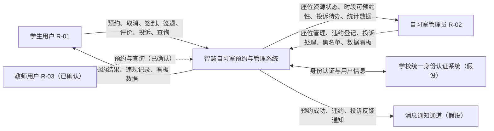

> 虚线表示【已确认】或【假设】关系。E1、E2 为【假设】的外部系统，REF-01 未提及。

#### 1.7.2 目标树（GT-01）

- **图编号**：GT-01
- **图名称**：智慧自习室预约与管理系统 目标树
- **建模对象**：业务目标层级
- **关联需求**：GO-01～GO-06、SI-01～SI-04

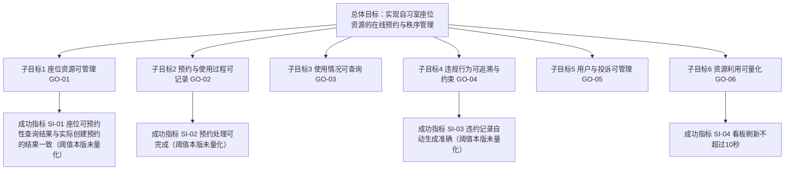

### 1.8 约束、假设与依赖

#### 1.8.1 约束与依赖汇总

| 编号 | 类型 | 内容 | 来源性质 | 确认状态 |
|---|---|---|---|---|
| CON-01 | 运行约束 | 数据看板每 10 秒自动刷新 | 原始资料（REF-01 · 第 7 项） | 已确认 |
| CON-02 | 技术约束 | 技术栈、部署环境、并发规模 | **未提供** | 已确认 |
| CON-03 | 依赖 | 学校统一身份认证系统 | 假设 | 已确认 |
| CON-04 | 依赖 | 消息通知通道 | 假设 | 已确认 |
| CON-05 | 合规 | 学生个人信息与违约记录的存储、展示与保留期限 | **未提供** | 已确认 |

#### 1.8.2 技术约束

| 编号 | 内容 | 来源性质 | 确认状态 |
|---|---|---|---|
| TC-01 | 数据看板须支持每 10 秒自动刷新 | 原始资料（REF-01 · 第 7 项） | 已确认 |
| TC-02 | 技术栈、框架、数据库 | **未提供** | 已确认 |
| TC-03 | 部署环境与运行平台 | **未提供** | 已确认 |

#### 1.8.3 业务约束

| 编号 | 内容 | 来源性质 | 确认状态 |
|---|---|---|---|
| BC-01 | 座位须先登记入库才能被预约（FR-002 依赖 FR-001） | 分析推导 | 已确认 |
| BC-02 | 座位资源状态为"维修中"或"停用"的座位**不可被预约**（BR-017、第 4.4.2 节 C1）。**注意**：本说明书已将座位状态重建为纯资源状态，因此本条不再涉及"座位与预约状态谁优先"的问题——两者已解耦（第 5.3.1 节建模约定）。**当存在与维修时段冲突的未来预约时如何处置，另见 BR-019（已确认）** | 分析推导 | 已确认 |
| BC-03 | 用户违约记录是账户受限的唯一自动依据（BR-009） | AI 候选 | 已确认 |

#### 1.8.4 法律、隐私及合规约束

| 编号 | 内容 | 来源性质 | 确认状态 |
|---|---|---|---|
| LC-01 | 学生姓名、学号、违约记录属个人信息，采集与展示范围须最小化 | 分析推导 | 已确认 |
| LC-02 | 违约记录对用户可见范围、管理人员可见范围 | **未提供** | 已确认 |
| LC-03 | 数据保留期限与删除机制（关联 BR-012、CON-05） | **未提供** | 已确认 |

#### 1.8.5 项目资源与进度限制

| 编号 | 内容 | 来源性质 | 确认状态 |
|---|---|---|---|
| RC-01 | 小组人数、分工、工期 | **未提供** | 已确认 |
| RC-02 | 实验 2 要求完成两个项目，本项目仅为其中之一 | 原始资料（REF-01 · 第 1 项） | 已明确，但第二个项目**尚未确定** |

#### 1.8.6 外部系统依赖

| 编号 | 依赖 | 影响 | 来源性质 | 确认状态 |
|---|---|---|---|---|
| DEP-01 | 学校统一身份认证系统 | 若不可用，登录与用户信息来源需改为本地账号体系（IR-001、IR-002 需重写） | 假设 | 已确认 |
| DEP-02 | 消息通知通道 | 若不可用，FR-060 无法实现 | 假设 | 已确认 |

#### 1.8.7 分析假设

| 编号 | 假设内容 | 采用理由 | 若不成立的影响 | 确认状态 |
|---|---|---|---|---|
| AS-01 | 系统为 Web 端软件系统，不含门禁、闸机等硬件控制 | 为界定系统边界而暂定 | 边界需重新划分，上下文图与接口需求需重写 | 已确认 |
| AS-02 | 用户身份来源于学校统一身份认证 | 校园场景常见做法 | IR-001、IR-002 与用户信息来源需重写 | 已确认 |
| AS-03 | 每个用户仅有一个账户，不支持一人多账户 | 为推进建模而暂定 | 用户与黑名单模型需调整 | 已确认 |
| AS-04 | 座位以"个"为最小可预约单位，不处理连座、组座等组合预约 | 为推进建模而暂定 | 预约模型与冲突校验逻辑需调整 | 已确认 |
| AS-05 | 存在"自习室 → 分区 → 座位"的层级结构 | 为组织座位数据而暂定 | 座位组织方式需调整 | 已确认 |
| AS-06 | 违约与黑名单仅约束预约权限，不影响其他校园系统 | 为界定影响范围而暂定 | 与其他系统的联动需求需补充 | 已确认 |

> **假设的效力说明**：AS-01～AS-06 是**为推进建模而暂时采用的前提**，全部标为【假设】，本版已确认采用（确认主体＝编制小组，见第 8.4 节）。其中 AS-01、AS-02 直接影响系统边界（1.7.1）与接口需求（第 3.4 节）；AS-05（分区）影响 FR-001 与领域模型（第 3.2 节）。

---
## 第 2 章 用户需求

> **本章对应课程要求**：给出用户故事、功能范围与优先级、关键用例。本章含故事清单（2.2）、功能范围与优先级（2.3）、**用例图（2.4，含 UCD-01 用例图与 UCD-02 角色用例图）**、**详细用例表（2.5）**与功能需求清单（2.6）。

### 2.1 用户角色与职责

| 角色编号 | 角色名称 | 角色职责 | 主要目标 | 使用场景 | 可执行操作 | 权限边界 | 相关需求 | 来源性质 | 确认状态 |
|---|---|---|---|---|---|---|---|---|---|
| R-01 | 学生用户 | 作为座位使用者发起预约与使用 | 找到并成功使用座位 | 预约、签到、签退、查询、评价、投诉 | 创建/取消本人预约、签到、签退、查询本人记录、提交评价与投诉 | 仅能操作本人预约单；不能修改座位资源、不能登记他人违约、不能查看他人信息 | FR-010～013、FR-020、021、FR-030～033、FR-041、042 | 原始资料（"用户"）+ 分析推导（具体边界） | 已确认 |
| R-02 | 自习室管理员 | 维护座位资源与使用秩序 | 保障座位资源可用与秩序可追溯 | 座位管理、违约登记、投诉处理、黑名单、数据看板 | 维护自习室与座位、调整座位资源状态、手动违约登记、处理投诉、维护黑名单、查看数据看板 | 不能修改用户本人的密码与身份信息；手动违约登记须记录原因 | FR-001～004、FR-016、FR-023、FR-040、FR-043、FR-044、FR-050～053 | 原始资料（"管理员"）+ 分析推导（具体边界） | 已确认 |
| R-03 | 教师用户 | （若需要）享有与 R-01 相同或更高的预约优先级 | 使用座位 | 同 R-01 | 与 R-01 相同的操作（本版不额外授予管理级权限） | 同 R-01：仅本人预约单 | FR-010～013、FR-020、021、FR-030、FR-031 | **假设**（REF-01 未提及教师角色） | 已确认 |
| R-04 | 系统管理员 | 账号、权限、系统参数配置 | 系统可运行可维护 | 权限配置、参数配置 | 参数配置（预约规则、开放时间、黑名单阈值）、账号与权限维护 | 不可代替管理员处理业务数据（座位、预约、投诉） | FR-001、FR-004；BR-001～BR-012 的参数值 | **假设**（为推进分析暂设定，REF-01 未提及） | 已确认 |

> **角色识别说明**：R-03、R-04 的来源性质仍是【假设】（为推进分析而设定的前提），但**本版已按"采用该假设"定稿**：R-03 不额外授予管理级权限，R-04 只承担参数与账号配置。**若后续确认这两个角色不存在，删除对应条目即可**，不影响 R-01 / R-02 的任何需求。各角色的**权限范围**与**对象范围限制**见第 4.1 节。

### 2.2 用户故事清单

> **本节性质**：本节为按课程结构**新增**的内容，用于把第 2.6 节的功能需求转换为用户视角的表述。**每一条用户故事的来源性质沿用其关联功能需求**；确认状态与优先级为**本版定稿值**（第 2.3 节的模块分级）。
> **优先级依据**：REF-01 未提供优先级依据，故本列取第 2.3 节模块优先级（高 / 中 / 低）为定稿值，来源性质仍为【分析推导】。

#### 2.2.1 学生用户（R-01）的用户故事

| 故事编号 | 用户故事 | 来源性质 | 优先级 | 关联需求 | 关联用例 | 验收要点所在处 | 确认状态 |
|---|---|---|---|---|---|---|---|
| US-01 | 作为学生，我希望**查询某自习室在某日期某时段的可预约座位**，以便提前决定去哪里自习 | 原始资料（座位查询存在）+ 分析推导 | 高（本版定稿） | FR-013 | UC-06 | FR-013 验收标准 | 已确认 |
| US-02 | 作为学生，我希望**按"座位 + 日期 + 时段"创建预约**，以便锁定一个座位 | 原始资料（REF-01 第 2 项）+ AI 候选 | 高（本版定稿） | FR-010、FR-012、**FR-014**、**FR-015** | UC-01 | FR-010 / FR-012 验收标准；并发与幂等见第 7.3 节 VS-01、VS-02 | 已确认 |
| US-03 | 作为学生，我希望**在预约开始前取消预约**，以便计划变化时释放座位 | 原始资料（REF-01 第 3 项）+ AI 候选（时限） | 高（本版定稿） | FR-011 | UC-02 | FR-011 验收标准 | 已确认 |
| US-04 | 作为学生，我希望**在签到窗口内签到**，以便开始使用座位 | 原始资料（REF-01 第 3 项）+ AI 候选（窗口） | 高（本版定稿） | FR-020 | UC-03 | FR-020 验收标准 | 已确认 |
| US-05 | 作为学生，我希望**用完座位后签退**，以便正常结束本次预约 | 原始资料（REF-01 第 3 项） | 高（本版定稿） | FR-021 | UC-04 | FR-021 验收标准 | 已确认 |
| US-06 | 作为学生，我希望**查看本人的预约记录（含当前与历史）** | 原始资料（REF-01 第 4 项） | 高（本版定稿） | FR-030 | UC-05 | FR-030 验收标准 | 已确认 |
| US-07 | 作为学生，我希望**查看本人的违约记录与账户状态**，以便了解自己为何不能预约 | 原始资料（REF-01 第 4、6 项） | 高（本版定稿） | FR-032、FR-044 | UC-07、UC-11 | FR-032 / FR-044 验收标准 | 已确认 |
| US-08 | 作为学生，我希望**对已完成的预约提交评价** | 原始资料（REF-01 第 6 项）+ AI 候选（维度） | 中（本版定稿） | FR-041 | —（评价尚未建立独立用例） | FR-041 验收标准 | 已确认（本版定稿口径） |
| US-09 | 作为学生，我希望**提交投诉并查看处理反馈** | 原始资料（REF-01 第 6 项）+ AI 候选 | 中（本版定稿） | FR-042、FR-043 | UC-10 | FR-042 / FR-043 验收标准 | 已确认（本版定稿口径） |
| US-10 | 作为学生，我希望**查看本人资料**（本版口径：仅联系方式可自行修改） | 原始资料（REF-01 第 6 项）+ AI 候选 | 中（本版定稿） | FR-040 | UC-11 | FR-040 验收标准 | 已确认（本版定稿口径） |

#### 2.2.2 管理员（R-02）的用户故事

| 故事编号 | 用户故事 | 来源性质 | 优先级 | 关联需求 | 关联用例 | 验收要点所在处 | 确认状态 |
|---|---|---|---|---|---|---|---|
| US-11 | 作为管理员，我希望**维护自习室与座位资源（新增 / 修改 / 停用）** | 原始资料（REF-01 第 1 项）+ AI 候选 | 高（本版定稿） | FR-001、FR-002 | UC-08 | FR-001 / FR-002 验收标准 | 已确认（本版定稿口径） |
| US-12 | 作为管理员，我希望**查看各座位的资源状态与预约占用情况**，以便掌握使用情况 | 原始资料（REF-01 第 4、5 项） | 高（本版定稿） | FR-003、FR-031 | UC-06 | FR-003 / FR-031 验收标准 | 已确认 |
| US-13 | 作为管理员，我希望**把座位改为"维修中 / 停用"或改回"可用"**，以便处理故障座位 | 原始资料（REF-01 第 5 项）+ AI 候选 | 中（本版定稿） | FR-004、**FR-016** | UC-08 | FR-004 验收标准；冲突场景见第 7.3 节 VS-05 | 已确认（BR-019 本版条例） |
| US-14 | 作为管理员，我希望**强制取消违规预约**（须填原因），以便释放被无效占用的座位 | 原始资料（REF-01 第 3 项）+ AI 候选 | 中（本版定稿） | FR-011 | UC-02 | FR-011 验收标准 | 已确认（本版定稿口径） |
| US-15 | 作为管理员，我希望**手动登记违约**（须填原因并留痕），以便处理到场但未正常签退等情形 | 原始资料（REF-01 第 5 项）+ AI 候选 | 中（本版定稿） | FR-023 | UC-09 | FR-023 验收标准 | 已确认（本版定稿口径） |
| US-16 | 作为管理员，我希望**受理、处理或驳回投诉并录入反馈** | 原始资料（REF-01 第 6 项）+ AI 候选（时限） | 中（本版定稿） | FR-043 | UC-10 | FR-043 验收标准 | 已确认（本版不规定超时升级） |
| US-17 | 作为管理员，我希望**查看与维护黑名单**（手动加入 / 解除） | 原始资料（REF-01 第 6 项）+ AI 候选 | 中（本版定稿） | FR-044 | UC-11 | FR-044 验收标准 | 已确认（本版定稿口径） |
| US-18 | 作为管理员，我希望**查看数据看板**（柱状图、折线图、统计概览，每 10 秒刷新） | 原始资料（REF-01 第 7 项）+ AI 候选（指标口径） | 中（本版定稿） | FR-050～FR-053 | UC-12 | 仅 FR-052（座位总数）、FR-053 可编写 | 已确认（FR-050～FR-052 本版口径） |

#### 2.2.3 系统自动行为（无直接参与者）与扩展故事的裁定

| 故事编号 | 用户故事 | 来源性质 | 优先级 | 关联需求 | 说明 | 确认状态 |
|---|---|---|---|---|---|---|
| US-19 | 作为系统，我希望**在签到截止时间到达后自动判定违约并累加有效违约次数**，以便约束占座行为 | 原始资料（REF-01 第 3 项"自动违约记录"）+ AI 候选 | 高（本版定稿） | FR-022 | 系统自动执行，**无直接参与者用例**；重复执行须幂等 | **已确认** |
| US-C1 | 作为学生，我希望**对错误的违约记录提出申诉** | **AI 候选（REF-01 未提及）** | 本版排除 | FR-024 | **本版裁定不实现**（SCOPE-08） | **已确认（不纳入本版）** |
| US-C2 | 作为管理员，我希望**把预约或违规记录导出为表格文件** | **AI 候选（REF-01 未提及）** | 本版排除 | FR-033 | **本版裁定不实现**（SCOPE-09） | **已确认（不纳入本版）** |
| US-C3 | 作为学生，我希望**在预约成功、即将违约、投诉被反馈时收到通知** | **AI 候选（REF-01 未提及）** | 中（本版定稿） | FR-060 | **本版纳入：仅站内提示**，不含短信/邮件（SCOPE-07） | **已确认** |

> **故事清单的覆盖检查**：US-01～US-19 覆盖 REF-01 第 1～7 项全部功能存在性；US-C1～US-C3 是【AI 候选】提出的扩展，本版已裁定：**C1（申诉）、C2（导出）不实现，C3（站内通知）纳入**。

### 2.3 功能范围与优先级

| 模块 | 模块名称 | 覆盖的功能需求 | REF-01 来源 | 范围状态（本版定稿） | 优先级（本版定稿） | 主要用例 |
|---|---|---|---|---|---|---|
| M1 | 座位资源管理 | FR-001～FR-004 | 第 1、5 项 | **在范围内**；分区维度纳入（SCOPE-06） | 高（资源基础数据） | UC-08 |
| M2 | 预约管理 | FR-010～FR-016 | 第 2、3 项 | **在范围内**；FR-014～FR-016 为【分析推导】补充 | 高（核心业务） | UC-01、UC-02 |
| M3 | 签到、签退与违约 | FR-020～FR-024 | 第 3、5 项 | 在范围内；**FR-024（申诉）不纳入本版**（SCOPE-08） | 高 | UC-03、UC-04、UC-09 |
| M4 | 查询 | FR-030～FR-033 | 第 4 项 | 在范围内；**FR-033（导出）不纳入本版**（SCOPE-09） | 高（查询）；导出项不实现 | UC-05、UC-06、UC-07 |
| M5 | 用户管理与投诉 | FR-040～FR-044 | 第 6 项 | 在范围内；FR-040 的可编辑字段**仅限联系方式**（Q-030 本版口径） | 中 | UC-10、UC-11 |
| M6 | 数据分析 | FR-050～FR-053 | 第 7 项 | **在范围内**；统计口径与指标见第 2.6 节 FR-050～FR-052 | 中 | UC-12 |
| M7 | 通知 | FR-060 | **未提及** | **本版纳入，但仅限站内提示**；短信/邮件等站外通道排除（SCOPE-07） | 低 | — |

> **优先级说明**：REF-01 未提供优先级依据，"优先级"列是【分析推导】的定稿结论，依据是"是否为流程闭环所必需"：构成核心闭环的模块（M1～M4）为**高**，管理与统计类（M5、M6）为**中**，站内通知为**低**。该分级用于排期，不代表来源已变为原始资料。

### 2.4 用例图（UCD-01、UCD-02）

> **本节含两张用例图**：2.4.1 为**用例图 UCD-01**（PlantUML，**有可编辑源文件**），2.4.2 为**角色用例图 UCD-02**（按端分组的现行版本，**仓库内只有 PNG、无源文件**）。两图表达同一批用例的不同侧面，**须一并阅读**：UCD-01 表达"参与者—用例"的静态关系；UCD-02 按**学生端 / 共享·系统内部 / 管理员端**分组，并额外画出两个外部系统与两个未编号的内部用例（身份认证与登录、自动违约判定）。

#### 2.4.1 用例图（UCD-01）

- **图编号**：UCD-01
- **图名称**：智慧自习室预约与管理系统 用例图
- **建模对象**：参与者与用例
- **关联需求**：UC-01～UC-12，对应 FR 见下表与第 7.4 节追踪矩阵
- **源文件**：`models/UCD-01-用例图.puml`（PlantUML）
- **渲染产物**：**已导出**为 `models/UCD-01-用例图.svg` 与 `models/UCD-01-用例图.png`（PlantUML 1.2024.7 + ELK 布局引擎）。导出只说明"源码可渲染"，**不构成对用例划分的确认**

| 用例编号 | 用例名称 | 主要参与者 | 关联需求 |
|---|---|---|---|
| UC-00 | 身份认证与登录（**本版补建**，编号沿用 UCD-02 图面） | 全部角色 | IR-001、IR-002；【假设】AS-02 |
| UC-01 | 预约座位 | 学生用户 | FR-010、012、013 |
| UC-02 | 取消预约 | 学生用户、管理员 | FR-011 |
| UC-03 | 签到 | 学生用户 | FR-020 |
| UC-04 | 签退 | 学生用户 | FR-021 |
| UC-05 | 查询预约记录 | 学生用户、管理员 | FR-030（FR-033 记录导出**本版不实现**，不纳入本用例） |
| UC-06 | 查询座位资源状态与时段可预约性 | 学生用户、管理员 | FR-003、031 |
| UC-07 | 查询违规记录 | 学生用户、管理员 | FR-032 |
| UC-08 | 管理座位资源 | 管理员 | FR-001、002、004 |
| UC-09 | 手动违约登记 | 管理员 | FR-023 |
| UC-10 | 投诉提交与处理 | 学生用户、管理员 | FR-042、043 |
| UC-11 | 用户与黑名单管理 | 管理员、学生用户（仅本人资料） | FR-040、044 |
| UC-12 | 查看数据看板 | 管理员 | FR-050～053 |

> **图注（须与用例表一并阅读）**：
> 1. R-03 教师用户、R-04 系统管理员的来源性质为【假设】（REF-01 未提及），本版已按第 2.1 节的定稿口径采用；若日后确认其不存在，删除对应角色及其关联即可，不影响 UC-01～UC-12。
> 2. 本用例图为**设计意图**；用例的**确认状态以本节用例表与第 2.5 节详细用例规格为准**（均为已确认）。
> 3. 全部用例与参与者关系的来源性质为【AI 候选】或【分析推导】；确认状态为**已确认**（本版定稿）。
> 4. UC-06 已更名为"查询座位资源状态与时段可预约性"，以体现"可预约性是按时段计算的派生结论"（第 4.4.2 节）。**本版已把上述用例表中的 UC-06 名称一并更正**；若 `models/角色用例图.png` 图面仍写旧名"查询座位实时状态"，属图与正文的差异，**以正文为准**，并登记于第 2.4.2 节图注 2。
> 5. UC-08 的"场地临时关闭"分支**在图面中未细化**（图未重绘）；其业务口径已在 BR-019 与 FR-016 中定稿（默认保留冲突预约并提示；管理员明确选择时按 BR-022 批量取消）。
> 6. UC-01 隐含 FR-014（并发冲突控制）与 FR-015（请求幂等性）两项【分析推导】补充需求。
> 7. **UC-00 为本版补建的用例**：角色用例图（UCD-02）把"身份认证与登录"画为未编号用例并与 UC-01～UC-12 并列，本版据此**在正文中补建 UC-00**（沿用图面编号，不新增编号段位），详细用例规格见第 2.5 节；"自动违约判定"在图中作为内部用例画出，本版仍按 FR-022 跟踪，**不单列用例**（依据：系统自动行为不设参与者用例，见第 2.2.3 节）。

**图 UCD-01（当前渲染产物）**：由 REF-03 源文件渲染，PlantUML 1.2024.7 + ELK 布局引擎（详见第 0.3 节）。

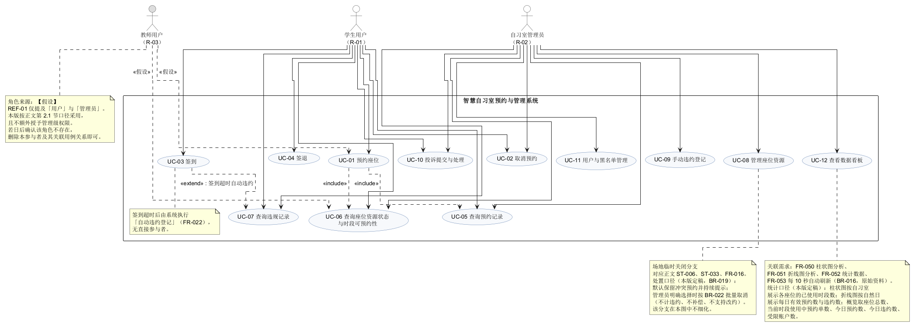

> **读图提示**：本 PNG 只是源文件的渲染结果。若图面与上述用例表或下方源文件不一致，**以用例表与源文件为准**，并按第 7.5.4 节登记差异。图面已渲染、已导出，**不代表用例划分、参与者关系或任何需求已被确认**。

**UCD-01 源文件全文**（与 REF-03 `models/UCD-01-用例图.puml` 同源；该图已导出为 `models/UCD-01-用例图.svg` / `.png`）：

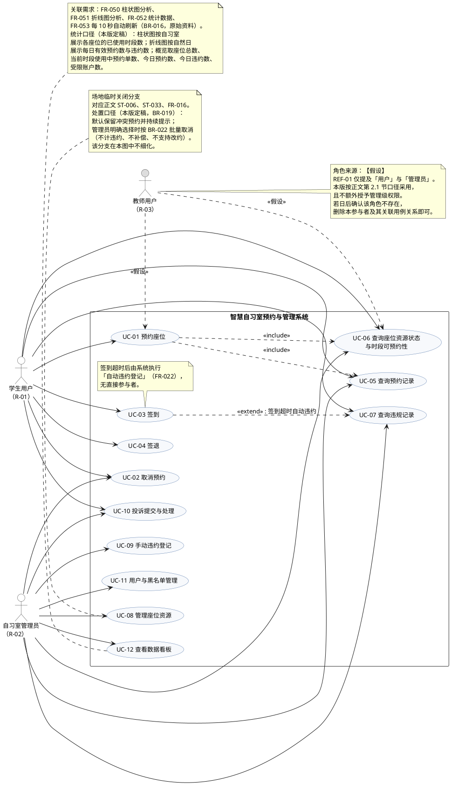

#### 2.4.2 角色用例图（UCD-02）

- **图编号**：**UCD-02**——【本版指定】原文件名 `models/角色用例图.png` **未带图编号**，本版按编号连续性命名为 UCD-02；该指定**由本版直接采用**，不再向建模人追认（第 8.2 节 Q-035 的本版裁定）
- **图名称**：角色用例图（按端分组的用例视图）
- **建模对象**：4 名内部参与者、2 个外部系统与 12 个用例（另有"身份认证与登录""自动违约判定"2 个未编号的内部用例）
- **关联需求**：UC-00～UC-12（同 2.4.1 用例表）；外部系统 E1 关联 IR-001、IR-002，E2 关联 IR-003、FR-060（FR-060 **本版纳入需求，但仅站内提示**，见 SCOPE-07）
- **源文件**：**仓库内不存在**（已在本仓库全部分支内检索，`models/` 下只有两个 `.puml`）；本图**只有 PNG**，其生成工具与版本**未记录**
- **渲染产物**：`models/角色用例图.png`（组内成员提交，提交记录 `95d84b0`，2026-10-15）
- **建模说明**：本图**按端（学生端 / 共享·系统内部 / 管理员端）分组**，不是按参与者分组；跨端的用例（UC-10）被放在"共享"泳道

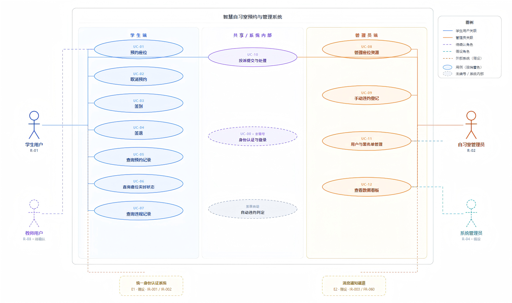

**（1）图内分组与用例清单（与 2.4.1 用例表逐条比对）**

| 图内分组 | 用例编号 | 图内用例名称 | 2.4.1 用例表中的名称 | 比对结论 |
|---|---|---|---|---|
| 学生端 | UC-01 | 预约座位 | 预约座位 | 一致 |
| 学生端 | UC-02 | 取消预约 | 取消预约 | 一致 |
| 学生端 | UC-03 | 签到 | 签到 | 一致 |
| 学生端 | UC-04 | 签退 | 签退 | 一致 |
| 学生端 | UC-05 | 查询预约记录 | 查询预约记录 | 一致 |
| 学生端 | UC-06 | 查询座位实时状态 | **查询座位资源状态与时段可预约性** | **不一致**（见本图注 2） |
| 学生端 | UC-07 | 查询违规记录 | 查询违规记录 | 一致 |
| 管理员端 | UC-08 | 管理座位资源 | 管理座位资源 | 一致 |
| 管理员端 | UC-09 | 手动违约登记 | 手动违约登记 | 一致 |
| 管理员端 | UC-11 | 用户与黑名单管理 | 用户与黑名单管理 | 一致 |
| 管理员端 | UC-12 | 查看数据看板 | 查看数据看板 | 一致 |
| 共享 / 系统内部 | UC-10 | 投诉提交与处理 | 投诉提交与处理 | 一致（跨学生端与管理员端） |
| 共享 / 系统内部 | **UC-00**（图面明确标为"未编号"） | 身份认证与登录 | **UC-00 身份认证与登录**（本版补建） | 一致（编号沿用图面"未编号"用例，见本图注 3） |
| 共享 / 系统内部 | **系统自动**（图面标为内部用例） | 自动违约判定 | 2.4.1 表中标注为"**系统自动，无直接参与者用例**"，对应 FR-022 | 一致（图面为内部用例表达，正文按 FR-022 跟踪，见本图注 4） |

> **图内用例总数**：图中画出的椭圆共 **14 个**（UC-01～UC-12 共 12 个 + "身份认证与登录" + "自动违约判定"）；正文用例表**共 13 个编号用例（UC-00～UC-12）**。图与正文的差异**已在本版消除**："身份认证与登录"由正文补建为 **UC-00**（编号沿用图面），"自动违约判定"为系统自动行为，正文不为其编号而按 **FR-022** 跟踪。两项处置均记为本版裁定（第 8.2 节 Q-034）。

**（2）图内参与者与外部系统（含图例线型）**

| 图内元素 | 图例中的线型 | 对应正文编号 | 比对结论 |
|---|---|---|---|
| 学生用户 | 实线（学生用户关联） | R-01 | 一致 |
| 自习室管理员 | 实线（管理员关联） | R-02 | 一致 |
| 教师用户 | 虚线（**角色**） | R-03【已确认】 | 一致（正文亦已定稿确认，第 2.1 节） |
| 系统管理员 | 点线（**假设角色**） | R-04（来源性质【假设】，确认状态已确认） | 一致 |
| 统一身份认证系统 | 点线（外部系统·假设） | E1（SCD-01）；IR-001、IR-002 | 一致 |
| 消息通知通道 | 点线（外部系统·假设） | E2（SCD-01）；IR-003、FR-060 | 一致；**FR-060 本版纳入需求但仅限站内提示**（SCOPE-07） |

**（3）图注（务必与本节表格及 2.4.1 用例表一并阅读）**

1. 图中全部用例、参与者与关联的来源性质为【AI 候选】或【分析推导】，确认状态**已确认**（本版定稿）；确认对象是**需求与模型定义本身**，**不代表**任何用例已实现或已验证。
2. **UC-06 名称不一致（须由建模人重新出图）**：图面沿用旧名"查询座位实时状态"。正文已在第 1.7 节把 REF-01 的"实时座位管理"修正为"展示系统记录的预约占用"，2.4.1 图注 4 与 `models/UCD-01-用例图.puml` 均已更名为"查询座位资源状态与时段可预约性"（座位本身不感知实时占用，见第 5.3.1 节建模约定）。**本版以正文为准**，并已同步更正 2.4.1 的用例表；**图面仍为旧名**（第 7.5.4 节、Q-035）。
3. **UC-00"身份认证与登录"已由正文补建**：图面把它画为未编号用例，本版据此在正文**补建 UC-00**（沿用图面位置、不新增编号段位），详细用例规格见第 2.5 节；其流程依据第 5.6 节 FLW-01（**本版已闭合**）、IR-001 / IR-002 与【假设】AS-02（Q-002、Q-034 本版裁定）。
4. **"自动违约判定"在图内作为内部用例画出，无参与者**：本版统一口径为——**系统自动行为不设参与者用例、不单独编号**，其行为由 FR-022 完整定义（第 2.2.3 节用户故事清单亦按"无直接参与者"处理）。图面为图形表达，与正文不冲突（Q-034 本版裁定）。
5. **R-03、R-04、E1、E2 的关联范围**：这四个元素的来源性质均为【假设】。本版对它们采取统一口径——R-03 仅关联 UC-01 与 UC-06、不额外授予管理级权限；R-04 仅承担账号与参数配置、不参与业务用例；E1 支撑 UC-00（统一身份认证）；E2 支撑 FR-060 的站内提示。该口径与 2.4.1 用例表、第 4.1.1 节权限矩阵完全一致；**图面线条若与本口径不符，以正文为准**，并按第 7.5.4 节登记为已知偏差（Q-003 本版裁定）。
6. **本图不含 UCD-01 中的部分细节**：2.4.1 图注 5 所述"UC-08 的场地临时关闭分支未细化"、图注 6 所述 UC-01 隐含的 FR-014 / FR-015，在本图中同样**未出现**，两图在这一点上一致。
7. **无源文件的风险**：本图**只有 PNG**，没有可编辑源文件，修改与复核**无法在源级别进行**；这不符合"模型须提交可编辑源文件"的提交要求（第 7.6 节 C-11、Q-037）。

### 2.5 详细用例规格

> **选择说明**：按课程要求，详细用例选取 **5 个有代表性、体现关键业务闭环**的用例，而不是选登录、查询这类简单功能。本节选取：**UC-01 预约座位 → UC-02 取消预约（含管理员强制取消）→ UC-03 签到（含失败与自动违约）→ UC-08 管理座位资源（含场地临时关闭）→ UC-09 手动违约登记**，构成"预约 → 取消 → 签到 → 座位关闭 → 违约"的完整闭环。
> **全部用例的确认状态为【已确认】**：其主流程、替代流程与判定条件均来自【AI 候选】或【分析推导】，**未经过任何走查、原型验证或业务确认**。
> **关于"预期使用频率或触发规律"**：REF-01 **未提供任何使用量数据**（如日均预约笔数、峰值时段、并发人数）。因此本节各用例的**频率数据一律标为【已确认】，不予编造**；仅给出可由设计本身推出的**触发规律**（即"由谁、在什么时点触发"）。

#### UC-01 预约座位

| 项目 | 内容 |
|---|---|
| **用例编号与名称** | UC-01 预约座位 |
| **参与者** | 主要参与者：学生用户（R-01）。次要参与者：无（系统内部完成校验与写入） |
| **触发事件** | 学生用户在选定"自习室 + 座位 + 日期 + 时段 `[s, e)`"后提交预约请求（请求携带幂等键，BR-021） |
| **前置条件** | ① 用户已登录，账户状态为"正常"（判定项 C5）；② 目标座位资源状态为"可用"（C1）；③ 目标自习室处于启用状态且目标时段落在开放时间内（C2）；④ 目标时段满足 BR-001（粒度对齐）、BR-002（提前天数）、BR-003（单次时长）、BR-004（每日次数）（C6） |
| **主流程** | 1. 用户选择自习室、座位、日期与时段； 2. 系统计算可预约性（第 4.4.2 节 C1～C6）并校验时段冲突：座位侧 C3（BR-006）、用户侧 C4（BR-005），重叠判定按左闭右开 `[s, e)`（BR-020）； 3. 校验通过后创建预约单，状态 = "待使用"； 4. 写入审计/操作记录；**座位资源状态不发生任何变更**（第 5.3.1 节建模约定）； 5. 该时段因 C3 命中而对其他用户变为不可预约； 6. 返回预约单编号与时段信息 |
| **替代流程** | **A1 用户取消选择**：用户在选择阶段放弃，不提交请求 → 无任何数据变化，用例结束。 **A2 同一请求重复提交（幂等）**：用户因弱网重试而以**同一幂等键**再次提交 → 系统返回**同一张**预约单，不产生第二条记录（FR-015 / ST-030 类幂等要求）；当日预约次数不重复计入 |
| **异常流程** | **E1 账户非"正常"**：拒绝，提示限制原因与预计解除时间（ST-047 / C5）。 **E2 座位非"可用"或在非开放时间**：拒绝，提示该座位不可预约（BR-017 / C1、C2）。 **E3 不满足 BR-001～BR-004**：拒绝，并返回**未通过的具体规则项及其参数值**（ST-028 / C6）。 **E4 时段冲突**：座位已被占用 → 拒绝并提示时段冲突（C3、BR-006）；用户自身已有重叠预约 → 拒绝（C4、BR-005）。 **E5 并发写入冲突**：两个请求同时通过校验 → 系统须保证**至多一条**创建成功，另一条返回"该时段已被占用"（FR-014 / ST-035）。**本版口径**：本条只规定**可观察的行为结果**（同一座位、同一时段最多存在一条有效预约单），**实现手段（唯一约束、悲观锁、乐观锁等）由实现决定，本版不规定**；该行为可在并发压测下按下方验收标准检验（第 8.2 节 Q-025 本版裁定）。 |
| **成功后的结果** | 系统中新增 1 条"待使用"预约单（含占用区间 `[s, e)` 与幂等键）；用户当日预约次数 +1；**座位资源状态保持原值不变**；该座位该时段对他人的可预约性变为"否" |
| **失败后的结果** | **不创建任何预约单、不产生任何占用**；座位资源状态不变；系统返回未通过的判定项编号（C1～C6）与对应规则编号，**不得仅提示"不可预约"**；所有被拒绝的路径均写入越权/拒绝审计日志（仅限权限类拒绝） |
| **关联规则** | BR-001、BR-002、BR-003、BR-004（预约参数，本版取值见第 4.2.1 节）；BR-005（用户时段不重叠）；BR-006（座位时段独占）；BR-017（不可预约座位）；BR-018（权限边界）；BR-020（左闭右开）；BR-021（幂等） |
| **关联需求与状态转换** | FR-010（创建预约）、FR-012（校验）、FR-013（可预约性查询）、FR-014（并发控制）、FR-015（幂等）、FR-011（后续取消）；ST-028、ST-035、ST-047；场景 BS-01、BS-02；图 AD-01、SM-02 |
| **验收标准** | **Given** 用户账户为"正常"、座位资源状态为"可用"、请求时段满足 BR-001～BR-004 且与该用户及该座位的既有有效预约均不重叠（`s_new < e_old ∧ s_old < e_new` 均不成立），**When** 用户提交预约，**Then** 系统创建 1 条"待使用"预约单、座位资源状态保持"可用"、该时段对他人变为不可预约。 **Given** 用户账户为"受限"，**When** 提交预约，**Then** 拒绝、不创建预约单、提示限制原因与预计解除时间（ST-047）。 **Given** 同一用户以同一幂等键重复提交同一"座位 + 时段"，**When** 第二次提交，**Then** 返回**同一张**预约单、不产生第二条记录。 **Given** 座位 S-001 在 `[14:00,16:00)` 已有有效预约，**When** 另一用户请求 `[16:00,18:00)`，**Then** 允许创建（左闭右开，BR-020）。 **Given** 两个用户对同一座位的同一时段并发提交预约（并发数 ≥ 2），**When** 全部请求返回，**Then** **恰好 1 条**预约单状态为"待使用"，其余请求均返回"该时段已被占用"（ST-035），且查询该座位该时段的有效预约单**有且仅有 1 条** |
| **预期使用频率或触发规律** | **触发规律（可由设计推出，非频率数据）**：由学生用户**主动发起**；触发时点集中在自习室开放时段前后。 **使用频率：REF-01 未提供任何使用量数据，本版不作估计**——REF-01 未提供日均预约笔数、峰值时段、并发人数等任何数据，本说明书**不编造**。需在确认工作中由模拟自习室管理员提供或由教师给出测量口径（第 8.2 节 Q-001、Q-010）。 |

#### UC-02 取消预约（含管理员强制取消）

| 项目 | 内容 |
|---|---|
| **用例编号与名称** | UC-02 取消预约（含管理员强制取消） |
| **参与者** | 学生用户（R-01，取消本人预约）；管理员（R-02，强制取消，须填原因） |
| **触发事件** | 学生用户提交取消请求；或管理员对指定预约单执行强制取消 |
| **前置条件** | 预约单状态为"待使用"；操作者对该预约单具备权限（学生仅限本人；管理员限其授权范围，第 4.1.1 节） |
| **主流程** | **学生取消**：1. 用户发起取消；2. 系统校验归属与状态；3. 校验是否在可取消时限内（提交时刻 `< s − C 分钟`，BR-011 本版取值 C=30）；4. 预约单 "待使用" → "已取消"（ST-021）；5. 记录取消时间与操作者。 **管理员强制取消**：1. 管理员选定预约单并**填写取消原因**；2. 系统校验操作者角色与授权范围；3. 预约单 → "已取消"（ST-022）；4. 记录操作者、原因与时间；5. 向该用户生成站内提示（FR-060，仅站内、不涉及站外通道）。 |
| **替代流程** | **A1 超出可取消时限** → 拒绝（ST-029），预约单保持"待使用"。**本版口径（BR-011）**：超过时限后用户**不能**自行取消，且该情形**不计违约**；管理员仍可按 FR-011 强制取消（须填原因）。 |
| **异常流程** | **E1 非本人**：学生取消他人预约 → 拒绝，不改变该预约单。 **E2 状态不允许**：预约单已为"使用中/已完成/已取消/已违约" → 拒绝（FR-011 权限要求）；已签到者应走签退而非取消。 **E3 管理员未填原因** → 拒绝提交，预约单保持原状态。 **E4 越权**：学生调用强制取消，或管理员超出授权范围 → 拒绝并写越权审计日志（ST-048 / ST-007）。 |
| **成功后的结果** | 预约单转"已取消"；该预约单**不再计入有效预约**（TM-18），占用区间 `[s, e)` 因 C3 不再命中而**自动重新可预约**；**座位资源状态不发生任何变化**（LK-03） |
| **失败后的结果** | 预约单状态与座位资源状态均**保持不变**；返回具体拒绝原因；越权类拒绝写入审计日志 |
| **关联规则** | BR-011（取消时限，本版取值 30 分钟）；BR-018（权限边界）；BR-015（管理员操作须填原因，同类要求） |
| **关联需求与状态转换** | FR-011；ST-021、ST-022、ST-029、ST-048、ST-007；场景 BS-02；图 AD-01、SM-02 |
| **验收标准** | **Given** 预约单为"待使用"、当前时刻早于 `s − C 分钟`（本版取值 C=30），**When** 用户取消，**Then** 预约单变为"已取消"、**座位资源状态保持"可用"不变**、该时段对其他用户重新可预约。 **Given** 预约单为"待使用"、当前时刻已不早于 `s − C 分钟`，**When** 用户取消，**Then** 拒绝、预约单保持"待使用"（ST-029）。 **Given** 管理员强制取消，**When** 未填写取消原因，**Then** 拒绝并提示原因必填。 **Given** 管理员强制取消，**When** 原因已填且在授权范围内，**Then** 预约单变为"已取消"、记录操作者与原因、**不产生违约记录**、**不累加**用户违约次数 |
| **预期使用频率或触发规律** | **触发规律**：由学生用户主动发起（计划变更时），或由管理员在处理违规/场地问题时发起；**无定时触发**。 **使用频率：REF-01 未提供任何使用量数据，本版不作估计**——REF-01 未提供取消率或取消量数据，**不编造**。 |
| **与 UC-09 的边界（必须一并阅读）** | 本用例的**强制取消**适用于"预约尚未开始"（`当前时刻 < s`）；若管理员希望追究当事人责任，应改走 **UC-09 手动违约登记**，该路径适用于当事人**已实际占用时段**的情形。**两条路径互斥**（第 8.2 节 Q-033，**该边界为暂定**） |

#### UC-03 签到（含签到失败与自动违约）

| 项目 | 内容 |
|---|---|
| **用例编号与名称** | UC-03 签到（含签到失败与自动违约） |
| **参与者** | 学生用户（R-01，发起签到）；系统（定时触发自动违约判定，无直接参与者） |
| **触发事件** | ① 用户在签到窗口内提交签到；② 系统定时扫描，发现超过签到截止时间仍未签到的"待使用"预约单 |
| **前置条件** | ① 预约单存在且属于本人；② 预约单状态为"待使用"；③ 当前时间处于签到窗口 `[s − X 分钟, s + Y 分钟)` 内（BR-007 本版取值 X=15、Y=15）；④ 时间判定以**服务器时间**为准（NFR-010） |
| **主流程** | 1. 用户提交签到（预约单编号或座位编号）； 2. 系统校验归属、状态与时间窗口； 3. 预约单 "待使用" → "使用中"（ST-020）； 4. 记录签到时间；**座位资源状态不发生变更**； 5. 用户在结束使用后签退（UC-04，走 FR-021 / ST-024）；若未主动签退，到达结束时间 `e` 后由系统自动结束（ST-025） |
| **替代流程** | **A1 未签到 → 自动违约（系统触发）**：当前时间 ≥ `s + Y 分钟` 且预约单仍为"待使用" → 系统判定违约（ST-023 / BR-008），生成违约记录，占用区间 `[s, e)` 因不再属于有效预约而**重新可预约**，累计有效违约次数 +1；达到阈值（BR-009 本版取值 3 次）则账户转"受限"（ST-040）。 **A2 到期自动结束**：已签到但未主动签退 → 到达 `e` 后系统自动结束（ST-025）。**本版裁定（Q-005）**：未主动签退**不计违约**——违约的判定条件仅由 BR-008（超过签到截止时间仍未签到）界定，不扩展到"未签退"。 |
| **异常流程** | **E1 非本人预约单** → 拒绝（ST-027）。 **E2 当前时间早于窗口起点** → 拒绝并提示"签到尚未开放"（ST-027）。 **E3 重复签到** → 拒绝（ST-030），**不覆盖**原签到时间（幂等，FR-015）。 **E4 对已达终态的预约单签到**（已取消/已完成/已违约） → 拒绝（ST-031）。 **E5 定时任务故障**：任务未执行或执行失败 → 记录错误日志，并在恢复后**补算**遗漏的违约判定。**本版口径**：任务调度周期、重试次数、退避策略与告警渠道**属实现层，本版不规定**；本版只规定两条**可观察约束**——①重复执行须**幂等**，以"预约单标识 + 违约类型"为去重键（ST-034 / BR-021 / LK-07）；②违约判定**只以预约开始时间与签到记录为依据**，因此补算（晚执行）得出的结果必须与准时执行**完全一致**（不因执行次数或执行时点不同而改变次数累加）。 |
| **成功后的结果** | 签到：预约单转"使用中"并记录签到时间；**座位资源状态保持原值**。 自动违约：预约单转"已违约"、生成**1 条**违约记录、累计有效违约次数 +1、该时段重新可预约、**座位资源状态不变**；达阈值则账户转"受限"并记录生效与预计解除时间（ST-040） |
| **失败后的结果** | 签到失败：预约单状态保持"待使用"或"使用中"（视失败原因），**不产生签到记录、不改变座位资源状态**；提示具体失败原因。 任务失败：不产生错误的违约记录；须留错误日志；**本版不规定兜底与对账机制**（属实现层），但补算结果须与准时执行一致（见上方 E5 的两条可观察约束） |
| **关联规则** | BR-007（签到窗口，本版取值：开始前 15 分钟至开始后 15 分钟）；BR-008（违约判定条件）；BR-009（黑名单阈值，本版取值 3 次）；BR-010（限制期限，本版取值 7 天）；BR-021（幂等） |
| **关联需求与状态转换** | FR-020、FR-021、FR-022、FR-015；ST-020、ST-023、ST-024、ST-025、ST-027、ST-030、ST-031、ST-034、ST-040；场景 BS-01、BS-03、BS-05；图 AD-02、SM-02、SM-03 |
| **验收标准** | **Given** 预约单为"待使用"、当前时间在 `[s−X, s+Y)` 内，**When** 用户签到，**Then** 预约单变为"使用中"、记录签到时间、**座位资源状态保持不变**。 **Given** 同一预约单已签到，**When** 再次签到，**Then** 拒绝（ST-030）、状态保持"使用中"、原签到时间不变。 **Given** 用户对他人预约单签到，**When** 提交，**Then** 拒绝、状态保持"待使用"（ST-027）。 **Given** 当前时间早于 `s−X`，**When** 签到，**Then** 拒绝并提示签到尚未开放。 **Given** 预约单为"待使用"且当前时间已不早于 `s + Y 分钟`，**When** 系统执行违约判定，**Then** 预约单变为"已违约"、生成**一条**违约记录、累计次数 +1、**座位资源状态不变**。 **Given** 同一预约单被扫描任务重复处理，**When** 第二次执行，**Then** 幂等跳过、不新增记录、不重复累加（ST-034） |
| **预期使用频率或触发规律** | **触发规律（可由设计推出，非频率数据）**：签到由学生用户在签到窗口内主动发起；自动违约判定由系统在**签到截止时刻之后**触发，属**定时/事件触发**，与用户操作无关。 **使用频率：REF-01 未提供任何使用量数据，本版不作估计**——REF-01 未提供签到人数、违约率或定时任务执行周期等数据，**不编造**。定时任务的**调度周期属实现层，本版不规定**。 |

#### UC-08 管理座位资源（含场地临时关闭）

| 项目 | 内容 |
|---|---|
| **用例编号与名称** | UC-08 管理座位资源（含场地临时关闭） |
| **参与者** | 管理员（R-02）。次要参与者：受影响的学生用户（被动受影响，非主动参与） |
| **触发事件** | 管理员新增 / 修改自习室与座位，或调整座位**资源状态**（可用 / 维修中 / 停用） |
| **前置条件** | ① 操作者为管理员；② 目标资源在其**被授权的自习室范围内**（第 4.1.2 节：**本版按管理员不分级建模**，任一管理员可操作全部座位资源）；③ 调整资源状态时，若存在冲突的未来有效预约，须按 **BR-019** 处置（列出冲突清单；默认保留预约并持续提示） |
| **主流程** | **资源维护**：1. 管理员提交自习室/座位信息；2. 系统校验必填项与唯一性；3. 保存记录；新增座位的**资源状态默认"可用"**（FR-002）。 **资源状态调整（无冲突预约）**：1. 管理员选择座位与目标状态并填写原因；2. 系统校验授权范围与当前状态；3. 座位资源状态转换（ST-001～ST-005）；4. 该座位的可预约性按第 4.4.2 节 C1 **立即重新计算**；5. 写入审计日志（NFR-009）。 |
| **替代流程** | **A1 存在冲突的未来有效预约（场地临时关闭）**：系统检出该座位/自习室在目标时段存在"待使用"或"使用中"的预约单 → 进入 ST-006 / ST-033 分支。**本版定稿口径（BR-019）**：① 系统**列出冲突预约清单**并提示；② **默认保留**冲突预约的状态（保持"待使用"或"使用中"），座位资源状态照常变更；③ 仅当管理员在清单中**明确选择批量取消**时才执行 ST-033，且须经 BR-022 的二次确认；④ 批量取消**不计违约、不生成补偿、不支持改约**。 **A2 结束维修 / 启用座位**：状态改回"可用" → 可预约性立即恢复，**无需其他任何操作**（LK-02）。 |
| **异常流程** | **E1 非管理员调用** → 拒绝并写越权审计日志（ST-048）。 **E2 超出授权自习室范围** → 拒绝、状态保持并记录（ST-007）。本版按"管理员不分级"建模（第 4.1.2 节），**单自习室部署下该分支不产生差异**；多自习室部署时以 BR-018 的资源范围作为判定依据。 **E3 当前状态不匹配**（如对"停用"座位执行"结束维修"） → 拒绝，状态保持。 **E4 删除存在未来有效预约的座位** → 系统拒绝删除并提示改用"停用"（FR-002 本版裁定：不提供座位物理删除，以保留历史记录的关联对象）。 |
| **成功后的结果** | 自习室/座位记录新增或更新；座位资源状态按目标值变更；该座位的可预约性按 C1 重新计算；审计日志新增记录（含操作者、时间、原因）；若管理员选择批量取消，则另生成取消记录与站内提示（FR-060） |
| **失败后的结果** | 座位资源状态**保持原值**；**默认情形下不产生任何预约单状态变化**；越权类拒绝写入审计日志；系统须保证不出现"座位已关闭但冲突提示缺失"的静默状态——按 BR-019，冲突预约在未被执行批量取消前**持续显示冲突提示** |
| **关联规则** | BR-017（维修中/停用不可预约）；BR-018（权限边界）；BR-019（场地临时关闭与冲突预约，本版定稿口径）；BR-022（批量操作保护）；BR-009 / BR-010（违约阈值与限制，仅在被取消预约另有违约认定时适用，本版批量取消不计违约）；NFR-009（操作审计） |
| **关联需求与状态转换** | FR-001、FR-002、FR-004、FR-016；ST-001～ST-007、ST-033；场景 BS-07；图 SM-01；第 7.3 节 VS-05 |
| **验收标准** | **Given** 座位 S-004 资源状态为"可用"且无冲突预约，**When** 管理员设置为"维修中"，**Then** 资源状态变为"维修中"且其可预约性立即变为否（C1）。 **Given** 座位 S-002 在明日 `[14:00,16:00)` 有一张"待使用"预约单，**When** 管理员将其设为"维修中"，**Then** 系统**列出该冲突预约单**、该预约单**状态保持"待使用"**，且在该座位上持续显示冲突提示（BR-019 默认口径）。 **Given** 冲突清单已列出而管理员未做选择即保存，**When** 保存成功，**Then** 仅座位资源状态变更，预约单不变更、不生成违约记录。 **Given** 管理员在冲突清单中明确勾选并确认批量取消，**When** 提交，**Then** 受影响预约单变为"已取消"、用户累计有效违约次数不变、无补偿记录、不创建改约记录，且全部操作写入审计日志。 **Given** 学生在无授权情况下调用该操作，**When** 提交，**Then** 拒绝并记录越权尝试（ST-007 / ST-048）。 **Given** 管理员将座位改回"可用"，**When** 保存，**Then** 该座位立即重新出现在可预约结果中（C1 恢复）。 |
| **预期使用频率或触发规律** | **触发规律**：由管理员**按需人工触发**（发现故障座位、检修、临时关闭场地时）；无定时触发。 **使用频率：REF-01 未提供任何使用量数据，本版不作估计**——REF-01 未提供座位故障率、场地关闭次数等数据，**不编造**。 |

#### UC-09 手动违约登记

| 项目 | 内容 |
|---|---|
| **用例编号与名称** | UC-09 手动违约登记 |
| **参与者** | 管理员（R-02）。次要参与者：被登记违约的学生用户（被动受影响） |
| **触发事件** | 管理员对指定预约单提交手动违约登记，并填写违约原因 |
| **前置条件** | ① 操作者为管理员且目标预约单在其授权范围内；② 目标预约单状态为**"使用中"**（即当事人已签到但未正常签退等情形）；③ 已填写违约原因（BR-015） |
| **主流程** | 1. 管理员选定预约单（或座位）并填写违约原因； 2. 系统校验操作者角色与授权范围； 3. 校验预约单当前状态为"使用中"； 4. 预约单 "使用中" → "已违约"（ST-026）； 5. 生成违约记录（含操作者、原因、时间）； 6. 用户累计有效违约次数 +1；达到阈值则触发账户受限（ST-040）； 7. **座位资源状态不发生任何变更** |
| **替代流程** | **A1 当事人尚未开始使用**：预约单为"待使用" → 本用例**不适用**，管理员应改走 UC-02 的**强制取消**（ST-022）。**本版裁定（Q-033）**：BR-015 的适用前提是"当事人已开始使用"，因此**"强制取消 + 另行登记违约"不并存**；不建立"待使用 → 已违约"的转换，ST-036 的预留位继续保留不占用。 |
| **异常流程** | **E1 未填写违约原因** → 拒绝提交，预约单保持"使用中"（ST-032）。 **E2 学生用户调用该操作** → 拒绝并记录越权尝试（ST-048）。 **E3 超出授权范围的管理员操作** → 拒绝（ST-007 / ST-048）。 **E4 预约单已处于终态**（已取消/已完成/已违约） → 拒绝，状态保持。 |
| **成功后的结果** | 预约单转"已违约"；新增 **1 条**含操作者与原因的违约记录；用户累计**有效**违约次数 +1；达阈值时账户转"受限"（ST-040）；**座位资源状态保持不变** |
| **失败后的结果** | 预约单状态与座位资源状态均**保持不变**；**不生成违约记录、不累加次数**；越权类拒绝写入审计日志 |
| **关联规则** | BR-015（手动违约必填原因）；BR-018（权限边界）；BR-009（阈值）；BR-010（限制期限） |
| **关联需求与状态转换** | FR-023；ST-026、ST-032、ST-048、ST-007、ST-040；场景 BS-04、BS-05；图 AD-02、SM-02、SM-03 |
| **验收标准** | **Given** 管理员已登录、目标预约单在其授权范围内且状态为"使用中"，**When** 提交手动违约登记并填写原因，**Then** 预约单变为"已违约"、**座位资源状态不变**、生成含操作者与原因的违约记录、累计有效违约次数 +1。 **Given** 违约原因为空，**When** 提交，**Then** 拒绝、预约单保持"使用中"（ST-032）。 **Given** 学生用户，**When** 调用该操作，**Then** 拒绝并记录越权尝试（ST-048）。 **Given** 预约单状态为"待使用"，**When** 管理员提交手动违约登记，**Then** 系统拒绝、预约单保持"待使用"并提示改用强制取消（ST-022），不生成违约记录 |
| **预期使用频率或触发规律** | **触发规律**：由管理员**按需人工触发**（巡场发现异常占用、用户到场但未正常签退、现场纠纷等）；**无定时触发**（与 UC-03 的自动违约路径相区别）。 **使用频率：REF-01 未提供任何使用量数据，本版不作估计**——REF-01 未提供手动登记的发生频次或占比数据，**不编造**。 |

> **五个用例的闭环关系**：UC-01（占用时段）→ UC-02（释放时段）或 UC-03（签到/违约）→ UC-08（资源状态变更，可能影响已排定预约）→ UC-09（责任认定）。四个衔接点在本版均已定稿：UC-08 的场地关闭分支按 **BR-019** 处置（默认保留并提示，管理员明确选择时才批量取消），UC-09 的"待使用"分支按 **Q-033 本版裁定**（不适用，改走强制取消），因此该闭环在文档层面**已无断点**（第 5.6 节 FLW-03 的闭环状态相应更新）。

#### 2.5.6 其余用例的规格（补充展开）

> **本节与课程要求的关系**：课程要求的"**3～5 个体现关键业务闭环的详细用例**"由 **2.5.1～2.5.5** 满足，共 5 个（UC-01、UC-02、UC-03、UC-08、UC-09），**数量与选取口径均未改变**。本节把其余 **8 个用例**按**完全相同的字段口径**一并展开，目的是让全部 13 个用例（UC-00～UC-12）都达到"可据以编码"的粒度。**若评审要求详细用例严格不超过 5 个，删除本节即可**，不影响 2.5.1～2.5.5 的完整性。
> **共同口径（适用于本节全部用例）**：① 频率数据一律**不编造**——REF-01 未提供任何使用量数据，本节只给出**可由设计推出的触发规律**；② 凡**实现层**（调度周期、超时秒数、会话有效期、口令策略、报文格式等）无依据的内容，一律写"本版不规定，由实现决定"，**不以 AI 候选冒充业务结论**；③ 成功/失败后的结果**逐条写明数据变化**，且均遵守"**座位资源状态仅在 FR-002 / FR-004 的管理员操作下改变**"这一建模约定（第 5.3.1 节）。

**UC-00 身份认证与登录**

| 项目 | 内容 |
|---|---|
| **用例编号与名称** | UC-00 身份认证与登录 |
| **参与者** | 主要参与者：全部角色（R-01 / R-02 / R-03 / R-04）。次要参与者：统一身份认证系统（E1，来源性质【假设】） |
| **触发事件** | 用户在登录入口提交用户标识与口令；或已登录会话失效后再次提交 |
| **前置条件** | ① 系统中存在该用户记录；② 账户状态为"正常"或"受限"（"受限"用户仍可登录，以便查看本人违约记录与限制原因）；③ 账户状态为"停用"时不允许登录（ST-044、ST-045） |
| **主流程** | 1. 用户提交用户标识与口令； 2. 系统校验凭证（**本版取值：用户标识 + 口令**；口令须**不可逆存储**、传输加密，NFR-005）； 3. 校验账户存在且状态允许登录； 4. 建立会话并返回登录令牌； 5. 由**本系统的用户记录**取得角色（R-01～R-04）并加载对应功能入口（角色不由外部系统返回，见第 4.1.1 节）； 6. 写入登录成功审计（NFR-009） |
| **替代流程** | **A1 会话有效期内重复登录**：返回同一会话，不重复建立（幂等）。 **A2 用户主动登出**：会话失效、令牌作废，回到登录入口。 |
| **异常流程** | **E1 凭证错误** → 拒绝；提示文案**不区分**"用户不存在"与"口令错误"（防用户枚举）。 **E2 账户状态为"停用"** → 拒绝登录，提示联系管理员（ST-046 可恢复）。 **E3 账户状态为"受限"** → **允许登录**，但功能入口受限：可查看本人预约与违规记录，**不能创建预约**（ST-047）。 **E4 访问超出角色的功能入口** → 拒绝并记录（ST-048、BR-018）。 |
| **成功后的结果** | 建立会话、返回令牌、按角色加载功能入口、新增 1 条登录成功审计记录；**不改变任何业务数据** |
| **失败后的结果** | 不建立会话、不返回令牌、无任何业务数据变化；失败尝试写入审计日志 |
| **关联规则** | BR-018（权限边界）；BR-021（幂等，适用 A1）；NFR-005（口令与传输安全）；NFR-009（审计） |
| **关联需求与状态转换** | IR-001、IR-002、DR-001、FR-040、NFR-005、NFR-009；ST-044～ST-048；图 SCD-01（外部实体 E1）；第 5.6 节 FLW-01 |
| **验收标准** | **Given** 存在状态为"正常"的用户 U-001 及其凭证，**When** 提交正确的用户标识与口令，**Then** 登录成功、返回令牌、按角色呈现功能入口、生成 1 条成功审计； **Given** 口令错误，**When** 提交，**Then** 拒绝，且提示文案与"用户不存在"完全一致（不泄露用户是否存在）； **Given** 账户状态为"停用"，**When** 使用正确凭证登录，**Then** 拒绝并提示联系管理员； **Given** 账户状态为"受限"，**When** 登录，**Then** 允许登录，但**提交预约时被拒绝并提示限制原因与预计解除时间**（ST-047）； **Given** 学生用户，**When** 直接访问管理员专属入口，**Then** 入口不可见或访问被拒绝并记录（ST-048） |
| **预期使用频率或触发规律** | **触发规律**：由用户在需要进入系统时**按需发起**（会话失效后再次发起）；**无定时触发**。 **使用频率：REF-01 未提供任何使用量数据，本版不作估计**。 |
| **本版不规定（实现层，由实现决定）** | 口令长度与复杂度策略、会话有效期与令牌刷新方式、多端并发登录策略、登录失败锁定阈值与解锁方式、统一身份认证系统（E1）的协议与报文格式（第 3.4 节不作接口参数规定）。 |

**UC-04 签退**

| 项目 | 内容 |
|---|---|
| **用例编号与名称** | UC-04 签退 |
| **参与者** | 主要参与者：学生用户（R-01，仅本人预约单）。次要参与者：无 |
| **触发事件** | 用户对本人状态为"使用中"的预约单发起签退 |
| **前置条件** | ① 用户已登录；② 目标预约单属于本人；③ 预约单状态为"使用中"（已签到） |
| **主流程** | 1. 用户选择本人"使用中"的预约单或输入座位编号； 2. 系统校验归属与状态； 3. 记录签退时间； 4. 预约单 "使用中" → "已完成"（ST-024）； 5. 该预约单不再计入有效预约，其时段对该座位**重新变为可预约**（C3 不再命中）； 6. **座位资源状态不发生任何变更**（第 5.3.1 节）； 7. 返回签退结果与签退时间 |
| **替代流程** | **A1 提前签退**（签退时刻 `< e`）：**允许**——剩余时段立即释放给他人；本版裁定：**不产生违约、不收费、无补偿**。 **A2 到期未签退**：不属本用例——到达 `e` 后由系统自动结束（ST-025），此后用户不再能签退。 |
| **异常流程** | **E1 非本人预约单** → 拒绝（ST-027）。 **E2 预约单为"待使用"**（尚未签到） → 拒绝并提示"需先签到"，状态保持"待使用"（ST-031）。 **E3 对终态预约单签退**（已取消 / 已完成 / 已违约） → 拒绝（ST-031）。 **E4 重复签退** → 拒绝，**原签退时间不被覆盖**（幂等，BR-021）。 |
| **成功后的结果** | 预约单转"已完成"并记录签退时间；该时段对他人恢复可预约；**座位资源状态不变**；用户可对该预约单提交评价（FR-041） |
| **失败后的结果** | 预约单状态与签退时间**均保持不变**；不产生任何记录变更；该时段仍视为被占用（在 `e` 之前） |
| **关联规则** | BR-018（权限边界）；BR-020（左闭右开区间）；BR-021（幂等）；NFR-010（时间以服务器时间为准） |
| **关联需求与状态转换** | FR-021；ST-024、ST-025、ST-027、ST-031；场景 BS-01；图 AD-02、SM-02 |
| **验收标准** | **Given** 预约单为"使用中"，**When** 用户签退，**Then** 预约单变为"已完成"、记录签退时间、**座位资源状态不变**； **Given** 预约单为"使用中"且当前时间早于 `e`，**When** 用户提前签退，**Then** 签退成功，且该座位在其剩余时段内**立即出现在他人的可预约结果中**； **Given** 预约单为"待使用"，**When** 用户签退，**Then** 拒绝并提示需先签到、状态保持"待使用"； **Given** 用户对他人预约单签退，**When** 提交，**Then** 拒绝（ST-027）； **Given** 同一预约单已签退，**When** 再次签退，**Then** 拒绝且原签退时间不变 |
| **预期使用频率或触发规律** | **触发规律**：由学生用户在本人使用结束后**主动发起**；**无定时触发**（未签退的自动结束由系统在 `e` 时刻执行，ST-025）。 **使用频率：REF-01 未提供任何使用量数据，本版不作估计**。 |

**UC-05 查询预约记录**

| 项目 | 内容 |
|---|---|
| **用例编号与名称** | UC-05 查询预约记录 |
| **参与者** | 主要参与者：学生用户（R-01，仅本人）、自习室管理员（R-02，全部） |
| **触发事件** | 用户或管理员提交查询条件（日期范围、预约单状态、自习室） |
| **前置条件** | 用户已登录（角色不限） |
| **主流程** | 1. 操作者选择查询条件； 2. 系统按**角色**收敛数据范围：R-01 强制为本人（不接收他人用户标识），R-02 为全部； 3. 按 BR-020 的口径展示占用区间 `[s, e)`； 4. 返回记录列表（座位、时段、状态、签到时间、签退时间、是否评价）； 5. 响应中对他人数据**不得包含姓名、学号等身份字段**（NFR-006）。 |
| **替代流程** | **A1 管理员按座位/时段反查**：允许，结果中不含他人身份字段（与 FR-031 配合）。 **A2 无匹配记录**：返回空列表，不视为错误。 |
| **异常流程** | **E1 R-01 请求他人记录**（含篡改请求参数指向他人） → 拒绝并仅返回本人可见数据（BR-018；越权场景见第 7.3 节 VS-06）。 **E2 非管理员调用记录导出** → 不适用：导出功能（FR-033）**本版不实现**（SCOPE-09），本用例**不含导出**。 |
| **成功后的结果** | 返回符合角色数据范围的记录列表；**不改变任何数据**（只读） |
| **失败后的结果** | 拒绝时返回无权限提示，**不返回任何他人数据**；无数据变化 |
| **关联规则** | BR-018（权限边界）；BR-020（区间口径）；BR-012（记录保留期限影响可查范围） |
| **关联需求与状态转换** | FR-030（FR-033 不纳入）；NFR-006；图 CD-01；UC-01 的 include 关系 |
| **验收标准** | **Given** 用户 U-001 存在 3 条预约记录，**When** 查询本人记录，**Then** 返回 3 条且不含任何其他用户的记录； **Given** 用户 U-001，**When** 尝试查询 U-002 的记录（含篡改参数），**Then** 拒绝或仅返回 U-001 的可见数据； **Given** 管理员，**When** 按日期范围查询，**Then** 返回范围内全部预约记录且**每条均不含他人身份字段**； **Given** 条件无匹配记录，**When** 查询，**Then** 返回空列表且系统不报错 |
| **预期使用频率或触发规律** | **触发规律**：学生用户在**预约前后自查**、管理员在**处理纠纷与核对占用**时按需发起；无定时触发。 **使用频率：REF-01 未提供任何使用量数据，本版不作估计**。 |

**UC-06 查询座位资源状态与时段可预约性**

| 项目 | 内容 |
|---|---|
| **用例编号与名称** | UC-06 查询座位资源状态与时段可预约性 |
| **参与者** | 主要参与者：学生用户（R-01）、自习室管理员（R-02）。次要参与者：教师用户（R-03，来源性质【假设】） |
| **触发事件** | 操作者选定"自习室 + 日期 + 时段"，请求查看座位布局与该时段的可预约情况 |
| **前置条件** | 用户已登录；所选自习室处于启用状态 |
| **主流程** | 1. 操作者选择自习室、日期与时段 `[s, e)`； 2. 系统按第 4.4.2 节的 **C1～C6** 对该时段**实时计算**每个座位的可预约性； 3. 展示座位**资源状态**（可用 / 维修中 / 停用，来自 FR-004）与**预约占用**（该时段是否已存在有效预约单）两类信息，二者**分别呈现、不混为一个状态**； 4. 支持按自习室、分区、资源状态筛选； 5. 学生可看到聚合后的占用状态，管理员可进一步查看占用预约单摘要（FR-031）。 |
| **替代流程** | **A1 无可用座位**：返回空的可预约集合并提示，不报错。 **A2 查询非当前时段**（未来时段）：按预约单数据计算，不依赖任何实时硬件感知（第 5.3.1 节建模约定）。 |
| **异常流程** | **E1 R-01 请求他人预约单明细** → 拒绝或隐藏他人身份字段（FR-031、BR-018）。 **E2 所选时段已过期** → 提示时段已过，不返回可预约结论。 **E3 自习室已停用** → 提示该自习室不可预约（C1 不成立）。 |
| **成功后的结果** | 返回座位列表及每座的资源状态与"该时段是否可预约"的派生结论；**只读，不改变任何数据** |
| **失败后的结果** | 拒绝或提示原因，无数据变化；不返回他人身份信息 |
| **关联规则** | BR-017（维修中/停用不可预约）；BR-018（权限边界）；BR-020（区间口径）；C1～C6（可预约性判定） |
| **关联需求与状态转换** | FR-003、FR-031；NFR-006；图 SM-01、CD-01；与 UC-01 构成 include 关系（预约前必查） |
| **验收标准** | **Given** 座位 S-004 资源状态为"维修中"，**When** 查询其任一未来时段，**Then** 结果中该座位的**资源状态为"维修中"且可预约性为"否"**； **Given** 座位 S-001 在目标时段已被预约，**When** 查询该时段，**Then** 该座位显示为不可预约（C3），而**其资源状态仍为"可用"**（两类信息不混淆）； **Given** 座位 S-002 在 `[14:00,16:00)` 已有预约，**When** 查询 `[16:00,18:00)`（左闭右开），**Then** 该座位显示为**可预约**（BR-020）； **Given** 学生用户，**When** 请求他人预约单明细，**Then** 拒绝或隐藏他人身份字段 |
| **预期使用频率或触发规律** | **触发规律**：学生用户在**发起预约前**查询（构成 UC-01 的前置步骤）、管理员在**巡场与资源调整前后**查询；无定时触发。 **使用频率：REF-01 未提供任何使用量数据，本版不作估计**。 |

**UC-07 查询违规记录**

| 项目 | 内容 |
|---|---|
| **用例编号与名称** | UC-07 查询违规记录 |
| **参与者** | 主要参与者：学生用户（R-01，仅本人）、自习室管理员（R-02，全部） |
| **触发事件** | 操作者提交查询条件（用户标识、日期范围、违约类型） |
| **前置条件** | 用户已登录 |
| **主流程** | 1. 操作者选择查询条件； 2. 系统按角色收敛数据范围（R-01 仅本人、R-02 全部）； 3. 返回违规记录列表（违约时间、原因、**来源：自动 / 手动**、操作者、关联预约单）； 4. 学生同时可看到账户状态与（受限时）预计解除时间。 |
| **替代流程** | **A1 学生查询本人账户状态**：一并返回"正常 / 受限 / 停用"与累计有效违约次数。 **A2 无违规记录**：返回空列表并明确提示"当前无违规记录"。 |
| **异常流程** | **E1 R-01 查询他人违规记录** → 拒绝（BR-018；第 7.3 节 VS-06）。 **E2 提交申诉** → 不适用：申诉功能（FR-024）**本版不实现**（SCOPE-08），本用例**不含申诉入口**。 |
| **成功后的结果** | 返回符合角色数据范围的违规记录列表；**只读，不改变任何数据** |
| **失败后的结果** | 拒绝时返回无权限提示，无数据变化 |
| **关联规则** | BR-012（记录保留期限影响可查范围）；BR-018（权限边界）；BR-009 / BR-010（累计次数与限制期限的解释口径） |
| **关联需求与状态转换** | FR-032、FR-044；ST-040～ST-047；图 CD-01、SM-03；与 UC-03 构成 extend 关系（签到超时自动违约后关联查看） |
| **验收标准** | **Given** 用户 U-001 存在 2 条违约记录，**When** 查询本人违规记录，**Then** 返回 2 条且每条标明来源为"自动"或"手动"； **Given** 管理员，**When** 按时间范围查询，**Then** 返回范围内全部用户的违约记录； **Given** 学生用户，**When** 请求他人违约记录，**Then** 拒绝； **Given** 用户账户为"受限"，**When** 查询本人违规记录，**Then** 同时返回累计有效违约次数与预计解除时间（ST-040 / ST-042） |
| **预期使用频率或触发规律** | **触发规律**：学生用户在**被拒绝预约后**（提示限制原因）主动查看；管理员在**处理纠纷与阈值判定复核**时按需发起；无定时触发。 **使用频率：REF-01 未提供任何使用量数据，本版不作估计**。 |

**UC-10 投诉提交与处理**

| 项目 | 内容 |
|---|---|
| **用例编号与名称** | UC-10 投诉提交与处理 |
| **参与者** | 主要参与者：学生用户（R-01，提交本人投诉并查看反馈）、自习室管理员（R-02，受理与处理） |
| **触发事件** | 用户提交投诉；或管理员对状态为"待处理 / 处理中"的投诉执行受理、驳回、录入处理结果 |
| **前置条件** | ① 提交方已登录；② 处理方为管理员；③ 处理时投诉状态为"待处理"或"处理中" |
| **主流程** | **用户提交**：1. 用户选择投诉对象类型（座位 / 自习室 / 预约单 / 被投诉用户）并给出对象标识；2. 填写投诉内容（必填）；3. 系统创建状态为"待处理"的投诉记录（ST-060 的初始状态）；4. 生成站内提示（FR-060）。 **管理员处理**：1. 管理员受理（待处理→处理中，ST-060）；2. 按 **BR-014 本版取值 3 个工作日**给出处理结果；3. 录入处理说明（处理中→已处理，ST-062）；4. 记录处理人、处理时间与结果；5. 用户可查看处理进度与反馈内容；6. 投诉人确认后关闭（已处理→已关闭，ST-063）。 |
| **替代流程** | **A1 管理员驳回**：待处理→已驳回（ST-061），**必须填写驳回理由**。 **A2 超时自动关闭**：超过关闭时限后由系统关闭（ST-063）；**关闭时限的具体数值属实现层，本版不规定**（BR-014 只规定"给出处理结果"的时限为 3 个工作日）。 |
| **异常流程** | **E1 投诉对象为空** → 拒绝，不创建记录。 **E2 R-01 调用处理操作** → 拒绝并记录越权尝试（ST-048）。 **E3 R-02 以管理员身份提交投诉** → 拒绝：投诉由用户发起，管理员对投诉的操作属处理侧（FR-043）。 **E4 处理时未填写处理说明 / 驳回理由** → 拒绝，状态保持原值。 **E5 R-01 查看他人投诉** → 拒绝。 |
| **成功后的结果** | 投诉记录新增或状态推进（待处理 → 处理中 → 已处理 → 已关闭，或待处理 → 已驳回）；记录处理人、时间、结果；用户可查看反馈；生成站内提示（FR-060） |
| **失败后的结果** | 不创建或不变更投诉记录，状态保持原值；越权类拒绝写入审计日志 |
| **关联规则** | BR-014（投诉处理时限，本版取值 3 个工作日）；BR-018（权限边界）；NFR-009（审计）；NFR-006（投诉内容可能含个人信息） |
| **关联需求与状态转换** | FR-042、FR-043、FR-060；ST-060～ST-063、ST-048；场景 BS-06；图 SM-04、CD-01 |
| **验收标准** | **Given** 用户已登录且填写了 4 类投诉对象之一与内容，**When** 提交，**Then** 创建状态为"待处理"的投诉记录并保存对象类型与标识； **Given** 投诉为"待处理"，**When** 管理员受理，**Then** 状态变为"处理中"并记录受理人与时间； **Given** 投诉为"处理中"，**When** 管理员录入处理结果，**Then** 状态变为"已处理"、记录处理说明、处理人与时间； **Given** 投诉为"待处理"，**When** 管理员驳回但未填理由，**Then** 拒绝、状态保持"待处理"； **Given** 投诉为"已处理"，**When** 投诉人确认，**Then** 状态变为"已关闭"； **Given** 用户 U-001，**When** 查看 U-002 的投诉，**Then** 拒绝 |
| **预期使用频率或触发规律** | **触发规律**：由用户**按需**提交（遇座位故障、他人占座等）；管理员在**看到待处理列表或收到站内提示后**发起处理；**无定时触发**（BR-014 的 3 个工作日为**处理时限**，其超时提醒以站内提示实现，不设自动升级）。 **使用频率：REF-01 未提供任何使用量数据，本版不作估计**。 |

**UC-11 用户与黑名单管理**

| 项目 | 内容 |
|---|---|
| **用例编号与名称** | UC-11 用户与黑名单管理 |
| **参与者** | 主要参与者：自习室管理员（R-02，维护黑名单与账户状态）。次要参与者：学生用户（R-01，仅查看本人资料与联系方式自改） |
| **触发事件** | 用户修改本人联系方式；管理员手动加入或移出黑名单；系统在累计违约达阈值时自动置为受限 |
| **前置条件** | ① 手动操作者为管理员且具备相应用户管理授权（第 4.1.1 节）；② 加入黑名单须填写限制原因与期限（ST-041）；③ 自动置限的前提是累计**有效**违约次数达到 **BR-009 本版取值 3 次** |
| **主流程** | **自动置限**：1. 新增有效违约记录；2. 系统判定累计次数 ≥ 阈值；3. 账户 正常→受限（ST-040）；4. 记录生效时间与预计解除时间（**BR-010 本版取值 7 天**）。（该步骤由系统执行，无参与者，见第 2.2.3 节。） **手动加入**：1. 管理员填写限制原因与期限；2. 账户→受限（ST-041）；3. 写入审计日志。 **解除**：① 期满自动解除（受限→正常，ST-042），**前提是该账户不存在其他生效中的限制记录**；② 管理员提前解除（受限→正常，ST-043），须填写解除原因。 **用户侧**：学生可查看本人资料并**仅可修改联系方式**（FR-040 本版口径）。 |
| **替代流程** | **A1 管理员停用 / 恢复账户**：正常或受限→停用（ST-044 / ST-045）；停用→正常（ST-046，须管理员操作）。 **A2 账户受限或停用后其名下已有的未来预约**：**保持原状，不自动取消**（ST-049 本版裁定）——受限用户仍可登录并签到使用既有预约，仅**不能创建新预约**（ST-047）；账户被"停用"者因无法登录而不能签到，此时由管理员按 FR-011 强制取消（须填原因，不计违约）。 |
| **异常流程** | **E1 非管理员调用黑名单管理或账户状态变更** → 拒绝并记录越权尝试（ST-048）。 **E2 加入黑名单未填写原因或期限** → 拒绝，状态保持。 **E3 学生修改本人身份信息（姓名、学号）或账户状态** → 拒绝，字段保持原值（BR-018 与 FR-040 本版口径）。 **E4 管理员编辑用户身份信息** → 拒绝（BR-018 本版裁定）。 |
| **成功后的结果** | 用户账户状态与黑名单记录按目标值变更；记录操作者 / 系统判定、时间、原因与期限；学生的联系方式更新；写入审计日志（NFR-009）。**座位资源状态与预约单状态均不受影响**（除 A2 所述管理员主动强制取消的情形） |
| **失败后的结果** | 账户状态与黑名单记录**保持原值**；不产生任何预约单状态变化；越权类拒绝写入审计日志 |
| **关联规则** | BR-009（阈值，本版取值 3 次）；BR-010（限制期限，本版取值 7 天）；BR-012（记录保留）；BR-018（权限边界）；NFR-009（审计） |
| **关联需求与状态转换** | FR-040、FR-044；ST-040～ST-049；场景 BS-05；图 SM-03、CD-01；第 5.6 节 FLW-06（本版闭环状态见该节） |
| **验收标准** | **Given** 用户累计有效违约达 3 次，**When** 系统执行阈值判定，**Then** 账户状态变为"受限"并记录生效与预计解除时间； **Given** 账户为"受限"，**When** 用户提交预约，**Then** 拒绝、不创建预约单、提示限制原因与预计解除时间（ST-047）； **Given** 账户为"受限"且其名下有 1 张明日"待使用"预约单，**When** 账户转为受限，**Then** 该预约单**状态保持"待使用"**（ST-049）； **Given** 限制期限届满且该账户无其他生效中的限制记录，**When** 系统执行解除判定，**Then** 账户恢复"正常"（ST-042）； **Given** 管理员填写解除原因，**When** 提前解除，**Then** 账户恢复"正常"并记录操作者、时间与原因（ST-043）； **Given** 学生 U-001，**When** 修改本人联系方式，**Then** 保存成功且不影响任何预约单； **Given** 学生 U-001，**When** 修改本人姓名或学号，**Then** 拒绝、字段保持原值； **Given** 管理员，**When** 编辑任一用户的姓名，**Then** 拒绝（BR-018） |
| **预期使用频率或触发规律** | **触发规律**：自动置限由**每次新增有效违约记录**触发（事件驱动）；手动加入 / 解除由管理员按需发起；期满解除由系统按期限到期触发；学生自改联系方式为按需发起。 **使用频率：REF-01 未提供任何使用量数据，本版不作估计**。 |

**UC-12 查看数据看板**

| 项目 | 内容 |
|---|---|
| **用例编号与名称** | UC-12 查看数据看板 |
| **参与者** | 主要参与者：自习室管理员（R-02，仅本版授予该权限的角色，见第 4.1.1 节"查看数据看板"行） |
| **触发事件** | 管理员打开数据看板页面；页面每 **10 秒**自动刷新（BR-016，来源性质【原始资料】） |
| **前置条件** | ① 操作者为 R-02 且目标自习室在其授权范围内；② 座位与预约数据已维护 |
| **主流程** | 1. 管理员打开看板并选定自习室（及柱状图 / 折线图的统计周期，即起止自然日）； 2. 系统按本版口径计算并渲染：**柱状图**——按自习室展示各座位的**已使用时段数**（该座位在周期内状态为"已完成"的预约单所覆盖的时段个数，时段按 TB-11 的对齐粒度计数）；**折线图**——按自然日展示**每日有效预约数**与**每日违约数**两条曲线；**概览卡片**——座位总数（不含维修中 / 停用）、当前时段使用中预约单数、今日预约数、今日违约数、受限账户数； 3. 每 10 秒自动刷新一次数据； 4. 刷新失败时保留上一次数据并提示（IR-004）。 |
| **替代流程** | **A1 切换自习室或统计周期**：按新条件重新计算，不缓存旧结果。 **A2 无数据**：各数值为 0、曲线为连续 0 值（不断点），图表正常渲染。 |
| **异常流程** | **E1 学生用户访问看板** → 拒绝或入口不可见（第 4.1.1 节明确不对学生开放）。 **E2 管理员访问授权范围外的自习室** → 拒绝（BR-018）。 **E3 单次刷新查询失败** → 保留上一次数据并提示，**不显示 0 值**（避免把故障误读为业务数据）。 |
| **成功后的结果** | 渲染柱状图、折线图与 5 项概览数值，且每 10 秒刷新；**只读，不改变任何业务数据** |
| **失败后的结果** | 拒绝或保留上次数据并提示；无业务数据变化 |
| **关联规则** | BR-016（每 10 秒自动刷新，本版取值 10 秒，【原始资料】）；BR-018（权限边界）；NFR-001（响应时间）、NFR-002 / NFR-003（并发与性能，见第 6 章分级说明） |
| **关联需求与状态转换** | FR-050、FR-051、FR-052、FR-053；状态无变更（只读，不引用 ST 编号）；图 CD-01；接口 IR-004 |
| **验收标准** | **Given** 自习室 A 在所选周期内有 3 个座位，其"已完成"预约单分别覆盖 5、3、0 个时段，**When** 打开柱状图，**Then** 三根柱形数值为 5、3、0，且与逐座位统计查询结果逐项一致； **Given** 存在连续 7 个自然日的预约与违约记录，**When** 打开折线图，**Then** 两条曲线各有 7 个数据点且与逐日查询结果一致； **Given** 当日创建 4 张预约单并取消 1 张、产生 2 条违约记录、当前 1 个账户受限，**When** 打开概览，**Then** 今日预约数为 3、今日违约数为 2、受限账户数为 1； **Given** 坐在 S-001 上的预约单处于"使用中"，**When** 打开概览，**Then** "当前时段使用中预约单数"包含该单，而**座位 S-001 的资源状态仍为"可用"**； **Given** 看板已打开，**When** 等待 10 秒，**Then** 数据自动刷新一次； **Given** 学生用户，**When** 访问看板，**Then** 拒绝或入口不可见 |
| **预期使用频率或触发规律** | **触发规律**：由管理员**按需打开**；打开后由**定时器每 10 秒触发一次刷新**（BR-016，唯一由 REF-01 直接给出的时间参数）。 **使用频率（管理员打开次数）：REF-01 未提供任何使用量数据，本版不作估计**；**刷新频率为 10 秒，取自 REF-01 原文**。 |

> **本节与原"断点"清单的关系**：2.5.1～2.5.5 结尾曾把 UC-08 的 A1 与 UC-09 的 A1 记为闭环中的两处断点。两处均已在本版定稿（BR-019、Q-033 裁定），相应表述已在该两节同步更新；本节的 8 个用例**不含断点**，其"本版不规定"项全部集中在**实现层**（调度周期、会话策略、关闭时限、报文格式），不影响需求层验收。

### 2.6 功能需求清单

> **通用说明**
> - 「需求来源」列中，"REF-01 · 第 N 项"指《实践项目说明.pdf》「2. 熟悉业务系统项目 → 智慧自习室预约与管理系统」下的第 N 条功能。
> - 所有功能需求的**具体交互细节与业务参数**的来源性质为【AI 候选】或【分析推导】；确认状态**一律为「已确认」**（本版逐条定稿，见各卡片"确认状态"行）。凡实现层面确实无依据的内容，本版一律写"本版不规定，由实现决定"，**不代以实现细节**。
> - 优先级：REF-01 未提供优先级依据，本版按"该功能对核心业务闭环（预约 → 签到 → 签退 → 违约 → 座位维护）的必要性 + REF-01 列出的顺序"逐条给出取值（高 / 中 / 低），来源性质为【分析推导】。
> - **编号方式**：功能需求按模块分块编号，**块内预留空位**，因此编号**存在空缺**（如 FR-005～FR-009、FR-017～FR-019、FR-025～FR-029、FR-034～FR-039、FR-045～FR-049、FR-054～FR-059 当前无对应需求）。空缺是**预留**，不是遗漏，也不代表存在未写出的隐藏需求。当前已定义的编号为：FR-001～004、FR-010～016、FR-020～024、FR-030～033、FR-040～044、FR-050～053、FR-060。引用时以本节实际存在的表格为准。

### M1 座位资源管理

#### FR-001 自习室与区域管理

| 字段 | 内容 |
|---|---|
| 需求编号 | FR-001 |
| 需求名称 | 自习室与区域管理 |
| 需求描述 | 管理员可新增、修改、停用自习室及其内部分区（如 A 区、B 区），维护自习室名称、位置、开放时间与容量。 |
| 需求来源 | REF-01 · 第 1 项（"自习室（座位）资源（属性）管理"） |
| 来源性质 | 原始资料（资源管理功能存在）+ AI 候选（分区、开放时间等具体属性） |
| 范围提示 | REF-01 只提到"自习室"，**未提到"分区"**（分区来自假设 AS-05）。**本版裁定**：SCOPE-06 已确定为"本期仅到自习室"，即**不引入校区 / 楼宇 / 楼层层级**；"分区"在本版中被保留为**自习室内部的座位分组属性**（用于座位展示与筛选），**不构成独立的资源管理层级**，不承担任何权限范围划分（权限范围以"自习室"为单位，见第 4.1.2 节） |
| 优先级 | 高（本版定稿） |
| 前置条件 | 操作者已登录且角色为管理员 |
| 业务规则 | BR-017、BR-018 |
| 权限要求 | 允许：R-02 管理员。拒绝：R-01 学生用户调用 → 返回无权限提示，数据不变化 |
| 输入 | 自习室名称、位置、开放时间、分区名称 |
| 输出 | 自习室与分区记录；操作结果提示 |
| 状态与数据影响 | 新增或更新自习室、分区数据；不影响座位与预约状态 |
| 验收标准 | Given 管理员已登录、When 提交合法的新自习室信息、Then 系统创建该自习室并可在座位管理中选用；Given 学生用户调用该接口、When 提交新增请求、Then 系统拒绝并提示无权限，数据不变化 |
| 关联场景 | UC-08、BS-07；图 SCD-01 |
| 确认状态 | 已确认 |

#### FR-002 座位信息维护

| 字段 | 内容 |
|---|---|
| 需求编号 | FR-002 |
| 需求名称 | 座位信息维护 |
| 需求描述 | 管理员可在自习室分区下新增、修改、停用座位，维护座位编号、座位类型、是否靠窗/有电源等属性。 |
| 需求来源 | REF-01 · 第 1 项 |
| 来源性质 | 原始资料（座位管理功能存在）+ AI 候选（座位类型、属性项） |
| 优先级 | 高（本版定稿） |
| 前置条件 | 操作者为管理员；所属自习室已存在 |
| 业务规则 | BR-017、BR-018 |
| 权限要求 | 允许：R-02。拒绝：R-01 → 提示无权限，数据不变化 |
| 输入 | 座位编号、所属分区、座位类型、属性标记 |
| 输出 | 座位记录 |
| 状态与数据影响 | 新增座位的**资源状态**默认为"可用"；批量停用按 BR-022（批量操作保护）。**本版不提供座位的物理删除**（Q-032 本版裁定）：座位一旦被预约、签到、违约、评价或投诉记录引用，物理删除会使历史记录失去关联对象，与 NFR-009（操作审计留痕）冲突；因此管理员以"停用"（FR-004）代替删除，历史记录与座位的关联保持可追溯 |
| 验收标准 | Given 管理员已登录且分区存在、When 新增座位并提交、Then 座位创建成功且**资源状态为"可用"**（不含任何占用含义）；Given 某座位存在未来有效预约单、When 管理员请求删除该座位、Then 系统拒绝该请求并提示改用"停用"，座位记录与预约单均不变化、不产生孤儿引用；Given 管理员改为将该座位"停用"、When 保存、Then 按 FR-016 与 BR-019 处置冲突预约（默认保留并提示） |
| 关联场景 | UC-08；图 CD-01、SM-01 |
| 确认状态 | 已确认 |

#### FR-003 座位资源状态与预约占用展示

| 字段 | 内容 |
|---|---|
| 需求编号 | FR-003 |
| 需求名称 | 座位资源状态与预约占用展示 |
| 需求描述 | 系统以图形化布局展示指定自习室各座位的**资源状态**（可用、维修中、停用），并在选定日期与时段下展示每个座位的**预约占用情况**（是否已存在有效预约）。支持按自习室、分区、资源状态筛选。 |
| 需求来源 | REF-01 · 第 4、5 项（座位查询、实时座位管理） |
| 来源性质 | 原始资料（座位查询与实时管理存在）+ AI 候选（展示形式、筛选维度） |
| 优先级 | 高（本版定稿） |
| 前置条件 | 操作者已登录 |
| 业务规则 | BR-017、BR-019 |
| 权限要求 | 允许：R-01、R-02。学生用户仅可查看，不可修改资源状态 |
| 输入 | 自习室、分区、日期、时段、资源状态筛选条件 |
| 输出 | 座位布局、各座位**资源状态**与**该时段的预约占用标记** |
| 状态与数据影响 | 只读；不改变任何状态 |
| 验收标准 | Given 座位 S-001 资源状态为"可用"且其在 `[14:00,16:00)` 存在一张"待使用"预约单、When 用户查询该时段座位情况、Then 界面显示 S-001 资源状态为"可用"**且**该时段标记为"已被预约"；Given 座位 S-005 资源状态为"维修中"、When 用户查询、Then 界面显示 S-005 为"维修中"并标记为不可预约；Given 学生用户、When 尝试通过该功能修改座位资源状态、Then 系统不提供该操作入口且接口拒绝 |
| 关联场景 | UC-06、BS-01；图 SM-01、第 4.4.2 节 |
| 边界声明 | 本功能展示的是**系统记录的预约占用**，**不能**反映座位是否真的有人坐着（见第 1.7 节边界表述修正与 TM-13） |
| 确认状态 | 已确认 |

#### FR-004 座位资源状态人工调整

| 字段 | 内容 |
|---|---|
| 需求编号 | FR-004 |
| 需求名称 | 座位资源状态人工调整 |
| 需求描述 | 管理员可将座位资源状态在"可用 / 维修中 / 停用"之间调整。当该座位存在与操作时段冲突的有效预约时，系统须先提示冲突（详见 FR-016）。 |
| 需求来源 | REF-01 · 第 5 项（实时座位管理） |
| 来源性质 | 原始资料（实时座位管理存在）+ AI 候选（具体状态与限制） |
| 优先级 | 中（本版定稿） |
| 前置条件 | 操作者为管理员，且目标座位在其被授权的自习室范围内（第 4.1.2 节：**本版按管理员不分级建模**，任一管理员可操作全部座位资源） |
| 业务规则 | BR-017、BR-018、BR-019 |
| 权限要求 | 允许：R-02（限授权范围）。拒绝：R-01，或超出授权范围的管理员 → 提示无权限（ST-007） |
| 输入 | 座位编号、目标资源状态、原因说明 |
| 输出 | 更新后的座位资源状态；存在冲突预约时输出冲突清单 |
| 状态与数据影响 | 座位资源状态在 **可用 / 维修中 / 停用** 之间转换（ST-001～ST-005）；**不改变任何预约单状态** |
| 验收标准 | Given 座位 S-004 资源状态为"可用"且无冲突预约、When 管理员设置为"维修中"、Then 资源状态变为"维修中"且其可预约性立即变为否（第 4.4.2 节 C1）；Given 座位 S-002 资源状态为"可用"但其在明日 14:00–16:00 有一张"待使用"预约单、When 管理员将其设置为"维修中"、Then 系统**列出该冲突预约单并要求管理员确认**，**该预约单状态保持"待使用"**（BR-019 默认口径：保留并持续提示）；Given 学生在无授权情况下、When 调用该操作、Then 系统拒绝并记录越权尝试（ST-007） |
| 关联场景 | UC-08、BS-07；图 SM-01 |
| 确认状态 | 已确认 |

### M2 预约管理

#### FR-010 创建预约

| 字段 | 内容 |
|---|---|
| 需求编号 | FR-010 |
| 需求名称 | 创建预约 |
| 需求描述 | 学生用户选择自习室、座位、日期与时段，系统依据预约规则与冲突校验后创建预约单。 |
| 需求来源 | REF-01 · 第 2、3 项 |
| 来源性质 | 原始资料（预约功能存在）+ AI 候选（全部具体规则与交互） |
| 优先级 | 高（本版定稿） |
| 前置条件 | 用户已登录；账户状态为"正常"；目标座位资源状态为"可用"；请求时段在允许预约范围内 |
| 业务规则 | BR-001、BR-002、BR-003、BR-004、BR-005、BR-006、BR-017、BR-018 |
| 权限要求 | 允许：R-01（仅本人）。R-02 是否可代客预约**已确认**（SCOPE-04）。受限或停用状态的账户一律拒绝（ST-047） |
| 输入 | 自习室、座位编号、日期、开始时间 `s`、结束时间 `e`（区间按 `[s, e)` 解释）、幂等键 |
| 输出 | 预约单（状态=待使用） |
| 状态与数据影响 | 新增预约单；用户当日预约次数 +1；**不改变座位资源状态**（第 5.3.1 节建模约定）；该座位该时段的可预约性按第 4.4.2 节 C3 自动变为"否" |
| 验收标准 | Given 用户账户为"正常"、目标座位资源状态为"可用"、请求时段满足 BR-001～BR-004 且与该用户及该座位的既有有效预约均不重叠（`s_new < e_old ∧ s_old < e_new` 均不成立）、When 用户提交预约、Then 系统创建一张"待使用"预约单、座位资源状态保持"可用"、该时段对他人变为不可预约；Given 用户账户为"受限"、When 提交预约、Then 系统拒绝、不创建预约单、提示限制原因与预计解除时间（ST-047）；Given 同一用户对同一"座位+时段"重复提交、When 第二次提交携带同一幂等键、Then 系统返回**同一张**预约单、不产生第二条记录（FR-015） |
| 关联场景 | UC-01、BS-01；图 AD-01、SM-02、第 4.4.2 节 |
| 确认状态 | 已确认 |

#### FR-011 取消预约

| 字段 | 内容 |
|---|---|
| 需求编号 | FR-011 |
| 需求名称 | 取消预约 |
| 需求描述 | 学生用户可取消本人状态为"待使用"的预约单；管理员可强制取消预约单并须填写原因。 |
| 需求来源 | REF-01 · 第 3 项 |
| 来源性质 | 原始资料（取消预约功能存在）+ AI 候选（可取消时限、管理员强制取消规则） |
| 优先级 | 高（本版定稿） |
| 前置条件 | 预约单状态为"待使用" |
| 业务规则 | BR-011、BR-018 |
| 权限要求 | 允许：R-01（仅本人预约单）、R-02（强制取消，须填原因）。预约单状态为"使用中""已完成""已违约""已取消"时一律拒绝 |
| **与 FR-023 的适用边界** | **强制取消（ST-022）**适用于"预约尚未开始"（`当前时刻 < s`，预约单为"待使用"）：结果是把时段**释放**给他人，**不产生**违约记录、**不累加**用户违约次数。**手动违约登记（ST-026）**适用于"用户已签到但未正常签退""实际未到场使用"等**当事人存在过错**的情形（预约单为"使用中"，见 FR-023）：结果是**登记违约**并累加次数。**同一预约单不得同时走两条路径**；若预约尚未开始而管理员希望追究当事人责任，须先按本条取消、再由管理员**另行**判断是否登记违约——**该追加判定是否允许由管理员自由决定【已确认】（Q-033）** |
| 输入 | 预约单编号、取消原因（管理员必填） |
| 输出 | 取消结果提示 |
| 状态与数据影响 | 预约单 待使用→已取消（ST-021 用户取消 / ST-022 管理员强制取消）；记录取消时间与操作者；**座位资源状态不发生任何变化**，该时段按第 4.4.2 节判定项 C3 自动重新可预约（LK-03） |
| 验收标准 | Given 预约单为"待使用"、当前时刻早于 `s − C 分钟`（BR-011 本版取值 C=30）、When 用户取消、Then 预约单变为"已取消"、座位资源状态**保持"可用"不变**、该时段对其他用户重新变为可预约；Given 预约单为"待使用"、当前时刻已不早于 `s − C 分钟`、When 用户取消、Then 系统拒绝、预约单保持"待使用"（ST-029）；Given 管理员强制取消、When 未填写取消原因、Then 系统拒绝并提示原因必填 |
| 关联场景 | UC-02、BS-02；图 AD-01、SM-02 |
| 确认状态 | 已确认 |

#### FR-012 预约冲突与规则校验

| 字段 | 内容 |
|---|---|
| 需求编号 | FR-012 |
| 需求名称 | 预约冲突与规则校验 |
| 需求描述 | 系统在创建预约时按第 4.4.2 节 C1～C6 逐项校验：座位在该时段是否已被占用、用户在该时段是否已有其他有效预约、座位资源是否可用、是否超出提前预约天数与时长上限、是否超出每日次数、时间是否对齐粒度，并在不通过时**给出未通过的具体判定项与其参数值**。 |
| 需求来源 | REF-01 · 第 2、3 项（推导：预约功能必然涉及冲突控制） |
| 来源性质 | 分析推导 + AI 候选 |
| 优先级 | 高（本版定稿） |
| 前置条件 | 已收到预约请求 |
| 业务规则 | BR-001、BR-002、BR-003、BR-004、BR-005、BR-006、BR-017 |
| 权限要求 | 不适用（系统内部校验） |
| 输入 | 预约请求参数（座位、`[s, e)`） |
| 输出 | 校验通过，或拒绝原因（含未通过的判定项编号 C1～C6、规则编号与冲突明细） |
| 状态与数据影响 | 校验失败时**不产生任何状态变化**（不创建预约单，座位资源状态本就与预约无关） |
| 验收标准 | Given 座位 S-001 在 `[14:00,16:00)` 已存在一张"待使用"预约单、When 另一用户请求预约 `[14:00,16:00)`、Then 系统拒绝并提示时段冲突（判定项 C3、BR-006），不创建预约单；Given 座位 S-001 在 `[14:00,16:00)` 已存在有效预约、When 另一用户请求预约 `[16:00,18:00)`、Then 系统**不判为冲突**并创建预约单（左闭右开，BR-001、第 4.4.1 节）；Given 用户当日预约次数已达 BR-004 上限、When 提交新预约、Then 系统拒绝并提示已超出每日预约次数上限（参数值一并返回） |
| 关联场景 | UC-01、BS-01；图 AD-01、第 4.4.2 节 |
| 确认状态 | 已确认 |

#### FR-013 可预约座位与时段查询

| 字段 | 内容 |
|---|---|
| 需求编号 | FR-013 |
| 需求名称 | 可预约座位与时段查询 |
| 需求描述 | 用户按自习室、日期、时段查询可预约的座位列表。 |
| 需求来源 | REF-01 · 第 4 项（座位查询） |
| 来源性质 | 原始资料（座位查询存在）+ 分析推导 |
| 优先级 | 中（本版定稿） |
| 前置条件 | 用户已登录 |
| 业务规则 | BR-001、BR-006、BR-017 |
| 权限要求 | 允许：R-01、R-02 |
| 输入 | 自习室、日期、开始时间、结束时间 |
| 输出 | 可预约座位列表 |
| 状态与数据影响 | 只读 |
| 验收标准 | Given 座位 S-001 资源状态为"可用"但在 `[14:00,16:00)` 已有有效预约、When 用户查询该时段可预约座位、Then 结果中不包含 S-001（判定项 C3）；Given 同上座位 S-001、When 用户查询 `[16:00,18:00)`、Then 结果中**包含** S-001（左闭右开，BR-001）；Given 座位 S-005 资源状态为"维修中"、When 用户查询、Then 结果中不包含 S-005（判定项 C1、BR-017）；Given 该用户自己已在某时段有有效预约、When 查询重叠时段、Then 结果中排除其自身冲突的座位（判定项 C4） |
| 关联场景 | UC-01、UC-06；图 AD-01、SM-01、第 4.4.2 节 |
| 确认状态 | 已确认 |

#### FR-014 预约并发冲突控制

| 字段 | 内容 |
|---|---|
| 需求编号 | FR-014 |
| 需求名称 | 预约并发冲突控制 |
| 需求描述 | 当两个预约请求在同一时刻针对同一座位的重叠时段通过校验时，系统须保证**最多只有一条**预约单创建成功，另一条被明确拒绝。 |
| 需求来源 | **【分析推导】**（REF-01 未提及并发）。由"同一座位同一时段不得存在两条有效预约"（BR-006）这一规则的**正确性要求**推导而来：仅靠"先查后写"无法保证该规则。 |
| 来源性质 | 分析推导 |
| 优先级 | 高（本版定稿） |
| 前置条件 | 已收到两个或以上针对同一座位重叠时段的预约请求 |
| 业务规则 | BR-006 |
| 权限要求 | 不适用（系统内部一致性要求） |
| 输入 | 并发到达的预约请求 |
| 输出 | 其中至多一条返回"创建成功"，其余返回"该时段已被占用" |
| 状态与数据影响 | 成功一条产生预约单；失败请求**不产生任何数据**（ST-035） |
| 验收标准 | Given 座位 S-001 在 `[14:00,16:00)` 无有效预约、When 用户 A 与用户 B 的预约请求在同一时刻通过校验并提交、Then 系统**恰好创建一条**"待使用"预约单、另一请求返回"该时段已被占用"、且数据库中**不存在**两条时段重叠的有效预约；Given 上述场景被重复执行多次，Then **每次**结果均满足"恰好一条成功" |
| **实现手段** | **属实现层，本版不规定**（可由数据库唯一约束 / 乐观锁 / 串行化事务等任选其一实现）；验收只看"至多一条成功"的可观察结果 |
| 关联场景 | UC-01；第 5.4.2 节 ST-035；**§7.3 VS-01** |
| 确认状态 | 已确认 |

#### FR-015 预约请求幂等性

| 字段 | 内容 |
|---|---|
| 需求编号 | FR-015 |
| 需求名称 | 预约请求幂等性（重复提交） |
| 需求描述 | 同一用户的同一"座位 + 时段"预约请求，在携带同一幂等键重复提交时，系统须返回**同一张**预约单，不得创建第二条；对同一预约单的重复签到、重复签退，同样须幂等处理。 |
| 需求来源 | **【分析推导】**（REF-01 未提及）。由用户在弱网环境下重复点击、网络重试等常见情形推导。 |
| 来源性质 | 分析推导 |
| 优先级 | 中（本版定稿） |
| 前置条件 | 请求携带幂等键（键的生成方式**已确认**） |
| 业务规则 | BR-006、BR-007 |
| 权限要求 | 允许：R-01（仅本人） |
| 输入 | 预约请求 + 幂等键；或预约单编号（签到/签退） |
| 输出 | 与首次请求**完全相同**的响应 |
| 状态与数据影响 | 不产生额外预约单；重复签到**不覆盖**原签到时间（ST-030） |
| 验收标准 | Given 用户提交预约并获得预约单 R-01、When 以同一幂等键再次提交同一座位同一时段、Then 系统返回 R-01 本身、**不产生**第二条预约单、不重复计入当日预约次数；Given 预约单已签到、When 用户再次签到、Then 系统拒绝重复签到（ST-030）且原签到时间**不变** |
| 关联场景 | UC-01、UC-03；ST-030；**§7.3 VS-02** |
| 确认状态 | 已确认 |

#### FR-016 场地临时关闭与受影响预约处置

| 字段 | 内容 |
|---|---|
| 需求编号 | FR-016 |
| 需求名称 | 场地临时关闭与受影响预约处置 |
| 需求描述 | 当管理员将座位（或整个自习室）转为"维修中""停用"，或临时关闭场地时，系统须识别受影响的未来有效预约，并按本版裁定的规则处置（见 BR-019）：**默认保留冲突预约的"待使用"状态并持续提示**；**仅当管理员在冲突清单中明确选择时**，才按 BR-022 批量取消（**不计违约、不补偿、不支持改约**）。 |
| 需求来源 | **【分析推导】**（REF-01 未直接提及，仅"实时座位管理"间接相关）。 |
| 来源性质 | 分析推导 |
| 优先级 | 高（本版定稿） |
| 前置条件 | 操作者为管理员且在其授权范围内；目标座位在该时段存在"待使用"或"使用中"预约单 |
| 业务规则 | BR-019、BR-022 |
| 权限要求 | 允许：R-02（限授权范围，批量操作须二次确认） |
| 输入 | 座位/自习室、起止时间、关闭原因；处置选择（保留 / 批量取消） |
| 输出 | 受影响预约清单；按所选处置执行的结果 |
| 状态与数据影响 | 座位资源状态 →"维修中"或"停用"；受影响预约单：**默认不变更**（保持"待使用"，ST-006 并持续提示）；管理员明确选择批量取消时 →"已取消"（ST-033、ST-022 口径的强制取消），**不计违约、不生成补偿、不支持改约**（LK-01） |
| 验收标准 | Given 座位 S-002 在明日 `[14:00,16:00)` 有一张"待使用"预约单、When 管理员将 S-002 设为"维修中"、Then 系统列出该冲突预约单、**该预约单状态仍为"待使用"**且在该座位、该时段上持续显示冲突提示；Given 冲突清单已列出、When 管理员**未做任何选择**直接保存、Then 仅座位资源状态改变，预约单不变更且不产生违约记录；Given 冲突清单已列出、When 管理员**明确勾选并确认批量取消**、Then 受影响预约单变为"已取消"、**用户累计有效违约次数不变**、无补偿记录、不创建改约记录；Given 受影响预约单中有一张状态为"使用中"、When 执行批量取消、Then 该预约单同样按上述口径变为"已取消"且不计违约；Given 批量取消的影响面超过一条记录（BR-022）、When 管理员提交、Then 系统在列出影响清单后要求二次确认，确认后才执行并写入审计日志 |
| 关联场景 | UC-08、BS-07；ST-006、ST-033；**§7.3 VS-05** |
| 确认状态 | 已确认（本版依 BR-019 定稿） |

### M3 签到、签退与违约

#### FR-020 签到

| 字段 | 内容 |
|---|---|
| 需求编号 | FR-020 |
| 需求名称 | 座位签到 |
| 需求描述 | 学生在签到窗口内对本人"待使用"的预约单执行签到，系统记录签到时间并推进状态。 |
| 需求来源 | REF-01 · 第 3 项 |
| 来源性质 | 原始资料（签到功能存在）+ AI 候选（签到方式、签到窗口） |
| 优先级 | 高（本版定稿） |
| 前置条件 | 预约单存在且状态为"待使用"；当前时间处于签到窗口内 |
| 业务规则 | BR-007 |
| 权限要求 | 允许：R-01（仅本人预约单）。拒绝：非本人预约单（ST-027）；状态非"待使用"的预约单 |
| 输入 | 预约单编号或座位编号 |
| 输出 | 签到结果提示与签到时间 |
| 状态与数据影响 | 预约单 待使用→使用中（ST-020）；记录签到时间；**座位资源状态不发生变化**（座位资源状态仅由 FR-004 的管理员操作改变，见第 5.3.1 节建模约定） |
| 验收标准 | Given 预约单为"待使用"、当前时间处于 `[s−X, s+Y)` 签到窗口内、When 用户签到、Then 预约单变为"使用中"、记录签到时间、**座位资源状态保持不变**；Given 同一预约单已签到、When 再次签到、Then 系统拒绝、状态保持"使用中"且原签到时间不变（ST-030）；Given 用户对他人预约单签到、When 提交、Then 系统拒绝、状态保持"待使用"（ST-027）；Given 当前时间早于 `s−X`、When 用户签到、Then 系统拒绝并提示签到尚未开放（ST-027） |
| 关联场景 | UC-03、BS-01；图 AD-02、SM-01、SM-02 |
| 确认状态 | 已确认 |

#### FR-021 签退

| 字段 | 内容 |
|---|---|
| 需求编号 | FR-021 |
| 需求名称 | 座位签退 |
| 需求描述 | 学生对本人"使用中"的预约单执行签退，系统记录签退时间、结束预约并释放座位。 |
| 需求来源 | REF-01 · 第 3 项 |
| 来源性质 | 原始资料（签退功能存在）+ AI 候选（是否允许提前签退等细则） |
| 优先级 | 高（本版定稿） |
| 前置条件 | 预约单状态为"使用中" |
| 业务规则 | BR-007 |
| 权限要求 | 允许：R-01（仅本人）。拒绝：非本人或状态非"使用中"的预约单 |
| 输入 | 预约单编号或座位编号 |
| 输出 | 签退结果提示与签退时间 |
| 状态与数据影响 | 预约单 使用中→已完成（ST-024）；记录签退时间；**座位资源状态不发生变化** |
| 验收标准 | Given 预约单状态为"使用中"、When 用户签退、Then 预约单变为"已完成"、记录签退时间、**座位资源状态不变**；Given 预约单状态为"待使用"（未签到）、When 用户签退、Then 系统拒绝并提示需先签到，状态保持"待使用"（ST-031）；Given 用户对已处于"已完成/已取消/已违约"的预约单签退、When 提交、Then 系统拒绝（ST-031） |
| 关联场景 | UC-04、BS-01；图 AD-02、SM-02 |
| 确认状态 | 已确认 |

#### FR-022 自动违约登记

| 字段 | 内容 |
|---|---|
| 需求编号 | FR-022 |
| 需求名称 | 自动违约登记 |
| 需求描述 | 系统在签到截止时间到达后，将仍未签到的"待使用"预约单自动判定为违约，生成违约记录、释放座位并累加用户违约次数。 |
| 需求来源 | REF-01 · 第 3 项（"自动违约记录"） |
| 来源性质 | 原始资料（自动违约存在）+ AI 候选（判定时点、违约后果） |
| 优先级 | 高（本版定稿） |
| 前置条件 | 预约单状态为"待使用"且已超过签到截止时间 |
| 业务规则 | BR-007、BR-008、BR-009、BR-010、BR-012 |
| 权限要求 | 系统自动执行，无用户角色。管理员可在同一预约单上提前手动登记（FR-023） |
| 输入 | 系统定时扫描或事件触发的预约单集合 |
| 输出 | 违约记录；用户违约次数更新 |
| 状态与数据影响 | 预约单 待使用→已违约（ST-023）；新增违约记录；用户累计**有效**违约次数 +1；达到阈值时账户 正常→受限（ST-040）；**座位资源状态不发生变化**；任务重复执行须幂等（ST-034、LK-07） |
| 验收标准 | Given 预约单为"待使用"且当前时间已不早于 `s + Y 分钟`、When 系统执行违约判定、Then 预约单变为"已违约"、生成**一条**违约记录、用户累计有效违约次数 +1、**座位资源状态不变**；Given 同一预约单被扫描任务**重复**处理、When 第二次执行、Then 系统幂等跳过、**不新增**违约记录、**不重复累加**次数（ST-034）；Given 用户累计有效违约次数已达 BR-009 阈值、When 新增一次违约、Then 用户账户状态变为"受限"（ST-040） |
| 关联场景 | —（自动违约登记由系统自动执行，无直接参与者用例）、BS-03、BS-05；图 AD-02、SM-02、SM-03 |
| 确认状态 | 已确认 |

#### FR-023 管理员手动违约登记

| 字段 | 内容 |
|---|---|
| 需求编号 | FR-023 |
| 需求名称 | 管理员手动违约登记 |
| 需求描述 | 管理员可对指定预约单或座位手动登记违约，须填写违约原因，系统记录操作者并生成违约记录。 |
| 需求来源 | REF-01 · 第 5 项（"手动违约登记"） |
| 来源性质 | 原始资料（手动违约登记存在）+ AI 候选（必填项、可操作性范围） |
| 优先级 | 中（本版定稿） |
| 前置条件 | 操作者为管理员；目标预约单状态为**"使用中"**（即当事人已签到但未正常签退等情形）。**注**：原稿曾写"待使用或使用中"，已按 ST-026 收敛为"使用中" |
| 业务规则 | BR-015、BR-018 |
| 权限要求 | 允许：R-02（限授权范围）。拒绝：R-01，或超出授权范围的管理员 → 提示无权限并记录越权尝试（ST-048） |
| **与 FR-011 的适用边界** | 预约**尚未开始**（"待使用"）时，管理员应走**强制取消**（FR-011 / ST-022），该路径**不登记违约**；只有当事人**已实际占用时段**（"使用中"）时才走本条**手动违约登记**。两者**互斥**，同一预约单不得同时适用。**该边界为本版定稿口径**（Q-033） |
| 输入 | 预约单编号或座位编号、违约原因 |
| 输出 | 违约登记结果 |
| 状态与数据影响 | 预约单 使用中→已违约（ST-026）；新增违约记录（含操作者、原因、时间）；用户累计有效违约次数 +1；**座位资源状态不发生变化** |
| 验收标准 | Given 管理员已登录且目标预约单在其授权范围内、预约单状态为"使用中"、When 提交手动违约登记并填写原因、Then 预约单变为"已违约"、**座位资源状态不变**、生成含操作者与原因的违约记录、用户累计有效违约次数 +1；Given 违约原因为空、When 提交、Then 系统拒绝、预约单保持"使用中"（ST-032）；Given 学生用户、When 调用该操作、Then 系统拒绝并记录越权尝试（ST-048）；Given 预约单状态为"待使用"、When 管理员提交手动违约登记、Then 系统拒绝、预约单保持"待使用"并提示改用强制取消（ST-022），不生成违约记录 |
| 关联场景 | UC-09、BS-04；图 AD-02、SM-02 |
| 确认状态 | 已确认 |

#### FR-024 违约申诉

| 字段 | 内容 |
|---|---|
| 需求编号 | FR-024 |
| 需求名称 | 违约申诉 |
| 需求描述 | ~~学生对被登记的违约记录提出申诉，管理员复核后可撤销该条违约记录。~~ **本版不纳入范围**（见下方裁定）。 |
| 需求来源 | REF-01 **未提及** |
| 来源性质 | **AI 候选** |
| 优先级 | —（**本版排除该项，不实现**） |
| 前置条件 | —（不纳入范围，不定义） |
| 业务规则 | —（本版不建立；"撤销违约后累计次数是否回退、账户是否解除受限"属未定义范围，不占用任何 BR 编号） |
| 权限要求 | —（本版未定义） |
| 输入 | — |
| 输出 | — |
| 状态与数据影响 | **本版不规定**：该需求不实现，故不定义"撤销违约"对累计违约次数与账户受限状态的回退规则 |
| 验收标准 | **不编写**：本需求不纳入本版范围，因此不进入验收计划（第 7 章） |
| 关联场景 | — |
| 确认状态 | 已确认（**本版裁定：排除**，依据 SCOPE-08） |

> **本版裁定说明（原风险提示的结算）**：FR-024 违约申诉、FR-033 记录导出均为【AI 候选】提出的功能扩展，REF-01 未列出。本版已裁定二者**均排除**（SCOPE-08、SCOPE-09），理由：REF-01 未提及、会引入新的状态回退规则与个人信息导出合规问题，超出本期边界。因此本卡片**不进入范围说明、不进入开发与验收**。同类候选中**唯一被纳入**的是 FR-060 通知，且**仅限站内提示**（SCOPE-07）。

### M4 查询

#### FR-030 个人预约记录查询

| 字段 | 内容 |
|---|---|
| 需求编号 | FR-030 |
| 需求名称 | 个人预约记录查询 |
| 需求描述 | 用户按日期范围与状态查询本人的历史与当前预约记录。 |
| 需求来源 | REF-01 · 第 4 项（"预约查询"） |
| 来源性质 | 原始资料（预约查询存在）+ AI 候选（筛选维度） |
| 优先级 | 高（本版定稿） |
| 前置条件 | 用户已登录 |
| 业务规则 | BR-018 |
| 权限要求 | 允许：R-01（仅本人数据）、R-02（全部数据，见 FR-032 相关约定） |
| 输入 | 日期范围、预约单状态、自习室 |
| 输出 | 预约记录列表（含座位、时段、状态、签到与签退时间） |
| 状态与数据影响 | 只读 |
| 验收标准 | Given 用户 U-001 存在 3 条预约记录、When 查询本人记录、Then 返回 3 条记录且不包含其他用户的记录；Given 用户 U-001、When 尝试查询 U-002 的预约记录、Then 系统拒绝并仅返回 U-001 的可见数据 |
| 关联场景 | UC-05；图 CD-01 |
| 确认状态 | 已确认 |

#### FR-031 座位实时占用查询

| 字段 | 内容 |
|---|---|
| 需求编号 | FR-031 |
| 需求名称 | 座位实时占用查询 |
| 需求描述 | 管理员按自习室与时间点查询座位占用情况，并支持查看某座位的当前预约单信息。 |
| 需求来源 | REF-01 · 第 4、5 项 |
| 来源性质 | 原始资料（座位查询存在）+ AI 候选 |
| 优先级 | 中（本版定稿） |
| 前置条件 | 操作者为管理员 |
| 业务规则 | BR-018 |
| 权限要求 | 允许：R-02。R-01 可查看聚合后的占用状态（FR-003），不可查看他人预约单明细 |
| 输入 | 自习室、时间点 |
| 输出 | 座位占用列表与对应预约单摘要 |
| 状态与数据影响 | 只读 |
| 验收标准 | Given 座位 S-001 在 14:00 存在预约单、When 管理员查询 14:00 座位占用、Then 结果中包含 S-001 及其预约单摘要；Given 学生用户、When 查询他人预约单明细、Then 系统拒绝或隐藏他人个人信息 |
| 关联场景 | UC-06；图 SM-01 |
| 确认状态 | 已确认 |

#### FR-032 违规记录查询

| 字段 | 内容 |
|---|---|
| 需求编号 | FR-032 |
| 需求名称 | 违规记录查询 |
| 需求描述 | 学生可查询本人的违规记录；管理员可查询全部违规记录并按用户、时间范围、违约类型筛选。 |
| 需求来源 | REF-01 · 第 4 项（"违规记录查询"） |
| 来源性质 | 原始资料（违规记录查询存在）+ AI 候选（筛选维度） |
| 优先级 | 中（本版定稿） |
| 前置条件 | 用户已登录 |
| 业务规则 | BR-012、BR-018 |
| 权限要求 | 允许：R-01（仅本人）、R-02（全部）。拒绝：R-01 查询他人记录 |
| 输入 | 用户标识（管理员）、日期范围、违约类型 |
| 输出 | 违规记录列表（含违约时间、原因、来源：自动/手动、操作者） |
| 状态与数据影响 | 只读 |
| 验收标准 | Given 用户 U-001 存在 2 条违约记录、When 查询本人违规记录、Then 返回 2 条；Given 管理员、When 按时间范围查询、Then 返回范围内全部用户的违约记录；Given 学生用户、When 请求他人违约记录、Then 系统拒绝 |
| 关联场景 | UC-07、BS-03、BS-04；图 CD-01 |
| 确认状态 | 已确认 |

#### FR-033 预约记录导出

| 字段 | 内容 |
|---|---|
| 需求编号 | FR-033 |
| 需求名称 | 预约与违规记录导出 |
| 需求描述 | ~~管理员将预约或违规记录导出为表格文件。~~ **本版不纳入范围**（依据 SCOPE-09）。 |
| 需求来源 | REF-01 **未提及** |
| 来源性质 | **AI 候选** |
| 优先级 | —（**本版排除，不实现**） |
| 前置条件 | —（不纳入范围，不定义） |
| 业务规则 | —（本版不建立） |
| 权限要求 | —（本版未定义） |
| 输入 | — |
| 输出 | — |
| 状态与数据影响 | **本版不规定**；若日后纳入，导出文件含个人信息，须按 NFR-006（个人信息保护）处理，并定义导出授权与留痕 |
| 验收标准 | **不编写**：本需求不纳入本版范围，因此不进入验收计划（第 7 章） |
| 关联场景 | —（UC-05 查询预约记录中**不含**导出功能） |
| 确认状态 | 已确认（**本版裁定：排除**） |

### M5 用户管理与投诉

#### FR-040 用户信息管理

| 字段 | 内容 |
|---|---|
| 需求编号 | FR-040 |
| 需求名称 | 用户信息管理 |
| 需求描述 | 管理员可**查询**用户基本信息与账户状态，并在授权范围内**调整账户状态**（走 FR-044）；用户可查看本人资料。**本版裁定**：**管理员不编辑用户的基本身份信息（姓名、学号、所属院系等）与口令**——与 BR-018 保持一致；用户的**联系方式**（手机号、邮箱）为其唯一可自行修改的字段，管理员亦不得代改。原"可编辑字段范围"为【AI 候选】，本版按 BR-018 收敛（原冲突已在下方结算）。 |
| 需求来源 | REF-01 · 第 6 项（"用户信息管理"） |
| 来源性质 | 原始资料（用户信息管理存在）+ **分析推导**（可编辑字段范围：仅联系方式，本版定稿） |
| 优先级 | 高（本版定稿） |
| 前置条件 | 用户已登录 |
| 业务规则 | BR-018（本版已消解原冲突，见下方） |
| 权限要求 | 允许：R-02（**查询**全部用户；调整账户状态须具备相应授权）、R-01（仅查看本人资料；**可修改本人联系方式**）。拒绝：R-01 查看或修改他人信息、修改本人账户状态字段；R-02 编辑任何用户的身份信息与口令、代改用户联系方式 |
| 输入 | 用户标识、查询条件；本人联系方式（用户自改）；账户状态变更原因（走 FR-044） |
| 输出 | 用户信息与账户状态 |
| 状态与数据影响 | **本需求不直接修改"账户状态"字段**，账户状态一律经 FR-044 的黑名单/停用流程变更（ST-041、ST-044、ST-045、ST-046）；用户修改联系方式不影响任何预约单状态 |
| 验收标准 | Given 管理员已登录、When 查询用户 U-002 的信息、Then 返回其基本信息与账户状态；Given 管理员、When 尝试修改 U-002 的姓名或学号、Then 系统拒绝该操作、字段保持原值、无审计痕迹之外的任何变更；Given 学生用户 U-001、When 修改本人联系方式、Then 保存成功且不影响其名下任何预约单；Given 学生用户 U-001、When 尝试将本人账户状态改为"正常"、Then 系统拒绝，账户状态保持原值；Given 学生用户 U-001、When 查询他人 U-002 的预约记录、Then 系统拒绝（BR-018） |
| **原冲突的结算记录（本版已消解）** | **冲突内容**：BR-018 声明"管理员……**不可修改用户身份信息**与口令"，而 FR-040 早期版本的需求描述与验收标准中出现"管理员修改用户姓名"。**来源**：BR-018 为【分析推导】；FR-040 的可编辑范围原为【AI 候选】。**本版裁定**：以 **BR-018 为准**——管理员仅可**查询**，不可编辑身份信息与口令；FR-040 收敛为"管理员查询用户信息 + 走 FR-044 调整账户状态"，**不含**编辑姓名/学号；用户可自行修改的字段**仅限联系方式**。**连带修订**：FR-040 的需求描述、权限要求与验收标准，以及权限矩阵第 4.1.1 节"用户信息管理"行（均已在 V2.0 同步）。 |
| 关联场景 | UC-11；图 CD-01、SM-03 |
| 确认状态 | 已确认（**本版裁定：以 BR-018 为准**） |

#### FR-041 用户评价管理

| 字段 | 内容 |
|---|---|
| 需求编号 | FR-041 |
| 需求名称 | 用户评价管理 |
| 需求描述 | 完成预约的用户可对本次使用提交评价；管理员可查看评价并进行处理（如删除违规内容）。**本版口径（分析推导）**：评价对象为**该用户本人状态为"已完成"的预约单**（评价记录以预约单编号为关联键，可据此追溯到座位与自习室）；评价维度采用**单一总体评分（1～5 星）加文本评价内容**，本版不细分多个评价维度；评价资格为"预约单状态已完成且该预约单尚无评价记录"，即一单一评。 |
| 需求来源 | REF-01 · 第 6 项（"评价管理"） |
| 来源性质 | 原始资料（评价管理存在）+ **分析推导**（评价对象、维度、资格，本版定稿） |
| 优先级 | 中（本版定稿） |
| 前置条件 | 用户本人存在状态为"已完成"的预约单 |
| 业务规则 | BR-013 |
| 权限要求 | 允许：R-01（提交本人评价）、R-02（查看与处理）。拒绝：无可评价预约单的用户提交评价 |
| 输入 | 预约单编号、评分（1～5）、评价内容 |
| 输出 | 评价记录 |
| 状态与数据影响 | 新增评价记录；不改变预约单状态，亦不影响座位资源状态与时段可预约性 |
| 验收标准 | Given 用户存在状态为"已完成"的预约单且尚未评价、When 提交评价、Then 系统创建评价记录；Given 用户无任何"已完成"预约单、When 提交评价、Then 系统拒绝；Given 用户对同一预约单重复评价、When 提交、Then 系统拒绝；Given 用户提交评分超出 1～5 的取值范围、When 提交、Then 系统拒绝 |
| 关联场景 | —（本版未为评价单独立用例：其行为已由本卡片完整定义，第 2.4 节用例图不含评价用例）；图 CD-01 |
| 确认状态 | 已确认（本版定稿口径） |

#### FR-042 投诉提交

| 字段 | 内容 |
|---|---|
| 需求编号 | FR-042 |
| 需求名称 | 投诉提交 |
| 需求描述 | 用户提交投诉，填写投诉对象与投诉内容，系统创建投诉记录。**本版口径（分析推导）**：投诉对象类型共 4 类——座位、自习室、预约单、被投诉用户；提交时须选择类型并给出该类型下的对象标识（座位编号 / 自习室编号 / 预约单编号 / 用户标识），投诉内容为必填。 |
| 需求来源 | REF-01 · 第 6 项（"用户投诉管理"） |
| 来源性质 | 原始资料（投诉功能存在）+ **分析推导**（投诉对象类型、必填项，本版定稿） |
| 优先级 | 中（本版定稿） |
| 前置条件 | 用户已登录 |
| 业务规则 | BR-014 |
| 权限要求 | 允许：R-01。拒绝：R-02 以管理员身份提交投诉（投诉由用户发起，管理员对投诉的操作属于 FR-043） |
| 输入 | 投诉对象类型与标识、投诉内容、可选附件 |
| 输出 | 投诉记录（状态=待处理） |
| 状态与数据影响 | 新增投诉记录（ST-060 的初始状态） |
| 验收标准 | Given 用户已登录且填写了投诉对象与内容、When 提交投诉、Then 创建状态为"待处理"的投诉记录；Given 投诉对象为空、When 提交、Then 系统拒绝，不创建记录；Given 用户选择了 4 类投诉对象中的任一类、When 提交、Then 记录中保存对应的对象类型与对象标识 |
| 关联场景 | UC-10、BS-06；图 SM-04 |
| 确认状态 | 已确认（本版定稿口径） |

#### FR-043 投诉处理与反馈

| 字段 | 内容 |
|---|---|
| 需求编号 | FR-043 |
| 需求名称 | 投诉处理与反馈 |
| 需求描述 | 管理员受理、处理或驳回投诉，录入处理结果；用户可查看本人投诉的处理进度与反馈内容。 |
| 需求来源 | REF-01 · 第 6 项（"投诉反馈信息"） |
| 来源性质 | 原始资料（投诉反馈存在）+ AI 候选（处理流程与时限） |
| 优先级 | 中（本版定稿） |
| 前置条件 | 操作者为管理员；投诉状态为"待处理"或"处理中" |
| 业务规则 | BR-014、BR-018 |
| 权限要求 | 允许：R-02（处理）、R-01（仅查看本人投诉）。拒绝：R-01 调用处理操作 |
| 输入 | 投诉编号、处理决定、处理说明 |
| 输出 | 更新后的投诉状态与反馈内容 |
| 状态与数据影响 | 投诉 待处理→处理中（ST-060）→已处理（ST-062）→已关闭（ST-063）；或 待处理→已驳回（ST-061）。记录处理人与处理时间 |
| 验收标准 | Given 投诉状态为"待处理"、When 管理员受理、Then 状态变为"处理中"；Given 投诉状态为"处理中"、When 管理员录入处理结果、Then 状态变为"已处理"并记录处理人与时间；Given 用户 U-001 的投诉、When U-002 查看该投诉、Then 系统拒绝 |
| 关联场景 | UC-10、BS-06；图 SM-04 |
| 确认状态 | 已确认 |

#### FR-044 黑名单管理

| 字段 | 内容 |
|---|---|
| 需求编号 | FR-044 |
| 需求名称 | 黑名单管理 |
| 需求描述 | 系统在用户累计违约达到阈值时自动将账户置为受限；管理员可手动加入或移出黑名单，并设定或解除限制期限。 |
| 需求来源 | REF-01 · 第 6 项（"黑名单管理"） |
| 来源性质 | 原始资料（黑名单管理存在）+ AI 候选（阈值、限制后果与期限） |
| 优先级 | 高（本版定稿） |
| 前置条件 | 操作者为管理员（手动操作）；或累计违约次数达到阈值（自动） |
| 业务规则 | BR-009、BR-010、BR-018 |
| 权限要求 | 允许：R-02。拒绝：R-01 调用黑名单管理操作 |
| 输入 | 用户标识、限制原因、限制期限 |
| 输出 | 黑名单记录与用户账户状态 |
| 状态与数据影响 | 用户账户 正常→受限（ST-040 自动 / ST-041 手动）；受限→正常（ST-042 期满 / ST-043 手动解除）；受限期间预约一律拒绝（ST-047，状态保持） |
| 验收标准 | Given 用户累计违约达 BR-009 阈值、When 系统执行阈值判定、Then 账户状态变为"受限"；Given 账户状态为"受限"、When 用户提交预约、Then 系统拒绝并提示限制原因与预计解除时间，不创建预约单；Given 管理员、When 手动移出黑名单、Then 账户状态恢复为"正常" |
| 关联场景 | UC-11、BS-05；图 SM-03 |
| 确认状态 | 已确认 |

### M6 数据分析

#### FR-050 柱状图分析

| 字段 | 内容 |
|---|---|
| 需求编号 | FR-050 |
| 需求名称 | 柱状图分析 |
| 需求描述 | 以柱状图展示统计数据。**本版口径（分析推导）**：横轴为所选自习室内的座位（座位编号），纵轴为该座位在所选统计周期内**已使用时段数**（该座位在周期内状态为"已完成"的预约单所覆盖的时段个数，时段按 TB-11 的对齐粒度计数）；同一自习室内各座位并排对比。 |
| 需求来源 | REF-01 · 第 7 项（"柱状图分析"） |
| 来源性质 | 原始资料（柱状图存在）+ **分析推导**（统计维度、口径、粒度，本版定稿） |
| 优先级 | 中（本版定稿） |
| 前置条件 | 操作者角色为 R-02 自习室管理员，且目标自习室在其授权范围内（第 4.1.1 节"查看数据看板"行） |
| 业务规则 | BR-016、BR-018 |
| 权限要求 | 允许：R-02。拒绝：R-01（第 4.1.1 节明确"查看数据看板"不对学生开放） |
| 输入 | 时间范围（起止自然日）、自习室 |
| 输出 | 柱状图与对应数值 |
| 状态与数据影响 | 只读 |
| 验收标准 | Given 自习室 A 在所选周期内存在 3 个座位、其"已完成"预约单分别覆盖 5、3、0 个时段、When 打开柱状图、Then 三根柱形的数值分别为 5、3、0，且与按同一口径统计"该座位在该周期内已使用时段的计数"的查询结果逐项一致；Given 所选周期内无任何"已完成"预约单、When 打开柱状图、Then 各柱形数值均为 0 且图表正常渲染 |
| 关联场景 | UC-12；图 CD-01 |
| 确认状态 | 已确认（本版定稿口径） |

#### FR-051 折线图分析

| 字段 | 内容 |
|---|---|
| 需求编号 | FR-051 |
| 需求名称 | 折线图分析 |
| 需求描述 | 以折线图展示指标随时间的变化趋势。**本版口径（分析推导）**：横轴为**自然日**，纵轴为两条曲线——"每日有效预约数"（该自然日内 `[00:00,24:00)` 区间内状态的流转记录中，由"待使用"进入"使用中"或"已完成"的预约单张数）与"每日违约数"（该自然日内产生的违约记录条数，含自动违约与手动违约登记）。 |
| 需求来源 | REF-01 · 第 7 项（"折线图分析"） |
| 来源性质 | 原始资料（折线图存在）+ **分析推导**（指标与粒度，本版定稿） |
| 优先级 | 中（本版定稿） |
| 前置条件 | 同 FR-050 |
| 业务规则 | BR-016、BR-018 |
| 权限要求 | 允许：R-02。拒绝：R-01 |
| 输入 | 时间范围（起止自然日）、自习室 |
| 输出 | 折线图与对应数值 |
| 状态与数据影响 | 只读 |
| 验收标准 | Given 存在连续 7 个自然日的预约与违约记录、When 打开折线图、Then 曲线共 7 个数据点，每个点的取值与按同一口径逐日查询的结果一致；Given 某自然日无有效预约或无违约记录、When 打开折线图、Then 该日对应取值为 0 而非断点，曲线连续 |
| 关联场景 | UC-12；图 CD-01 |
| 确认状态 | 已确认（本版定稿口径） |

#### FR-052 统计数据概览

| 字段 | 内容 |
|---|---|
| 需求编号 | FR-052 |
| 需求名称 | 统计数据概览 |
| 需求描述 | 以数值卡片展示关键统计数字。**本版口径（分析推导）**，共 5 项：①座位总数——当前"可用"座位数（不含"维修中""停用"）；②当前时段使用中预约单数——在查询时刻处于"使用中"状态的预约单张数（**不是**"座位状态为使用中"）；③今日预约数——当日 `[00:00,24:00)` 内创建且未被取消的预约单张数；④今日违约数——当日产生的违约记录条数；⑤受限账户数——当前账户状态为"受限"的用户数。各项均按所选自习室范围统计，时间粒度见各指标定义（②为瞬时值，③④为自然日累计值）。 |
| 需求来源 | REF-01 · 第 7 项（"统计数据"） |
| 来源性质 | 原始资料（统计数据存在）+ **分析推导**（具体指标项与口径，本版定稿） |
| 优先级 | 中（本版定稿） |
| 前置条件 | 同 FR-050 |
| 业务规则 | BR-016、BR-018 |
| 权限要求 | 允许：R-02。拒绝：R-01 |
| 输入 | 自习室 |
| 输出 | 5 个统计数值卡片 |
| 状态与数据影响 | 只读 |
| 验收标准 | Given 座位总数已维护、When 打开统计概览、Then ①与该自习室"可用"座位数量一致；Given 某预约单处于"使用中"状态、When 打开统计概览、Then ②包含该预约单且座位资源状态不影响该计数；Given 当日创建了 4 张预约单并取消了 1 张、When 打开统计概览、Then ③为 3；Given 当日产生 2 条违约记录、When 打开统计概览、Then ④为 2；Given 当前有 1 个账户处于"受限"状态、When 打开统计概览、Then ⑤为 1 |
| 关联场景 | UC-12 |
| 确认状态 | 已确认（本版定稿口径） |

#### FR-053 数据看板自动刷新

| 字段 | 内容 |
|---|---|
| 需求编号 | FR-053 |
| 需求名称 | 数据看板自动刷新 |
| 需求描述 | 数据分析看板每 10 秒自动刷新一次数据。 |
| 需求来源 | REF-01 · 第 7 项（"每 10 秒自动刷新"） |
| 来源性质 | **原始资料**（唯一的明确数值约束） |
| 优先级 | 中（本版定稿） |
| 前置条件 | 看板页面处于打开状态 |
| 业务规则 | BR-016 |
| 权限要求 | 已确认 |
| 输入 | 无（自动触发） |
| 输出 | 刷新后的看板数据 |
| 状态与数据影响 | 只读；不改变业务数据 |
| 验收标准 | Given 看板页面已打开、When 观察 30 秒、Then 数据至少刷新 2 次且刷新间隔不超过 10 秒；Given 刷新期间后端数据发生变化、When 下一次刷新完成、Then 看板数值与最新数据一致 |
| 关联场景 | UC-12 |
| 确认状态 | 已确认 |

> **实现风险提示**：REF-01 未说明"10 秒自动刷新"是全量刷新还是增量刷新，也未给出并发浏览看板的人数上限。该约束可能对后端造成持续压力，需在非功能需求（NFR-001、NFR-003）中一并确认。

### M7 通知（本版纳入：仅站内提示）

#### FR-060 预约与违约通知

| 字段 | 内容 |
|---|---|
| 需求编号 | FR-060 |
| 需求名称 | 预约与违约通知 |
| 需求描述 | 在预约成功、签到即将截止、发生违约、投诉被反馈等节点向用户发送通知。**本版裁定（SCOPE-07）**：通知**仅以站内消息形式**提供，即在系统内的消息列表中呈现并计数；**不引入短信、邮件、微信等站外通道**，因而**不涉及外部通道可达性与失败重试**（外部系统 E2 仅作为站内提示的承载界面，其不可用不影响任何业务结果）。 |
| 需求来源 | REF-01 **未提及** |
| 来源性质 | **AI 候选**（本版裁定纳入，范围收敛为站内提示） |
| 优先级 | 低（本版定稿） |
| 前置条件 | 已登录用户；存在本版规定的触发事件 |
| 业务规则 | —（本版不为其建立独立业务规则；触发节点与"仅站内"的边界见需求描述） |
| 权限要求 | 用户仅可查看**本人**的站内消息；管理员不代发消息 |
| 输入 | 触发事件（预约成功 / 签到即将截止 / 违约发生 / 投诉被反馈）、接收用户 |
| 输出 | 站内消息记录（含时间、类型、关联对象编号、已读标记） |
| 状态与数据影响 | 新增站内消息记录；**不改变任何预约单状态、座位资源状态或可预约性**；**通知失败不影响业务结果**（例如违约判定不因消息未读而改变） |
| 验收标准 | Given 用户 U-001 预约成功、When 预约单创建完成、Then U-001 的站内消息列表新增 1 条"预约成功"消息且关联该预约单编号；Given 预约单即将进入签到截止窗口、When 系统执行提醒、Then 生成"签到即将截止"消息；Given 预约单被判定违约、When 违约记录生成、Then 生成"违约通知"消息；Given 管理员录入投诉处理结果、When 保存、Then 生成"投诉反馈"消息；Given 用户 U-001、When 查看 U-002 的消息、Then 系统拒绝；Given 站内消息列表不可用、When 上述任一事件发生、Then **业务结果照常生效**（预约成功、违约记录均不回滚），仅消息延迟展示 |
| 关联场景 | 无独立用例（消息由 UC-01～UC-12 各用例完成后由系统生成）；图 SCD-01（外部系统 E2）；FR-060 亦被多个用例的流程步引用（如 UC-02 取消后通知、UC-08 批量取消后通知） |
| 确认状态 | 已确认（**本版裁定：纳入，仅站内提示**） |

---
## 第 3 章 领域与数据

> **本章对应课程要求**：统一术语、核心对象、对象间关系、关键数据的业务含义。本章含术语表（3.1）、领域模型（3.2）、**数据字典（3.3）**与外部接口与数据来源（3.4）。

### 3.1 统一术语表

> **术语一致性要求**：全文的角色名称（R-01～R-04）、状态名称与业务对象名称必须与本表一致。新增术语时须同时更新本表及关联模型。
> **易混淆点提示**：本表中 `座位资源状态`（TM-04）与 `可预约性`（TM-17）**不是同一件事**——资源状态为"可用"的座位，在某个具体时段仍可能因已有预约而不可预约。

| 术语编号 | 术语名称 | 定义 | 同义词或易混淆概念 | 来源 | 确认状态 | 关联模型与需求 |
|---|---|---|---|---|---|---|
| TM-01 | 自习室 | 提供座位供学生使用的场所，是座位资源的顶层组织单位 | 与"图书馆"区分：自习室专指座位资源管理场景 | REF-01 · 第 1 项 | 已确认 | DR-002、FR-001、SCD-01 |
| TM-02 | 分区 | 自习室内部的区域划分（如 A 区、B 区），用于组织座位 | 与"自习室"区分：分区从属于自习室 | 假设（AS-05） | **已确认**（REF-01 未提及分区概念） | DR-003、FR-001 |
| TM-03 | 座位 | 最小可预约的资源单位 | 与"自习室"区分：座位是唯一可被预约的对象 | REF-01 · 第 1 项 | 已确认 | DR-003、SM-01、FR-002～FR-004 |
| TM-04 | 座位资源状态 | **座位资源的行政可用性**，取值：**可用、维修中、停用**。**不含"已预约""使用中"**（见第 5.3.1 节建模约定） | **不是**事件；"设置维修"是事件，"维修中"是状态。**易混淆**：与"可预约性"（TM-17）不是一回事；与"账户停用"同名不同义 | 分析推导 | 已确认（本版裁定：座位只保留资源状态，不含"已预约""使用中"） | SM-01、ST-001～ST-007、DR-003、FR-002～FR-004、FR-016 |
| TM-05 | 预约单 | 记录一次座位预约请求及其生命周期的业务对象 | 与"座位"区分：一个座位可对应多个不同时段的预约单 | REF-01 · 第 2 项 | 已确认 | DR-004、SM-02、FR-010、FR-011 |
| TM-06 | 预约状态 | 预约单当前所处的情况，取值：待使用、使用中、已完成、已取消、已违约 | **不是**事件；"签到"是事件，"使用中"是状态。**注意**："使用中"只属于预约单，不再属于座位 | 分析推导 | 已确认 | SM-02、ST-020～ST-035 |
| TM-07 | 签到 | 用户在签到窗口 `[s−X, s+Y)` 内确认到达的操作 | 与"签退"区分；签到是**事件**，使用中是**状态**。"座位使用中"这一说法已废止 | REF-01 · 第 3 项 | 已确认 | FR-020、BR-007、ST-020、ST-027、ST-030 |
| TM-08 | 签退 | 用户在结束使用时确认离开并释放座位的操作 | 与"签到"区分 | REF-01 · 第 3 项 | 已确认 | FR-021、ST-024、ST-031 |
| TM-09 | 自动违约 | 系统在签到截止时间到达后，对未签到的预约单自动判定为违约并生成记录 | 与"手动违约登记"区分：自动由系统触发，手动由管理员登记 | REF-01 · 第 3 项 | 已确认 | FR-022、BR-008、ST-023、ST-034 |
| TM-10 | 手动违约登记 | 管理员主动对指定预约单或座位登记违约记录的操作 | 与"自动违约"区分；须填写原因（BR-015） | REF-01 · 第 5 项 | 已确认 | FR-023、ST-026 |
| TM-11 | 违约记录 | 记录一次违约行为的业务数据，含违约时间、类型、原因与登记操作者 | 与"违约次数"区分：违约次数由有效违约记录累加得出 | REF-01 · 第 4 项 | 已确认 | DR-005、FR-032 |
| TM-12 | 黑名单 | 对用户账户的限制状态；处于黑名单的用户无法创建预约 | 与"停用"区分：受限可能是临时的且有自动解除机制，停用须管理员恢复 | REF-01 · 第 6 项 | 已确认 | DR-008、SM-03、FR-044 |
| TM-13 | 实时座位管理 | 管理员查看座位资源状态与**各时段预约占用情况**，并调整座位资源状态的能力 | 与"座位查询"区分：查询是只读，管理包含状态调整。**"实时"指系统记录的预约占用，不指物理占用**（见第 1.7 节边界表述修正） | REF-01 · 第 5 项 | 已确认 | FR-003、FR-004、第 4.4.2 节 |
| TM-14 | 数据看板 | 展示柱状图、折线图与统计数据，并每 10 秒自动刷新的页面 | 与"记录查询"区分：看板为聚合统计，查询为明细列表 | REF-01 · 第 7 项 | 已确认 | FR-050～FR-053、NFR-001 |
| TM-15 | 投诉 | 用户提交的问题反馈记录，含投诉对象、内容、状态与处理结果 | 与"评价"区分：评价针对使用体验打分，投诉针对问题反馈 | REF-01 · 第 6 项 | 已确认 | DR-007、SM-04、FR-042、FR-043 |
| TM-16 | 评价 | 用户对已完成的预约使用体验的反馈记录 | 与"投诉"区分 | REF-01 · 第 6 项 | 已确认（本版口径见 FR-041：评价对象为已完成预约单，维度为单一总体评分 1～5 加文本） | DR-006、FR-041 |
| TM-17 | 可预约性 | 针对"某座位 + 某目标时段"**实时计算**得出的结论（可预约 / 不可预约），**不是**座位的一个状态，也不作为字段存储 | **易混淆**：与 TM-04"座位资源状态"不是一回事——资源状态是"可用"的座位，在某个时段仍可能因已有预约而**不可预约** | 分析推导 | 已确认 | 第 4.4.2 节、FR-003、FR-013、SI-01 |
| TM-18 | 有效预约 | 状态为"待使用"或"使用中"的预约单；只有有效预约占用时段，已取消/已完成/已违约**不占用** | 与"全部预约单"区分：历史记录不计入占用与冲突判定 | 分析推导 | 已确认 | 第 4.4.2 节 C3、BR-005、BR-006 |
| TM-19 | 占用区间 | 一张有效预约单占用的半开时间区间 `[startTime, endTime)`；两条预约重叠当且仅当 `s₁ < e₂ 且 s₂ < e₁` | **易混淆**：`[14:00,16:00)` 与 `[16:00,18:00)` **不重叠**，可连续预约 | 分析推导（REF-01 未定义区间开闭） | **已确认**（Q-018） | 第 4.4.1 节、BR-001、BR-006 |

> **术语一致性要求**：全文的角色名称（R-01～R-04）、状态名称（TM-04、TM-06 所列取值）、业务对象名称必须与本节一致。新增术语时须同时更新本节及关联模型。

### 3.2 领域模型（CD-01）

- **图编号**：CD-01
- **图名称**：智慧自习室预约与管理系统 领域类图
- **建模对象**：核心业务实体及其关联
- **关联内容**：第 3.3 节数据字典（DR-001～DR-009，其中**分区为 DR-002a**）、第 5.3 节状态模型（SM-01～SM-04）
- **关联需求**：第 7.4 节需求追踪矩阵中"图模型"列引用 CD-01 的功能需求——**FR-001、FR-002、FR-003、FR-030、FR-032、FR-040、FR-041、FR-050、FR-051、FR-060**
- **源文件**：`models/CD-01-领域类图.puml`（PlantUML）
- **渲染产物**：**已导出**为 `models/CD-01-领域类图.svg` 与 `models/CD-01-领域类图.png`（PlantUML 1.2024.7 + ELK 布局引擎 + JDK 24.0.2，`-charset UTF-8`）；该组图片在**本版更正 `Area` 类的数据字典编号（`DR-003` → `DR-002a`）之后重新生成**。导出仅完成"源码能渲染"，**不代表图内容已确认**——图中全部实体与属性仍为【AI 候选】

> **图注（务必与正文一并阅读）**
> 1. 全部实体、属性名、类型与取值枚举均为【AI 候选】，确认状态「已确认」（本版定稿）。
> 2. REF-01 未提供任何数据字典，本图为【分析推导】的建模结果。
> 3. **座位状态为纯资源状态**（可用 / 维修中 / 停用），**不含**「已预约」「使用中」（建模约定见第 5.3.1 节）；**「可否预约」不作为图中的状态**，改为按第 4.4.2 节实时计算。
> 4. 「分区（Area）」概念来自【假设】AS-05，REF-01 未提及。
> 5. 全部类型与长度为占位建议值，未经确认；本图**不用于**表达数据库表结构、索引或存储设计。
> 6. **预约单是占用关系的唯一权威数据源**；座位不存储任何占用字段。

**以下三张清单把图内元素与正文编号对应起来**，供核对"图与数据字典、状态图是否一致"（对应《需求分析质量验证报告》A.3.2、A.3.3 的要求）。**清单只转述源文件中的内容，不额外推断业务规则**；需求与规则的对应关系见第 7.4 节追踪矩阵。

**（1）类清单：图内 10 个类**

| 图内类名 | 中文名 | 数据字典 | 图内标注的需求 / 规则 | 关联状态图 |
|---|---|---|---|---|
| `User` | 用户 | DR-001 | FR-010、FR-011、FR-020、FR-021 | SM-03（账户状态） |
| `Room` | 自习室 | DR-002 | FR-001 | — |
| `Area` | 分区 | **DR-002a**（【假设】AS-05） | — | — |
| `Seat` | 座位 | DR-003 | FR-004；**不含任何占用字段** | SM-01（座位资源状态） |
| `Reservation` | 预约单 | DR-004 | FR-012、BR-005 / BR-006 | SM-02（预约单状态） |
| `ViolationRecord` | 违约记录 | DR-005 | —（类型见 `ViolationType`） | SM-02、SM-03 |
| `Review` | 评价 | DR-006 | 评价对象与维度【已确认】 | — |
| `Complaint` | 投诉 | DR-007 | 投诉对象类型【已确认】 | SM-04（投诉状态） |
| `BlacklistEntry` | 黑名单记录 | DR-008 | — | SM-03 |
| `AuditLog` | 审计日志 | DR-009 | NFR-009 | — |

> **本版更正（来源可核对）**：源文件原将 `Area` 标注为 `DR-003`，与第 3.3.3 节"分区（DR-002a）与座位（DR-003）"**不一致**（同一编号指向两个实体）。已改为 `DR-002a`；图、数据字典与本节清单三者现一致。修改只涉及图中的编号标注，**未改动任何实体、属性或关联**。

**（2）枚举与状态清单：图内 6 个枚举**

| 图内枚举名 | 中文名 | 取值 | 对应状态图 |
|---|---|---|---|
| `SeatStatus` | 座位资源状态 | 可用 / 维修中 / 停用（**不含**「已预约」「使用中」） | SM-01 |
| `ReservationStatus` | 预约状态 | 待使用 / 使用中 / 已完成 / 已取消 / 已违约 | SM-02 |
| `AccountStatus` | 账户状态 | 正常 / 受限 / 停用 | SM-03 |
| `ComplaintStatus` | 投诉状态 | 待处理 / 处理中 / 已处理 / 已驳回 / 已关闭 | SM-04 |
| `Role` | 用户角色 | R-01 学生用户 / R-02 自习室管理员 / R-03 教师用户【已确认】 / R-04 系统管理员【假设】 | — |
| `ViolationType` | 违约类型 | 自动违约 / 手动违约登记 | SM-02 |

> **注意**：`停用` 在 `SeatStatus` 与 `AccountStatus` 中**同名不同义**（座位不可用 / 账户不可登录），不得互相引用（另见第 3.1 节术语表与第 5.5 节）。枚举取值全部为【AI 候选】，确认前不得作为状态机实现的依据。

**（3）关联与数量关系清单：图内 15 条关联**

| 序号 | 左端类 | 关系（图内记法） | 右端类 | 数量关系 | 图内含义 |
|---|---|---|---|---|---|
| 1 | `Room` | 组合 `*--` | `Area` | 1 → 1..* | 包含 |
| 2 | `Area` | 组合 `*--` | `Seat` | 1 → 0..* | 包含 |
| 3 | `Room` | 聚合 `o--` | `Seat` | 1 → 0..* | 直接组织（不经分区，【假设】AS-05） |
| 4 | `User` | 关联 `--` | `Reservation` | 1 → 0..* | 发起 |
| 5 | `Seat` | 关联 `--` | `Reservation` | 1 → 0..* | 被预约 |
| 6 | `Reservation` | 关联 `--` | `ViolationRecord` | 1 → 0..* | 产生 |
| 7 | `User` | 关联 `--` | `ViolationRecord` | 1 → 0..* | 承担 |
| 8 | `Seat` | 关联 `--` | `ViolationRecord` | 1 → 0..* | 涉及 |
| 9 | `Reservation` | 关联 `--` | `Review` | 1 → 0..1 | 评价 |
| 10 | `User` | 关联 `--` | `Review` | 1 → 0..* | 提交 |
| 11 | `User` | 关联 `--` | `Complaint` | 1 → 0..* | 提交 |
| 12 | `User` | 关联 `--` | `Complaint` | 1 → 0..* | 被投诉【已确认】（投诉对象类型本版定稿为四类，见 Q-008） |
| 13 | `User` | 关联 `--` | `BlacklistEntry` | 1 → 0..* | 受限记录 |
| 14 | `User` | 关联 `--` | `AuditLog` | 1 → 0..* | 产生操作 |
| 15 | `User` | 关联 `--` | `Reservation` | 1 → 0..* | 管理操作（图内标注 `<<R-02>>`） |

> **两处口径说明**：①第 3 行的 `Room — Seat` 直接组织关系依赖【假设】AS-05（"分区"概念 REF-01 未提及）；②第 12 行"被投诉"关系的对象类型**本版已定稿为四类**（座位 / 自习室 / 预约单 / 被投诉用户，Q-008），图内 `Complaint.targetType` 按该口径取值。**本图不作为数据库设计依据**，图中不存在表结构、索引或外键定义。

**图 CD-01（当前渲染产物）**：由 REF-04 源文件渲染，PlantUML 1.2024.7 + ELK 布局引擎 + JDK 24.0.2，`-charset UTF-8`；该图在**更正 `Area` 类的数据字典编号（`DR-003` → `DR-002a`）之后重新生成**（详见第 0.3 节）。

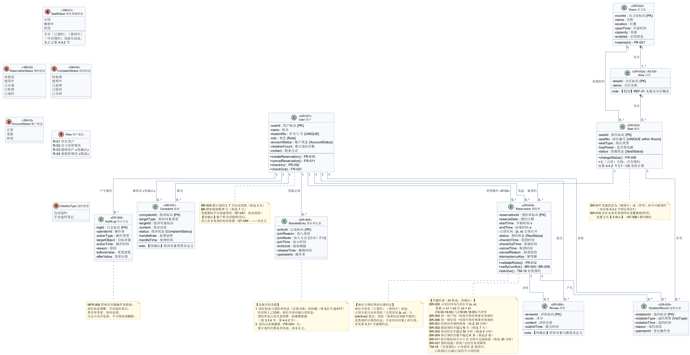

> **读图提示**：本 PNG 只是源文件的渲染结果。图面若与上述三张清单或源文件不一致，**以源文件与三张清单为准**，并按第 7.5.4 节登记差异。图中全部实体、属性与枚举取值仍为【AI 候选】，**渲染与更正都不代表内容已确认**。

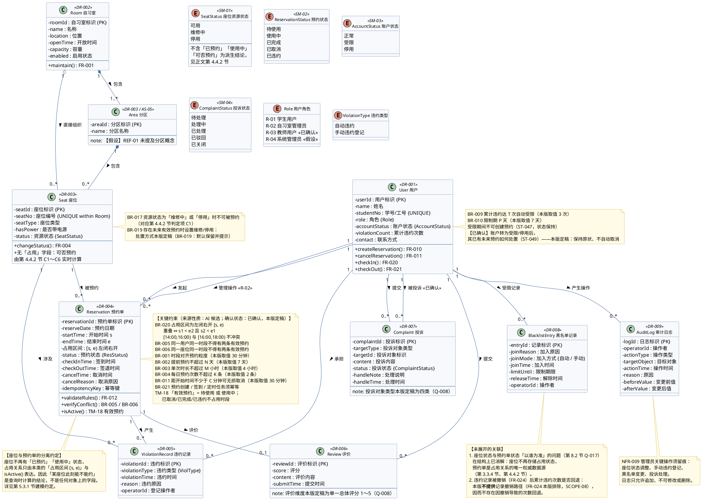

> **模型的阅读要点**：本图的核心是**座位与预约单的分离**——`Seat.status` 只表达行政可用性，`Reservation` 通过 `占用区间 [s, e)` 与 `isActive()` 表达占用。因此"某座位此刻能不能约"是一个**查询时计算的结论**，而不是任何对象上的一个字段。

### 3.3 数据字典

> **本节性质**：本节按课程要求，对每个关键数据对象说明**业务含义、来源、约束、责任人或维护角色、隐私属性及访问规则**。
> **重点表达业务概念，不预设实现**：本节**不规定**数据库字段类型、长度、索引或实现类；下列"关键字段"仅为**业务概念的候选载体**，其名称与类型均为【AI 候选】。
> **来源声明**：REF-01 **未提供任何数据字典**，本节全部内容为【分析推导】或【AI 候选】，**确认状态一律为「已确认」（本版逐条定稿）；凡实现层确实无依据的内容一律写"本版不规定，由实现决定"**。

#### 3.3.1 用户（DR-001）

| 项目 | 内容 |
|---|---|
| **数据对象** | 用户 User |
| **业务含义** | 使用本系统的自然人账户。既是被预约服务的对象，也是违约与黑名单约束的承担主体 |
| **关键字段（本版取值）** | 用户标识、姓名、学号/工号、角色（R-01～R-04）、账户状态（正常/受限/停用）、累计有效违约次数、联系方式 |
| **数据来源** | 【假设】由学校统一身份认证系统同步，或由管理员手工录入（AS-02、IR-002） |
| **主要约束** | 用户标识唯一；学号/工号唯一（本版取值）；角色取值见第 2.1 节；账户状态枚举见 SM-03；累计违约次数须与该用户**有效**违约记录数量一致 |
| **责任人或维护角色** | 数据来源责任方：【假设】学校统一身份认证系统。**业务维护角色：无**——管理员仅可**查询**，**不可编辑身份信息**（BR-018 本版裁定）。账户状态变更统一走 FR-044 的黑名单/停用流程 |
| **隐私属性** | **含个人信息**：姓名、学号/工号为可识别到个人的信息（LC-01）；违约记录与账户状态为**敏感业务信息** |
| **访问规则** | 本人（R-01）可查看本人资料；管理员（R-02）可查询全部用户的资料与账户状态，**但不得编辑身份信息**；学生**不得**查看他人任何资料（BR-018、ST-048）。日志与导出中的敏感字段须脱敏（NFR-006）。学生**可修改本人联系方式**——这是其唯一可自行修改的字段，保存后立即生效、无需审核（Q-031 本版裁定） |
| **生命周期** | 长期保留；账户停用**不删除**用户记录与历史数据，保留期限见 BR-012（LC-03） |
| **关联需求** | FR-040、FR-044、NFR-006、IR-001、IR-002 |
| **来源性质 / 确认状态** | 分析推导 + AI 候选 / **已确认** |

#### 3.3.2 自习室（DR-002）

| 项目 | 内容 |
|---|---|
| **数据对象** | 自习室 Room |
| **业务含义** | 提供座位供学生使用的场所，是座位资源的顶层组织单位（TM-01） |
| **关键字段（本版取值）** | 自习室标识、名称、位置、开放时间、容量、启用状态 |
| **数据来源** | 管理员（R-02）录入 |
| **主要约束** | 自习室标识唯一；启用状态为"停用"时其下座位不可被预约（判定项 C2） |
| **责任人或维护角色** | **维护角色：R-02 自习室管理员**（在其被授权的范围内；本版按管理员不分级建模，见第 4.1.2 节） |
| **隐私属性** | **不含个人信息**（属资源基础数据） |
| **访问规则** | 全部已登录用户可读（R-01 用于选择自习室）；仅 R-02 可写（BR-018、ST-048）。自习室停用时其下座位一律不可预约（判定项 C2）；既有有效预约按 BR-019 处置：**默认保留并持续提示**，仅管理员明确选择时才批量取消 |
| **生命周期** | 长期保留；**本版不提供物理删除**，退场一律以"停用"状态表达（FR-002、FR-004 本版裁定） |
| **关联需求** | FR-001、FR-003、FR-013 |
| **来源性质 / 确认状态** | 分析推导 + AI 候选 / **已确认** |

#### 3.3.3 分区（DR-002a）与座位（DR-003）

| 项目 | 内容 |
|---|---|
| **数据对象** | 分区 Area（DR-002a，来自假设 AS-05）／座位 Seat（DR-003） |
| **业务含义** | **分区**：自习室内部的区域划分（如 A 区、B 区），用于组织座位（TM-02）。**座位**：最小可预约的资源单位（TM-03）——**只有座位能被预约** |
| **关键字段（本版取值）** | 分区：分区标识、分区名称。座位：座位标识、所属自习室、所属分区、座位编号、座位类型、是否带电源、**资源状态（可用/维修中/停用）** |
| **数据来源** | 管理员（R-02）录入 |
| **主要约束** | 座位编号在**同一自习室内**唯一；**资源状态枚举只含"可用/维修中/停用"**，**不含"已预约""使用中"**；**"该座位此刻能否预约"不作为字段存储**，由第 4.4.2 节实时计算 |
| **责任人或维护角色** | **维护角色：R-02 自习室管理员**（授权范围内） |
| **隐私属性** | **不含个人信息** |
| **访问规则** | 资源状态与"该时段的预约占用标记"对所有已登录用户可读（FR-003），**但不含任何他人个人信息**；资源状态的写操作仅限 R-02（BR-018、ST-007）。**本版不提供座位物理删除**，退场以"停用"表达（FR-002 本版裁定，Q-032） |
| **生命周期** | 长期保留；**本版不提供物理删除**（FR-002 本版裁定） |
| **关联需求** | FR-002、FR-003、FR-004、FR-016 |
| **来源性质 / 确认状态** | 分析推导 + AI 候选 / **已确认**（分区维度来自【假设】，REF-01 未提及） |

#### 3.3.4 预约单（DR-004）

| 项目 | 内容 |
|---|---|
| **数据对象** | 预约单 Reservation |
| **业务含义** | 一次座位预约请求及其生命周期的记录。**是"某座位在某时段被占用"这唯一事实的记录载体**（TM-05、TM-18） |
| **关键字段（本版取值）** | 预约单标识、用户、座位、预约日期、开始时间 `s`、结束时间 `e`、状态（待使用/使用中/已完成/已取消/已违约）、签到时间、签退时间、取消时间、取消原因、**幂等键** |
| **数据来源** | 由用户在 FR-010 流程中产生；管理员强制取消与手动违约会**变更其状态**但不新增预约单 |
| **主要约束** | 预约单标识唯一；**占用区间为 `[s, e)`（左闭右开，BR-020）**；同一座位同一时段**不得存在两条有效预约**（BR-006）；同一用户同一时段不得存在两条有效预约（BR-005）；**有效预约 = 状态为"待使用"或"使用中"**，已取消/已完成/已违约**不占用时段**（TM-18）；"同一时段两条有效预约"的库级约束手段**已确认**（Q-025） |
| **责任人或维护角色** | **无人工维护角色**：记录由系统按用户操作生成；管理员仅可强制取消（FR-011）、手动违约登记（FR-023），两者均须填原因并留痕 |
| **隐私属性** | **含个人信息（关联性）**：预约单与用户相关联，可推断"某人在某时在某座位"；对他人展示时必须**去标识化**——只显示"该座位该时段已被预约"，**不得**泄露预约人身份（NFR-006） |
| **访问规则** | 本人（R-01）可查看本人预约单；R-02 可查看全部（限其授权范围，本版按管理员不分级建模（第 4.1.2 节））；**学生不得查询他人预约单**（FR-030、FR-031、BR-018）。看板统计只能使用聚合结果（FR-050～FR-052） |
| **生命周期** | 保留期限按 BR-012 本版取值 1 年 |
| **关联需求** | FR-010～FR-016、FR-020～FR-023、FR-030、FR-031 |
| **来源性质 / 确认状态** | 分析推导 + AI 候选 / **已确认** |

#### 3.3.5 违约记录（DR-005）

| 项目 | 内容 |
|---|---|
| **数据对象** | 违约记录 ViolationRecord |
| **业务含义** | 记录一次违约行为的业务数据，是"账户受限"判定的**唯一依据**（TM-11） |
| **关键字段（本版取值）** | 违约标识、用户、预约单、违约类型（自动违约 / 手动违约登记）、违约时间、违约原因、登记操作者 |
| **数据来源** | **自动违约**：由系统定时任务生成（FR-022）；**手动违约登记**：由管理员生成（FR-023），须填原因 |
| **主要约束** | 自动违约与预约单**一对一**；手动登记可能一对多（已确认）；与预约单的关联必须存在（参照完整性）；**去重键**："预约单标识 + 违约类型"（ST-034 幂等要求）；记录**不可被用户修改或删除** |
| **责任人或维护角色** | 自动记录无人工维护者；手动记录由**操作管理员（R-02）负责**，须留操作者与原因（NFR-009） |
| **隐私属性** | **含个人信息**：违约记录直接关联学生个人，属**敏感信息**（LC-01）；**违约记录对用户可见范围与管理人员可见范围未提供**（LC-02） |
| **访问规则** | 本人（R-01）可查看本人违约记录；R-02 可查看全部（FR-032、BR-018）；**学生不得查询他人违约记录**（ST-048 类）。**本版不提供记录撤销路径**（FR-024 本版排除，SCOPE-08），故不存在因撤销导致的累计次数回退 |
| **生命周期** | 保留期限按 BR-012 本版取值 1 年 |
| **关联需求** | FR-022、FR-023、FR-032、FR-044、NFR-009 |
| **来源性质 / 确认状态** | 分析推导 + AI 候选 / **已确认** |

#### 3.3.6 评价（DR-006）

| 项目 | 内容 |
|---|---|
| **数据对象** | 评价 Review |
| **业务含义** | 用户对已完成预约的使用体验反馈（TM-16）。与"投诉"区分：评价是体验打分，投诉是问题反馈 |
| **关键字段（本版取值）** | 评价标识、用户、预约单、评分、评价内容、提交时间 |
| **数据来源** | 用户（R-01）提交 |
| **主要约束** | 同一预约单**仅允许一条**评价（BR-013）；仅本人状态为"已完成"的预约单可评价；**评价维度本版定稿为单一总体评分 1～5**（Q-008），不作分项打分 |
| **责任人或维护角色** | 提交者：R-01；**处理角色：R-02**（可查看与处理，如删除违规内容） |
| **隐私属性** | **含个人信息（可选）**：评价可能包含文本内容，存在泄露他人信息的可能；按 NFR-006 的敏感字段口径处理 |
| **访问规则** | **本版取值**：评价内容**仅本人与管理员可见**，不对外展示（提交者 R-01、处理者 R-02，Q-008 本版裁定） |
| **生命周期** | 随关联预约单保留；**本版不单独规定评价的保留期限** |
| **关联需求** | FR-041、BR-013 |
| **来源性质 / 确认状态** | AI 候选 / **已确认**（本版口径见 FR-041） |

#### 3.3.7 投诉（DR-007）

| 项目 | 内容 |
|---|---|
| **数据对象** | 投诉 Complaint |
| **业务含义** | 用户提交的问题反馈记录，含投诉对象、内容、状态与处理结果（TM-15） |
| **关键字段（本版取值）** | 投诉标识、提交用户、投诉对象类型与标识、内容、状态（待处理/处理中/已处理/已驳回/已关闭）、处理人、处理说明、处理时间 |
| **数据来源** | 用户（R-01）提交；管理员（R-02）更新状态与处理结果 |
| **主要约束** | 投诉对象与内容为**必填**（否则不创建记录，ST-064）；状态枚举见 SM-04；**投诉对象类型本版定稿为四类**（座位 / 自习室 / 预约单 / 被投诉用户，Q-008）；处理时限 **3 个工作日**（BR-014 本版取值） |
| **责任人或维护角色** | 提交者：R-01；**处理角色：R-02**（本版裁定 Q-021、D-07：**管理员不分级、不按自习室分工**，任一管理员均可处理） |
| **隐私属性** | **含个人信息**：投诉内容可能涉及被投诉用户或提交者身份；**被投诉人身份的展示范围属处理流程的展示细节，本版不规定**（统一按 NFR-006 的敏感字段口径处理） |
| **访问规则** | 提交者仅可查看**本人**提交的投诉；R-02 可查看全部投诉（FR-043、BR-018）；**U-001 的投诉不得对 U-002 展示**（已写入 FR-043 验收标准） |
| **生命周期** | 长期保留；**关闭时限属实现层，本版不规定**（BR-014 只规定 3 个工作日内给出处理结果） |
| **关联需求** | FR-042、FR-043、BR-014 |
| **来源性质 / 确认状态** | 分析推导 + AI 候选 / **已确认** |

#### 3.3.8 黑名单记录（DR-008）

| 项目 | 内容 |
|---|---|
| **数据对象** | 黑名单记录 BlacklistEntry |
| **业务含义** | 对用户账户的限制状态记录；处于限制期的用户**无法创建预约**（TM-12）。与"停用"区分：受限可能是临时的且可自动解除，停用须管理员恢复 |
| **关键字段（本版取值）** | 记录标识、用户、加入原因、加入方式（自动/手动）、加入时间、限制期限、解除时间、操作者 |
| **数据来源** | **自动**：累计有效违约达阈值时由系统生成（FR-022 / ST-040）；**手动**：由管理员加入（ST-041） |
| **主要约束** | 一个用户可有**多条历史记录**，任一记录处于生效中即账户受限；**若存在管理员手动设置的限制，系统不得自动解除**（ST-042）；解除须填原因（ST-043） |
| **责任人或维护角色** | 自动记录无人工维护者；手动记录由**操作管理员（R-02）负责**。**本版裁定（Q-021、D-07）：管理员不分级**，任一管理员均可管理；不存在"总管理员"这一独立角色 |
| **隐私属性** | **含个人信息且敏感**：直接标识"某学生被限制预约"；违约记录对管理人员可见范围未提供（LC-02） |
| **访问规则** | 本人可获知本人受限状态与预计解除时间（ST-047 提示）；管理员可查看与管理；**学生不得调用黑名单管理操作**（ST-048）。**仅管理员（R-02）可查询审计日志**；保留期限按 BR-012 本版取值（审计日志 1 年）。**日志不可由任何角色导出**（FR-033 本版排除） |
| **生命周期** | 保留期限按 BR-012 本版取值 1 年；限制期按 BR-010 本版取值 7 天 |
| **关联需求** | FR-044、BR-009、BR-010、BR-012 |
| **来源性质 / 确认状态** | 分析推导 + AI 候选 / **已确认** |

#### 3.3.9 审计日志（DR-009）

| 项目 | 内容 |
|---|---|
| **数据对象** | 审计日志 AuditLog |
| **业务含义** | 记录管理员**关键操作**的留痕数据，用于事后追溯与责任认定（NFR-009） |
| **关键字段（本版取值）** | 日志标识、操作者、操作类型、目标对象、操作时间、原因、变更前后的值 |
| **数据来源** | 由系统在以下操作发生时**自动追加**：座位资源状态调整、手动违约登记、黑名单变更、投诉处理；越权尝试亦须写入（ST-007、ST-048、ST-065） |
| **主要约束** | **只允许追加，不允许修改或删除**（不可篡改要求） |
| **责任人或维护角色** | 无人工维护者（系统写入）；**查询权限按第 4.1.1 节矩阵本版定稿**——仅管理员（R-02）可查询 |
| **隐私属性** | **含个人信息**：日志包含操作者身份与目标用户标识 |
| **访问规则** | **仅管理员（R-02）可查询**；**不提供导出**（FR-033 本版排除，SCOPE-09）；查询行为写入审计日志（NFR-009） |
| **生命周期** | 保留期限 **1 年**（BR-012 本版取值） |
| **关联需求** | NFR-009、BR-012 |
| **来源性质 / 确认状态** | 分析推导 / **已确认** |

#### 3.3.10 数据完整性要求（本版取值）

- 预约单引用的**用户与座位必须存在**（参照完整性）。
- **同一座位不得存在两条时间段重叠的"有效"预约单**（BR-006、TM-18）。该约束**必须在持久层强制**（数据库层或事务层），仅靠应用层"先查后写"不足以保证；**具体机制属实现层，本版不规定**（FR-014、Q-023、Q-025 本版口径）。
- **座位资源状态与预约占用之间不存在需要保持一致的冗余字段**：座位不存储占用状态，预约单是占用关系的**唯一权威数据源**；两者的关联由第 4.4.3 节跨对象联动表（LK-01～LK-08）描述。因此"以哪一方为准"这类一致性问题**在结构上不存在**。
- 用户**累计有效违约次数**应与其**有效**违约记录数量一致；该一致性为**结构约束**；**违约记录的撤销功能本版不实现**（FR-024 排除，SCOPE-08），因此不存在"撤销后回退累计次数"的场景。
- **本版已定稿的三项**（原为未定义项，现给出结论，不得再作为遗留问题引用）：①预约与违约记录保留期限 = **1 年**，审计日志 = **1 年**（BR-012 本版取值）；②座位**不提供物理删除**，退场以"停用"表达（FR-002 本版裁定）；③看板统计口径 = 柱状图按自习室展示各座位已使用时段数、折线图按自然日展示有效预约数与违约数、概览 5 项数值（FR-050～FR-052 本版口径）。
- **本节仍未规定的内容**：数据库表结构、字段类型与长度、索引与分区、约束的具体实现机制——属**实现层**，本版**不规定**。

### 3.4 外部接口与数据来源

> **本节性质**：当前处于需求阶段。以下接口在**逻辑层**描述，**不预设具体 URL、请求体或技术实现**。**本版未对任何接口做过连通性验证或契约测试**；下表"验证状态"一律为**未开展**（第 7 章逐条记录）。
> **本节对"无依据项"的统一处理**：凡 REF-01 与现有图模型均未给出的内容（报文格式、超时秒数、重试次数、错误码表、认证协议），一律写"**本版不规定**"，**不作为需求写入验收**，避免以占位值冒充业务结论。

**（1）接口清单**

| 接口编号 | 接口名称 | 调用方 → 提供方 | 接口用途 | 输入 | 输出 | 数据格式 | 认证与权限 | 异常响应 | 超时 / 重试 / 幂等 | 关联需求 | 确认状态 |
|---|---|---|---|---|---|---|---|---|---|---|---|
| IR-001 | 身份认证接口 | 本系统 → 学校统一身份认证系统（**假设**） | 用户登录与身份校验 | 用户标识、口令（**本版取值**，见 2.5.6 UC-00） | 身份标识、角色 | **本版不规定**（报文格式属实现层） | 由提供方校验凭证；本系统不重复校验口令 | 认证失败返回错误码，用户保持未登录；**提示文案不区分"用户不存在"与"口令错误"**（防用户枚举） | 本版不规定超时与重试值；登录为**用户发起**，失败由用户重试 | FR-040、2.5.6 UC-00 | 已确认 |
| IR-002 | 用户信息同步接口 | 本系统 → 学校统一身份认证系统（**假设**） | 同步学生基础信息 | 用户标识 | 姓名、学号、所属院系 | **本版不规定** | 由提供方授权；本系统仅**读入**，**不回写** | 同步失败时**保留本地已有数据**并记录日志；**不得因同步失败而清空既有用户信息** | 本版不规定调度与重试值；同步须**幂等**（同一用户重复同步结果一致） | DR-001、FR-040 | 已确认 |
| IR-003 | 消息通知接口 | 本系统 → 消息通知通道（**假设**） | 发送预约、违约、投诉反馈通知 | 接收人、类型、关联对象编号 | 发送结果 | — | — | — | — | **本版不实现**：SCOPE-07 已将通知收敛为"仅站内提示"，站外通道（短信 / 邮件 / 微信）全部排除，本接口**不在本版实现与验收范围内** | 已确认（**本版裁定：不实现**） |
| IR-004 | 看板数据接口 | 前端看板 → 本系统后端 | 每 10 秒获取统计数据 | 自习室、统计周期（起止自然日） | 柱状图数据、折线图数据、5 项概览数值 | **JSON**（本版采用） | **仅 R-02 自习室管理员可调用**，且限其授权范围内的自习室（BR-018） | 查询失败时**保留上一次数据并提示**，**不得以 0 值代替故障** | 本版不规定超时与重试值；**查询为只读，天然幂等**；刷新间隔 = **10 秒**（BR-016，【原始资料】） | FR-050～FR-053、NFR-001 | 已确认 |

**（2）接口的字段与错误约定（本版口径，来源性质：分析推导）**

凡本版给出的约定均**只约束"必须表达什么"**，不约束"如何表达"：

| 约定编号 | 约定内容 | 适用范围 | 依据 |
|---|---|---|---|
| IC-01 | 接口传递**用户标识**时一律使用系统内唯一的用户标识，**不使用姓名、学号作为标识**（姓名可重复，学号可变更） | IR-001、IR-002、IR-004 | DR-001、NFR-006 |
| IC-02 | 涉及**时间区间**的参数与返回值一律为**左闭右开** `[s, e)`，且以**服务器本地时间**（TB-12）为准，不做客户端时区换算 | IR-004、全部查询类调用 | BR-020、TB-12 |
| IC-03 | 涉及**统计数值**的返回必须同时可追溯到其口径：柱状图 = 各座位已使用时段数；折线图 = 按自然日的有效预约数与违约数；概览 = 座位总数 / 当前时段使用中预约单数 / 今日预约数 / 今日违约数 / 受限账户数 | IR-004 | FR-050～FR-052 |
| IC-04 | 错误响应必须**可区分以下四类**，且不得在错误信息中泄露他人数据：①**无权限**（角色不符或超出资源范围）；②**前置条件不满足**（如账户受限、座位维修中）；③**规则不通过**（须指出未通过的具体规则编号及其参数值，ST-028）；④**冲突**（时段已被占用，ST-035） | 全部接口 | BR-018、ST-028、ST-035、NFR-006 |
| IC-05 | **写操作**（创建预约、状态变更、违约登记等）须支持**幂等键**，重复提交返回同一结果、不产生第二条记录 | 全部写接口 | BR-021 |
| IC-06 | 未登录（无有效会话）时，接口一律拒绝，**不返回任何业务数据** | 全部接口 | 2.5.6 UC-00 |

> **本版不规定的接口内容（明示，不得据本节推定）**：协议与传输方式、报文结构与字段名、超时与重试的具体数值、错误码的具体取值与编码、限流与熔断策略、认证令牌的格式与有效期。这些属**实现层**，本版**不作需求、不作验收项**。

> **接口风险提示（保留并更新）**：IR-001 与 IR-002 依赖"学校统一身份认证系统"，该依赖属于【假设】，REF-01 未提及。本版对登录的**凭证形式取了本版值（用户标识 + 口令）**，但仍**未规定**该外部系统的协议与错误码。若实际不接入外部认证而采用本地账号体系，则 IR-001、IR-002 的"提供方"与"认证与权限"两列需整体重写，**其余约定（IC-01～IC-06）不受影响**。

> **接口来源汇总**：IR-001、IR-002 所依赖的外部系统均为【假设】；**IR-003 本版不实现**（SCOPE-07）；**IR-004 是本系统内部的接口**，其 10 秒轮询约束直接来源于 REF-01。

---
## 第 4 章 规则与权限

> **本章对应课程要求**：给出允许、禁止及计算规则，角色及对象范围限制。本章含规则表（4.2，含必要的决策表）、权限矩阵（4.1，同时考虑角色与对象范围）、时间边界的决策表（4.3）与可预约性计算规则（4.4）。
> **总体声明**：REF-01 给出的是功能清单，**未附任何业务参数**。除 BR-016 外，本章所有规则的**数值与判定条件均为【AI 候选】或【分析推导】**。本版（V2.0 定稿）已对本章全部规则、权限边界与时间边界的取值**逐项定稿**：确认状态一律为「已确认」，取值见第 4.2 节的"规则内容"与第 4.3 节判定表。**来源性质与确认状态是两件事**——规则的来源仍是【AI 候选】或【分析推导】，本版确认的是"采用该取值"，不改变其来源。

### 4.1 角色权限矩阵

> **本节同时回答两个问题**：4.1.1 回答"**谁能做什么操作**"；4.1.2 回答"**能对哪些对象/资源做**"。
> **本矩阵为【分析推导】结果，本版已逐格定稿。** 权限规则的具体编号见 BR-018。**看表说明**：R-03 教师、R-04 系统管理员在本版中**未被授予任何操作级权限**（表中记"—（本版：无操作级权限）"，唯 R-04 拥有全局参数配置），该处理依据 §1.6 SCOPE-04（代他人预约排除）、UCD-02（"查看数据看板"仅出现在管理员端）与第 8.2 节 Q-021 / Q-031 的本版口径。

#### 4.1.1 操作级权限矩阵

| 操作 | R-01 学生用户 | R-02 自习室管理员 | R-03 教师 / R-04 系统管理员 | 确认状态 |
|---|---|---|---|---|
| 创建预约 | ✔（仅本人） | ✘（不代学生创建预约） | —（本版：无操作级权限） | 已确认 |
| 取消预约 | ✔（仅本人预约） | ✔（强制取消，须填原因） | —（本版：无操作级权限） | 已确认 |
| 签到 / 签退 | ✔（仅本人预约） | ✘ | —（本版：无操作级权限） | 已确认 |
| 查看座位实时状态 | ✔ | ✔ | —（本版：无操作级权限） | 已确认 |
| 查看本人预约与违规记录 | ✔ | — | —（本版：无操作级权限） | 已确认 |
| 查看全部用户预约与违规记录 | ✘ | ✔ | —（本版：无操作级权限） | 已确认 |
| 维护自习室与座位资源 | ✘ | ✔ | —（本版：无操作级权限） | 已确认 |
| 调整座位资源状态（可用 / 维修中 / 停用） | ✘ | ✔ | —（本版：无操作级权限） | 已确认 |
| 手动违约登记 | ✘ | ✔ | —（本版：无操作级权限） | 已确认 |
| 用户信息管理 | 查看本人资料；仅联系方式可自行修改，身份信息不可改 | ✔（查看与处理，不可编辑身份信息） | —（本版：无操作级权限） | 已确认 |
| 评价管理 | 提交评价（仅本人已完成预约） | ✔（查看与处理） | —（本版：无操作级权限） | 已确认 |
| 投诉提交 | ✔ | ✘ | —（本版：无操作级权限） | 已确认 |
| 投诉处理与反馈 | 查看本人投诉处理结果 | ✔ | —（本版：无操作级权限） | 已确认 |
| 黑名单管理 | ✘ | ✔ | —（本版：无操作级权限） | 已确认 |
| 查看数据看板 | ✘ | ✔ | —（本版：无操作级权限） | 已确认 |
| 参数配置（预约规则、开放时间、黑名单阈值） | ✘ | ✘（本版按不分级建模） | R-04 ✔（全局）；R-03 — | 已确认 |

#### 4.1.2 资源范围维度（对象范围限制）

> **说明**：上表只回答了"谁能做什么操作"，没有回答"能对**哪些资源**做"。若存在多个自习室或跨校区管理，仅凭操作级权限会出现"管理员 A 改动了管理员 B 负责楼层的座位"这类越权。REF-01 未提供资源范围信息，本节为【分析推导】补齐，**本版已逐项定稿**。

| 角色 | 操作 | 本版资源范围 | 越权风险与约束 | 状态 |
|---|---|---|---|---|
| R-01 学生用户 | 创建/取消/签到/签退/评价 | **仅本人**预约单；不可指定他人用户标识 | 不允许代他人预约（SCOPE-04 已排除），归属校验以用户标识为准 | 已确认 |
| R-01 学生用户 | 查询预约与违规记录 | **仅本人**；响应中不得包含他人姓名、学号 | 跨用户查询列入越权验收场景（第 7.3 节 VS-06） | 已确认 |
| R-02 管理员 | 座位管理、状态调整、手动违约登记 | **其被授权的自习室范围内**；本版按**不分级**建模（任一管理员可操作全部座位资源） | 见 CF-02 的本版口径（第 8.2 节 Q-021）；若日后引入分级，须重写本行与 BR-018 | 已确认 |
| R-02 管理员 | 投诉处理 | 全部投诉；本版**不按自习室分工** | 投诉可能牵涉跨区域用户 | 已确认 |
| R-02 管理员 | 黑名单管理 | 本版由**任一管理员**执行（与"不分级"一致） | 解除限制属高影响操作，须写入审计日志（NFR-009） | 已确认 |
| R-02 管理员 | 批量操作（批量关闭场地、批量取消预约） | 仅其被授权范围内；**须二次确认并列出影响范围**（BR-022） | 批量操作影响范围大，须留痕 | 已确认 |
| R-04 系统管理员 | 参数配置（预约规则、开放时间、黑名单阈值） | 全局 | 参数变更影响全部用户，须写入审计日志（NFR-009） | 已确认 |

> **权限越权验收要求**：第 7.3 节 VS-06 须至少覆盖以下越权情形——①学生查询他人预约记录；②学生取消他人预约；③学生调用管理员的座位资源状态调整或手动违约登记；④管理员操作其授权范围外的座位；⑤无相应授权者执行黑名单解除。本版按"管理员不分级"建模，故情形④在**单自习室部署**下不产生差异；多自习室部署时以 BR-018 的资源范围为判定依据。

> **权限矩阵的效力**：本矩阵为本版定稿的权限基线（确认状态见各行），越权验收场景见第 7.3 节 VS-06。

### 4.2 业务规则表

| 规则编号 | 规则名称 | 规则内容 | 适用对象与场景 | 规则来源 | 来源性质 | 确认人员、角色、日期及状态 | 相关需求 | 相关状态转换 | 本版处理口径 |
|---|---|---|---|---|---|---|---|---|---|
| BR-016 | 看板刷新间隔 | 数据分析看板每 10 秒自动刷新一次 | 数据看板页面 | REF-01 · 第 7 项 | **原始资料** | 已确认（编制小组定稿） | FR-050～FR-053、NFR-001 | 无 | 该数值直接采用 REF-01 表述（【原始资料】），本版不另行调整 |
| BR-017 | 不可预约座位 | 座位资源状态为"维修中"或"停用"时，不可被查询为可预约、不可被预约（对应第 4.4.2 节判定项 C1） | 座位资源、预约 | 分析推导（由 SM-01 状态定义推导） | 分析推导 | 已确认（编制小组定稿） | FR-004、FR-013 | ST-001、ST-003、ST-006 | 本版采用，按此规则建模 |
| BR-018 | 权限边界 | 学生用户仅能操作与查询本人数据；管理员在其**被授权的自习室范围内**操作数据，且不可修改用户身份信息与口令。**本版按"管理员不分级"定稿**（CF-02、第 4.1.2 节） | 全部角色 | 分析推导（由 REF-01 的"用户、管理员"划分推导） | 分析推导 | 已确认（编制小组定稿） | FR-001～FR-044 | ST-007、ST-048 | 本版采用"不分级、管理员可操作全部座位资源" |
| BR-019 | 场地临时关闭与冲突预约 | 座位（或自习室）转为"维修中""停用"或临时关闭时，若存在与之冲突的未来有效预约，系统须**识别并列出**冲突预约清单，并按下述**本版定稿口径**处置：**默认保留**冲突预约的状态（保持"待使用"并持续提示，不自动取消）；管理员**明确选择批量取消**时，须先列出影响清单并二次确认（BR-022），取消后通知用户；**不计违约、不补偿**；本版**不支持自动改约** | 座位资源、预约 | **分析推导**（REF-01 未提及） | 分析推导 | 已确认（编制小组定稿） | FR-004、FR-016 | ST-006、ST-033 | 按上述口径实现；改约与补偿能力不在本版范围内 |
| BR-020 | 时间区间开闭 | 预约占用区间统一采用**左闭右开** `[s, e)`；两条预约重叠当且仅当 `s₁ < e₂ 且 s₂ < e₁` | 预约、冲突校验 | **分析推导**（REF-01 未定义） | 分析推导 | 已确认（编制小组定稿） | FR-010、FR-012、FR-013 | ST-021、ST-028、ST-035 | 本版采用该约定；BR-006 的冲突校验以此为准 |
| BR-021 | 预约请求幂等 | 同一用户对同一"座位 + 时段"的重复提交（携带同一幂等键）须返回同一张预约单，不得产生第二条；定时任务的重复执行须幂等 | 预约、签到 | **分析推导**（REF-01 未提及） | 分析推导 | 已确认（编制小组定稿） | FR-014、FR-015、FR-022 | ST-030、ST-034、ST-035 | 本版采用该**幂等结果**；**幂等键的生成方式属实现层，本版不规定**（第 8.2 节 Q-024） |
| BR-022 | 批量操作保护 | 影响面超过一条记录的批量操作（如批量关闭场地、批量取消预约）须**先列出影响清单、二次确认**，并由具备相应授权者执行，全部写入审计日志 | 座位资源、预约、审计 | **分析推导**（由 NFR-009 审计要求推导） | 分析推导 | 已确认（编制小组定稿） | FR-016、FR-044 | ST-006、ST-033 | 本版采用；授权层级见第 8.2 节 Q-021 |
| BR-001 | 预约时间粒度 | 预约时段以固定粒度为最小单位（本版取值：30 分钟），开始与结束时间须对齐粒度 | 预约创建 | **AI 候选** | AI 候选 | 已确认（编制小组定稿） | FR-010、FR-013 | ST-028 | 候选值 30 分钟，本版采用该值 |
| BR-002 | 提前预约上限 | 最多可提前预约未来 N 天（本版取值：7 天） | 预约创建 | **AI 候选** | AI 候选 | 已确认（编制小组定稿） | FR-010、FR-012 | ST-028 | 候选值 7 天，本版采用 |
| BR-003 | 单次预约时长上限 | 单次预约时长不超过 M 小时（本版取值：4 小时） | 预约创建 | **AI 候选** | AI 候选 | 已确认（编制小组定稿） | FR-010、FR-012 | ST-028 | 候选值 4 小时，本版采用 |
| BR-004 | 每日预约次数上限 | 每位用户每日最多创建 K 条有效预约（本版取值：2 条） | 预约创建 | **AI 候选** | AI 候选 | 已确认（编制小组定稿） | FR-010、FR-012 | ST-028 | 候选值 2 条，本版采用 |
| BR-005 | 用户时段不重叠 | 同一用户在同一时段不得存在两条有效预约 | 预约创建 | 分析推导 | 分析推导 | 已确认（编制小组定稿） | FR-012 | ST-028 | 本版采用 |
| BR-006 | 座位时段独占 | 同一座位在同一时段不得存在两条有效预约 | 预约创建 | 分析推导 | 分析推导 | 已确认（编制小组定稿） | FR-012、FR-013 | ST-006、ST-028 | 本版采用 |
| BR-007 | 签到窗口 | 签到须在预约开始前 X 分钟至开始后 Y 分钟内完成（本版取值：前 15 分钟至后 15 分钟）；**签到方式本版取"用户端签到"**（在系统中选择本人"待使用"预约单或输入座位编号完成签到，不引入扫码／门禁等硬件联动，见 SCOPE-10） | 签到、签退 | **AI 候选** | AI 候选 | 已确认（编制小组定稿） | FR-020、FR-021、FR-022 | ST-020、ST-027、ST-023 | 本版取值：窗口 前 15 分钟至后 15 分钟；签到方式见本行"规则内容" |
| BR-008 | 违约判定条件 | 超过签到截止时间仍未签到的"待使用"预约单判定为违约 | 自动违约 | **AI 候选** | AI 候选 | 已确认（编制小组定稿） | FR-022 | ST-023、ST-034 | 本版采用 |
| BR-009 | 黑名单触发阈值 | 累计有效违约次数达到 T 次时账户自动受限（本版取值：3 次） | 用户账户 | **AI 候选** | AI 候选 | 已确认（编制小组定稿） | FR-022、FR-044 | ST-040 | 候选值 3 次，本版采用 |
| BR-010 | 黑名单限制期限 | 因累计违约触发的限制持续 P 天（本版取值：7 天），期满自动解除 | 用户账户 | **AI 候选** | AI 候选 | 已确认（编制小组定稿） | FR-044 | ST-042 | 候选值 7 天，本版采用 |
| BR-011 | 取消预约时限 | 距预约开始时间不少于 C 分钟时可无损取消（本版取值：30 分钟）；超过时限后**不允许用户自行取消**（提交即被拒绝，预约单状态保持，ST-029），该情形**不计违约**；管理员仍可按 BR-015 的边界强制取消 | 取消预约 | **AI 候选** | AI 候选 | 已确认（编制小组定稿） | FR-011 | ST-021、ST-029 | 候选值 30 分钟，本版采用 |
| BR-012 | 记录保留期限 | 预约记录、违约记录、审计日志的保留期限**统一为 1 年**（本版取值） | 数据生命周期 | **AI 候选** | AI 候选 | 已确认（编制小组定稿） | FR-022、FR-030、FR-032、NFR-009 | 无 | 本版取值：**1 年**（预约记录、违约记录、审计日志三者一致）；合规要求见 CON-05 |
| BR-013 | 评价资格 | 仅本人状态为"已完成"的预约单可提交一次评价 | 评价 | **AI 候选** | AI 候选 | 已确认（编制小组定稿） | FR-041 | 无 | 本版采用该资格判定（一单一评）；评价对象与维度见 FR-041 本版口径（Q-008 本版裁定） |
| BR-014 | 投诉处理时限 | 投诉自提交起 D 个工作日内应给出处理结果（本版取值：3 个工作日） | 投诉 | **AI 候选** | AI 候选 | 已确认（编制小组定稿） | FR-042、FR-043 | ST-060～ST-063 | 本版取值：3 个工作日；超时以站内提示实现，不设自动升级（通知能力见 FR-060） |
| BR-015 | 手动违约登记必填原因 | 管理员手动违约登记必须填写原因，系统记录操作者与时间 | 手动违约登记 | 分析推导（由 NFR-009 审计要求推导） | 分析推导 | 已确认（编制小组定稿） | FR-023 | ST-026、ST-032 | 本版采用 |

#### 4.2.1 本版定稿的规则取值汇总

| 规则编号 | 本版取值 | 影响范围 | 实现与验收要点 |
|---|---|---|---|
| BR-001 | 30 分钟 | 全部预约流程、时段冲突判定 | 时段模型以此为准；数据表与界面按此粒度 |
| BR-002 | 7 天 | 预约创建校验 | 校验参数 = 7 天 |
| BR-003 | 4 小时 | 预约创建校验 | 校验参数 = 4 小时 |
| BR-004 | 2 条/日 | 预约创建校验 | 校验参数 = 2 条/日 |
| BR-007 | 前 15 分钟至后 15 分钟 | 签到、自动违约 | 违约判定时点 = `s + 15 分钟`（TB-10） |
| BR-009 | 3 次 | 账户受限、黑名单 | 阈值 = 3 次有效违约 |
| BR-010 | 7 天 | 账户受限 | 限制期 = 7 天，期满自动解除（ST-042） |
| BR-011 | 30 分钟 | 取消预约 | `< s − 30 分钟` 可无损取消；否则拒绝（TB-09） |
| BR-020 | 左闭右开 `[s, e)` | 预约冲突判定、可预约性查询、数据表设计 | 相邻时段（`14:00–16:00` 与 `16:00–18:00`）不冲突（TB-01） |
| BR-019 | 默认**保留**冲突预约并提示；管理员明确选择时按 BR-022 批量取消（不计违约、不补偿、不支持改约） | 座位状态调整、场地临时关闭、已排定预约 | FR-016 的验收标准见第 2.6 节 |
| BR-021 | 幂等**结果**：重复提交返回同一张预约单；**幂等键的生成方式由实现决定，本版不规定** | 预约创建、签到、定时任务 | 重复提交返回同一张预约单（VS-02、NFR-012） |
| BR-022 | 批量操作须**列出影响清单 + 二次确认 + 写入审计日志**；授权层级按"管理员不分级" | 批量取消、批量关闭 | 越权与影响面控制见第 7.3 节 VS-06 |

### 4.3 时间边界判定表

> **来源性质**：【分析推导】。REF-01 **未定义**任何时间区间的开闭与边界判定方式。本节用于把"边界怎么算"这一隐性约定显式化。
> **确认状态：全部已确认**。本表是 BR-006 冲突校验的实现依据——**编码与测试均以本表判定为准**。

**统一约定：所有时间区间为左闭右开 `[s, e)`**，即包含 `s`，不包含 `e`。

| 编号 | 边界情形 | 本版判定 | 容易出错的直觉写法 | 来源性质 | 状态 |
|---|---|---|---|---|---|
| TB-01 | 已有 `[14:00, 16:00)`，请求 `[16:00, 18:00)` | **不冲突**，允许创建 | 若误用闭区间，会判为在 16:00 重叠而错误拒绝 | 分析推导 | 已确认 |
| TB-02 | 已有 `[14:00, 16:00)`，请求 `[15:00, 17:00)` | 冲突，拒绝 | — | 分析推导 | 已确认 |
| TB-03 | 已有 `[14:00, 16:00)`，请求 `[13:00, 14:00)` | **不冲突**，允许创建 | — | 分析推导 | 已确认 |
| TB-04 | 已有 `[14:00, 15:00)` 与 `[15:00, 16:00)` 两张，请求 `[14:00, 16:00)` | 与两单分别重叠，冲突，拒绝 | — | 分析推导 | 已确认 |
| TB-05 | 已取消的 `[14:00, 16:00)` 预约单 | **不占用**该时段（TM-18），新请求可创建 | 若把"已取消"也算占用，会永久锁死时段 | 分析推导 | 已确认 |
| TB-06 | 已违约的 `[14:00, 16:00)` 预约单 | **不占用**该时段（TM-18） | 同上 | 分析推导 | 已确认 |
| TB-07 | "使用中"的预约单，其结束时间 `e` 已过但系统尚未执行 ST-025 | **仍占用**（仍为"使用中"，属有效预约） | — | 分析推导 | 已确认 |
| TB-08 | 签到窗口边界：预约 `s = 14:00`，本版取值 X=15、Y=15 | 窗口为 `[13:45, 14:15)`；13:45 整**可签到**，14:15 整**不可签到** | — | AI 候选（BR-007 取值） | 已确认 |
| TB-09 | 取消时限边界：`s = 14:00`，本版取值 C=30 | 提交时刻 `< 13:30` 可无损取消；`≥ 13:30` 拒绝（ST-029） | — | AI 候选（BR-011 取值） | 已确认 |
| TB-10 | 自动违约触发点：`s = 14:00`，本版取值 Y=15 | 当前时间 `≥ 14:15` 触发 ST-023 | — | AI 候选（BR-007 取值） | 已确认 |
| TB-11 | 跨日预约（如 `23:00–01:00` 次日） | **不允许**：预约的开始与结束时间必须落在同一自然日内，跨日请求按未通过处理 | 若允许跨日，日期归属会产生歧义 | **分析推导** | 已确认 |
| TB-12 | 夏令时、时区 | 统一按**服务器本地时间（UTC+8）**判定，不处理夏令时（NFR-010） | 若按客户端时间判定，改系统时间即可绕过签到窗口 | **分析推导** | 已确认 |
| TB-13 | 预约粒度对齐（BR-001 本版取值 30 分钟）：`14:10` 提交 | **直接拒绝**未对齐的请求，提示用户改为 `14:00` 或 `14:30` 后重新提交（ST-028） | 若自动取整，用户看到的时段会与提交值不一致 | **分析推导** | 已确认 |

> **本表与哪些需求相关**：FR-010、FR-012、FR-013（创建与校验）、FR-020、FR-022（签到与违约）、FR-011（取消时限）、BR-001、BR-006、BR-007、BR-011、BR-020。
> **本表的效力**：以上判定为本版定义的设计口径，实现与验收均以此为准；验证工作的开展情况见第 7.6 节。

### 4.4 可预约性判定与跨对象联动

> **本节是全文档的计算规则核心**：回答"某座位在某具体时段能不能被预约"。该结论**不是**座位的状态字段，而是由"资源状态 + 有效预约记录 + 目标时段"**实时计算**得出（见第 5.3.1 节建模约定）。

#### 4.4.1 时间区间约定（左闭右开）

> **来源性质**：【分析推导】。REF-01 未定义时间区间的开闭。**确认状态：已确认**（本版取值，见第 4.3 节）。

| 项目 | 约定 | 说明 |
|---|---|---|
| 预约占用区间 | `[startTime, endTime)` —— 含开始时刻，**不含**结束时刻 | 预约 14:00–16:00 表示占用 14:00 至 15:59:59 |
| 重叠判定 | 两条预约重叠 **当且仅当** `s₁ < e₂ 且 s₂ < e₁` | 该式在左闭右开下等价于"存在共同占用时刻" |
| 相邻时段 | `[14:00, 16:00)` 与 `[16:00, 18:00)` **不重叠** | 允许同一座位上连续预约 |
| 签到窗口 | `[s − X 分钟, s + Y 分钟)` | 本版取值 X=15、Y=15（BR-007） |
| 取消时限 | 提交时刻 `< s − C 分钟` 视为无损取消 | 本版取值 C=30（BR-011） |
| 时间粒度 | 全部时间须对齐 30 分钟粒度（本版取值） | BR-001 |

> **为什么必须写死**：若采用闭区间 `[s, e]`，则"14:00–16:00"与"16:00–18:00"在 16:00 这一点重叠，会被判为冲突，用户无法预约紧邻的下一时段。这一约定**必须**在编码前确认，否则将直接影响 BR-006 的冲突校验实现（Q-018）。

#### 4.4.2 座位可预约性判定（派生结论）

> **重要**：本表**不是**座位状态表。可预约性**不作为字段存储在座位记录上**，而是在每次查询与每次预约校验时**实时计算**。

| 判定项 | 条件 | 不满足时的结果 |
|---|---|---|
| C1 资源状态 | 座位资源状态 = "可用" | 不可预约（BR-017） |
| C2 所属自习室 | 所属自习室处于启用状态，且目标时段落在开放时间内 | 不可预约 |
| C3 座位时段占用 | 不存在其他有效预约单，其占用区间与目标区间满足 `s_new < e_old ∧ s_old < e_new` | 不可预约（BR-006） |
| C4 用户时段占用 | 该用户在同一时段不存在其他有效预约单 | 不可预约（BR-005） |
| C5 用户资格 | 账户状态 = "正常" | 不可预约（ST-047） |
| C6 规则约束 | 满足 BR-001（粒度对齐）、BR-002（提前天数）、BR-003（单次时长）、BR-004（每日次数） | 不可预约（ST-028） |

- **"有效预约单"**指状态为 **待使用** 或 **使用中** 的预约单；"已取消""已完成""已违约"的预约单**不占用**时段。
- **不改变座位状态的释放机制**：用户取消或违约后，该时段因 C3 不再命中而**自动**重新可预约，**无需**任何"座位 → 空闲"的写入操作。这正是把占用写入座位记录的做法做不到的。
- **结果必须可解释**：拒绝预约时必须返回**未通过的具体判定项**（C1～C6）及其参数值，而不是笼统提示"不可预约"。

- **与已消解的冲突项（第 8.2 节 Q-017）的关系**：原"座位状态与预约单状态不一致时以谁为准"这一问题在结构上**已消解**——座位不再存储占用状态，唯一权威数据源是预约单记录。残留的一致性问题仅剩"同一时段出现两条有效预约"，由第 5.4.2 节 ST-035 与 BR-006 处理。

#### 4.4.3 跨对象联动表（LK）

| 联动编号 | 触发对象与事件 | 受影响对象 | 联动内容 | 来源性质 | 当前状态 |
|---|---|---|---|---|---|
| LK-01 | 座位资源 → 维修中 / 停用（ST-001/003/005） | 该座位未来的有效预约单 | 应提示冲突；是否自动取消见 ST-006 / ST-033 | 分析推导 | **已确认** |
| LK-02 | 座位资源 → 可用（ST-002/004） | 该座位的可预约性 | 立即重新可预约，无需其他操作 | 分析推导 | 分析推导 |
| LK-03 | 预约单 → 已取消（ST-021/022） | 该时段的可预约性 | 该时段立即重新可预约；**座位资源状态不变** | 分析推导 | 分析推导 |
| LK-04 | 预约单 → 已违约（ST-023/026） | 用户账户的累计有效违约次数 | 有效违约次数 +1，触发 ST-040 的阈值判定 | 分析推导 | 分析推导 |
| LK-05 | 用户账户 → 受限（ST-040/041） | 该账户名下未来的"待使用"预约单 | 已排定预约**保持原状、不自动取消**（ST-049 本版裁定）；受限用户仅不能新建预约（ST-047） | 分析推导 | **已确认** |
| LK-06 | 用户账户 → 停用（ST-044/045） | 该账户名下未来的"待使用"预约单 | 同上 | 分析推导 | **已确认** |
| LK-07 | 自动违约任务 → 重复触发同一预约单（ST-034） | 违约记录、累计违约次数、ST-040 阈值判定 | 必须幂等：不重复生成记录、不重复累加次数、不重复触发受限 | 分析推导 | 分析推导 |
| LK-08 | 座位资源状态与预约记录 → 数据看板统计 | FR-050～FR-052 的统计口径 | **不再使用"座位使用率""空闲座位数"这类无定义指标**；本版口径为：柱状图按座位展示已使用时段数、折线图按自然日展示有效预约数与违约数、概览 5 项数值（FR-050～FR-052，Q-009 本版裁定） | 已确认 | **已确认** |

> **联动表的用途**：当任一对象的状态发生转换时，可依本表检查"还有哪些对象需要同步处理"，用于 A.5 节场景走查与第 7.3 节验收场景设计。**本表未开展任何走查或验证。**

---
## 第 5 章 行为与状态

> **本章对应课程要求**：说明核心业务过程、对象生命周期与异常处置。本章含活动图（5.1）、业务场景（5.2）、建模约定与状态图（5.3）、状态转换说明表（5.4）、状态与事件区分（5.5）、关键业务流程闭环检查（5.6）与**关键流程时序图（5.7）**。
> **本章全部状态、转换编号与判定条件均为【AI 候选】或【分析推导】，确认状态为【已确认】。全部图模型均为设计意图，未走查、未验证。**
> **本章图的三种来源（须区分，见第 0.3 节）**：①**当前活动图 AD-01 / AD-02** 以**泳道版 PNG** 表达（`models/` 内，组内成员提交，**无独立可编辑源文件**），本节同时保留与之等价的 **Mermaid 源码**内嵌于正文（本机未安装 Mermaid 渲染工具，源码未由本说明书导出为图片）；②**状态图 SM-01～SM-04** 与第 1.7 节 SCD-01、GT-01 仍**只有内嵌 Mermaid 源码**，未导出为图片；③**时序图 SQ-01～SQ-04** 在**新增的第 5.7 节**，为**仅 PNG、无源文件**的图。第 2.4 节 UCD-01 / UCD-02 与第 3.2 节 CD-01 见各节"渲染产物"。

### 5.1 核心业务过程（活动图）

#### 5.1.1 活动图 AD-01：预约与取消流程

- **图编号**：AD-01
- **图名称**：预约与取消流程（当前泳道版：**学生用户·R-01 / 系统 / 自习室管理员·R-02**）
- **建模对象**：预约创建与取消的业务流程
- **关联需求**：FR-010、FR-011、FR-012、FR-013、FR-014、FR-015
- **关联规则**：BR-001～BR-004（预约参数，本版取值：粒度 30 分钟、提前 7 天、单次 4 小时、每日 2 条）、BR-011（取消时限，本版取值 30 分钟）、BR-018（权限边界）；**BR-017（维修中/停用座位不可预约）、BR-020（左闭右开，经第 4.4.2 节 C1～C6 引入）为图内引用**；**本版按当前图面补入 BR-021（幂等）与联动项 LK-03（取消后该时段立即重新可预约）、NFR-009（写审计日志）**
- **关联非功能需求**：NFR-009（写审计日志，图内引用）
- **关联状态转换**：ST-021、ST-022、ST-028、ST-035；**ST-029（超时取消被拒）、ST-047（受限账户预约被拒）为图内引用**；图面另在 ST-022 处标注"**须填原因**"（对应 BR-015 同类要求）
- **建模说明**：本图按第 5.3.1 节建模约定绘制——**预约流程不再改变座位资源状态**，"可否预约"改为按第 4.4.2 节实时计算。
- **源文件**：**本图没有独立可编辑源文件**（`models/` 内只有 PNG）；**下方内嵌的 Mermaid 源码是本文档维护的等价源文件**（与 REF-08 所检查的 V0.4 说明书第 4.4 节源码同源）

> **清单核对**：本节清单已与图内节点逐条核对，**凡清单与图内引用不一致者，以图内引用为准**（原 V0.3 版漏列 BR-017、ST-047、ST-029，已按《需求分析质量验证报告》V-13 补齐，见第 7.5.6 节；本版 V1.1 又按当前图面补入 BR-021、LK-03、NFR-009）。

**图 AD-01（当前版本，泳道版 PNG）**：`models/AD-01 预约与取消流程活动图.png`

> **该 PNG 与下方源码的逐节点比对结论（本版核对）**：
> 1. **判定节点、分支走向与编号引用一致**：C5 账户状态 → ST-047；C1/C2 资源状态与开放时间 → BR-017；C6 与 BR-001～BR-004 → ST-028；C3/C4 时段冲突 → ST-028；并发写入 → ST-035（图面在此处标注了"实现手段"，未给出结论；**本版裁定：只规定"至多一条成功"的可观察结果，实现手段由实现决定**，见第 2.5.1 节 UC-01 的 E5）；取消路径 → ST-021（用户）/ ST-022（管理员，须填原因）；超时取消 → ST-029。
> 2. **图面节号写作"10.4.2 节"**——那是 V0.4 说明书的编号，**本文档对应第 4.4.2 节**；这是图的渲染时点留下的编号口径，**以正文编号为准**（Q-035）。
> 3. **"计算可预约性"节点下的小字疑为"C1-C5"**，而正文第 4.4.2 节的判定项为 **C1～C6**；该处小字在 PNG 中清晰度不足，**须放大原图核对**（Q-035）。本版**不据此改动正文**。
> 4. **图面新增的标注**：开始节点标 BR-020；"提交预约请求"标 FR-015·BR-021；"写入审计日志"标 NFR-009·LK-03；"该时段按 C3 重新可预约"标 LK-03。第 1 条已把它们补入本节清单。
> 5. **图面不含** ST-033（场地被转维修/停用后已排定预约的处置）；本版已按 **BR-019** 定稿（默认保留并提示，管理员明确选择时才批量取消），**图面仍不细化该分支**（更新图面须重绘 AD-01，见第 7.5.4 节）。

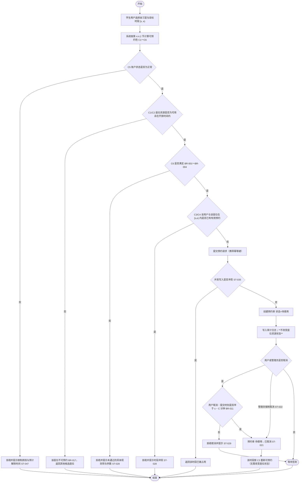

> **幂等说明**：FR-015 要求同一用户对同一"座位 + 时段"的重复提交返回同一结果，不得因网络重试产生第二张预约单。

#### 5.1.2 活动图 AD-02：签到、签退与自动违约流程

- **图编号**：AD-02
- **图名称**：签到、签退与自动违约流程（当前泳道版：**学生用户·R-01 / 系统 / 系统·自动违约支线**）
- **建模对象**：座位使用阶段的状态推进与违约判定
- **关联需求**：FR-016、FR-020、FR-021、FR-022、FR-023
- **关联规则**：BR-007（签到窗口）、BR-008（违约判定）、BR-009（阈值，本版取值 3 次）、BR-019（场地临时关闭，本版定稿口径见第 4.2 节）
- **关联非功能需求**：NFR-010（**以服务器时间为准**，图内引用——图面在"记录签到时间"节点标注）
- **关联状态转换**：ST-020、ST-023、ST-024、ST-025、ST-026、ST-030、ST-031、ST-033、ST-034；**ST-027（签到校验未通过被拒）、ST-040（违约阈值触发账户受限）为图内引用**
- **建模说明**：本图按第 5.3.1 节建模约定绘制——**签到、签退、违约均不再写入座位资源状态**。
- **源文件**：**本图没有独立可编辑源文件**（`models/` 内只有 PNG）；**下方内嵌的 Mermaid 源码是本文档维护的等价源文件**

> **清单核对**：本节清单已与图内节点逐条核对，**凡清单与图内引用不一致者，以图内引用为准**（原 V0.3 版漏列 ST-027、ST-040，已按《需求分析质量验证报告》V-13 补齐，见第 7.5.6 节；本版 V1.1 又按当前图面补入 NFR-010）。

**图 AD-02（当前版本，泳道版 PNG）**：`models/AD-02 签到、签退和自动违约流程活动图.png`

> **该 PNG 与下方源码的逐节点比对结论（本版核对）**：
> 1. **判定节点与编号引用一致**：签到窗口 `[s−X, s+Y)`·BR-007；窗口前提示未开放；非本人或状态不符 → ST-027；已使用中 → ST-030（幂等）；已终态 → ST-031；签到成功 ST-020（图面注明"**座位资源状态不变**"）；签退 ST-024；未主动签退且到达 `e` → ST-025；自动违约 ST-023（超过 `s+Y` 仍未签到）→ 生成违约记录 → 幂等 ST-034 → 阈值 BR-009 → 账户受限 ST-040。
> 2. **图面新增标注**：用户提交签到标 FR-020；"记录签到时间"标 **NFR-010 服务器时间为准**；已计入本节清单。
> 3. **一处画法差异（须由建模人确认）**：图面把"同一预约单是否已被处理过"的**幂等分支与"累计有效违约是否达到阈值"节点连在一起**，而下方源码为"已处理 → 幂等结束（不再判定阈值）"。两种画法在图面上都体现"不重复生成记录、不重复累加"，**业务结果相同、表达不同**；本版**以本节源码与第 5.4 节 ST-034 的文字定义为准**（登记于 Q-036）。
> 4. **图面不含** ST-033（场地被转维修/停用后已排定预约的处置），与第 5.4.2 节的处理一致。

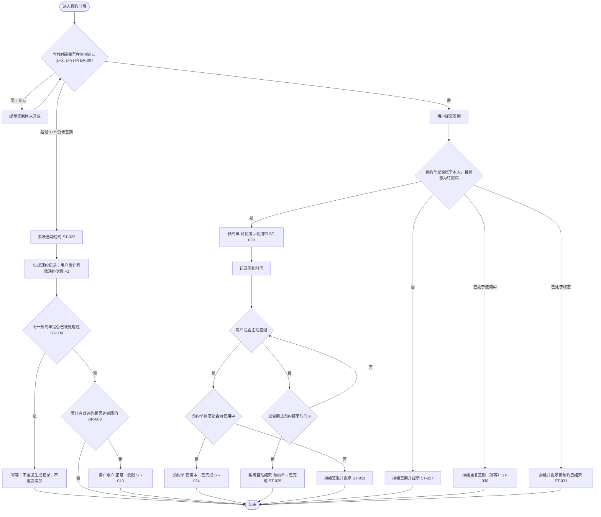

> **未纳入本图的流程**："座位被转为『维修中』或『停用』后，其已排定预约如何处置"（ST-033、FR-016）。**本版已按 BR-019 定稿**：默认**保留**冲突预约并持续提示，仅当管理员明确选择时才批量取消（不计违约、不补偿、不支持改约）。该分支**仍不绘制为确定流程**——图面要细化须重绘 AD-01，本版未重绘（第 7.5.4 节）。

### 5.2 业务场景说明（BS-01～BS-07）

> **编号说明**：本节业务场景使用 **BS-xx** 编号（Business Scenario）。课程报告中的场景走查记录使用 **SC-xx** 编号，两者**不得混用**；BS 与 SC 的对应关系在后续验证阶段建立，**本阶段尚未建立**。
> **全部场景的"走查状态"均为未开展**，各场景表中"主成功流程""数据变化""结果状态"均为**设计意图**。

#### BS-01 正常预约并完成使用

| 项目 | 内容 |
|---|---|
| 场景编号 | BS-01 |
| 场景名称 | 正常预约并完成使用 |
| 场景类型 | 正常主流程 |
| 场景目标 | 学生用户成功预约座位并完成签到与签退 |
| 参与角色 | 学生用户（主）、系统（自动违约判定） |
| 前置条件 | 用户账户状态为"正常"；目标座位资源状态为"可用"；目标时段 `[14:00,16:00)` 按第 4.4.2 节 C1～C6 判定为可预约；系统时间在可预约范围内 |
| 初始数据与状态 | 座位 S-001 资源状态=可用；该座位在目标时段无有效预约；用户 U-001 累计违约次数=0；预约单不存在 |
| 触发事件 | 用户提交预约请求（携带幂等键，BR-021） |
| 主成功流程 | 1. 用户选择自习室、座位、日期与时段；2. 提交请求并携带幂等键；3. 系统校验账户状态（ST-047）与预约规则（BR-001～BR-004）；4. 系统按第 4.4.2 节 C1～C6 判定该时段可预约性，并校验时段冲突（BR-005、BR-006、BR-020）；5. 系统创建预约单（待使用）——**座位资源状态不发生任何变更**；6. 用户在签到窗口内签到（ST-024）；7. 预约单转为使用中；8. 用户签退（ST-025）；9. 预约单转为已完成，该时段重新变为可预约 |
| 替代流程 | 用户在可取消时限内取消预约 → 预约单转已取消（ST-022）；该时段重新变为可预约（座位资源状态自始至终不变） |
| 异常流程 | 超时未签到 → 自动违约（见 BS-03）；并发写入同一座位同一时段 → 见 ST-035【已确认】 |
| 权限限制 | 用户仅能对本人预约单执行签到与签退 |
| 数据变化 | 新增预约单（含占用区间 `[s, e)` 与幂等键）；生成签到/签退时间戳；**座位资源状态字段不变** |
| 结果状态 | 预约单=已完成；座位资源状态=可用（全程未变）；该时段恢复可预约 |
| 关联需求与规则 | FR-010、FR-020、FR-021；BR-001～BR-007；UC-01、UC-03、UC-04 |
| 关联状态转换 | ST-020、ST-024、ST-025 |
| 验收条件 | 见 FR-010、FR-020、FR-021 的验收标准 |
| 走查状态 | **未开展**（A.5 节场景走查尚未进行） |

#### BS-02 用户在可取消时限内取消预约

| 项目 | 内容 |
|---|---|
| 场景编号 | BS-02 |
| 场景名称 | 取消预约 |
| 场景类型 | 状态转换流程 |
| 场景目标 | 用户主动取消尚未开始的预约 |
| 参与角色 | 学生用户 |
| 前置条件 | 预约单状态为"待使用" |
| 初始数据与状态 | 预约单 R-20261015-0001 状态=待使用，占用区间 `[14:00,16:00)`；座位 S-001 资源状态=可用；距离预约开始时间 60 分钟 |
| 触发事件 | 用户提交取消请求 |
| 主成功流程 | 1. 用户发起取消；2. 系统校验预约单归属与状态；3. 系统校验是否在可取消时限内（BR-011）；4. 预约单转已取消（ST-022）；5. 该预约单不再计入有效预约，时段 `[14:00,16:00)` 重新变为可预约（**座位资源状态不变**） |
| 替代流程 | 超过可取消时限 → 拒绝取消（ST-029），预约单保持待使用 |
| 异常流程 | 预约单已进入使用中 → 不允许取消，提示改用签退 |
| 权限限制 | 仅本人；管理员可强制取消但须填写原因（与手动违约登记的区别见 FR-011、FR-023） |
| 数据变化 | 预约单状态变更、取消时间与操作者记录；**座位资源状态字段不变** |
| 结果状态 | 预约单=已取消；座位资源状态=可用（未变）；时段 `[14:00,16:00)` 恢复可预约 |
| 关联需求与规则 | FR-011；BR-011；UC-02 |
| 关联状态转换 | ST-021、ST-022、ST-029 |
| 验收条件 | 见 FR-011 的验收标准 |
| 走查状态 | **未开展** |

#### BS-03 超时未签到触发自动违约

| 项目 | 内容 |
|---|---|
| 场景编号 | BS-03 |
| 场景名称 | 超时未签到自动违约 |
| 场景类型 | 异常流程 |
| 场景目标 | 验证系统在用户未签到时自动登记违约并释放该时段 |
| 参与角色 | 系统（自动）；学生用户（被影响方） |
| 前置条件 | 预约单状态为"待使用"；已超过签到截止时间（BR-007、BR-008，判定规则见第 4.3 节 TB-05） |
| 初始数据与状态 | 预约单 R-20261015-0002 状态=待使用，占用区间 `[14:00,16:00)`；座位 S-002 资源状态=可用；用户 U-002 累计违约次数=2 |
| 触发事件 | 签到截止时间到达 |
| 主成功流程 | 1. 系统扫描超时未签到的预约单；2. 预约单转已违约（ST-023）；3. 生成违约记录；4. 该预约单不再计入有效预约，时段 `[14:00,16:00)` 重新变为可预约（**座位资源状态不变**）；5. 累计违约次数加 1；6. 达到阈值（BR-009）则账户转受限（ST-040） |
| 替代流程 | 无 |
| 异常流程 | 系统任务重复执行 → 由幂等约束阻断（ST-034、BR-021）；系统任务执行失败 → 记录错误日志，**重试与告警策略属实现层，本版不规定**；但补算结果须与准时执行一致（第 2.5.2 节 UC-03 的 E5） |
| 权限限制 | 不适用（系统自动执行）；管理员可在生效前手动违约登记 |
| 数据变化 | 预约单状态变更；新增违约记录；**座位资源状态字段不变**；用户累计违约次数 +1（本例 2→3，达到阈值则触发 ST-040） |
| 结果状态 | 预约单=已违约；座位资源状态=可用（未变）；时段 `[14:00,16:00)` 恢复可预约；用户账户=受限（本例达到阈值）或保持正常 |
| 关联需求与规则 | FR-022；BR-007、BR-008、BR-009；自动违约登记由系统自动执行，**无直接参与者用例**，见 UCD-01 图注 |
| 关联状态转换 | ST-023、ST-034、ST-040 |
| 验收条件 | 见 FR-022 的验收标准；重复执行场景见 VS-04 |
| 走查状态 | **未开展** |

#### BS-04 管理员手动违约登记

| 项目 | 内容 |
|---|---|
| 场景编号 | BS-04 |
| 场景名称 | 管理员手动违约登记 |
| 场景类型 | 权限流程 |
| 场景目标 | 验证只有管理员可登记违约，且登记必须留痕 |
| 参与角色 | 管理员（主）、学生用户（被影响方） |
| 前置条件 | 管理员已登录且具备违约登记权限 |
| 初始数据与状态 | 预约单 R-20261015-0003 状态=使用中，占用区间 `[14:00,16:00)`；座位 S-003 资源状态=可用 |
| 触发事件 | 管理员提交手动违约登记 |
| 主成功流程 | 1. 管理员选定预约单（当事人已签到但未正常签退等情形）；2. 填写违约原因；3. 系统校验操作者为管理员；4. 预约单转已违约（ST-026）；5. 该预约单不再计入有效预约（**座位资源状态不变**）；6. 生成违约记录并记录操作者 |
| 替代流程 | 无 |
| 异常流程 | 原因未填写 → 拒绝提交，预约单保持原状态（ST-032） |
| 权限限制 | 学生用户调用该操作 → 拒绝并记录越权尝试（ST-048） |
| 数据变化 | 预约单状态变更；新增违约记录（含操作者与原因）；**座位资源状态字段不变** |
| 结果状态 | 预约单=已违约；座位资源状态=可用（未变） |
| 关联需求与规则 | FR-023；BR-015、BR-018；UC-09 |
| 关联状态转换 | ST-026、ST-032、ST-048 |
| 验收条件 | 见 FR-023 的验收标准 |
| 走查状态 | **未开展** |

#### BS-05 违约累积进入黑名单

| 项目 | 内容 |
|---|---|
| 场景编号 | BS-05 |
| 场景名称 | 违约累积触发账户受限 |
| 场景类型 | 状态转换流程 |
| 场景目标 | 验证累计违约达到阈值后账户被限制预约 |
| 参与角色 | 系统（自动）、管理员（可手动调整）、学生用户 |
| 前置条件 | 用户累计违约次数达到 BR-009 阈值 |
| 初始数据与状态 | 用户 U-002 累计违约次数=3；账户状态=正常 |
| 触发事件 | 新增一次违约记录后触发阈值判定 |
| 主成功流程 | 1. 系统累加违约次数；2. 判定达到阈值；3. 账户转受限；4. 记录限制生效时间与预计解除时间 |
| 替代流程 | 受限期间用户发起预约 → 拒绝并提示（ST-047） |
| 异常流程 | 限制期满 → 自动解除（ST-042）；管理员提前解除（ST-043）；账户转受限时名下已有未来预约如何处置 → **【已确认】（ST-049，Q-027）**，定义前系统只提示与记录、不自动取消 |
| 权限限制 | 仅管理员可手动加入（ST-041）或移出黑名单（ST-043） |
| 数据变化 | 用户账户状态变更；黑名单记录新增/更新；**已有未来预约单不受影响**（ST-049 本版定稿：保持原状、不自动取消） |
| 结果状态 | 账户=受限 |
| 关联需求与规则 | FR-044、FR-010；BR-009、BR-010、BR-012；UC-11 |
| 关联状态转换 | ST-040、ST-041、ST-042、ST-043、ST-047 |
| 验收条件 | 见 FR-044 的验收标准 |
| 走查状态 | **未开展** |

#### BS-06 用户提交投诉与管理员反馈

| 项目 | 内容 |
|---|---|
| 场景编号 | BS-06 |
| 场景名称 | 投诉提交与反馈 |
| 场景类型 | 异常流程 |
| 场景目标 | 验证投诉可提交、可受理、可反馈且状态可追溯 |
| 参与角色 | 学生用户、管理员 |
| 前置条件 | 用户已登录 |
| 初始数据与状态 | 投诉不存在 |
| 触发事件 | 用户提交投诉 |
| 主成功流程 | 1. 用户填写投诉内容与对象；2. 系统创建投诉（待处理）；3. 管理员受理（处理中）；4. 管理员录入处理结果（已处理）；5. 用户查看反馈（已关闭） |
| 替代流程 | 管理员驳回投诉（待处理→已驳回） |
| 异常流程 | 投诉对象为空 → 拒绝提交；投诉处理超过时限（BR-014）→ 以**站内提示**在超过 BR-014 的 3 个工作日时提醒受理人；**不设自动升级**（本版裁定） |
| 权限限制 | 用户仅能查看本人提交的投诉；管理员可查看全部 |
| 数据变化 | 投诉记录新增与状态变更；处理意见与处理人记录 |
| 结果状态 | 投诉=已处理或已驳回或已关闭 |
| 关联需求与规则 | FR-042、FR-043；BR-014；UC-10 |
| 关联状态转换 | ST-060、ST-061、ST-062、ST-063 |
| 验收条件 | 见 FR-042、FR-043 的验收标准 |
| 走查状态 | **未开展** |

#### BS-07 管理员将座位设置为维修

| 项目 | 内容 |
|---|---|
| 场景编号 | BS-07 |
| 场景名称 | 座位维修状态管理 |
| 场景类型 | 状态转换流程 + 权限流程 |
| 场景目标 | 验证座位资源状态可人工调整，且不破坏已存在的预约 |
| 参与角色 | 管理员 |
| 前置条件 | 管理员已登录并具备座位管理权限 |
| 初始数据与状态 | 座位 S-004 资源状态=可用；该座位无未来有效预约 |
| 触发事件 | 管理员设置座位资源状态为"维修中" |
| 主成功流程 | 1. 管理员选择座位并设置"维修中"；2. 系统校验该座位不存在未来有效预约；3. 座位资源状态转为"维修中"（ST-002）；4. 该座位自当前时刻起不再通过第 4.4.2 节 C1 判定，不出现在可预约结果中 |
| 替代流程 | 该座位存在未来有效预约 → **本版裁定（BR-019）**：座位资源状态照常变更为"维修中"/"停用"，系统**列出冲突预约清单并持续提示**，冲突预约**默认保持原状态**（ST-006）；仅当管理员在清单中**明确选择批量取消**时才执行批量取消（须二次确认、写审计日志），**不计违约、不补偿、不支持改约**（ST-033）。 |
| 异常流程 | 非管理员调用 → 拒绝并记录越权尝试（ST-048）；超出授权自习室范围 → 状态保持并记录（ST-007） |
| 权限限制 | 仅管理员，且仅限其被授权的自习室范围（见 Q-021） |
| 数据变化 | 座位资源状态字段变更；维修原因与操作者是否记录【已确认】 |
| 结果状态 | 座位资源状态=维修中（若替代流程②成立则为维修中 + 受影响预约已取消） |
| 关联需求与规则 | FR-004；BR-017、BR-019；UC-08 |
| 关联状态转换 | ST-002、ST-005、ST-006、ST-007、ST-048 |
| 验收条件 | 见 FR-004 的验收标准 |
| 走查状态 | **未开展** |

### 5.3 对象生命周期（状态图）

#### 5.3.1 建模约定：座位资源状态与预约占用的分离

> **本节性质**：这是本说明书**最基础的一条建模约定**，决定了第 4.4 节、5.4 节与第 3.3 节的全部结论。**该约定为【分析推导】，状态为已确认**（本版逐条裁定，相关决策见第 8.4 节 D-01）。

| 约定 | 内容 | 若不这样约定的后果 |
|---|---|---|
| **① 座位只承载"行政可用性"** | 座位资源的取值只有 **可用 / 维修中 / 停用**，与人无关、与时间无关 | 若座位也保存"已预约""使用中"，则同一座位"T1 时段被预约、T2 时段空闲"这两件事无法用一个字段同时表达 |
| **② 占用由预约单单独记录** | "某座位在某时段被占用"这一事实**只存在于预约单记录**中（`占用区间 [s, e)`，有效预约见 TM-18） | 若座位与预约单**相互写入**，任一侧写入失败都会造成不一致，且没有任何依据判断以哪一方为准（该问题已登记为 Q-017，在结构上被消除） |
| **③"可否预约"是派生结论** | 可预约性 = 按目标时段对 `资源状态 + 有效预约 + 用户资格 + 规则约束` 的**实时计算结果**（第 4.4.2 节 C1～C6），**不作为字段存储** | 若把"空闲/已占用"当作座位状态，它只能描述"此刻"，无法回答"明天 14:00–16:00 这个座位能不能约" |
| **④ 时段必须带开闭约定** | 占用区间统一为**左闭右开 `[s, e)`**（第 4.4.1 节、BR-020） | "14:00–16:00"与"16:00–18:00"是否冲突无法判定，冲突校验（BR-006）无法正确实现 |
| **⑤ 释放无需写入座位** | 取消、违约、签退后，该时段因 C3 不再命中而**自动**重新可预约，**不需要**任何"座位 → 空闲"的写操作 | 需要额外的释放逻辑与补偿机制，且容易漏写，形成"既约不上也放不出"的滞留状态 |
| **⑥ 检查"是否存在冲突预约"而非"座位是否被占用"** | 调整座位资源状态时，判断依据是"**是否存在与拟操作时段冲突的有效预约**"（BR-019），而不是"座位此刻是否被占用" | 把"未来有预约"与"此刻不能动"混为一谈，管理员无法为下周需要检修的座位提前登记维修 |

> **约定带来的一个明确结论**：**预约流程全程不改变座位资源状态**。签到、签退、取消、违约都不会写入座位——因此本文档中凡涉及座位状态的写入，**只有管理员通过 FR-004 的资源状态调整**这一条路径。

#### 5.3.2 状态图（SM-01～SM-04）

##### SM-01 座位资源状态图

- **图编号**：SM-01
- **图名称**：座位资源状态图
- **建模对象**：座位（资源属性，非占用情况）
- **关联需求**：FR-002、FR-003、FR-004、FR-016
- **关联规则**：BR-017、BR-018、BR-019

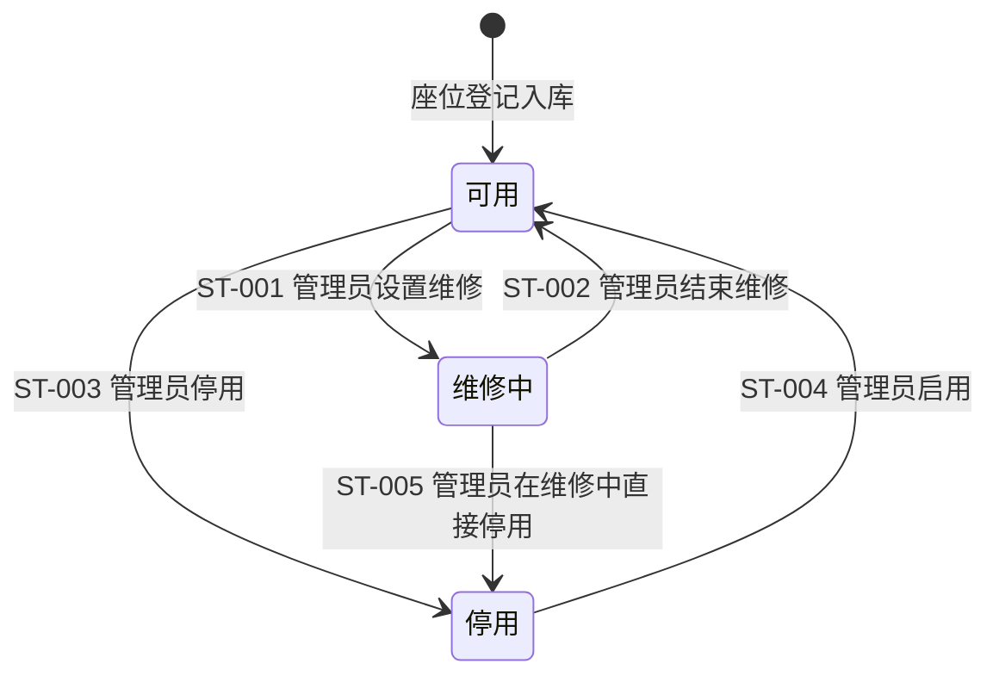

> **图注**：本图**只描述座位资源的行政状态**，不含"已预约""使用中"。"这个座位此刻能不能约"由第 4.4.2 节实时计算得出，不在本图中。
> ST-006（存在冲突的未来预约时设置维修/停用）、ST-007（越权操作）为**状态保持**记录，不改变状态，故未绘制为转换线，详见第 5.4 节。

##### SM-02 预约单状态图

- **图编号**：SM-02
- **图名称**：预约单状态图
- **建模对象**：预约单
- **关联需求**：FR-010、FR-011、FR-014、FR-015、FR-016、FR-020、FR-021、FR-022、FR-023
- **关联规则**：BR-001～BR-011

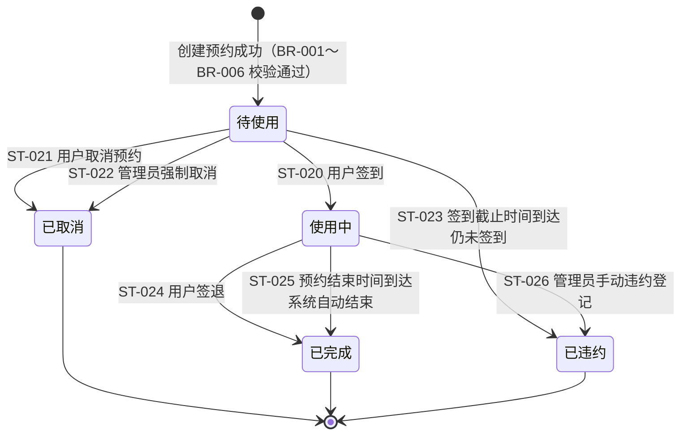

> **图注**：`已取消 / 已完成 / 已违约` 为**终态**，不再转出。
> ST-027（签到校验未通过）、ST-028（创建被拒绝）、ST-029（超出取消时限）、ST-030（重复签到）、ST-031（对终态签到/签退）、ST-032（违约未填原因）、ST-034（重复扫描）均为**状态保持**记录；ST-033（场地临时关闭）与 ST-035（并发写入冲突）为**已确认**记录，两条均未在图中绘制为确定转换线，详见第 5.4 节。

##### SM-03 用户账户状态图

- **图编号**：SM-03
- **图名称**：用户账户状态图
- **建模对象**：用户账户
- **关联需求**：FR-040、FR-044
- **关联规则**：BR-009、BR-010

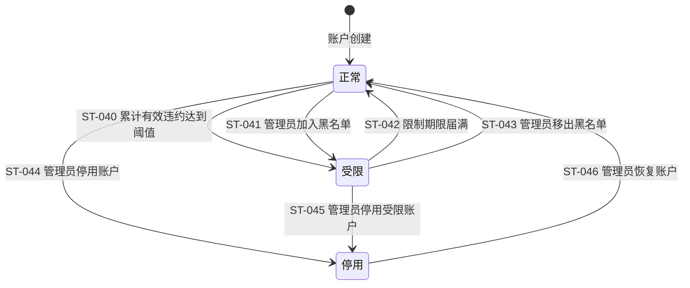

> **图注**：ST-047（受限/停用账户发起预约被拒）、ST-048（非管理员调用管理员操作）为**状态保持**记录，未在图中绘制为转换线，详见第 5.4 节。
> ST-049（账户被限制后其已有未来预约如何处置）为**已确认**记录。图注中 **无**"受限 → 自动取消已有预约"这类转换，因为本版已裁定该转换不存在（ST-049）。

##### SM-04 投诉状态图

- **图编号**：SM-04
- **图名称**：投诉状态图
- **建模对象**：投诉
- **关联需求**：FR-042、FR-043
- **关联规则**：BR-014

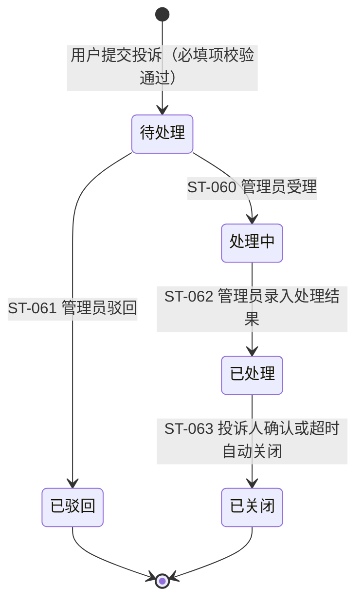

> **图注**：ST-064（投诉必填项缺失，不创建记录）、ST-065（非管理员处理投诉）为**状态保持**或**不适用**记录，未在图中绘制为转换线。

### 5.4 状态转换说明表

> **统一说明**
> - 所有转换的**判定条件与数值均为【AI 候选】或【分析推导】**，确认状态为「已确认」（本版逐条定稿）。
> - 各状态转换引用的规则值以第 4.2 节为准（本版均已定稿）；写入本表不改变各条规则的**来源性质**（【原始资料】/【AI 候选】/【分析推导】/【假设】）。
> - 「状态保持」表示操作被拒绝或未发生状态变化，当前状态与目标状态一致。
> - 编号按**建模对象分块**：ST-001～ST-007 座位资源；ST-020～ST-035 预约单；ST-040～ST-049 用户账户；ST-060～ST-065 投诉。

#### 5.4.1 座位资源（ST-001～ST-007）

| 转换编号 | 建模对象 | 当前状态 | 触发事件 | 执行角色 | 条件或判定依据 | 目标状态 | 业务结果 | 失败处理 | 关联规则 | 关联需求与场景 |
|---|---|---|---|---|---|---|---|---|---|---|
| ST-001 | 座位资源 | 可用 | 管理员设置维修 | 管理员 | 操作者为管理员且目标座位在其授权自习室范围内（BR-018、第 4.1.2 节）；座位当前为"可用"；**该座位不存在与拟维修时段冲突的有效预约**（BR-019） | 维修中 | 座位转为"维修中"；其可预约性立即变为"否"；写入审计日志 | 非管理员或超出授权范围则拒绝（ST-007）；存在冲突预约则转入 ST-006 处理（**已确认**） | BR-017、BR-018、BR-019 | FR-004、FR-016；UC-08；BS-07 |
| ST-002 | 座位资源 | 维修中 | 管理员结束维修 | 管理员 | 操作者为管理员且在其授权范围内；座位当前为"维修中" | 可用 | 座位恢复"可用"；可预约性按第 4.4.2 节重新计算 | 非管理员或超出授权范围则拒绝（ST-007）；当前状态不是"维修中"则拒绝，状态保持 | BR-017、BR-018 | FR-004；UC-08 |
| ST-003 | 座位资源 | 可用 | 管理员停用 | 管理员 | 操作者为管理员且在其授权范围内；座位当前为"可用" | 停用 | 座位转为"停用"；不再可被预约 | 同 ST-002 | BR-017、BR-018 | FR-004；UC-08 |
| ST-004 | 座位资源 | 停用 | 管理员启用 | 管理员 | 操作者为管理员且在其授权范围内；座位当前为"停用" | 可用 | 座位恢复"可用" | 同 ST-002 | BR-017、BR-018 | FR-004；UC-08 |
| ST-005 | 座位资源 | 维修中 | 管理员直接停用 | 管理员 | 操作者为管理员且在其授权范围内；座位当前为"维修中" | 停用 | 座位转为"停用"；用于"长期停用不再修复"的座位 | 同 ST-002 | BR-018 | FR-004；UC-08 |
| ST-006 | 座位资源 | 可用 / 维修中 / 停用 | 管理员设置维修或停用，但该座位存在与之冲突的未来有效预约 | 管理员 | 系统检出该座位在未来时段存在状态为"待使用"或"使用中"的预约单 | **默认：资源状态照常变更**（保持 ST-006 的座位侧结果） | **本版裁定（BR-019）**：列出冲突预约清单并持续提示，冲突预约**保持原状态**；仅当管理员**明确选择批量取消**时才执行（须二次确认、写审计日志），且**不计违约、不补偿、不支持改约** | 默认路径下**预约单完全不变**；批量取消路径下按强制取消口径处理且不累加违约次数；两种路径均须留痕 | BR-017、BR-019、BR-022 | FR-004、FR-016；UC-08；BS-07、§7.3 VS-05 |
| ST-007 | 座位资源 | 任意 | 非管理员，或超出授权范围的管理员执行座位状态变更 | 学生用户 / 越权管理员 | 执行者角色非管理员，或目标座位不在其被授权的自习室范围内 | **保持原状态** | **操作被拒绝**；写入越权审计日志 | 提示"无权限操作该资源"；除审计日志外，不产生任何数据变化 | BR-018 | FR-004；BS-04、BS-07；§7.3 VS-06 |

#### 5.4.2 预约单（ST-020～ST-035）

| 转换编号 | 建模对象 | 当前状态 | 触发事件 | 执行角色 | 条件或判定依据 | 目标状态 | 业务结果 | 失败处理 | 关联规则 | 关联需求与场景 |
|---|---|---|---|---|---|---|---|---|---|---|
| ST-020 | 预约单 | 待使用 | 用户签到 | 学生用户 | 预约单属于本人；当前时间落在签到窗口 `[s − X, s + Y)` 内（BR-007，本版取值 X=15、Y=15） | 使用中 | 预约单转为"使用中"；记录签到时间 | 校验不通过则拒绝（ST-027）；**座位资源状态不因签到而改变** | BR-007、BR-018 | FR-020；UC-03；BS-01 |
| ST-021 | 预约单 | 待使用 | 用户取消预约 | 学生用户 | 预约单属于本人；提交时刻早于 `s − C 分钟`（BR-011，本版取值 C=30） | 已取消 | 预约单转为"已取消"；记录取消时间；该时段按第 4.4.2 节重新变为可预约 | 超出时限则拒绝（ST-029）；非本人则拒绝 | BR-011、BR-018 | FR-011；UC-02；BS-02 |
| ST-022 | 预约单 | 待使用 | 管理员强制取消 | 管理员 | 操作者为管理员且在其授权范围内；**已填写取消原因**（与 BR-015 同类要求） | 已取消 | 预约单转为"已取消"；记录操作者、原因与时间；通知该用户 | 未填写原因则拒绝；非管理员或超出范围则拒绝 | BR-011、BR-015、BR-018 | FR-011；UC-02；BS-02 |
| ST-023 | 预约单 | 待使用 | 签到截止时间到达 | 系统 | 当前时间 ≥ `s + Y 分钟`，且预约单仍为"待使用"（BR-008） | 已违约 | 预约单转为"已违约"；生成违约记录；该用户累计**有效**违约次数 +1；触发 ST-040 阈值判定 | 定时任务异常时记录错误日志；**重试与告警策略属实现层，本版不规定**（Q-016 本版裁定）；任务重复执行须幂等、补算结果须与准时执行一致（ST-034、BR-021） | BR-007、BR-008、BR-009 | FR-022；BS-03 |
| ST-024 | 预约单 | 使用中 | 用户签退 | 学生用户 | 预约单属于本人且状态为"使用中" | 已完成 | 预约单转为"已完成"；记录签退时间 | 状态非"使用中"则拒绝（ST-031）；非本人则拒绝 | BR-007、BR-018 | FR-021；UC-04；BS-01 |
| ST-025 | 预约单 | 使用中 | 预约结束时间到达 | 系统 | 当前时间 ≥ 预约结束时间 `e`，且预约单仍为"使用中" | 已完成 | 预约单转为"已完成"；记录"系统自动结束"标记 | **本版取值（BR-008、Q-005）：未签退不计入违约** | BR-008 | FR-022；AD-02；BS-01 |
| ST-026 | 预约单 | 使用中 | 管理员手动违约登记 | 管理员 | 操作者为管理员且在其授权范围内；**已填写违约原因**（BR-015） | 已违约 | 预约单转为"已违约"；生成含操作者与原因的违约记录；该用户累计有效违约次数 +1 | 原因未填写则拒绝（ST-032）；非管理员或超出范围则拒绝（ST-048 / ST-007） | BR-009、BR-015、BR-018 | FR-023；UC-09；BS-04 |
| ST-027 | 预约单 | 待使用 | 用户签到（校验未通过） | 学生用户 | 预约单不属于该用户，或状态不为"待使用"，或当前时间不在签到窗口 `[s − X, s + Y)` 内 | **待使用**（状态保持） | **签到被拒绝**；不产生签到记录 | 分别提示"非本人预约""当前状态不可签到""不在签到窗口内（本单窗口为 …）"；不改变任何数据 | BR-007、BR-018 | FR-020；UC-03；BS-01 |
| ST-028 | 预约单 | **不适用**（不创建预约单） | 用户创建预约 | 学生用户 | 命中以下任一条：账户状态非"正常"（ST-047）；座位资源非"可用"（BR-017）；不符合 BR-001（粒度）/ BR-002（提前天数）/ BR-003（单次时长）/ BR-004（每日次数）；与本人已有有效预约时段重叠（BR-005）；与目标座位已有有效预约时段重叠（BR-006） | **不适用** | **预约被拒绝**；不产生预约单与任何占用 | 提示**具体未通过的那一条规则**及其参数值；不产生任何业务数据 | BR-001～BR-006、BR-017、BR-018 | FR-010、FR-012；UC-01；BS-01 |
| ST-029 | 预约单 | 待使用 | 用户取消预约（超出可取消时限） | 学生用户 | 提交时刻 ≥ `s − C 分钟`（BR-011） | **待使用**（状态保持） | **取消被拒绝**；预约单仍然有效 | 提示超出可取消时限；**本版取值（BR-011、Q-004）：超出可取消时限后取消被拒绝，且不计违约** | BR-011 | FR-011；UC-02；BS-02 |
| ST-030 | 预约单 | 使用中 | 用户重复签到 | 学生用户 | 预约单已处于"使用中" | **使用中**（状态保持） | **重复签到被拒绝**；不覆盖原签到时间 | 提示"已签到，签到时间为 …"；**幂等，不产生重复记录** | BR-007 | FR-015、FR-020；UC-03；§7.3 VS-02 |
| ST-031 | 预约单 | 已取消 / 已完成 / 已违约 | 用户签到或签退 | 学生用户 | 预约单已处于终态 | **保持终态**（状态保持） | **操作被拒绝** | 提示"该预约已结束（当前状态：…），无法签到/签退"；不改变任何数据 | BR-007 | FR-020、FR-021；UC-03、UC-04 |
| ST-032 | 预约单 | 使用中 | 管理员手动违约登记（未填写原因） | 管理员 | 违约原因为空，不满足 BR-015 | **使用中**（状态保持） | **违约登记被拒绝**；不生成违约记录 | 提示"请填写违约原因（必填）"；预约单与违约记录均不变化 | BR-015 | FR-023；UC-09；BS-04 |
| ST-033 | 预约单 | 待使用 / 使用中 | 对应座位被转为"维修中"或"停用"（场地临时关闭） | 管理员 / 系统 | 该预约单对应的座位资源状态已变为"维修中"或"停用" | **默认：保持原状态**（待使用 / 使用中不变）；**仅当管理员在冲突清单中明确选择批量取消时才转为"已取消"** | **本版裁定（BR-019）**：① 默认**不自动取消**、持续提示冲突；② 批量取消须经二次确认并写审计日志（BR-022）；③ **不计违约、不补偿、不支持改约** | 默认路径下预约单**完全不变**；选择批量取消时按强制取消口径处理且**不累加违约次数** | BR-019、BR-022 | FR-016；UC-08；§7.3 VS-05 |
| ST-034 | 预约单 | 已违约 | 自动违约任务重复扫描到同一预约单 | 系统 | 预约单已为"已违约" | **已违约**（状态保持） | **不重复处理**：不新增违约记录、**不重复累加**用户违约次数 | 幂等要求：以"预约单标识 + 违约类型"作为去重键 | BR-008、BR-009 | FR-014、FR-022；BS-03；§7.3 VS-03 |
| ST-035 | 预约单 | **不适用**（并发写入） | 两个预约请求同时通过校验并写入同一座位重叠时段 | 学生用户 | 两个请求在同一时刻通过 BR-006 校验，尚未落库 | **不适用**（无预约单写入） | **本版只规定可观察结果**：同一座位、同一时段**恰好一条**创建成功，其余请求返回"该时段已被占用"；**实现手段（唯一约束 / 悲观锁 / 乐观锁等）由实现决定，本版不规定** | 冲突方请求失败且**不产生**预约单；**不得**出现两条时段重叠的有效预约 | BR-006 | FR-014；UC-01；§7.3 VS-01 |

> **关于"待使用"预约单的手动违约登记（本版已裁定，Q-033）**：上表**不收录**"预约单=待使用 → 管理员手动违约登记"这一转换，因为本版裁定其**不适用**——BR-015 的适用前提是"当事人已开始使用"。因此路径唯一："未开始 → 只能强制取消（ST-022）；已实际占用时段（使用中）→ 才能手动违约登记（ST-026）"，两条路径**互斥**，"强制取消 + 另行登记违约"**不并存**，ST-036 预留位继续保留不使用。

#### 5.4.3 用户账户（ST-040～ST-049）

| 转换编号 | 建模对象 | 当前状态 | 触发事件 | 执行角色 | 条件或判定依据 | 目标状态 | 业务结果 | 失败处理 | 关联规则 | 关联需求与场景 |
|---|---|---|---|---|---|---|---|---|---|---|
| ST-040 | 用户账户 | 正常 | 新增有效违约记录后触发阈值判定 | 系统 | 累计**有效**违约次数 ≥ BR-009 阈值（本版取值 3 次） | 受限 | 账户转为"受限"；记录生效时间与预计解除时间；生成黑名单记录 | 未达阈值则状态保持"正常"，仅累加次数 | BR-009、BR-012 | FR-022、FR-044；BS-05 |
| ST-041 | 用户账户 | 正常 | 管理员手动加入黑名单 | 管理员 | 操作者具备黑名单管理授权（第 4.1.2 节：本版按管理员不分级建模，任一管理员均可执行）；已填写限制原因与期限 | 受限 | 账户转为"受限"；生成含操作者与原因的黑名单记录 | 未填写原因或期限则拒绝；无授权则拒绝 | BR-010、BR-018 | FR-044；UC-11；BS-05 |
| ST-042 | 用户账户 | 受限 | 限制期限届满 | 系统 | 当前时间已超过限制期限，且该账户**不存在其他生效中的限制记录** | 正常 | 账户恢复"正常"；黑名单记录标记为已解除 | 期限未满则状态保持；**若存在管理员手动设置的限制，系统不得自动解除**（须由管理员按 ST-043 处理） | BR-010、BR-012 | FR-044；BS-05 |
| ST-043 | 用户账户 | 受限 | 管理员移出黑名单 | 管理员 | 操作者具备解除授权；已填写解除原因 | 正常 | 账户恢复"正常"；记录操作者、时间与原因 | 未填写原因或无授权则拒绝，状态保持"受限" | BR-010、BR-018 | FR-044；UC-11；BS-05 |
| ST-044 | 用户账户 | 正常 | 管理员停用账户 | 管理员 | 操作者为管理员且具备用户管理授权 | 停用 | 账户转为"停用"；该用户无法登录，无法创建预约 | 无授权则拒绝，状态保持"正常" | BR-018 | FR-040；UC-11 |
| ST-045 | 用户账户 | 受限 | 管理员停用受限账户 | 管理员 | 操作者为管理员且具备授权；账户当前为"受限" | 停用 | 账户转为"停用"；原限制记录保留，账户须由管理员按 ST-046 显式恢复 | 无授权则拒绝，状态保持"受限" | BR-018 | FR-040；UC-11 |
| ST-046 | 用户账户 | 停用 | 管理员恢复账户 | 管理员 | 操作者为管理员且具备授权 | 正常 | 账户恢复"正常" | 无授权则拒绝，状态保持"停用" | BR-018 | FR-040；UC-11 |
| ST-047 | 用户账户 | 受限 / 停用 | 用户发起预约 | 学生用户 | 账户状态为"受限"或"停用" | **保持原状态** | **预约被拒绝**；不创建预约单 | 受限账户提示限制原因与预计解除时间；停用账户不展示预计时间；不产生任何业务数据 | BR-009、BR-010、BR-018 | FR-010、FR-044；BS-05 |
| ST-048 | 用户账户 | 任意 | 非管理员调用管理员专属操作 | 学生用户 | 执行者角色非管理员（手动违约登记、座位状态变更、投诉处理、黑名单管理等） | **保持原状态** | **操作被拒绝**；写入越权审计日志 | 提示"无权限执行该操作"；除审计日志外目标数据不发生任何变化 | BR-018 | FR-004、FR-023、FR-040、FR-043、FR-044；BS-04、BS-07；§7.3 VS-06 |
| ST-049 | 用户账户 | 正常 → 受限 / 停用 | 账户被限制或停用，但其名下存在未来时段的"待使用"预约单 | 系统 | 状态变更完成后检索该用户名下的未来有效预约单 | **保持不变** | **本版裁定**：该预约单**保持原状**（状态不变、不禁用、不计违约）；受限用户仍可登录并签到使用该预约，仅**不能创建新预约**（ST-047）。**停用**账户因无法登录而不能签到，此时由管理员按 FR-011 强制取消（须填原因，不计违约） | 一律**不自动取消**、不生成违约、不生成补偿；如需取消须由管理员显式操作 | BR-009、BR-010、BR-018 | FR-044；UC-11；§7.3 VS-06 |

#### 5.4.4 投诉（ST-060～ST-065）

| 转换编号 | 建模对象 | 当前状态 | 触发事件 | 执行角色 | 条件或判定依据 | 目标状态 | 业务结果 | 失败处理 | 关联规则 | 关联需求与场景 |
|---|---|---|---|---|---|---|---|---|---|---|
| ST-060 | 投诉 | 待处理 | 管理员受理 | 管理员 | 操作者为管理员且在其处理范围内 | 处理中 | 投诉转为"处理中"；记录受理人与时间 | 无授权则拒绝，状态保持"待处理" | BR-014、BR-018 | FR-043；UC-10；BS-06 |
| ST-061 | 投诉 | 待处理 | 管理员驳回 | 管理员 | 操作者为管理员；**已填写驳回理由** | 已驳回 | 投诉转为"已驳回"；记录驳回理由与处理人 | 未填写理由则拒绝，状态保持"待处理" | BR-014、BR-018 | FR-043；UC-10；BS-06 |
| ST-062 | 投诉 | 处理中 | 管理员录入处理结果 | 管理员 | 操作者为管理员；**已填写处理说明** | 已处理 | 投诉转为"已处理"；记录处理说明、处理人与时间；用户可查看反馈 | 未填写说明则拒绝，状态保持"处理中" | BR-014、BR-018 | FR-043；UC-10；BS-06 |
| ST-063 | 投诉 | 已处理 | 投诉人确认，或超过关闭时限 | 学生用户 / 系统 | 投诉人确认结果，或当前时间超过关闭时限（**关闭时限属实现层，本版不规定**） | 已关闭 | 投诉转为"已关闭"；流程结束 | 未到期则状态保持"已处理"；超时自动关闭以**站内提示**告知投诉人（FR-060 仅站内） | BR-014 | FR-043；BS-06 |
| ST-064 | 投诉 | **不适用**（不创建投诉） | 用户提交投诉 | 学生用户 | 投诉对象为空或内容为空 | **不适用** | **投诉被拒绝**；不创建投诉记录 | 提示必填项缺失；不产生任何记录 | BR-014 | FR-042；UC-10；BS-06 |
| ST-065 | 投诉 | 任意 | 非管理员处理投诉 | 学生用户 | 执行者角色非管理员 | **保持原状态** | **操作被拒绝**；写入越权审计日志 | 提示无权限；投诉数据不变 | BR-018 | FR-043；BS-06；§7.3 VS-06 |

#### 5.4.5 编号缺口与预留段位

**（1）预留段位**：`ST-008～ST-019`、`ST-036～ST-039`、`ST-050～ST-059` 为**预留段位**，当前未使用，**不对应任何实际记录，任何章节与追踪矩阵均不得引用**。其中 ST-036 曾被预留用于"待使用预约单的手动违约登记"这一转换；**本版裁定（Q-033、D-05）：该转换不存在**——强制取消与手动违约登记互斥（未开始只能强制取消），故 ST-036 **保持预留、不启用**。

**（2）编号规则**：状态转换编号按**建模对象分块**——`ST-001～ST-007` 座位资源；`ST-020～ST-035` 预约单；`ST-040～ST-049` 用户账户；`ST-060～ST-065` 投诉。块与块之间**不连续是设计使然，不是缺漏**。

**（3）"状态保持"记录的含义**：部分 ST 记录的目标状态与当前状态相同（如 ST-027、ST-030、ST-032、ST-034、ST-047、ST-048、ST-065）。这类记录用于表达"**操作被拒绝且状态不变**"，因此**不出现在状态图中**，但**必须实现**，是验收中"拒绝路径"的对照表。

### 5.5 状态与事件区分说明

| 名称 | 类型 | 说明 |
|---|---|---|
| 可用 / 维修中 / 停用 | 状态 | **座位资源**的行政可用性。**不含"已预约""使用中"**（见第 5.3.1 节建模约定） |
| 待使用 / 使用中 / 已完成 / 已取消 / 已违约 | 状态 | **预约单**的生命周期状态 |
| 正常 / 受限 / 停用 | 状态 | **用户账户**的当前所处情况 |
| 待处理 / 处理中 / 已处理 / 已驳回 / 已关闭 | 状态 | **投诉**的当前所处情况 |
| 可预约 / 不可预约 | **不是状态** | 由第 4.4.2 节按"资源状态 + 有效预约 + 目标时段"**实时计算**得出的结论，不作为字段存储 |
| 创建预约 / 签到 / 签退 / 取消预约 / 手动违约登记 / 设置维修 / 停用座位 | 事件 | 触发状态转换的操作，**不是状态** |
| 签到截止时间到达 / 预约结束时间到达 / 限制期限届满 | 事件 | 由系统时间触发的定时事件 |

> **注意（易混点）**："使用中"只属于**预约单**，不再属于座位。"座位（使用中）"这一表述已**废止**；如确需表达"某座位此刻有人在使用"，应表述为"该座位在 `[s, e)` 内存在一张状态为『使用中』的预约单"。
>
> **注意**："停用"在座位资源与用户账户中**同名不同义**（座位停用 = 不可预约；账户停用 = 不可登录）。引用时须结合"建模对象"识别。

### 5.6 关键业务流程闭环检查

> **本节性质**：逐条检查六条关键流程在**文档层面**是否已定义到"可据以编码"的程度。
> **重要说明**：下表的"闭环状态"是对**本说明书内容完整性**的检查结论，**不是**系统运行结果、**不是**走查结论、**不是**验证结论。标注"已闭合"仅指"规则已被明确写出且已无遗留项"，**不代表该规则已经业务确认或已经实现**（见第 8.1 节基线说明）。

| 编号 | 关键流程 | 已覆盖的需求 / 状态转换 | 闭环状态 | 尚未闭合的缺口 | 关联问题 |
|---|---|---|---|---|---|
| FLW-01 | **身份认证与登录** | IR-001、IR-002、DR-001、AS-02、FR-040、SCD-01 外部实体 E1；2.5.6 UC-00 | **已闭合（文档层面）** | **本版已定稿的部分**：凭证形式 = **用户标识 + 口令**；角色由**本系统用户记录**取得（不由外部系统返回）；账户"停用"不得登录、"受限"可登录但不可新建预约（ST-044、ST-047）；口令不可逆存储与传输加密（NFR-005）；成功与失败均写审计（NFR-009）。**明确属实现层、本版不规定**：登录失败次数限制、会话有效期与登出、令牌刷新方式、多端登录策略、外部认证系统的协议与报文。**依赖风险仍在**：统一身份认证为【假设】AS-02，若改为本地账号体系，仅需重写 IR-001/IR-002 的提供方与认证列 | Q-002（本版裁定：按 AS-02 假设推进）；DEP-01；AS-02 |
| FLW-02 | **预约时间边界** | 第 4.3 节 TB-01～TB-13、第 4.4 节 C1～C6、BR-020、FR-012、FR-013 | **已闭合（文档层面）** | TB-01～TB-13 全部给出本版取值：**TB-11 = 不允许跨日预约**（预约的起止必须落在同一自然日内）；**TB-12 = 以服务器本地时间（UTC+8）为唯一时间源**（NFR-010）；**TB-13 = 未对齐粒度的请求直接拒绝**（ST-028），不做自动取整 | —（Q-018、Q-019、Q-020 均已在第 4.3 节定稿） |
| FLW-03 | **场地临时关闭** | BR-019、ST-006、ST-033、FR-016、BS-07 | **已闭合（文档层面）** | 四个原悬空点均已定稿：**默认保留冲突预约并持续提示**、**仅管理员明确选择时才批量取消**、**不计违约**、**不补偿**、**不支持改约**（BR-019）。**注意**：这只表示规则已写清，未做任何走查或测试 | — |
| FLW-04 | **签到失败** | ST-027（校验未通过）、ST-030（重复签到）、ST-031（对终态预约签到） | **已闭合（设计层面）** | 三条失败路径的拒绝行为、状态保持与提示文案均已明确，**已无遗留项**。**注意**：这仅表示规则已写清，未做任何走查或测试 | — |
| FLW-05 | **自动违约任务故障** | ST-023 的失败处理、ST-034（幂等）、BR-021、FR-014、FR-022、§7.3 VS-04 | **已闭合（文档层面）** | 幂等要求（去重键、不重复记违约、不重复累加）已明确；本版另规定两条**可验收约束**：任务**重复执行结果一致**，任务**晚执行（补算）结果与准时执行一致**——违约判定只以预约开始时间与签到记录为依据。**重试次数、退避策略、告警渠道与责任人属实现层，本版不规定** | —（Q-029 本版裁定） |
| FLW-06 | **黑名单解除** | ST-040（进入）、ST-041（手动加入）、ST-042（期满自动解除）、ST-043（管理员解除）、ST-047（受限后拒绝预约）、**ST-049（受限后已有预约的处置，本版定稿）**、BR-010、BR-012 | **已闭合（文档层面）** | 两条解除路径已定义，已明确"存在管理员手动限制时系统不得自动解除"；**账户受限/停用后其已有未来预约：保持原状、不自动取消、不计违约**（ST-049 本版裁定）；**违约申诉（FR-024）本版排除**（SCOPE-08），因此不存在"申诉成功后解除与次数回退"的场景 | —（Q-027 本版裁定） |

**汇总：6 条关键流程（FLW-01～FLW-06）在**文档层面全部已闭合**（FLW-01、FLW-02、FLW-03、FLW-04、FLW-05、FLW-06）。**注意两点**：① "已闭合"只表示规则已被明确写出、已无遗留项，**不等于已实现、已走查或已验证**；② 6 条流程**均未经业务方确认**，其依据是 REF-01（原始资料）与【假设】/【分析推导】/【AI 候选】。

> **对后续工作的要求**：FLW-01～FLW-06 在**需求层**已无遗留项，可以进入设计与编码；三处**实现层**内容（调度与重试策略、会话与令牌策略、投诉关闭时限）由实现决定，**本版不作为需求与验收项**。全部结论的依据性质与确认状态见第 4 章各规则卡片与本章各表。

> **闭环检查与当前图模型的对应（本版补记，只陈述"哪张图涉及哪条流程"）**：FLW-04（签到失败）的三条拒绝分支见 **AD-02**（ST-027、ST-030、ST-031）；FLW-05（自动违约任务故障）的幂等分支见 **SQ-03**（ST-034）；FLW-06（黑名单解除）中"进入受限"一段见 **SQ-03** 的 ST-040 分支，**而两条解除路径（ST-042、ST-043）在任何时序图中都没有出现**。FLW-01（身份认证）只在 **UCD-02** 中以未编号用例出现、无时序图；FLW-02（预约时间边界）与 FLW-03（场地临时关闭）**当前没有任何图**——这与它们"未闭合 / 部分闭合"的结论是一致的，**不得**把"图已画出"理解为"流程已闭合"。

### 5.7 关键流程时序图（SQ-01～SQ-04）

> **本节性质**：转述 `models/` 内 **4 张时序图（PNG）**，并把图内每条消息引用的需求、规则与状态转换**逐条**对到第 2.6 节、第 4.2 节与第 5.4 节。本节是**图-文对照记录**，**不是运行日志、不是接口设计、不是任何验证结论**。
> **三条限制（不得淡化）**：
> 1. **这 4 张图在仓库内没有可编辑源文件**（`models/` 下只有 PNG；**生成工具与版本未记录**），**本说明书未参与其绘制**。因此本节只做**转述与对照**，不据图推定任何新规则；图中的参与者、消息与编号引用一律保持原确认状态。
> 2. 图中的消息序列是**设计意图**。它**不能**被引用为"系统这样运行过"，也**不能**被当作接口定义（本说明书不含任何接口参数规格，见第 3.4 节）。
> 3. 图面为**静态 PNG**，其中的示例数据（如 SQ-03 的预约单号）只是**图面示例**，**不是业务数据、不是测试数据**（见 5.7.5）。
> **编号来源提示**：`SQ-02`～`SQ-04` 见图面标题；**"正常预约时序图"的文件名未带编号，本版按编号连续性指定为 `SQ-01`**，**该指定须由建模人确认**（Q-035）。

**（0）总览**

| 图编号 | 图名称 | 泳道（参与者 / 系统 / 数据存储） | 覆盖的关键流程 | 所在小节 | 可编辑源文件 |
|---|---|---|---|---|---|
| **SQ-01**（本版指定编号） | 正常预约时序图 | 学生用户 R-01、预约服务（系统）、预约单库（数据存储）、用户账户（状态·违约次数） | 预约 → 签到 → 签退的**正常路径** | 第 5.7.1 节 | **无（待补）** |
| SQ-02 | 取消预约与超时拒绝时序图 | 学生用户 R-01、预约服务、预约单库、自习室管理员 R-02 | 用户取消 / 超时拒绝 / **管理员强制取消** | 第 5.7.2 节 | **无（待补）** |
| SQ-03 | 自动违约与账户受限时序图 | 定时任务（系统调度）、违约服务、预约单库·违约记录、用户账户·黑名单 | 自动违约 → 违约记录 → 阈值 → 账户受限 | 第 5.7.3 节 | **无（待补）** |
| SQ-04 | 管理员手动违约登记时序图 | 自习室管理员 R-02、预约服务、预约单库·违约记录、审计日志（NFR-009） | 手动违约登记（含拒绝与越权路径） | 第 5.7.4 节 | **无（待补）** |

> **共同说明**：四张图都**只画了主路径与少数拒绝分支**，均**未画**并发冲突（ST-035）、场地关闭（ST-033）、账户受限后已有预约的处置（ST-049）等分支（ST-049 已在第 5.4.3 节定稿）；这一取舍与第 5.4 节"图只画主路径与少数拒绝分支"的处理一致。

#### 5.7.1 SQ-01 正常预约时序图（编号为本版指定）

- **建模对象**：从提交预约请求到签退的**正常路径**消息序列
- **图内分片**：预约 / 签到 / 签退（三段）
- **关联需求**【分析推导：由图中消息与规则项推导，非图面标注】：FR-010（预约创建）、FR-012 / FR-013（时段校验）、FR-015（幂等）、FR-020（签到）、FR-021（签退）
- **关联规则**：BR-001～BR-004（预约参数）、BR-006（座位时段独占）、BR-018（权限边界）
- **关联状态转换**：ST-020（待使用 → 使用中）、ST-024（使用中 → 已完成）
- **源文件**：**仓库内无**；图面见 `models/正常预约时序图.png`

**图内消息清单（逐条转述）**

| 序号 | 消息内容 | 发送方 → 接收方 | 图内标注 |
|---|---|---|---|
| ① | 提交预约请求（座位、`[s, e)`、幂等键） | 学生用户 R-01 → 预约服务 | — |
| ② | 校验账户状态 | 预约服务 → 用户账户 | **BR-018** |
| ③ | 返回：账户正常 | 用户账户 → 预约服务 | — |
| ④ | 校验预约参数（自调用） | 预约服务 → 预约服务 | **BR-001～BR-004** |
| ⑤ | 查询该座位时段占用 | 预约服务 → 预约单库 | **BR-006** |
| ⑥ | 返回：无冲突 | 预约单库 → 预约服务 | — |
| ⑦ | 创建预约单（状态＝待使用） | 预约服务 → 预约单库 | — |
| ⑧ | 返回：创建成功 | 预约单库 → 预约服务 | — |
| ⑨ | 预约成功（**座位资源状态不变**） | 预约服务 → 学生用户 R-01 | — |
| ⑩ | 提交签到 | 学生用户 R-01 → 预约服务 | — |
| ⑪ | 校验归属与状态 | 预约服务 → 预约单库 | — |
| ⑫ | 返回：待使用 | 预约单库 → 预约服务 | — |
| ⑬ | 更新为使用中 | 预约服务 → 预约单库 | **ST-020** |
| ⑭ | 返回：成功 | 预约单库 → 预约服务 | — |
| ⑮ | 签到成功 | 预约服务 → 学生用户 R-01 | — |
| ⑯ | 提交签退 | 学生用户 R-01 → 预约服务 | — |
| ⑰ | 更新为已完成 | 预约服务 → 预约单库 | **ST-024** |
| ⑱ | 返回：成功 | 预约单库 → 预约服务 | — |
| ⑲ | 签退成功 | 预约服务 → 学生用户 R-01 | — |

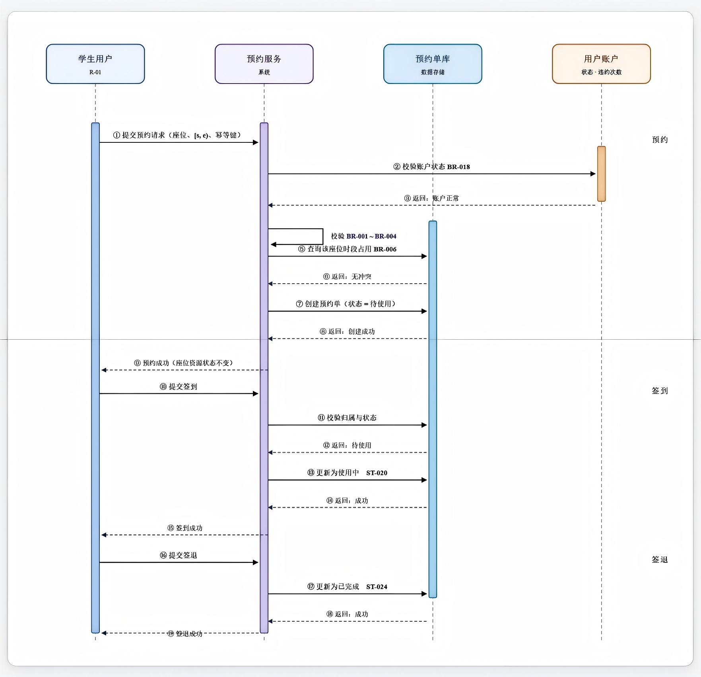

> **图注**
> 1. ⑨"预约成功（座位资源状态不变）"与第 5.3.1 节建模约定、LK-03 一致——**创建预约不写入座位资源状态**；"某时段是否被占用"只能通过预约单查询（`⑤`）得出。
> 2. 本图**只画正常路径**：**未画**并发写入冲突（ST-035）、参数未通过（ST-028）、受限账户被拒（ST-047）、签到/签退失败（ST-027、ST-030、ST-031）等分支——这些见第 5.1.1、5.1.2 节与第 5.4 节。
> 3. 本图用"BR-001～BR-004 + BR-006"直述校验内容，**未展开第 4.4.2 节的 C1～C6 判定顺序**。两者不矛盾（C1～C6 是判定项的编号，BR 是被引用的规则），但**实现时必须以第 4.4.2 节的 C1～C6 为准**，并返回未通过的具体判定项。
> 4. 图内"幂等键"与 FR-015 一致；其**生成方式属实现层，本版不规定**（Q-024 本版裁定），但**语义已定**：同一用户对同一"座位 + 时段"的重复提交须返回同一张预约单（BR-021）。图内未表达"重复提交返回同一结果"的验证细节（第 7.3 节 VS-02）。
> 5. 图内未出现事务边界、超时与重试的表达，**本版不对其作推断**。

#### 5.7.2 SQ-02 取消预约与超时拒绝时序图

- **建模对象**：用户取消预约（含超时被拒）与管理员强制取消
- **关联需求**【分析推导】：FR-011（取消预约）
- **关联规则**：BR-011（取消时限，本版取值 C=30 分钟）、BR-018（权限边界）；**图面在管理员分支标注"须填原因"**，与 BR-015"手动违约登记必填原因"同类（ST-022 的"已填写取消原因"）
- **关联状态转换**：ST-021（待使用 → 已取消，用户）、ST-022（待使用 → 已取消，管理员）、ST-029（超时取消被拒，状态保持）
- **源文件**：**仓库内无**；图面见 `models/SQ-02 取消预约与超时拒绝时序图.png`

**图内消息清单（逐条转述）**

| 序号 | 消息内容 | 发送方 → 接收方 | 图内标注 |
|---|---|---|---|
| ① | 提交取消请求（预约单号） | 学生用户 R-01 → 预约服务 | — |
| ② | 校验归属与状态 | 预约服务 → 预约单库 | — |
| ③ | 返回：待使用、属于本人 | 预约单库 → 预约服务 | — |
| ④ | 校验可取消时限（自调用） | 预约服务 → 预约服务 | **BR-011** |
| ⑤ | （时限内）更新为已取消 | 预约服务 → 预约单库 | **ST-021** |
| ⑥ | 返回：成功 | 预约单库 → 预约服务 | — |
| ⑦ | 取消成功（**该时段重新可预约**） | 预约服务 → 学生用户 R-01 | — |
| ⑧ | （超出时限）拒绝取消 | 预约服务 → 学生用户 R-01 | **ST-029** |
| ⑨ | 提交强制取消（**须填原因**） | 自习室管理员 R-02 → 预约服务 | — |
| ⑩ | 校验管理员权限与原因非空（自调用） | 预约服务 → 预约服务 | — |
| ⑪ | 更新为已取消 | 预约服务 → 预约单库 | **ST-022** |
| ⑫ | 强制取消成功，记录操作者 | 预约服务 → 自习室管理员 R-02 | — |

> **图注**
> 1. ⑦"取消成功（该时段重新可预约）"与 LK-03 一致：**取消只改预约单状态，不写座位资源状态**。
> 2. ⑤ / ⑧ 为 `alt` 的两个分支（时限内 / 超出时限）；⑨～⑫ 是**管理员强制取消**分支。
> 3. **图面瑕疵（须由建模人修正，不影响结论）**：`alt / else` 框**未标注分支名**，且 ⑨～⑫ 在版面上落在 `else` 框内，**分支归属只能靠线条判读**；建议补注"用户取消成功 / 用户取消被拒 / 管理员强制取消"三个分支名。
> 4. ②的成功前提是"预约单属于本人且状态为待使用"；**非本人、状态为终态**的情形图面未画（对应 ST-027 同类的归属校验与 ST-031 终态拒绝，见第 5.4.2 节）。
> 5. ⑩ 校验"原因非空"——**未填原因时应拒绝**（与 ST-032 同类），但**图面未画出该拒绝分支**。

#### 5.7.3 SQ-03 自动违约与账户受限时序图

- **建模对象**：定时任务扫描超时未签到预约单 → 生成违约记录 → 阈值判定 → 账户受限
- **关联需求**【分析推导】：FR-022（自动违约与违约记录）、FR-044（黑名单/账户限制）；**图面未标注 FR 编号**
- **关联规则**：BR-009（黑名单触发阈值，本版取值 3 次）
- **关联状态转换**：ST-023（待使用 → 已违约）、ST-034（重复扫描幂等，状态保持）、ST-040（正常 → 受限）
- **源文件**：**仓库内无**；图面见 `models/SQ-03 自动违约与账户受限时序图.png`

**图内消息清单（逐条转述）**

| 序号 | 消息内容 | 发送方 → 接收方 | 图内标注 |
|---|---|---|---|
| ① | 触发扫描任务 | 定时任务（系统调度）→ 违约服务 | — |
| ② | 查询超时未签到的待使用预约单 | 违约服务 → 预约单库·违约记录 | — |
| ③ | 返回预约单 **R-20261015-0002**（**图面示例**，见 5.7.5） | 预约单库 → 违约服务 | — |
| ④ | 校验该预约单是否已被处理（自调用） | 违约服务 → 违约服务 | **幂等 ST-034** |
| ⑤ | 返回：未处理 | 预约单库 → 违约服务 | — |
| ⑥ | 更新为已违约 | 违约服务 → 预约单库 | **ST-023** |
| ⑦ | 生成违约记录·累计有效违约次数 +1 | 违约服务 → 预约单库·违约记录 | — |
| ⑧ | 阈值判定（自调用） | 违约服务 → 违约服务 | **BR-009** |
| ⑨ | （达阈值）账户转为受限·新增黑名单记录 | 违约服务 → 用户账户·黑名单 | **ST-040** |
| ⑩ | 记录受限生效时间与解除时间 | 违约服务 → 预约单库·违约记录（图面泳道为"预约单库 / 违约记录"） | — |
| ⑪ | （未达阈值）仅累加次数，账户状态保持正常 | 图面为**文字标注**，无消息箭头 | — |
| ⑫ | 返回：已处理 | 违约服务 → 定时任务 | — |

> **图注**
> 1. ④ 的幂等校验与 ST-034 一致（去重键"预约单标识 + 违约类型"，见第 5.4.2 节）；**重复扫描不得重复生成记录、不得重复累加次数**（第 7.3 节 VS-04）。
> 2. ⑨ 与 ST-040 一致：账户"正常 → 受限"、生成黑名单记录、记录生效与解除时间；**阈值数值（3 次）的来源性质为【AI 候选】，确认状态为已确认（本版取值，见 BR-009）**。
> 3. **⑩ 的表达不严谨**：图面把"记录受限生效时间与解除时间"发往"预约单库 / 违约记录"泳道，而按第 5.4.3 节 ST-040 的定义，**生效/解除时间属于黑名单记录（DR-008）或账户**。**本版以 DR-008 / ST-040 的文字定义为准**，登记为图面待修正项（Q-035）。
> 4. ⑪ 为文字标注（"仅累加次数，账户状态保持正常"）、未画消息箭头，与 ST-040 的失败处理一致（未达阈值则状态保持"正常"，仅累加次数）。
> 5. **图面未画**：定时任务的调度周期与失败重试（Q-029、Q-016）、受理申诉（FR-024，本版排除）、限制期限届满自动解除（ST-042）。

#### 5.7.4 SQ-04 管理员手动违约登记时序图

- **建模对象**：管理员对"使用中"预约单登记违约（含拒绝与越权路径）
- **关联需求**【分析推导】：FR-023（手动违约登记）；**NFR-009（审计日志，图面直接以"NFR-009"标注泳道名）**
- **关联规则**：BR-015（必填原因）、BR-018（权限边界）
- **关联状态转换**：ST-026（使用中 → 已违约）、ST-032（未填原因被拒，状态保持"使用中"）、ST-048（越权被拒，状态保持）
- **源文件**：**仓库内无**；图面见 `models/SQ-04 管理员手动违约登记时序图.png`

**图内消息清单（逐条转述）**

| 序号 | 消息内容 | 发送方 → 接收方 | 图内标注 |
|---|---|---|---|
| ① | 提交手动违约登记（预约单号 + 原因） | 自习室管理员 R-02 → 预约服务 | — |
| ② | 校验操作者角色（自调用） | 预约服务 → 预约服务 | **BR-018** |
| ③ | 校验违约原因非空（自调用） | 预约服务 → 预约服务 | **BR-015** |
| ④ | （校验通过）更新预约单为已违约 | 预约服务 → 预约单库·违约记录 | **ST-026** |
| — | 返回：成功（**图面无序号**） | 预约单库 → 预约服务 | — |
| ⑤ | 生成违约记录（含操作者、原因） | 预约服务 → 预约单库·违约记录 | — |
| ⑥ | 写入审计日志 | 预约服务 → 审计日志 | **NFR-009** |
| ⑦ | 登记成功（**图面位置与分支标注不一致，见 5.7.5**） | 预约服务 → 自习室管理员 R-02 | — |
| ⑧ | （原因未填）拒绝提交·**预约单保持"使用中"** | 预约服务 → 自习室管理员 R-02 | **ST-032** |
| ⑨ | （非管理员）拒绝并记录越权尝试 | 预约服务 → 自习室管理员 R-02 | **ST-048** |

> **图注**
> 1. ④ 的前提是预约单当前为"**使用中**"（第 5.4.2 节 ST-026）；⑧ 与 ST-032 一致——**原因未填则拒绝，预约单状态保持"使用中"、不生成违约记录**。图面"预约单保持使用中"是该分支的**结果描述**，不是拒绝原因；拒绝原因在图面**未标注**，按 BR-015 应为"原因未填写"。
> 2. ⑥ 与 NFR-009 一致：管理员的手动违约登记**必须留痕**（记录操作者、原因与时间）。
> 3. ⑨ 与 ST-048 一致：非管理员调用管理员专属操作 → **拒绝 + 记越权审计日志**，目标数据不变（第 7.3 节 VS-06）。
> 4. **未画**"预约单处于'待使用'时能否手动违约登记"这一路径——该情形**本版已裁定为不适用**：应改走强制取消（ST-022），不登记违约（Q-033 本版裁定、第 5.4.2 节）。

#### 5.7.5 时序图与正文的对照结论（含差异登记）

> **本节性质**：**文档层面的逐条核对**。核对只说明"图与正文的编号引用是否一致"，**不能**说明图的内容正确，**也不能**替代人工评审（第 7.6 节 C-11）。

| 检查项 | 核对结论 | 残留问题 |
|---|---|---|
| **状态转换引用的一致性** | SQ-01 → ST-020、ST-024；SQ-02 → ST-021、ST-022、ST-029；SQ-03 → ST-023、ST-034、ST-040；SQ-04 → ST-026、ST-032、ST-048。**逐条与第 5.4.2 / 5.4.3 节比对：起始状态、触发事件、目标状态与"状态保持 / 终态"含义均一致**，未发现方向冲突 | 无 |
| **规则引用的一致性** | SQ-01 → BR-001～BR-004、BR-006、BR-018；SQ-02 → BR-011；SQ-03 → BR-009；SQ-04 → BR-015、BR-018。**均可在第 4.2 节找到对应条目，含义未被图的表述改变** | 引用到的数值均为**本版取值**（BR-011 的 C=30 分钟、BR-009 的 3 次），其来源性质仍为【AI 候选】 |
| **与建模约定的一致性** | SQ-01 ⑨、SQ-02 ⑦ 都明示"座位资源状态不变 / 该时段重新可预约"，与第 5.3.1 节建模约定、LK-03 一致；AD-02 的"预约单 待使用 → 使用中"亦标注"座位资源状态不变" | 无 |
| **需求归属** | 本节的"关联需求"一栏是**本版由图内规则与编号推导**（【分析推导】），**图面本身没有标注 FR 编号**（仅 AD-01 / AD-02 与 SQ-04 的泳道/节点标了 FR、NFR 编号） | 需求归属需由图的所有人确认，**不得**据此认为图已覆盖这些需求 |
| **图面瑕疵（须由建模人修正）** | ①SQ-02 的 `alt / else` **未标分支名**，⑨～⑫ 的版面落在 `else` 框内；②SQ-04 的"⑦ 登记成功"标注位置与分支不符，"返回：成功"**缺序号**；③SQ-03 的 ⑪ 为文字标注、无消息箭头；④SQ-03 的 ⑩ 把"受限生效/解除时间"发往"预约单库 / 违约记录"泳道 | 均属**版面与表达问题**，不改变业务结论；修正后须重新对照一次（Q-035） |
| **图面与正文的差异** | ①**示例数据**：SQ-03 的 ③ 出现预约单号 **`R-20261015-0002`**——该编号**只是图面示例**，其格式（`R-日期-序号`）在第 3.3.4 节 DR-004 中**未定义**，**不得**据图推定编号规则；②"节号 / 项数"差异：AD-01 图面写作 V0.4 的"10.4.2 节"、小字疑为"C1-C5"（正文第 4.4.2 节、C1～C6）；③名称差异：UCD-02 图内 UC-06 仍为旧名 | 三项均已登记（第 7.5.4 节、Q-035） |
| **未能核对的部分** | 图面**看不到**的内容（事务边界、幂等键生成方式、定时任务调度周期与重试、并发控制手段、接口参数与报文格式）**一律不作推断** | Q-024、Q-025、Q-029；第 3.4 节：接口参数本版不规定 |

**汇总**：4 张时序图引用的 **11 条状态转换**（ST-020、ST-021、ST-022、ST-023、ST-024、ST-026、ST-029、ST-032、ST-034、ST-040、ST-048）与 **9 条业务规则**（BR-001～BR-004、BR-006、BR-009、BR-011、BR-015、BR-018）与正文定义**逐条一致**，未发现方向或终态冲突；**1 条编号格式**（SQ-03 的示例预约单号）与 **1 处发送对象**（SQ-03 的 ⑩）属于图面待修正项；**4 张图均无仓库内可编辑源文件**。以上结论**仅为文档层面自查**，**不构成验证结论**，且**未经人工评审**（见第 7.6 节 C-11）。

---
## 第 6 章 质量要求

> **本章对应课程要求**：给出重要的性能、可靠性、安全等要求及取舍理由，并包含**具体情境、可观察指标和检验方法**。
> **本章的取值纪律（先读这条）**：REF-01 除"每 10 秒自动刷新"外**未提供任何量化指标**。本版采取如下纪律——
> ① **有原文来源的指标**（NFR-001 的 10 秒）**直接采用**，并据以编写验收标准；
> ② **无任何来源的数值**（响应时间秒数、并发用户数、可用性百分比）**本版一律不规定**：只保留"要求的方向 + 可观察指标 + 检验方法"，**不填占位数字**，也不把它们写成可判定的验收项；
> ③ 凡本版不规定的数值，**由实现决定**，任何人**不得据本章推定存在性能承诺**。
> **原 V1.x 稿的调整记录**：本稿曾为 NFR-002（2 秒）、NFR-003（500 并发）、NFR-004（99%）填入【AI 候选】占位值。按本版纪律，这三个数值**已撤回**（理由见 6.2 与第 8.5 节 RK-01 的处置）。

### 6.1 非功能需求

> **与课程要求的三点对应**：本表以"**适用范围**"列表达**具体情境**（该要求在什么场景下必须成立）、以"**指标及单位**"列表达**可观察指标**、以"**测量或验证方法**"列表达**检验方法**。凡本版不规定数值者，在"指标及单位"列明确写"**本版不规定**"，并在"验收标准"列说明本项**如何判定**（而非判定到多少）。

| 需求编号 | 需求名称 | 具体要求 | 适用范围（具体情境） | 指标及单位（可观察指标） | 测量或验证方法（检验方法） | 依据来源 | 验收标准 | 确认状态 |
|---|---|---|---|---|---|---|---|---|
| NFR-001 | 看板刷新周期 | 数据看板自动刷新间隔不超过 10 秒 | 管理员打开数据看板期间 | **≤10 秒**（唯一有原文来源的量化指标） | 打开看板并记录连续 3 次刷新的时间间隔 | **原始资料**（REF-01 · 第 7 项） | Given 看板已打开、When 观察 30 秒、Then 刷新间隔均 ≤10 秒 | 已确认 |
| NFR-002 | 页面响应时间 | 常规查询与提交操作在正常网络条件下应在用户可接受的等待时间内返回 | 全部用户操作 | **本版不规定阈值**；可观察量为"单次操作的端到端耗时" | 对主要操作各执行若干次并记录耗时分布（环境、次数与统计方式由实现确定） | 原为【AI 候选】（候选值 2 秒，**无来源，本版撤回**） | **本版不作定量验收**；仅规定"必须可测量"——Given 任一主要操作、When 执行并记录耗时、Then 能给出可复现的耗时数据（不设通过阈值） | 已确认（**数值本版不规定**） |
| NFR-003 | 并发能力 | 系统在预约高峰期应能承受并发访问而不产生数据错误（如重叠预约、重复记录） | 预约高峰期 | **本版不规定并发用户数阈值**；可观察量为"并发下的错误率与响应时间" | 并发发起重叠时段预约请求（见第 7.3 节 VS-01），记录错误率与耗时 | 原为【AI 候选】（候选值 500 并发，**无来源，本版撤回**） | **本版不作定量验收**；可判定部分为——Given N 个并发请求争用同一座位同一时段、When 全部返回、Then **恰好 1 条**预约单创建成功且库中无重叠有效预约（即 NFR-011 成立，与 N 无关） | 已确认（**数值本版不规定**） |
| NFR-004 | 可用性 | 自习室开放时段内系统应可用；计划内停机与故障停机须有记录与告知 | 全系统 | **本版不规定可用性百分比**；可观察量为"停机时段与原因的记录条数" | 检查停机记录；在开放时段内抽样访问核心页面 | 原为【AI 候选】（候选值 99%，**无来源，本版撤回**） | **本版不作定量验收**；可判定部分为——Given 发生停机、When 查询运行记录、Then 停机起止时间与原因**有记录**；Given 学生在开放时段提交预约、When 系统处于可用状态、Then 请求被正常处理 | 已确认（**数值本版不规定**） |
| NFR-005 | 身份与传输安全 | 用户口令须**不可逆**存储；涉及账户与个人信息的传输须加密 | 全系统 | 口令存储为不可逆结果；传输使用加密通道（具体算法与协议**本版不规定**） | 代码审查与配置检查 | **AI 候选**（无来源） | Given 检查用户口令字段、When 查看其存储形式、Then 为不可逆结果而非明文；Given 检查传输配置、Then 账户与个人信息**不经明文通道**传输 | 已确认 |
| NFR-006 | 个人信息隐私 | 仅采集与预约管理必要的个人信息；**对他人一律不展示身份字段**；日志中敏感字段脱敏 | 用户信息、日志、界面展示 | **本版给出敏感字段清单**：姓名、学号/工号、手机号、邮箱、违约记录明细 | 检查界面输出与日志样本，逐项核对上述字段是否对非本人展示 | **AI 候选** + 分析推导（字段清单为本版补齐） | Given 管理员查询用户列表、When 查看结果、Then 手机号与邮箱以掩码呈现；Given 学生查询本人预约记录、When 查看结果、Then 不含任何他人的姓名与学号；Given 抽查日志、Then 上述字段均已脱敏 | 已确认（**字段清单为本版补齐，原"脱敏范围未定义"缺口已闭合**） |
| NFR-007 | 浏览器兼容性 | 支持主流现代浏览器的近期版本；**本版不指定具体浏览器与版本号** | 用户端界面 | 兼容范围 = 主流现代浏览器的最近两个大版本（**本版取值**） | 在所选浏览器上实际打开核心页面（预约、签到、看板） | **AI 候选**（无来源；本版作为方向性约定采用） | Given 在兼容范围内任选一款浏览器、When 打开并完成"查询座位 → 预约 → 签到"主流程、Then 页面可用且流程可完成；在兼容范围外的浏览器上**不作保证** | 已确认（**本版取值**） |
| NFR-008 | 可维护性与可扩展性 | 模块边界清晰；**新增自习室或新增统计维度不需要改动核心预约逻辑** | 全系统 | 结构性约束：新增上述内容所涉及的改动范围**不进入**核心预约逻辑 | 代码审查（审查新增自习室/统计维度时被修改的模块清单） | **分析推导** | Given 新增一个自习室、When 完成配置、Then 核心预约逻辑的代码**无改动**；Given 新增一个统计维度、When 完成实现、Then 预约创建与冲突校验的代码**无改动** | 已确认 |
| NFR-009 | 操作审计 | 管理员的关键操作（座位资源状态调整、手动违约登记、黑名单变更、投诉处理、批量取消）留存**操作者、时间与原因** | 管理员操作 | 每条关键操作**1 条**审计记录；**保留期限 = 1 年**（BR-012 本版取值） | 执行操作后查询审计记录；检查保留策略配置 | **分析推导** | Given 管理员执行手动违约登记、When 查询审计记录、Then 可查到操作者、时间与原因；Given 管理员执行批量取消、Then 审计记录含影响清单与二次确认痕迹；**审计记录不可由任何角色导出**（FR-033 本版排除） | 已确认 |
| NFR-010 | 时间一致性 | 签到窗口、自动违约判定等时间相关判断以**统一的服务器时间为准**（**TB-12：服务器本地时间 UTC+8**） | FR-020、FR-022、FR-010 | 单一时钟源（UTC+8） | 对比客户端与服务器时间差异下的判定结果 | **分析推导** | Given 客户端时间被人工改偏、When 用户签到、Then 判定结果仍以服务器时间为准；Given 客户端时区非 UTC+8、When 提交预约、Then 系统按服务器本地时间解释时段 | 已确认 |
| NFR-011 | 预约占用一致性 | 任一时刻，同一座位不得存在两条时间段重叠的**有效**预约单 | FR-010、FR-014、FR-015 | 违反条数 = 0（**是正确性约束，不是性能指标**） | 并发发起重叠时段的预约请求（见第 7.3 节 VS-01），检查库中重叠有效预约条数 | **分析推导** | Given 同一座位同一时段收到 2 个并发预约请求、When 两者同时通过校验并提交、Then **恰好一条**创建成功、其余返回"该时段已被占用"，库中重叠的有效预约条数为 0 | 已确认（**只规定可观察结果；实现手段由实现决定**，见第 2.5.1 节 UC-01 的 E5） |
| NFR-012 | 请求幂等性 | 预约创建、签到、签退、自动违约判定在重复提交/重复执行时须为幂等操作，不得产生重复业务记录或重复累加 | FR-014、FR-015、FR-022 | 重复执行 N 次后的业务记录条数与执行 1 次相同（**正确性约束**） | 对同一请求重复提交（见第 7.3 节 VS-02、VS-04），比对业务记录条数与累计次数 | **分析推导** | Given 同一预约请求以同一幂等键提交 3 次、When 比对结果、Then 只存在 1 张预约单且当日预约次数只 +1；Given 自动违约任务对同一预约单重复执行、Then 只生成 1 条违约记录且累计次数只 +1 | 已确认（**幂等键的生成方式属实现层，本版不规定**） |

### 6.2 指标可用性分级与取舍理由

> **分级理由**：本系统只有"每 10 秒刷新"一项指标有原文来源。为避免把**无来源的候选值**与**有来源的指标**混在一起使用，本节对全部 NFR 做可用性分级，并给出**本版的处置结论**。

| 分级 | 含义 | 包含的 NFR | 本版处置 |
|---|---|---|---|
| **A 级：有来源，可直接追溯** | 可追溯至 REF-01 原文 | NFR-001（10 秒刷新，来源为 REF-01 第 7 项） | **保留为可验收项**，验收标准见 6.1 |
| **B 级：正确性约束，与数值无关** | 不依赖任何数值即可判定对错 | NFR-005、NFR-008、NFR-009、NFR-010、NFR-011、NFR-012 | **纳入设计与验收**——它们不需要业务方补参数即可判定，且 NFR-011 / NFR-012 直接支撑 BR-006 与 BR-021 |
| **C 级：原为无来源的占位数值** | 原数值为【AI 候选】凭空提出 | NFR-002、NFR-003、NFR-004（数值**本版已撤回**）；NFR-006、NFR-007（**本版已补齐判定口径**） | **撤回数值**：NFR-002 / 003 / 004 只保留"必须可测量"的要求，**不作为验收项**；NFR-006 / 007 因本版补齐了字段清单与兼容范围，**转为可判定项** |

#### 6.2.1 取舍结论

| 决策 | 对象 | 理由 |
|---|---|---|
| **保留为可验收项** | NFR-001（10 秒刷新） | 有 REF-01 来源；检验方法明确（连续观察刷新间隔），不依赖任何业务参数的取值 |
| **纳入设计与验收** | NFR-005、NFR-006、NFR-007、NFR-008、NFR-009、NFR-010、NFR-011、NFR-012 | 对错与具体数值无关，或本版已补出可判定的口径（NFR-006 的字段清单、NFR-007 的兼容范围） |
| **撤回数值、降为"可测量但不判定"** | NFR-002（原 2 秒）、NFR-003（原 500 并发）、NFR-004（原 99%） | 三个数值**没有任何资料依据**，属于"为了让文档看起来完整"的补全（第 8.5 节 RK-01）。本版的处理是**撤回而非照抄**：保留要求方向与检验方法，**不设通过阈值**，因而不会产生不可执行的验收条目 |
| **不再存在"暂不纳入验收"项** | 原与 FR-016、FR-050～FR-052 相关的质量要求 | 其依赖的业务规则与统计口径**本版已定稿**（BR-019、FR-050～FR-052），相关的质量约束（批量操作留痕、看板刷新）已分别归入 NFR-009 与 NFR-001 |

> **关于"性能指标缺失"的正式声明**：本说明书**未能提出有依据的性能指标**。这不是遗漏，而是原始资料确实未提供的如实反映。在业务方给出并发规模、响应时间期望与部署环境之前（第 8.2 节 Q-010），本版**不会**用候选值填补这些空白；届时补入的数值应作为**新增需求**登记，而不是回填到本版。

> **本版仍不规定的质量内容（明示）**：具体的响应时间秒数、并发用户数、可用性百分比、加密算法与协议套件、浏览器与版本清单、代码结构形态。这些属**实现层**，本版**不规定、不作验收项**。

---
## 第 7 章 验收与验证

> **本章对应课程要求**：给出验收场景、来源核对、原型走查、覆盖和一致性检查。
> **本章的前提**：第 1～6 章的规则、参数、口径与状态已在本版（V2.0）逐项定稿。本章给出**验收方案的设计与文档层面的核对**。
> **本版不包含任何执行记录**：走查、原型验证与功能测试按课程安排由《需求分析质量验证报告》（REF-08）承载（见第 7.6 节）。
> **红线（不因本版定稿而改变）**：本章所有"期望结果""验收标准"均为**设计意图**，**不得**被引用为已验证的结论。

### 7.1 验收层次与本版状态

| 层级 | 内容 | 本版状态 | 确认状态 |
|---|---|---|---|
| 业务成功指标 | SI-01～SI-04 | 本版确认为**定性业务成功指标**；目标值**一律不设数值**（REF-01 未提供任何业务量级依据） | 已确认（无数值阈值） |
| 单条需求验收标准 | 见第 2.6 节各 FR 的"验收标准"字段 | 已编写为 Given-When-Then 形式，可直接判定 | 已确认（设计层面） |
| 关键场景验收设计 | 第 7.3 节 VS-01～VS-06 | 6 个场景的判定口径**本版已全部定稿** | 已确认（设计层面） |
| 系统非功能指标 | 第 6.1 节 NFR-001～NFR-012 | 12 条全部定稿，按 A / B / C 三级处置（第 6.2 节） | 已确认 |
| 实际测试结果 | — | **本版不含测试结果**；功能与非功能测试不在本说明书的交付范围内 | 不适用 |

### 7.2 验收标准覆盖检查

| 覆盖类型 | 已覆盖的需求 | 说明 |
|---|---|---|
| 正常流程 | FR-001、FR-002、FR-003、FR-010、FR-011、FR-013、FR-020、FR-021、FR-030～FR-032、FR-040、FR-043、FR-044、FR-052、FR-053 | 已编写 Given-When-Then，均可判定 |
| 权限拒绝 | FR-001、FR-002、FR-003、FR-004、FR-011、FR-020、FR-021、FR-023、FR-030、FR-031、FR-032、FR-040、FR-042、FR-043、FR-044 | 已编写；对应 ST-007、ST-027、ST-047、ST-048、ST-065 |
| 边界条件 | FR-011（取消时限）、FR-012（次数与时长达上限、相邻时段边界）、FR-022（违约阈值边界） | 已编写；**边界数值均由本版定稿的 BR 给出**（BR-002～BR-004、BR-009、BR-011、BR-020、BR-022），判定见第 4.3、4.4 节 |
| 异常处理 | FR-011（超时取消被拒）、FR-020（校验未通过）、FR-022（自动违约重复执行）、FR-023（违约未填原因）、FR-043（投诉处理时限） | 已编写。可判定的部分是"重复执行结果一致"（NFR-012）与"处理时限为 BR-014 本版取值 3 个工作日"；自动违约任务的**调度周期与失败重试策略**、投诉超时后的**提醒与升级机制**均**属实现层，本版不规定**，不作为验收项 |
| 数据与状态变化 | FR-004、FR-010、FR-011、FR-020、FR-021、FR-022、FR-023、FR-044 | 已编写；对应 ST 记录 |
| 并发与幂等 | FR-014、FR-015 | 已编写 Given-When-Then。本版**只规定可观察结果**——同一时段**恰好一条**成功、重复提交**不重复累加**；**实现手段与幂等键生成方式属实现层，本版不规定**，不作为验收项（第 6.1 节 NFR-011、NFR-012） |
| 本版排除项 | FR-024、FR-033 | 二者按 SCOPE-08、SCOPE-09 **本版裁定排除**，不进入开发与验收，**不编写验收标准**（编号保留为占位、不复用） |

> **重要声明**：以上"已编写验收标准"仅表示**验收方案已设计**，**不表示已执行或已通过**。本说明书**不含**任何原型走查或功能测试的执行记录。

### 7.3 关键场景的验收设计

> **本节性质**：以下 6 个场景是《需求分析质量验证报告》（A 报告）A.7 节评审指出的**高风险点**。本节给出**验收场景的设计**（怎么验、验什么、期望什么），**不是**执行记录。
> **编号说明**：BS-xx 是业务场景（第 5.2 节）；SC-xx 是 A 报告 A.5 节的场景走查记录编号（**本说明书不包含该批记录**）；本节编号为 **VS-xx（Verification Scenario）**，是**待执行**的验收场景设计。三者**不得混写**——VS 的设计**不能**当作 SC 的走查记录，也不能当作任何执行结果。

| 场景编号 | 场景名称 | 对应需求与转换 | 前置条件 | 操作步骤（设计） | 期望结果（**设计意图**） | 判定口径状态 |
|---|---|---|---|---|---|---|
| VS-01 | **并发预约冲突** | FR-014、BR-006、ST-035 | 座位 S-001 在 `[14:00,16:00)` 无有效预约 | 两位用户对同一座位同一时段发起预约，使两个请求**同时**通过校验并提交 | **恰好一条**预约单创建成功，另一条返回"该时段已被占用"；库中**不存在**两条时段重叠的有效预约 | **已定稿可判定**：只规定该可观察结果（NFR-011）；实现手段（唯一约束 / 乐观锁 / 事务）**由实现决定**。**未执行** |
| VS-02 | **重复提交（幂等）** | FR-015、BR-021、ST-030 | 用户 A 账户正常，目标时段可预约 | ①以同一幂等键连续提交同一"座位+时段"预约请求 3 次；②对已签到的预约单再次签到 | ①始终返回**同一张**预约单，只产生 1 条记录，当日预约次数只 +1；②第二次签到被拒绝（ST-030），原签到时间**不变** | **已定稿可判定**（NFR-012）；幂等键生成方式**由实现决定**。**未执行** |
| VS-03 | **预约冲突判定与时段相邻边界** | FR-012、BR-001、BR-006、BR-020、TB-01～TB-06 | 座位 S-001 在 `[14:00,16:00)` 已有"待使用"预约 | ①请求 `[15:00,17:00)`；②请求 `[16:00,18:00)`；③先取消原预约，再请求 `[14:00,16:00)` | ①拒绝并提示 C3 冲突；②**允许创建**（左闭右开）；③**允许创建**（已取消不占用） | **已定稿可判定**：BR-020 本版取值为左闭右开 `[s, e)`。**未执行** |
| VS-04 | **定时任务重复执行** | FR-022、BR-021、ST-034、LK-07 | 存在一张超过签到截止时间的"待使用"预约单 | 让自动违约扫描任务对同一预约单**重复执行 2 次以上** | 只生成 **1 条**违约记录；用户累计有效违约次数只 **+1**；账户受限（ST-040）不被重复触发 | **已定稿可判定**（NFR-012）；**调度周期与重试策略由实现决定**。**未执行** |
| VS-05 | **场地临时关闭对已排定预约的影响** | FR-016、BR-019、ST-006、ST-033、LK-01 | 座位 S-002 在明日 `[14:00,16:00)` 有一张"待使用"预约单 | 管理员将 S-002 资源状态改为"维修中" | **本版定稿（BR-019）**：座位资源状态照常变更；系统**列出冲突预约清单并持续提示**，冲突预约**默认保留为"待使用"、不自动取消**；仅当管理员在清单中**明确选择批量取消**时才执行（须二次确认、写审计日志），**不计违约、不补偿、不支持改约** | **已定稿可判定**（BR-019、FR-016 验收标准）。**未执行** |
| VS-06 | **越权访问** | BR-018、ST-007、ST-048、ST-065、第 4.1.2 节 | 存在学生用户 A、管理员 M（授权范围为**全部座位资源**，本版定稿） | ①学生 A 调用"手动违约登记"；②学生 A 取消他人预约单；③学生 A 查询他人预约记录；④管理员 M 操作授权范围外的座位；⑤无授权者执行黑名单解除 | ①③⑤拒绝并记录越权审计日志；②拒绝且不改变他人预约；④**本版定稿（CF-02）**：管理员**不分级**，任一管理员可操作全部座位资源，故不存在"授权范围外"的座位；该步改为判定"非管理员角色对座位的任何写操作一律被拒" | **已定稿可判定**；第 ④ 步按 CF-02 本版裁定调整。**未执行** |

**判定口径汇总**：6 个场景的判定口径**本版已全部定稿**（原先卡在"业务规则本身未定"的 VS-05、卡在"管理员分级未定"的 VS-06 ④，均已随 BR-019 与 CF-02 的定稿而消解；原先卡在"实现手段未定"的 VS-01、VS-02、VS-04，改为**只规定可观察结果、实现手段由实现决定**）。**6 个场景的执行状态均为"未执行"**——本说明书不含任何测试结果。

### 7.4 需求追踪矩阵

> **重要说明**
> 1. 本矩阵**仅引用本说明书中真实存在的编号**（FR、NFR、DR、IR、BR、ST、UC、BS、图编号）。
> 2. **SC（场景走查）、PV（原型验证）、V（问题处理）、AI（AI 任务）、E（证据）等编号不在本说明书内**（属课程报告），对应列统一填写"—（不在本版交付范围）"，不得虚构。
> 3. 本矩阵反映的是"设计意图的对应关系"，**不代表任何验证已通过**。

| 需求编号 | 需求来源 | 来源性质 | 业务规则 | 用例 | 图模型 | 状态转换 | 场景走查 | 原型验证 | 验收标准 | 确认状态 |
|---|---|---|---|---|---|---|---|---|---|---|
| FR-001 | REF-01 · 第 1 项 | 原始资料 + AI 候选 | BR-017、BR-018 | UC-08 | GT-01、SCD-01、CD-01 | — | —（不在本版交付范围） | —（不在本版交付范围） | 已编写 | 已确认 |
| FR-002 | REF-01 · 第 1 项 | 原始资料 + AI 候选 | BR-017、BR-018 | UC-08 | CD-01、SM-01 | — | —（不在本版交付范围） | —（不在本版交付范围） | 已编写 | 已确认 |
| FR-003 | REF-01 · 第 4、5 项 | 原始资料 + AI 候选 | BR-017、BR-019 | UC-06 | SCD-01、SM-01、第 4.4.2 节 | — | —（不在本版交付范围） | —（不在本版交付范围） | 已编写 | 已确认 |
| FR-004 | REF-01 · 第 5 项 | 原始资料 + AI 候选 | BR-017、BR-018、BR-019 | UC-08 | SM-01、第 4.4.2 节 | ST-001～ST-007 | —（不在本版交付范围） | —（不在本版交付范围） | 已编写 | 已确认 |
| FR-010 | REF-01 · 第 2、3 项 | 原始资料 + AI 候选 | BR-001～BR-006、BR-017、BR-018、BR-020 | UC-01 | AD-01、SM-02、第 4.4.2 节 | ST-028、ST-047 | —（不在本版交付范围） | —（不在本版交付范围） | 已编写 | 已确认 |
| FR-011 | REF-01 · 第 3 项 | 原始资料 + AI 候选 | BR-011、BR-018、BR-020 | UC-02 | AD-01、SM-02 | ST-021、ST-022、ST-029 | —（不在本版交付范围） | —（不在本版交付范围） | 已编写 | 已确认 |
| FR-012 | REF-01 · 第 2、3 项 | 分析推导 + AI 候选 | BR-001～BR-006、BR-017、BR-020 | UC-01 | AD-01、第 4.4.2 节 | ST-028 | —（不在本版交付范围） | —（不在本版交付范围） | 已编写 | 已确认 |
| FR-013 | REF-01 · 第 4 项 | 原始资料 + 分析推导 | BR-001、BR-006、BR-017、BR-020 | UC-01、UC-06 | AD-01、SM-01、第 4.4.2 节 | — | —（不在本版交付范围） | —（不在本版交付范围） | 已编写 | 已确认 |
| FR-014 | **REF-01 未提及（分析推导）** | 分析推导 | BR-006、BR-021 | UC-01 | AD-01、第 4.4.2 节 | ST-035 | —（不在本版交付范围） | —（不在本版交付范围） | 已编写 | 已确认（只规定可观察结果，实现手段由实现决定） |
| FR-015 | **REF-01 未提及（分析推导）** | 分析推导 | BR-006、BR-007、BR-021 | UC-01、UC-03 | AD-01 | ST-030 | —（不在本版交付范围） | —（不在本版交付范围） | 已编写 | 已确认（幂等键生成方式由实现决定） |
| FR-016 | **REF-01 未提及（分析推导）** | 分析推导 | BR-017、BR-019、BR-022 | UC-08 | SM-01、第 4.4.3 节 LK-01 | ST-006、ST-033 | —（不在本版交付范围） | —（不在本版交付范围） | 已编写（第 2.6 节 FR-016，5 条验收标准） | 已确认（依 BR-019 本版定稿） |
| FR-020 | REF-01 · 第 3 项 | 原始资料 + AI 候选 | BR-007、BR-021 | UC-03 | AD-02、SM-02 | ST-020、ST-027、ST-030 | —（不在本版交付范围） | —（不在本版交付范围） | 已编写 | 已确认 |
| FR-021 | REF-01 · 第 3 项 | 原始资料 + AI 候选 | BR-007 | UC-04 | AD-02、SM-02 | ST-024、ST-031 | —（不在本版交付范围） | —（不在本版交付范围） | 已编写 | 已确认 |
| FR-022 | REF-01 · 第 3 项 | 原始资料 + AI 候选 | BR-007、BR-008、BR-009、BR-021 | —（系统自动，无直接参与者用例） | AD-02、SM-02、SM-03 | ST-023、ST-025、ST-034、ST-040 | —（不在本版交付范围） | —（不在本版交付范围） | 已编写 | 已确认 |
| FR-023 | REF-01 · 第 5 项 | 原始资料 + AI 候选 | BR-015、BR-018 | UC-09 | AD-02、SM-02 | ST-026、ST-032、ST-048 | —（不在本版交付范围） | —（不在本版交付范围） | 已编写 | 已确认 |
| FR-024 | REF-01 未提及 | AI 候选 | —（本版裁定排除） | — | — | — | —（不在本版交付范围） | —（不在本版交付范围） | —（不进入验收） | 已确认（本版裁定：不纳入，SCOPE-08） |
| FR-030 | REF-01 · 第 4 项 | 原始资料 + AI 候选 | BR-018 | UC-05 | CD-01 | — | —（不在本版交付范围） | —（不在本版交付范围） | 已编写 | 已确认 |
| FR-031 | REF-01 · 第 4、5 项 | 原始资料 + AI 候选 | BR-018 | UC-06 | SM-01 | — | —（不在本版交付范围） | —（不在本版交付范围） | 已编写 | 已确认 |
| FR-032 | REF-01 · 第 4 项 | 原始资料 + AI 候选 | BR-012、BR-018 | UC-07 | CD-01 | — | —（不在本版交付范围） | —（不在本版交付范围） | 已编写 | 已确认 |
| FR-033 | REF-01 未提及 | AI 候选 | —（本版裁定排除） | — | — | — | —（不在本版交付范围） | —（不在本版交付范围） | —（不进入验收） | 已确认（本版裁定：不纳入，SCOPE-09） |
| FR-040 | REF-01 · 第 6 项 | 原始资料 + AI 候选 | BR-018 | UC-11 | CD-01、SM-03 | ST-044、ST-046、ST-045 | —（不在本版交付范围） | —（不在本版交付范围） | 已编写 | 已确认 |
| FR-041 | REF-01 · 第 6 项 | 原始资料 + AI 候选 | BR-013 | — | CD-01 | — | —（不在本版交付范围） | —（不在本版交付范围） | 已编写 | 已确认 |
| FR-042 | REF-01 · 第 6 项 | 原始资料 + AI 候选 | BR-014 | UC-10 | SM-04 | ST-060、ST-064 | —（不在本版交付范围） | —（不在本版交付范围） | 已编写 | 已确认 |
| FR-043 | REF-01 · 第 6 项 | 原始资料 + AI 候选 | BR-014、BR-018 | UC-10 | SM-04 | ST-060～ST-063 | —（不在本版交付范围） | —（不在本版交付范围） | 已编写 | 已确认 |
| FR-044 | REF-01 · 第 6 项 | 原始资料 + AI 候选 | BR-009、BR-010、BR-018 | UC-11 | SM-03 | ST-040～ST-043、ST-047 | —（不在本版交付范围） | —（不在本版交付范围） | 已编写 | 已确认 |
| FR-050 | REF-01 · 第 7 项 | 原始资料 + AI 候选 | BR-016、BR-018 | UC-12 | CD-01 | — | —（不在本版交付范围） | —（不在本版交付范围） | 已编写（口径本版定稿） | 已确认 |
| FR-051 | REF-01 · 第 7 项 | 原始资料 + AI 候选 | BR-016、BR-018 | UC-12 | CD-01 | — | —（不在本版交付范围） | —（不在本版交付范围） | 已编写（口径本版定稿） | 已确认 |
| FR-052 | REF-01 · 第 7 项 | 原始资料 + AI 候选 | BR-016、BR-018 | UC-12 | — | — | —（不在本版交付范围） | —（不在本版交付范围） | 已编写（口径本版定稿） | 已确认 |
| FR-053 | REF-01 · 第 7 项 | **原始资料** | BR-016 | UC-12 | — | — | —（不在本版交付范围） | —（不在本版交付范围） | 已编写 | 已确认 |
| FR-060 | REF-01 未提及 | AI 候选 | —（本版裁定：仅站内提示，SCOPE-07） | — | SCD-01 | — | —（不在本版交付范围） | —（不在本版交付范围） | 已编写（仅站内提示，不含站外通道） | 已确认（本版纳入，SCOPE-07） |

**非功能需求追踪**

| 需求编号 | 来源 | 关联功能需求 | 关联接口 | 验证方法 | 状态 |
|---|---|---|---|---|---|
| NFR-001 | 原始资料 | FR-053 | IR-004 | 页面走查观察刷新间隔（**本说明书不含执行记录**） | 已确认 |
| NFR-002 | AI 候选 | 全部用户操作 | — | 性能测试：记录端到端耗时（**本说明书不含执行记录**；且**本版不设通过阈值**） | 已确认（数值本版不规定） |
| NFR-003 | AI 候选 | FR-010、FR-053 | IR-004 | 并发压力测试（**本说明书不含执行记录**；本版只判定"恰好一条成功"） | 已确认（数值本版不规定） |
| NFR-004 | AI 候选 | 全系统 | — | 运行记录检查（**本说明书不含执行记录**；本版只判定"停机有记录"） | 已确认（数值本版不规定） |
| NFR-005 | AI 候选 | FR-040 | IR-001 | 代码审查：口令存储形式与传输配置 | 已确认 |
| NFR-006 | AI 候选 | FR-033、FR-040、FR-032 | — | 界面输出与日志样本逐项核对敏感字段 | 已确认 |
| NFR-007 | AI 候选 | 全部界面 | — | 在兼容范围内的浏览器打开并完成主流程 | 已确认（兼容范围本版取值） |
| NFR-008 | 分析推导 | 全系统 | — | 架构评审：核对新增自习室/统计维度时被改动的模块 | 已确认 |
| NFR-009 | 分析推导 | FR-004、FR-023、FR-043、FR-044 | — | 操作后查询审计记录 | 已确认 |
| NFR-010 | 分析推导 | FR-020、FR-022 | — | 修改客户端时间后验证判定基准 | 已确认 |
| NFR-011 | 分析推导 | FR-010、FR-014、FR-015 | — | 并发发起重叠时段预约，检查重叠有效预约条数（见 §7.3 VS-01） | 已确认 |
| NFR-012 | 分析推导 | FR-014、FR-015、FR-022 | — | 重复提交与重复执行任务，比对记录条数（见 §7.3 VS-02、VS-04） | 已确认 |

> **关于编号的更正（本版补充）**：`V-nn`（问题处理）编号**已在《需求分析质量验证报告》A.7 节建立**（V-01～V-13），本说明书只在第 7.5.6 节**引用**其编号做处置登记，**不另立一套问题编号**，也不在追踪矩阵中虚构其内容。`SC-nn`（场景走查）、`PV-nn`（原型验证）、`AI-nn`、`E-nn` 编号**属课程报告，不在本说明书内**。

**图模型追踪（当前图清单，V1.1 新增）**

> **性质**：本表**反向**记录"每张图对应哪些需求"，与上表的"图模型"列互为索引。**"直接对应的需求"一栏中，凡图面未标注需求编号者，均由本版按图内规则与编号推导（【分析推导】），不代表图已覆盖这些需求**；图清单与源文件状态见第 0.3 节。

| 图编号 | 图名称 | 直接对应的需求 | 关联规则 | 关联状态转换 | 所在章节 | 可编辑来源 |
|---|---|---|---|---|---|---|
| UCD-01 | 用例图 | UC-01～UC-12（FR 对应见 2.4.1 用例表） | BR-017、BR-018、BR-019、BR-021 | — | 第 2.4.1 节 | `models/UCD-01-用例图.puml` |
| UCD-02 | 角色用例图 | UC-01～UC-12；IR-001、IR-002（E1）、IR-003 / FR-060（E2） | BR-018 | — | 第 2.4.2 节 | **无（待补）** |
| CD-01 | 领域类图 | FR-001、FR-002、FR-003、FR-030、FR-032、FR-040、FR-041、FR-050、FR-051、FR-060 | BR-005、BR-006 | SM-01～SM-04（状态图） | 第 3.2 节 | `models/CD-01-领域类图.puml` |
| AD-01 | 预约与取消流程活动图 | FR-010～FR-015；NFR-009 | BR-001～BR-004、BR-011、BR-017、BR-018、BR-020、BR-021；LK-03 | ST-021、ST-022、ST-028、ST-029、ST-035、ST-047 | 第 5.1.1 节 | Mermaid 源码（正文内嵌） |
| AD-02 | 签到、签退与自动违约流程活动图 | FR-016、FR-020、FR-021、FR-022、FR-023；NFR-010 | BR-007、BR-008、BR-009、BR-019 | ST-020、ST-023、ST-024、ST-025、ST-026、ST-027、ST-030、ST-031、ST-033、ST-034、ST-040 | 第 5.1.2 节 | Mermaid 源码（正文内嵌） |
| **SQ-01**（本版指定编号） | 正常预约时序图 | FR-010、FR-012、FR-013、FR-015、FR-020、FR-021 | BR-001～BR-004、BR-006、BR-018 | ST-020、ST-024 | 第 5.7.1 节 | **无（待补）** |
| SQ-02 | 取消预约与超时拒绝时序图 | FR-011 | BR-011、BR-018 | ST-021、ST-022、ST-029 | 第 5.7.2 节 | **无（待补）** |
| SQ-03 | 自动违约与账户受限时序图 | FR-022、FR-044 | BR-009 | ST-023、ST-034、ST-040 | 第 5.7.3 节 | **无（待补）** |
| SQ-04 | 管理员手动违约登记时序图 | FR-023；NFR-009 | BR-015、BR-018 | ST-026、ST-032、ST-048 | 第 5.7.4 节 | **无（待补）** |
| SCD-01 | 系统上下文图 | GO-01～GO-06、R-01～R-04、IR-001、IR-002 | — | — | 第 1.7.1 节 | Mermaid 源码（正文内嵌） |
| GT-01 | 目标树 | GO-01～GO-06、SI-01～SI-04 | — | — | 第 1.7.2 节 | Mermaid 源码（正文内嵌） |
| SM-01～SM-04 | 状态图（座位资源 / 预约单 / 用户账户 / 投诉） | FR-002～FR-004、FR-010、FR-011、FR-014～FR-016、FR-020～FR-023、FR-040、FR-042～FR-044（逐图对应见第 5.3.2 节） | BR-001～BR-019（逐图对应见第 5.3.2 节） | 见第 5.4 节状态转换说明表 | 第 5.3.2 节 | Mermaid 源码（正文内嵌） |

> **三处不得混淆的说明**：①**"图存在"不等于"需求已覆盖"**——上表的对应关系是**索引**；②`UCD-02`、`SQ-01` 的图编号由本版指定（原文件名未编号），**须由建模人确认**（Q-035）；③`UCD-02`、`SQ-01`～`SQ-04` 共 5 张图**在仓库内没有可编辑源文件**，不满足"模型须提交可编辑源文件"的提交要求（第 7.6 节 C-11、Q-037）。

### 7.5 来源核对、覆盖检查与一致性检查

> **本节性质**：本节为按课程结构**新增**的核查记录，全部结论均为**文档层面的自查**。**自查不能作为需求正确的证明**——本文档的图模型、规则、状态与验收标准出自同一次 AI 推导，存在同源生成与伪一致性风险（第 8.5.2 节 RK-08），必须由人工独立核验。

#### 7.5.1 来源核对：REF-01 逐项对照

| REF-01 条目 | 原文功能 | 对应目标 / 范围 / 需求 | 覆盖状态 |
|---|---|---|---|
| 第 1 项 | 自习室（座位）资源（属性）管理 | GO-01、SC-IN-01、FR-001～FR-004 | **已覆盖**（"分区"维度来自【假设】AS-05，原文未提及） |
| 第 2 项 | 预约管理功能（用户、管理员） | GO-02、SC-IN-02、FR-010～FR-016 | **已覆盖**；FR-014～FR-016 为【分析推导】补充，原文未提及 |
| 第 3 项 | 预约及取消预约、签到及签退、自动违约记录 | GO-02、SC-IN-02 / SC-IN-03、FR-011、FR-020～FR-023 | **已覆盖** |
| 第 4 项 | 相关查询：预约查询、座位查询、违规记录查询等 | GO-03、SC-IN-04、FR-030～FR-032 | **已覆盖**；FR-033（导出）为【AI 候选】，本版裁定排除（SCOPE-09），不进入开发与验收 |
| 第 5 项 | 管理员：实时座位管理（手动违约登记）、座位使用预约记录 | GO-04、SC-IN-03、FR-004、FR-023、FR-031 | **已覆盖**（"实时"已按系统边界修正为"展示系统记录的预约占用"，见第 1.7 节） |
| 第 6 项 | 用户管理：用户信息管理（评价管理）、用户投诉管理、投诉反馈信息、黑名单管理 | GO-05、SC-IN-05、FR-040～FR-044 | **已覆盖**（可编辑字段范围本版裁定：管理员**仅可查询、不可编辑身份信息**，见 BR-018 与 Q-030） |
| 第 7 项 | 数据分析：柱状图分析、折线图分析、统计数据等，每 10 秒自动刷新 | GO-06、SC-IN-06、FR-050～FR-053、NFR-001、BR-016 | **已覆盖**；统计口径（FR-050～FR-052）**本版已定稿**，见第 2.6 节各需求卡片 |

#### 7.5.2 原文未提及、由 AI 主动扩展的需求（本版范围决议）

| 需求编号 | 内容 | 性质 | 关联范围项 | **本版决议** |
|---|---|---|---|---|
| FR-014 | 预约并发冲突控制 | 分析推导（由 BR-006 的**正确性要求**导出） | — | **纳入本版**——不纳入则 BR-006 无法成立；只规定可观察结果（恰好一条成功） |
| FR-015 | 预约请求幂等性 | 分析推导（由弱网重试情形导出） | — | **纳入本版**——重复提交不得重复建单或重复累加 |
| FR-016 | 场地临时关闭与受影响预约处置 | 分析推导 | SCOPE-05（**纳入**） | **纳入本版**；规则按 **BR-019 定稿**：默认保留并提示，管理员明确选择时才批量取消，不计违约、不补偿、不支持改约 |
| FR-024 | 违约申诉 | **AI 候选** | SCOPE-08（**排除**） | **本版裁定排除**——不进入范围说明、开发计划与验收标准；编号保留为占位、不复用 |
| FR-033 | 预约与违规记录导出 | **AI 候选** | SCOPE-09（**排除**） | **本版裁定排除**——同上；且涉及个人信息导出合规，超出本期边界 |
| FR-060 | 预约与违约通知 | **AI 候选** | SCOPE-07（**纳入，仅站内提示**） | **本版纳入**，但**仅限站内提示**，不含短信、邮件等站外通道 |

> **处理口径**：被排除的两项（FR-024、FR-033）**编号保留为占位、不复用**，不写入范围说明、开发计划与验收标准；被纳入的三项（FR-014、FR-015、FR-016）与限缩纳入的一项（FR-060）均已在第 2.6 节写出可判定的验收标准。全部裁定依据为【AI 候选】或【分析推导】，**确认主体为编制小组**（见第 8.4 节关键人工决策记录）。

#### 7.5.3 需求覆盖检查

| 检查项 | 结论 |
|---|---|
| REF-01 第 1～7 项功能存在性 | **全部覆盖**（见 7.5.1） |
| 必做范围项 SC-IN-01～SC-IN-06 | **全部有对应功能需求** |
| 范围决策项 SCOPE-01～SCOPE-12 | **12 项已由本版逐项裁定**（纳入 **2 项**：SCOPE-05、SCOPE-07；**排除 10 项**），裁定表见第 1.6.2 节 |
| 功能需求验收标准 | 30 条功能需求中 **28 条设有可判定的验收标准**；**2 条（FR-024、FR-033）本版裁定排除**，编号保留为占位，**不编写验收标准**（第 7.2 节） |
| 非功能需求验收标准 | 12 条全部定稿：NFR-001 为可量化的 A 级验收项；NFR-005～NFR-012 为可判定的 B 级项；NFR-002～NFR-004 **撤回数值**、只规定"必须可测量"（第 6.2 节） |
| 详细用例 | **13 个**——其中**课程要求的关键业务闭环详细用例 5 个**（第 2.5.1～2.5.5 节：UC-01 / UC-02 / UC-03 / UC-08 / UC-09），另有 **8 个补充用例**按**完全相同的字段口径**展开于第 2.5.6 节。**若评审要求详细用例严格不超过 5 个，删除第 2.5.6 节即满足**（该节自带说明） |

#### 7.5.4 一致性检查（文档层面自查）

| 检查维度 | 结论 | 残留问题 |
|---|---|---|
| **术语一致性** | 位置资源状态仅取"可用 / 维修中 / 停用"；"使用中"仅用于预约单；"可预约性"作为派生结论而非状态 | 无 |
| **编号一致性** | 章节引用、需求编号、状态转换编号、追踪矩阵已相互核对；ST 预留段位（ST-008～ST-019、ST-036～ST-039、ST-050～ST-059）**未被任何章节引用** | 无悬空引用 |
| **规则与需求的一致性** | 逐条核对 BR 与 FR 的对应关系 | **本版已裁定消解 1 处冲突**：BR-018 声明管理员"不可修改用户身份信息"，而 FR-040 曾出现"管理员修改用户姓名"。本版按 BR-018 建模（管理员**仅可查询**），并在 FR-040 内**显式登记**该处理而不隐去（Q-030 本版裁定） |
| **状态转换与需求的一致性** | FR-011 的适用条件与 ST-021 / ST-022 一致；FR-023 的前置条件收敛为"使用中"，与 ST-026 的起始状态一致 | **本版已裁定消解 1 处边界**：强制取消与手动违约登记**互斥**（Q-033 本版裁定） |
| **验收标准与规则的一致性** | 抽查 FR-010、FR-011、FR-020、FR-022、FR-023、FR-044：一致 | 原 RK-02 指出的"FR-050～FR-052 在口径未定时已出现'与查询结果一致'的表述"**已随统计口径定稿而消解**（第 8.5.2 节 RK-02 本版处置） |
| **数值一致性** | 全部数值在正文、规则表与状态转换表中一致（30 分钟 / 7 天 / 4 小时 / 2 条 / 前后 15 分钟 / 3 次 / 7 天 / 30 分钟 / 1 年 / 3 个工作日） | 数值本身**均无资料依据**，一致性只说明文档内部不矛盾，**不说明数值正确** |
| **图与正文的名称一致性** | 已按第 0.3 节的当前图清单逐图与正文核对：UCD-01、CD-01 的图面元素与第 2.4.1 节用例表、第 3.2 节三张清单一致；AD-01 / AD-02 的判定节点与 ST / BR 引用一致；SQ-01～SQ-04 引用的状态转换与规则一致（明细见第 5.7.5 节） | **1 处名称不一致**：**UCD-02 图内 UC-06 仍写旧名"查询座位实时状态"**，正文（第 1.7 节、2.4.1 图注 4 与用例表、`models/UCD-01-用例图.puml`）已更名为"查询座位资源状态与时段可预约性"。**本版以正文为准**，图须重新出图（Q-035） |
| **图与正文的编号口径** | 图内编号引用（ST / BR / FR / NFR / LK / DR）与正文定义逐条可比对，无悬空编号 | **2 处编号口径差异**：①**AD-01 图面写"10.4.2 节"**（V0.4 编号，本文档为第 4.4.2 节）；②**AD-01 图内小字疑为"C1-C5"**（正文 C1～C6，须放大原图核对）。均以正文为准（Q-035） |
| **图与正文的示例数据** | 4 张时序图中仅 SQ-03 出现具体编号 | **1 处无来源示例**：SQ-03 的预约单号 `R-20261015-0002` 的格式在 DR-004 中**未定义**；**不得**据图推定编号规则（Q-035） |
| **图模型源文件的完整性** | PlantUML 两张（UCD-01、CD-01）与 Mermaid 八张（SCD-01、GT-01、AD-01、AD-02 各 1 张 + SM-01～SM-04 共 4 张）均有可编辑来源（`.puml` 或正文内嵌源码） | **5 张图无仓库内可编辑源文件**：UCD-02、SQ-01～SQ-04（均只有 PNG）；此外 AD-01 / AD-02 **另有 PNG 图面但无独立源文件**，正文的 Mermaid 源码是等价来源（第 7.6 节 C-11、Q-037） |

#### 7.5.5 本版定稿与未决事项的规模（如实统计）

| 类别 | 数量 | 说明 |
|---|---|---|
| 本版已裁定的问题（Q-001～Q-037） | **37 条** | 逐条裁定见第 8.2 节；其中 Q-034～Q-037 为本版随图模型同步新增 |
| 本版已消解的冲突（原 CF-01、CF-02） | **2 条** | 见第 8.3 节：CF-01 的并发规模与刷新策略**改由实现决定**；CF-02 按"管理员**不分级**"定稿 |
| AI 生成风险项（RK-01～RK-11） | **11 条** | 见第 8.5.2 节，逐条给出本版处置 |
| 业务规则的取值（BR-001～BR-015） | **15 条** | 全部为本版取值；**均无资料依据**——这一点不因本版定稿而改变 |
| 范围决策项（SCOPE-01～SCOPE-12） | **12 项** | 已逐项裁定：纳入 2 项（SCOPE-05、SCOPE-07），排除 10 项 |
| 验收场景（VS-01～VS-06） | **6 个** | 判定口径**本版已全部定稿**；**已执行 0 个**——本说明书不含执行记录 |
| 关键流程（FLW-01～FLW-06） | **6 条** | 在**文档层面全部已闭合**（第 5.6 节）；**均未经业务方确认，也不等于已实现** |
| **经业务方 / 教师 / 教学模拟确认的需求** | **0 条** | 本版的"已确认"是**编制小组与 AI 在文档层面的定稿**，**不是业务确认**（第 8.1.2 节） |

#### 7.5.6 与《需求分析质量验证报告》问题清单（V-01～V-13）的对应处置

> **本节性质**：本节是**本说明书对 A 报告 A.7 节登记问题的处置登记**。A 报告（REF-08，**V1.1**，2026-10-15）的检查对象是《智慧自习室预约与管理系统-需求规格说明书》**V0.4（评审修订版）**，A.7 节共登记 13 项问题（V-01～V-13）。本说明书（课程结构版）与 V0.4 **内容同源、章节编号不同**，本节逐项说明这些问题在**本版**中是否已消除、以何种方式处置、以及**仍未闭合的部分**。
> **三条限制**（不得淡化）：
> 1. **"已处理"只表示文档已按该判断改写，不表示问题已被独立复核确认。**A 报告 A.7.3 明确要求"负责人"与"复核者"分别填写，且**不得由同一人处理并复核**；本组成员名单已由 REF-08 · A.1 提供（郭学毅、梅智杰、徐温骄、蔡善文），但**各问题的处理人与复核人尚未落实到人**，本节**不代填**任何负责人或复核者。
> 2. **A 报告中"未开展"的两类检查在本版中同样未开展**：场景走查（A.5 节 SC-01～SC-15）与原型走查、功能验证（A.6 节 PV-01 起）。本节**不可能**报告任何业务正确性问题，全部结论仅限**文档一致性层面**。
> 3. **进度口径不得混用**：A 报告 V1.1 对 V-06、V-07、V-13 的处理决定已记为"**修改（说明书 V0.4 已完成）……待复核**"。下表的"当前状态"一列**同时标注 A 报告的原话口径**，避免把两个版本的进度当成同一件事。

**表前对照：A 报告（按说明书 V0.4）的章节编号 → 本版章节编号**

| V0.4 中的位置 | 本版（课程结构版）对应位置 | 说明 |
|---|---|---|
| §1.1 版本变更记录、§1.2 关联文件 | 第 0.1、0.2、0.3 节 | |
| §1.3 编号体系 | 第 0.4 节 | `CD-nn` 在两版均已登记 |
| §2.5.2 范围决策、§2.8.1 指标可用性声明 | 第 1.6.2 节、第 1.4 节 | |
| §3.3 权限矩阵 | 第 4.1.1、4.1.2 节 | |
| §4.1 上下文图、§4.2 目标树 | 第 1.7.1、1.7.2 节（SCD-01、GT-01） | |
| §4.3 用例图与用例表 | 第 2.4.1 节（UCD-01）。**第 2.4.2 节（UCD-02 角色用例图）与第 5.7 节（SQ-01～SQ-04 时序图）为 V1.1 新增，V0.4 中没有任何对应章节** | V-13① 的"关联需求"栏在两版均已更正；本版新增的图**不在 A 报告的检查范围内**（见本节表前第 3 条口径差异） |
| §4.4 活动图 AD-01、§4.5 活动图 AD-02 | 第 5.1.1、5.1.2 节 | V-13②③ 的清单漏列在两版均已补齐 |
| §4.7 领域类图 CD-01（V0.4 新增） | 第 3.2 节 | 本版另补"类 / 枚举 / 关联"三张清单 |
| §4.8 时间边界、§10.4.1 可预约性判定 | 第 4.3 节、第 4.4.1 与 4.4.2 节 | |
| §4.9 关键流程闭环检查 | 第 5.6 节 | |
| §5 功能需求（通用说明含预留编号） | 第 2.6 节 | |
| §6.1 非功能需求 A / B / C 分级 | 第 6.1、6.2 节 | |
| §9 业务规则、§10.2 状态转换说明表 | 第 4.2 节、第 5.4 节 | |
| §10.1 状态图 SM-01～SM-04 | 第 5.3.2 节 | |
| §10.2.5 编号缺口与旧编号 | 第 5.4.5 节 | |
| §10.3 状态与事件区分 | 第 5.5 节 | |
| §10 缺陷记录 MD-01～MD-06 | **本版已移除**，其结论改写为第 5.3.1 节建模约定（见第 0.2 节处置说明） | 属过程性记录 |
| §11.8 冲突登记、§11.9 AI 生成风险 | 第 8.3 节、第 8.5.2 节 | |
| §12.3 验收场景设计 VS-01～VS-06 | 第 7.3 节 | |
| §14 需求追踪矩阵 | 第 7.4 节 | |
| 附录 A 问题清单 Q-001～Q-033 | 第 8.2 节 | 本版已把全部条目逐项裁定，并在该节注明裁定主体为编制小组 |
| 附录 B 待办清单 TODO-A2～D2 | **本版已移除**（见第 0.2 节处置说明）；验证工作的归属改写为第 7.6 节 | 属过程管理清单 |

> **两版之间的口径差异（如实登记，不单方面采信任意一方，也不隐藏）**：
> 1. **未导出的 Mermaid 图数量**：A 报告 A.3.3 记为"GT-01、SCD-01、AD-01、AD-02、SM-01～SM-04 **共 6 张**"。按本版（V1.1）的图编号清点，A 报告列出的同一批图实为 **8 张**（GT-01、SCD-01、AD-01、AD-02 各 1 张 + SM-01～SM-04 共 4 张）；**其中 AD-01、AD-02 现已由组内成员提交了 PNG 导出**（第 0.3 节），因此**当前仍未导出图片的是 6 张**（GT-01、SCD-01、SM-01～SM-04）。即：A 报告的"6 张"与本版的"8 个图编号 / 剩余 6 张未导出"**不是同一口径**，**该差异须由人工核对后统一**；本版不据此改动 A 报告。
> 2. **A 报告 A.7.1 引用的字节数**（说明书 194,029 字节、`models/UCD-01-用例图.puml` 4,213 字节、`models/CD-01.svg` 66,920 字节等）记录的是**其检查时点的仓库状态**。本版对两个 `.puml` 源文件做了正文一致性更正，因此这些数字**在更正后不再适用**，应以仓库当前文件为准（见第 0.3 节）。
> 3. **图模型产物的口径差异（V1.1 新增）**：A 报告 A.3.1 / A.3.3 登记的图清单为 UCD-01、CD-01、GT-01、SCD-01、AD-01、AD-02、SM-01～SM-04；**本版按仓库当前状态清点到 4 张时序图（SQ-01～SQ-04）与 1 张角色用例图（UCD-02）**，这 5 张图**既不在 A 报告的清单内，也没有在 A 报告中被评价**，且**在仓库内没有可编辑源文件**。本版**不为它们补写 A 报告的结论**，只按第 2.4.2、5.7 节转述并登记差异（Q-035、Q-037）。

| 问题编号 | A 报告登记的问题（摘要） | 本版（课程结构版）的处置 | 处置位置 | 当前状态 |
|---|---|---|---|---|
| V-01 | 版本变更记录虚写：V0.2 行记载了正文中并不存在的 6 项内容 | 本版版本记录**只保留真实发生的三行**（V1.0 课程结构重排、V1.1 图模型同步、**V2.0 本版定稿**），每行列出的改动均可在正文中逐处核对，不保留任何与正文不符的变更记载；旧版内容的去留改为按**内容**逐项说明 | 第 0.2 节 | **已处理**（待人工复核） |
| V-02 | 座位状态建模缺陷：把"是否被占用"当作座位自身状态并与预约单互相写入 | 明确**座位只承载资源状态（可用 / 维修中 / 停用）**，占用关系只由预约单表达，"可否预约"改为派生结论 | 第 5.3.1 节、第 4.4 节、第 3.2 节 CD-01 | **已处理**（该约定由本版与 D-01 定稿） |
| V-03 | 时间区间开闭未定义，"14:00–16:00"与"16:00–18:00"是否冲突不明 | 全文统一**左闭右开 `[s, e)`**，以 BR-020 与第 4.4.1 节写明重叠判定式 | 第 4.4.1 节、BR-020、第 4.3 节 TB-01～TB-13 | **已写明**（BR-020 本版取值为左闭右开，Q-018 本版裁定） |
| V-04 | BR-018 与 FR-040 直接冲突（管理员可否编辑用户身份信息） | 按候选①建模（管理员**仅可查询**，不可编辑身份信息），并在 FR-040 内**显式登记冲突**而不隐去 | FR-040"规则冲突"行、第 4.1.1 节、第 7.5.4 节 | **已按 BR-018 裁定**（Q-030 本版裁定：管理员仅可查询） |
| V-05 | 强制取消与手动违约登记的适用边界不一致 | 收敛为**互斥**：未开始 → 只能强制取消；"使用中" → 才能手动违约登记 | FR-011、FR-023、ST-022、ST-026、第 2.5 节 UC-02 / UC-09 | **已处理**（互斥口径由本版与 D-05 定稿，Q-033 本版裁定） |
| V-06 | CD-01 有源文件但正文无对应章节，编号体系未登记 `CD-nn`，追踪矩阵却引用它 | 本版**第 3.2 节即 CD-01 领域模型**，内含源文件全文、图注与"类 / 枚举 / 关联"三张清单；第 0.4 节已登记 `CD-nn` 前缀；第 7.4 节矩阵的"图模型"列可反向定位 | 第 3.2 节、第 0.4 节、第 7.4 节 | **已解决**（A 报告 V1.1 记为"V0.4 已完成、**待复核**"） |
| V-07 | 正文路径写作 `模型/` 与仓库实际目录 `models/` 不一致；仓库内无 SVG/PNG 导出版本 | 全文统一为 `models/`；两张 PlantUML 图**已导出**为 SVG / PNG（本版在更正 `Area` 类编号后重新生成，见第 3.2 节）。**遗留**：仓库中 V0.4 提交的 `models/CD-01.svg` 生成于该更正之前，其 `Area` 标注与源文件当前状态不一致，**须在下次导出时同步**。**V1.1 补充**：仓库内另有 7 张由组内成员提交的 PNG（AD-01、AD-02、角色用例图、正常预约时序图、SQ-02～SQ-04），本版已把它们接入正文（第 2.4.2、5.1、5.7 节）并登记其**无源文件**与**图-文差异** | 第 0.3 节、第 2.4.1 / 2.4.2 节、第 3.2 节、第 5.1 节、第 5.7 节、第 7.6 节 C-07 | **已解决**（A 报告 V1.1 记为"V0.4 已完成、**待复核**"；导出仅完成格式转换，不构成验证） |
| V-08 | 功能需求编号存在空缺（FR-005～FR-009 等），易被误读为遗漏 | 按模块分块编号并在通用说明中**显式登记预留编号**，说明空缺不是遗漏 | 第 2.6 节通用说明 | **保留**（已说明，已无遗留项） |
| V-09 | 不可验证需求：SI-01～SI-04 无阈值；NFR-002～NFR-004 等为无来源占位值 | 成功指标**目标值一律不设数值**，本版将其确认为**定性业务成功指标**；非功能需求做 **A / B / C 可用性分级**，**NFR-002～NFR-004 的占位数值本版撤回**，只保留"必须可测量"的要求 | 第 1.4.1 节、第 6.2 节 | **已定稿**（SI 与 NFR-002～NFR-004 的处置由本版作出，Q-001、Q-010 本版裁定） |
| V-10 | A 报告指出：当时尚未定稿的分支被当作确定行为实现（ST-006、ST-033、ST-035、ST-049） | 四条转换的**业务结果本版已全部定稿**：统一按"**默认保留、只提示与记录，不自动改变状态**"建模（ST-006、ST-033、ST-049），并发写入按"**至多一条成功**"定稿（ST-035）；**实现手段由实现决定，不作为需求与验收项** | 第 5.4.2 节、第 5.6 节、第 8.4 节 D-01 / D-08、第 8.5.2 节 RK-10 | **已定稿**（BR-019、NFR-011 本版取值） |
| V-11 | V0.2 正文残留旧座位状态表述与旧编号引用 | 全文术语统一为"可用 / 维修中 / 停用"，旧表述与旧编号对照表按第 0.2 节处置说明移除，其**结论**保留在第 5.3.1 节 | 第 0.2 节、第 5.3.1 节、第 5.4.5 节 | **已清理**（清理动作未经独立复核） |
| V-12 | 关键流程完全未闭合：FLW-01（身份认证）、FLW-03（场地临时关闭） | **本版已在文档层面闭合**：FLW-01 的凭证形式、角色来源、账户状态与审计要求均已写明，属实现层的内容明示"本版不规定"；FLW-03 按 BR-019 定稿（默认保留并提示，管理员明确选择时才批量取消） | 第 5.6 节 FLW-01 / FLW-03、第 8.2 节 Q-002 / Q-026 | **已闭合（文档层面）**——**不等于**已实现、已走查或已验证 |
| V-13 | 图模型"关联清单"与图内 / 表内内容不一致：①UCD-01 关联需求写 UC-01～UC-11 而表含 UC-12；②AD-01 未列 BR-017、ST-047；③AD-02 未列 ST-027、ST-040 | ①本版 UCD-01 关联需求已为 **UC-01～UC-12**；②③AD-01 / AD-02 的关联清单已**逐条与图内节点核对并补齐**（AD-01 另补 ST-029），并统一注明"**以图内引用为准**" | 第 2.4 节、第 5.1.1 节、第 5.1.2 节 | **已解决**（A 报告 V1.1 记为"已在 V0.4 更正、**待复核**"） |

> **本节结论**：A 报告 A.7.1 的处理决定为 **修改 10 项**（V-01、V-02、V-03、V-05、V-06、V-07、V-09、V-10、V-11、V-13）、**保留 2 项**（V-08、V-12）、**暂缓 1 项**（V-04）。落到本版：V-06、V-07、V-13 **已解决**（与 A 报告记为"V0.4 已完成"一致，**均待人工复核**）；V-01、V-02、V-05、V-11 **已按文档层面处理**；**V-03、V-04、V-09、V-10、V-12 已随本版定稿落定**（BR-020 取值、BR-018 取候选①、SI 与 NFR-002～NFR-004 的处置、四条转换的建模口径、FLW-01 / FLW-03 的文档层面闭合）；V-08 **按 A 报告的决定保留**（已说明、无遗留）。
> **仍未闭合的部分（不得视为已解决）**：①全部候选数值仍**无资料依据**；②本版的"已确认"是**编制小组与 AI 的文档层面定稿**，**0 条经过业务方 / 教师 / 教学模拟确认**；③**A 报告 A.7.3 要求的团队成员人工复核尚未开展**，上述"已处理 / 已解决"一律**待复核**（见第 7.6 节 C-09）；④场景走查与原型验证**本说明书不含**，**本表不能作为任何业务正确性的证明**；⑤本节表前登记的**三处口径差异**（Mermaid 图数量、A 报告引用的字节数、A 报告未覆盖的 5 张新图）**尚未由人工裁定**；⑥**V1.1 接入的 5 张图（UCD-02、SQ-01～SQ-04）无仓库内可编辑源文件、且未经独立评审**，接入正文**不等于**它们的内容被确认（C-11、Q-035、Q-037）。

### 7.6 本版的交付边界：验证工作的归属

> **依据**：本说明书的交付物**仅为需求规格说明书**。课程要求的场景走查、原型走查、问题处理与人工责任记录应**单独形成报告**（REF-08《需求分析质量验证报告》及课程报告），**不在本说明书内**。**下表不是已完成的验证记录**，而是本版**对每一类验证工作归属的声明**。

| 编号 | 工作类别 | 归属与说明 | 本版处置 |
|---|---|---|---|
| C-01 | 业务方访谈与需求确认 | 由课程环节的访谈与确认活动承载 | **不在本版交付范围** |
| C-02 | 教学模拟确认（BR-001～BR-015 的取值） | 需学生扮演业务角色模拟后记录参与人、角色与日期 | **不在本版交付范围**——**本说明书不含任何教学模拟记录** |
| C-03 | 场景走查（BS-01～BS-07） | 走查记录（SC-nn）属 A 报告 A.5 节 | **不在本版交付范围** |
| C-04 | 权限流程走查（第 4.1.2 节五类越权情形） | 走查记录属课程报告 | **不在本版交付范围** |
| C-05 | 原型走查与验证 | 需先有可运行原型 | **不在本版交付范围**——本说明书不含原型验证记录 |
| C-06 | 功能测试与非功能测试（含压测） | 测试数据与测试结论属测试报告 | **不在本版交付范围**——**本说明书不含任何测试数据或测试结论** |
| C-07 | 图模型导出为 SVG / PNG | 两张 **PlantUML** 图（`models/UCD-01-用例图.puml`、`models/CD-01-领域类图.puml`）**已导出**为 SVG / PNG（同名 `.svg` / `.png`，PlantUML 1.2024.7，详见第 2.4.1、3.2 节"渲染产物"）；**活动图 AD-01 / AD-02 已另有组内提交的 PNG**（泳道版，`models/` 内，见第 5.1 节）；**剩余 6 张 Mermaid 图**（GT-01、SCD-01、SM-01～SM-04）**未导出**，仅以源码内嵌于正文 | **部分完成**（仅格式转换）；**导出不构成任何验证** |
| C-08 | 需求评审与签署 | 本版状态为**定稿（未经评审）** | **不在本版交付范围**——评审与签署由评审环节完成 |
| C-09 | **A 报告 A.7 节问题的处理人与复核人落实** | A 报告 A.7.3 要求"负责人"与"复核者"分别填写，且**不得由同一人既处理又复核**。本组成员名单已由 REF-08 · A.1 提供（郭学毅、梅智杰、徐温骄、蔡善文），但**各项问题的处理人与复核人尚未落实到人**；因此第 7.5.6 节的全部"已处理 / 已解决"**一律待复核** | **不在本版交付范围**（归 REF-08 / 课程报告） |
| C-10 | **成员贡献与人工责任认领（A 报告 A.8）** | A.8 要求每位成员**自行认领**并说明实际完成的任务与产物位置、本人作出的审核或取舍及理由、协作与证据编号；**本说明书不代填、不照抄**，认领前不得将任何条目记为已完成工作 | **不在本版交付范围（待认领）** |
| C-11 | **当前图模型的独立复核与源文件补齐**（V1.1 新增） | `models/` 内当前的图由两部分组成：①**组内成员提交**的 7 张 PNG（AD-01、AD-02、角色用例图、正常预约时序图、SQ-02～SQ-04，提交记录 `95d84b0`）；②**本说明书自行渲染**的 UCD-01 / CD-01 两组导出与正文内嵌的 Mermaid 源码。本说明书**只做了"图-文对照"的文档层面核对**（第 5.7.5 节、第 7.5.4 节），**未开展**任何图的独立评审，也**未与图的绘制人确认**图中编号、名称与正文是否一致；其中 **5 张图（UCD-02、SQ-01～SQ-04）在仓库内没有可编辑源文件**，**不满足"模型须提交可编辑源文件"的提交要求** | **不在本版交付范围（源文件待补）** |

> **不得声称已完成的红线**：本文档中任何"预期结果""期望结果""验收标准"**均不得**被引用为已验证的结论。凡涉及走查、原型、测试、访谈、教学模拟的内容，**一律以本节的"不在本版交付范围"为准**。

---
## 第 8 章 基线与人机协作

> **本章对应课程要求**：说明已确认范围、未决问题、关键人工决策、AI 使用及任务约束。本章是全文档的**诚实性出口**——凡前文标为已确认的内容，均在此汇总其**确认主体与依据性质**，不得散落或淡化。

### 8.1 本版定稿范围与基线

#### 8.1.1 可作为工作输入的部分

| 类别 | 具体内容 | 为什么可以先行使用 | 本版状态 |
|---|---|---|---|
| **来源可追溯** | REF-01 第 1～7 项的**功能存在性**（"系统需要具备座位资源管理、预约、签到签退与自动违约、查询、管理员管理、用户与投诉管理、数据分析"） | 有原文出处（第 0.3 节 REF-01） | 来源为【原始资料】；**功能的具体实现方式与参数取值不含在本类中** |
| **来源可追溯的数值** | BR-016 / NFR-001 / FR-053：数据看板**每 10 秒自动刷新** | REF-01 第 7 项原文 | 全文**唯一**有原文来源的量化指标；刷新方式（全量 / 增量）与并发浏览规模**由实现决定**（CF-01 本版处置） |
| **文档结构** | 全文的编号体系（第 0.4 节）、需求与规则的追踪关系（第 7.4 节） | 属文档自身的组织方式，可供后续引用与变更管理 | 已定稿；编号变更须同步第 0.4 节与第 7.4 节 |
| **模型结构** | 座位资源状态与预约占用分离的建模约定（第 5.3.1 节）、左闭右开的时间区间约定（第 4.4.1 节） | 是可自洽推演的建模结论，可作为设计与编码的输入 | **本版定稿**（BR-020、D-01、D-03）；来源性质为【分析推导】，**无资料依据** |
| **可判定的正确性要求** | NFR-005、NFR-008～NFR-012 | 对错与具体数值无关 | **本版定稿**，已纳入设计与验收 |
| **本版逐项裁定的业务规则与范围** | BR-001～BR-019、SCOPE-01～SCOPE-12、Q-001～Q-037 的处置 | 已在文档层面给出唯一口径，消除前后歧义 | **本版定稿**；**依据性质不变**——取值仍为【AI 候选】/【分析推导】，无资料依据 |

#### 8.1.2 结论：本版的定稿状态与确认主体

| 判断 | 说明 |
|---|---|
| **本版"已确认"的含义** | 全文的"已确认"一律指**编制小组与 AI 在文档层面的定稿**——即"口径已给出唯一答案、文档内部不再有歧义"。**它不等于业务确认，也不等于评审通过** |
| **经业务方 / 教师 / 教学模拟确认的需求条数** | **0 条**。本文档没有任何一条需求、规则或参数经过业务方、教师或教学模拟确认（第 8.5.1 节、第 7.6 节 C-01～C-03） |
| **可直接用于验收的内容** | NFR-001（10 秒刷新）与 FR-053 可追溯至 REF-01；NFR-005～NFR-012 为与数值无关的正确性约束。其余指标的取值**均为本版取值、无资料依据**，验收时须同时知悉其来源性质 |
| **可据以编码的内容** | 第 5.6 节的 6 条关键流程在**文档层面全部已闭合**，规则已写明、无遗留项；其中属**实现层**的内容（调度与重试策略、会话与令牌策略、并发控制手段、幂等键生成方式、加密算法与协议套件等）**明示由实现决定，本版不规定**（第 5.6 节、第 6.2 节、第 8.2 节各条目） |
| **本文档的定位** | **本版定稿的需求规格说明书**：业务规则、参数、口径与范围已逐项定稿；同时**如实标注**哪些内容无资料依据、哪些验证工作不在本版交付范围。定稿**不等于**业务确认 |

### 8.2 问题清单与本版裁定（Q-001～Q-037）

> **本节性质**：本清单登记编写过程中浮现的 37 个待决问题。**本版（V2.0）已对全部条目逐项裁定**，"本版裁定"一列即为本版的最终口径。**裁定的主体是编制小组与 AI，依据性质为【AI 候选】或【分析推导】**——裁定使文档不再有歧义，**但没有使这些取值获得资料依据**。凡本版不规定的条目，一律明示"属实现层，由实现决定"。

| 问题编号 | 问题描述 | 影响范围 | 重要程度 | 建议复核对象 | **本版裁定** |
|---|---|---|---|---|---|
| Q-001 | 项目业务目标与成功指标无来源（SI-01～SI-03 无阈值） | 第 1 章、第 7 章 | 高 | 任课教师 / 业务方 | SI-01～SI-04 确认为**定性业务成功指标**，目标值**不设数值**；唯一有来源的量化指标是 SI-T-01 / NFR-001（10 秒刷新） |
| Q-002 | 系统边界不明：是否含移动端、硬件联动、外部认证 | 第 1.6 节、SCD-01、IR-001 | 高 | 业务方 | 按 AS-01、AS-02 定稿：**不含**移动端原生应用与门禁 / 人脸等硬件联动；**含**外部统一身份认证（E1，IR-001 / IR-002） |
| Q-003 | 角色定义不明：是否存在教师用户、系统管理员；管理员是否分级 | 第 2.1 节、权限矩阵、CF-02 | 高 | 业务方 | R-01 学生、R-02 自习室管理员；**R-03 教师用户为【假设】且不授予任何管理级权限**；R-04 系统管理员仅承担账号与参数配置、不参与业务用例；**管理员不分级** |
| Q-004 | 预约参数全部缺失（粒度、提前天数、时长、次数上限） | BR-001～BR-004 | 高 | 模拟自习室管理员 | **本版取值**：粒度 30 分钟、可提前 7 天、单次最长 4 小时、每人每日 2 条（BR-001～BR-004）；**均无资料依据** |
| Q-005 | 签到方式与签到窗口未定义；未签退是否计违约未定义 | BR-007、ST-025 | 高 | 模拟自习室管理员 | **本版取值**：签到窗口为开始时点前 15 分钟至后 15 分钟（BR-007）；**未签退不计违约**（BR-008、ST-025） |
| Q-006 | 违约后果未定义：是否冻结权限、期限、是否可申诉 | BR-009、BR-010、FR-024 | 高 | 模拟自习室管理员 | **本版取值**：累计 3 次违约则账户受限 7 天（BR-009、BR-010）；**违约申诉 FR-024 本版排除**（SCOPE-08），故不存在"申诉成功后解除与次数回退" |
| Q-007 | 座位状态方案未定（含"已预约"状态 vs 单独建模占用） | SM-01、第 5.3 节 | 高 | 团队内部复核 | **本版裁定：采用方案②**——座位只含"可用 / 维修中 / 停用"，占用由预约单建模（D-01、第 5.3.1 节） |
| Q-008 | 投诉对象类型与评价维度未定义 | FR-041、FR-042、DR-006、DR-007 | 中 | 模拟自习室管理员 | **本版定稿**：投诉对象为**四类**（座位 / 自习室 / 预约单 / 被投诉用户）；评价采用**单一总体评分 1～5** |
| Q-009 | 数据分析统计口径未定义（柱状图/折线图/统计概览各统计什么） | FR-050～FR-052、RK-02 | 中 | 模拟自习室管理员 / 教师 | **本版定稿**：柱状图按自习室展示各座位的已使用时段数；折线图按自然日展示每日有效预约数与违约数；概览取座位总数、当前时段使用中预约单数、今日预约数、今日违约数、受限账户数 |
| Q-010 | 技术运行约束未提供（技术栈、部署、并发、保留期限） | TC-02、TC-03、NFR-002～NFR-007、BR-012 | 中 | 教师 / 团队 | 技术栈与部署环境**由实现决定**；并发规模与可用性**不设阈值**（NFR-002～NFR-004 数值本版撤回）；审计与违约记录**保留 1 年**（BR-012） |
| Q-011 | 权限矩阵未经确认 | 第 4.1.1 节、BR-018、RK-05 | 高 | 业务方 / 团队复核 | **本版定稿**：第 4.1.1 节矩阵逐格定稿；**R-03、R-04 未被授予任何操作级权限**（R-04 仅全局参数配置） |
| Q-012 | 实验 2 要求的第二个专业领域项目尚未确定 | RC-02 | 高 | 教师 / 小组 | **本版处置**：本次仅交付自习室项目；RC-02 该项要求**未满足**，如实保留 |
| Q-013 | 是否有学校现行自习室管理规定可作为原始资料 | 第 4.2 节全部规则的来源性质 | 高 | 业务方 | **本版裁定**：无该资料，BR-001～BR-015 的**来源性质全部保持【AI 候选】**，其数值为本版取值 |
| Q-014 | 小组成员署名与贡献认领未落实（原登记为"小组编号、成员名单缺失"） | 文档基本信息、A.1、A.8、B.1 | 高 | 小组 | **部分消解**：小组编号与成员名单已由 REF-08 · A.1 提供并写入第 0.1 节；**各问题的处理人 / 复核人署名与成员贡献认领仍须本人认领，本说明书不代填**（第 7.6 节 C-09、C-10） |
| Q-015 | AI 工具名称与版本未记录 | B.1 | 中 | 小组 | 工具名称 **Cline**（来源 REF-08 · A.1）；**模型或版本未记录**，按课程要求不推测填写 |
| Q-016 | 自动违约扫描任务失败的兜底与对账机制未定义 | RK-06、ST-023、ST-034 | 中 | 团队 / 教师 | **本版裁定**：把"重复执行结果一致"与"晚执行结果与准时执行一致"作为可验收约束（NFR-012、FLW-05）；**调度周期、重试策略与告警渠道属实现层，本版不规定** |
| Q-017 | 座位状态与预约单状态不一致时的裁定基准未定义 | DR-004、第 5.3.1 节 | 中 | 团队内部复核 | **已消解**：座位**不存储**占用状态，预约单为唯一权威数据源（D-01、D-04） |

**以下为随状态模型重建与验证设计补齐的问题（Q-018～Q-033）**

| 问题编号 | 问题描述 | 影响范围 | 重要程度 | 建议复核对象 | **本版裁定** |
|---|---|---|---|---|---|
| Q-018 | **时间区间开闭未定义**（`[s,e)` 还是 `[s,e]`） | BR-020、第 4.3 节、FR-012、FR-013、数据表设计 | **最高** | 团队内部复核 + 模拟管理员 | **本版取值：左闭右开 `[s, e)`**（BR-020、TB-01～TB-13）；重叠判定式为 `s₁ < e₂ 且 s₂ < e₁` |
| Q-019 | 是否允许跨日预约（如 23:00–次日 01:00）；跨日时段的日期归属如何定义 | 第 4.3 节 TB-11、BR-001、DR-004 | 中 | 模拟自习室管理员 | **本版取值：不允许跨日**（TB-11）——预约起止必须落在同一自然日内，跨日请求直接拒绝 |
| Q-020 | 预约时间粒度的**对齐方式**（向下取整 / 向上取整 / 直接拒绝）未定义 | BR-001、第 4.3 节 TB-13 | 中 | 模拟自习室管理员 | **本版取值：未对齐粒度的请求直接拒绝**（TB-13、ST-028），**不做自动取整** |
| Q-021 | **管理员是否分级**（区域管理员 / 总管理员），各自可操作哪些资源范围 | CF-02、BR-018、BR-022、第 4.1.2 节 | **高** | 业务方 / 模拟管理员 | **本版裁定：不分级**——任一管理员可操作**全部**座位资源（D-07、第 4.1.2 节） |
| Q-022 | **管理员可代客预约**是否允许 | BR-018、SCOPE-04、FR-010 | 中 | 业务方 | **本版裁定：不允许**（BR-018）；代他人预约在范围项中亦排除（SCOPE-04） |
| Q-023 | 同一时段出现两条重叠有效预约时，**以哪一条为准**、如何对账与修复 | Q-017 残余、FR-014、BR-006 | 中 | 团队内部复核 | **本版取值：先写入者有效，后写入者必须被拒绝**（NFR-011）；对账与修复机制**由实现决定** |
| Q-024 | **预约幂等键的生成方式**（客户端生成 / 服务端按"用户+座位+时段"派生） | FR-015、BR-021 | 中 | 团队内部复核 | **本版不规定**（属实现层）；只规定幂等**结果**——同一键重复提交只产生 1 张预约单（NFR-012） |
| Q-025 | **并发控制的实现手段**（数据库唯一约束 / 乐观锁 / 串行化事务） | FR-014、ST-035 | 中 | 团队内部复核 | **本版不规定**（属实现层）；只规定可观察结果——**至多一条成功**（NFR-011、VS-01） |
| Q-026 | 座位被转为"维修中/停用"或场地临时关闭时，**已排定预约如何处置**（保留 / 自动取消 / 改约 / 是否计违约 / 是否补偿） | BR-019、FR-016、ST-006、ST-033、VS-05 | **最高** | 业务方 / 模拟管理员 | **本版取值（BR-019）**：默认**保留**冲突预约并持续提示；**仅当管理员明确选择时才批量取消**（须二次确认、写审计日志），**不计违约、不补偿、不支持改约** |
| Q-027 | 账户被"受限"或"停用"后，其名下**已有的未来预约单如何处理**（保留 / 取消 / 通知 / 是否计违约） | ST-049、LK-05、LK-06、FR-044、VS-06 | 高 | 业务方 / 模拟管理员 | **本版取值**：**保持原状、不自动取消、不计违约**（ST-049、LK-05） |
| Q-028 | **审计日志的保留期限与可访问范围**（谁能查、能否导出） | NFR-009、BR-012、LC-02 | 中 | 业务方 / 教师 | **本版取值**：**保留 1 年**（BR-012）；**仅管理员可查，任何角色均不可导出**（NFR-009） |
| Q-029 | 定时任务（自动违约扫描、限制期届满解除）的**调度周期与失败重试策略** | FR-022、ST-034、Q-016 | 中 | 团队 / 教师 | **本版不规定**（属实现层）；可验收部分为重复执行与晚执行的结果一致性（NFR-012、FLW-05） |
| Q-030 | **管理员能否编辑用户的身份信息**（姓名、学号等）——BR-018 与 FR-040 存在直接冲突 | BR-018、FR-040、第 4.1.1 节权限矩阵 | 高 | 业务方 / 教师 | **本版裁定：管理员仅可查询，不可编辑身份信息**（与 BR-018 一致，D-06）；FR-040 内已显式登记该处理 |
| Q-031 | 学生用户能否修改**本人的**资料（如联系方式）；修改后是否需要审核 | FR-040、DR-001、NFR-006 | 中 | 业务方 | **本版取值：仅联系方式可自行修改、无需审核；身份信息不可改**（FR-040） |
| Q-032 | 座位在存在**未来有效预约**时能否被删除；自习室停用时其下座位与预约如何处理 | DR-003、FR-001、FR-004、BR-019 | 中 | 团队内部复核 | **本版取值：禁止物理删除，只允许"停用"**（FR-002）；停用时按 BR-019 处置冲突预约 |
| Q-033 | 预约**尚未开始**时，管理员能否在"强制取消"之外**另行**登记违约；强制取消与手动违约登记的适用边界是否为互斥 | FR-011、FR-023、ST-022、ST-026、BR-015 | 高 | 业务方 / 教师 | **本版取值：两者互斥**——未开始 → 只能**强制取消**；已签到未正常签退 → 才能**手动违约登记**（D-05） |

**以下为随图模型同步（V1.1）新增的问题（Q-034～Q-037）**

| 问题编号 | 问题描述 | 影响范围 | 重要程度 | 建议复核对象 | **本版裁定** |
|---|---|---|---|---|---|
| Q-034 | **图内的两个"未编号用例"是否立项**：角色用例图（UCD-02）画出了 **UC-00"身份认证与登录"**与内部用例**"自动违约判定"**，而正文用例表中只有 UC-01～UC-12 | 第 2.4.2 节、第 5.6 节 FLW-01、IR-001 / IR-002、FR-022 | 中 | 业务方 / 教师 | **本版不为这两个用例编号**：身份认证按 FLW-01 与 IR-001 / IR-002 跟踪；自动违约判定按 FR-022 跟踪 |
| Q-035 | **图面与正文的编号 / 名称差异如何统一**：①UCD-02 图内 **UC-06 仍为旧名"查询座位实时状态"**（正文已更名为"查询座位资源状态与时段可预约性"）；②**AD-01 图面节号写作 V0.4 的"10.4.2 节"**（本文档为第 4.4.2 节），且小字疑为"**C1-C5**"（正文 C1～C6）；③**SQ-03 图面出现示例预约单号 `R-20261015-0002`**，其格式在 DR-004 中未定义；④SQ-02 的 `alt / else` 未标分支名、SQ-04 的"登记成功"标注位置与分支不符且"返回：成功"缺序号、SQ-03 的"记录受限生效与解除时间"发送泳道与 DR-008 / ST-040 的定义不符；⑤`UCD-02`、`SQ-01` 两个**图编号由本版指定**（原文件名未编号） | 第 2.4.2 节、第 5.1.1 节、第 5.7 节、第 3.3.4 节 DR-004、第 7.5.4 节 | 中 | 图的绘制人 / 小组 | **本版一律以正文为准**，不改图：编号与名称按正文、示例单号**不得**当作编号规则、图面瑕疵待绘制人修正后重新对照 |
| Q-036 | **AD-02 自动违约支线的画法**：图面把"同一预约单是否已被处理过"的**幂等分支与"阈值判定"节点相连**，正文源码与第 5.4.2 节 ST-034 则为"已处理 → 幂等结束（不再判定阈值）" | 第 5.1.2 节、ST-034、BR-009、FR-022 | 低 | 图的绘制人 / 小组 | **本版以正文 ST-034 的文字定义为准**（不重复生成记录、不重复累加次数）；两种画法的业务结果相同，仅表达不同 |
| Q-037 | **时序图与角色用例图没有可编辑源文件**：`models/` 内 UCD-02、SQ-01～SQ-04 共 5 张图**只有 PNG**，生成工具与版本**未记录**；另有 AD-01 / AD-02 的 PNG 图面亦无独立源文件（正文 Mermaid 源码为该流程的等价表达，两处逐节点差异见第 5.1.1、5.1.2 节图注） | 第 0.3 节、第 2.4.2 节、第 5.1 节、第 5.7 节、第 7.6 节 C-11 | 中 | 图的绘制人 / 小组 | **本版处置**：登记为**源文件待补**（第 0.3 节、C-11）；补齐可编辑源文件后**重新与正文对照一次**；在此之前这 5 张图**不得**被当作可维护的模型产物引用 |

**本版裁定的风险提示（【分析推导】的建议，供小组与教师复核）**

> 本版已对全部条目作出裁定，因此下列顺序不再是"待办优先级"，而是**"若裁定有误、后果最重的几条"**，建议复核时优先抽验。

| 顺序 | 条目 | 若裁定有误的影响 |
|---|---|---|
| 1 | **Q-018**（时间区间开闭）、**Q-026**（场地关闭时已排定预约的处置） | Q-018 决定 BR-006 冲突校验的正确性——取值错误会导致相邻时段被误判冲突或重叠被漏判；Q-026 决定已预约用户的权益处置，取值错误会造成用户预约被无声取消 |
| 2 | Q-021（管理员分级）、Q-030（管理员可否编辑身份信息）、Q-033（强制取消与手动违约的边界） | 权限与责任认定的基础，直接影响第 4.1 节矩阵与越权验收（VS-06） |
| 3 | Q-004～Q-006（BR-001～BR-011 的数值）、Q-019、Q-020 | 预约与违约功能的全部参数；取值错误会直接改变业务口径 |
| 4 | Q-002、Q-003（系统边界与角色）、Q-012（第二个项目） | 影响范围与上下文图，影响后续所有阶段 |
| 5 | Q-009（统计口径）、Q-024、Q-025、Q-029 | 影响 M6 与实现手段；其中 Q-024、Q-025、Q-029 已明示由实现决定 |
| 6 | **Q-034～Q-037**（V1.1 随图模型同步新增） | 属**图与正文的口径统一、图编号指定与源文件补齐**，**不改变需求本身**；但影响"图模型能否作为可维护的工作输入"，建议在图定稿前处理（第 0.3、2.4.2、5.7.5、7.6 节） |

### 8.3 需求冲突的处置

> **本节登记冲突及其本版处置。** 冲突的**消解方式**分为两类：①**结构消解**——通过建模约定使冲突不再存在；②**本版裁定**——给出唯一口径，并记录裁定依据与主体。

| 编号 | 冲突内容 | 来源 | 影响范围 | 本版处置 | 状态 |
|---|---|---|---|---|---|
| CF-01 | REF-01 要求"每 10 秒自动刷新"看板，但未提供并发浏览人数与后端承载能力约束 | REF-01 · 第 7 项 vs. 未提供 | NFR-001、NFR-003、IR-004 | **本版裁定**：10 秒刷新作为可验收项保留（有原文来源）；**刷新策略（全量 / 增量、轮询 / 推送）与并发承载规模由实现决定**，不设 NFR 阈值（NFR-003 数值本版撤回） | **本版处置完毕**（新增约束留待实现阶段，见第 6.2 节） |
| CF-02 | REF-01 第 5 项"实时座位管理"与第 6 项"黑名单管理"均归管理员，但未说明是否由同一角色承担，也未说明是否存在权限分级 | REF-01 · 第 5、6 项 | R-02 权限边界、FR-004、FR-044 | **本版裁定**：由**同一角色**（自习室管理员 R-02）承担，且**管理员不分级**——任一管理员可操作全部座位资源（与 Q-021 同一裁定，D-07） | **本版处置完毕** |

> **已消解、不再单列的历史冲突**：座位状态与预约单状态"以谁为准"的问题已在结构上消除（座位不存储占用状态，见第 3.3.10 节与 Q-017）；座位状态方案的选择已由第 5.3.1 节的建模约定确定（Q-007）；BR-018 与 FR-040 的"管理员可否编辑身份信息"冲突已按 BR-018 裁定（Q-030、D-06，并在 FR-040 内显式登记）。

### 8.4 关键人工决策记录

> **本节性质**：登记本文档在编写过程中**由 AI 或小组做出的关键决策**。这些决策**均未经业务方或教师确认**，它们的价值在于"把隐含假设显式化"，以便后续复核时逐条推翻或接受。**本版（V2.0）已对全部决策采用，并在正文各处按该口径定稿。**
> **"决策者"一列**：`AI 暂定` 表示该决策由 AI 在编写过程中提出并采用；`小组待复核` 表示该决策需由小组内部复核后才能视为团队决定。**本文档中不存在标注为"业务方已确认"的决策。**

| 决策编号 | 决策内容 | 决策依据 | 决策者 | 影响的章节与编号 | 对应问题 | 状态 |
|---|---|---|---|---|---|---|
| D-01 | 座位建模采用**方案②**：座位只承载"可用 / 维修中 / 停用"资源状态，占用关系只由预约单记录 | 避免座位与预约单两套状态相互覆盖、无法判断以谁为准 | AI 暂定 | 第 3.2 节 CD-01、第 4.4 节、第 5.3.1 节、DR-003 | Q-007 | **本版已采用**（待人工复核） |
| D-02 | 时间区间统一为**左闭右开 `[s, e)`**，「14:00–16:00」与「16:00–18:00」不判为冲突 | 闭区间会导致相邻时段无法预约，且原文未定义开闭 | AI 暂定 | 第 4.4.1 节、BR-020、TB-01～TB-13 | **Q-018（最高优先）** | **本版已采用**（待人工复核） |
| D-03 | **"可否预约"不作字段存储**，改为按目标时段实时计算的派生结论（C1～C6） | 存储字段只能表达"此刻"，无法回答"明天该时段能否预约" | AI 暂定 | 第 4.4.2 节、FR-003、FR-013、DR-003 | Q-007 | **本版已采用**（待人工复核） |
| D-04 | **预约流程不写入座位资源状态**；取消/违约后时段"自动"重新可预约，无需释放写操作 | 由 D-01、D-03 直接导出；可消除状态滞留与补偿逻辑 | AI 暂定 | FR-010、FR-011、FR-020～FR-023、LK-03 | Q-017 | **本版已采用**（待人工复核） |
| D-05 | **强制取消（未开始）与手动违约登记（使用中）互斥**，同一预约单不得同时走两条路径 | 二者业务后果不同（释放时段 vs 认定责任），并存会导致责任认定混乱 | AI 暂定 | FR-011、FR-023、ST-022、ST-026、第 2.5 节 UC-02 / UC-09 | Q-033 | **本版已采用**（待人工复核） |
| D-06 | **管理员仅可查询用户信息，不可编辑身份信息**（姓名、学号等） | 与 BR-018 的"不可修改用户身份信息"保持一致，避免权限过宽 | AI 暂定 | FR-040、第 4.1.1 节权限矩阵 | Q-030 | **本版已采用**（待人工复核） |
| D-07 | 管理员**不分级**建模（任一管理员可操作全部座位资源） | REF-01 未说明是否存在区域/总管理员之分；为推进建模先行裁定 | AI 暂定 | 第 4.1.2 节、BR-018、BR-022、VS-06 | Q-021 | **本版已采用**（待人工复核） |
| D-08 | 场地关闭（Q-026）与账户受限（Q-027）时，**已有预约按"只提示与记录、不自动取消"** 处理 | 自动取消用户预约造成的损害不可逆；在无资料依据的情况下采保守口径 | AI 暂定 | FR-016、ST-006、ST-033、ST-049 | Q-026、Q-027 | **本版已采用**（待人工复核） |
| D-09 | 全部候选参数**在本版中给出唯一取值**（BR-001～BR-015），并**逐条标注其来源性质为【AI 候选】**；**NFR-002～NFR-004 的无来源数值一律撤回**（改为"本版不规定、只要求可测量"） | 取值使文档可用；标注来源性质与撤回无依据数值，防止候选值在开发中被事实上当作有依据的规则（第 8.5.2 节 RK-01、RK-04） | AI 暂定 | 第 4.2 节 BR-001～BR-015、第 6.2 节 | Q-004～Q-006、Q-010 | **本版已采用**（待人工复核） |
| D-10 | 范围裁定：**纳入** SCOPE-05（场地关闭）、SCOPE-07（通知，仅站内提示）、FR-014 / FR-015 / FR-016；**排除** SCOPE-01～SCOPE-04、SCOPE-06、SCOPE-08～SCOPE-12 及 FR-024、FR-033 | 纳入项为业务正确性所必需；排除项 REF-01 未提及且引入新的状态或合规问题（详见第 1.6.2 节） | AI 暂定 | 第 1.6.2 节、FR-024、FR-033、FR-060 | Q-012 等 | **本版已采用**（待人工复核） |
| D-11 | **保留原有编号体系，不重新编号**（FR / BR / ST / DR / NFR / UC / TM / Q 等） | 图模型源文件 `models/*.puml` 与课程验证报告均引用这些编号，重编号会切断追踪链 | 小组待复核 | 第 0.4 节、第 7.4 节 | — | 已采用，待复核 |
| D-12 | **移除过程性记录**（旧模型缺陷记录、旧编号对照表、后续待办清单、修订勘误行），其结论改写为第 5.3.1 节建模约定 | 需求规格说明书的读者需要结论而非修订史；同时保证结论不丢失 | 小组待复核 | 第 0.2 节、第 5.3.1 节、第 5.4.5 节 | — | 已采用，待复核 |

### 8.5 AI 使用说明与生成风险

#### 8.5.1 AI 使用说明与任务约束

> **本节性质**：按课程"人机协作"要求如实登记 AI 在本需求分析中的参与方式与所受约束。**没有实际记录的内容一律填"未记录"，不推测、不补写。**

| 项目 | 内容 |
|---|---|
| **AI 工具名称与版本** | 工具名称：**Cline**（依据 REF-08 · A.1"使用工具与 AI"表）；**模型或版本：未记录**，按课程要求不推测填写（Q-015） |
| **AI 参与范围** | 在**本说明书全部章节**中参与：需求结构化、领域与状态建模、业务规则与参数的取值提出、状态转换表与验收标准编写、图模型源码（Mermaid / PlantUML）生成，以及**本版（V2.0）对 Q-001～Q-037、SCOPE-01～SCOPE-12 与全部待决口径的逐项裁定** |
| **图模型产物的生成来源（V1.1 登记，须逐类区分）** | ①**由 AI 生成**：第 1.7、5.1、5.3 节内嵌的 Mermaid 源码（SCD-01、GT-01、AD-01、AD-02、SM-01～SM-04），以及由 `models/*.puml` 渲染的 `models/UCD-01-用例图.svg` / `.png`、`models/CD-01-领域类图.svg` / `.png`。②**非 AI 生成**：`models/角色用例图.png`、`models/正常预约时序图.png`、`models/SQ-02 取消预约与超时拒绝时序图.png`、`models/SQ-03 自动违约与账户受限时序图.png`、`models/SQ-04 管理员手动违约登记时序图.png`、`models/AD-01 预约与取消流程活动图.png`、`models/AD-02 签到、签退和自动违约流程活动图.png`——**由组内成员提交**（提交记录 `95d84b0`，2026-10-15 15:30），**本说明书未参与其绘制**，也**无法定位其可编辑源文件**；`models/CD-01-领域类图.png` 亦由该提交引入，其后被本说明书**重新渲染覆盖**（第 0.3 节）。③**两类图均未经任何人工评审或业务确认**：正文对图面的引用只做"转述与逐条对照"（第 5.7.5 节），**不代表图的内容正确** |
| **AI 未参与的范围** | 未参与任何**业务确认**、**场景走查**、**原型验证**、**功能测试**；未访问任何本说明书之外的项目资料；**未阅读 REF-06、REF-07（当前不可用）**。REF-05 的小组编号与成员名单**转引自 REF-08 · A.1**，未据其推断任何其他内容 |
| **人工介入情况** | 人工提出的修改意见已落实在文档中（如状态模型重建、时间区间约定、权限冲突的处理、按课程结构重排、按当前 UML 图同步）；但**AI 提出的候选取值与业务规则本版虽已逐项定稿，却仍未经过任何人工的业务专业判断确认**。小组编号与成员名单已由 REF-08 · A.1 提供并写入第 0.1 节，但**成员对本文档的复核、认领与贡献说明尚未开展** |
| **人机交互记录** | **未留存**。关键提示词、人工质疑与独立核验过程尚未整理（属课程报告内容，本文档不含） |
| **团队成员人工复核** | **未开展**。A 报告 A.7.3 要求"负责人"与"复核者"分别填写，且**不得由同一人既处理又复核**；本文档、图模型源文件与导出图片的**全部内容均无人工复核记录**（见第 7.6 节 C-09）。**AI 自检不能替代人工复核或业务确认** |
| **施加给 AI 的任务约束（本次实际执行的约束）** | ① 严格区分【原始资料】【AI 候选】【分析推导】【假设】【教学模拟】【已确认】六类标签，不得混用；② **不得声称已阅读实际无法访问的文件**；③ 无法精确定位页码或行号时只标注章节标题，**不得编造位置**；④ 信息缺失导致核心需求无法定义时**先提出澄清问题，不用虚构内容填补**；⑤ **严禁编造**访谈、人员确认、测试执行、AI 对话或验证结果；⑥ **严禁**把 AI 候选**当作**有资料依据的规则；⑦ **严禁**将分析推演写为实际运行结果；⑧ **严禁**将页面展示或原型模拟写为后台功能已实现；⑨ **严禁编造**性能指标、接口参数、业务数据或外部资料；⑩ **严禁**为让文档显得完整而隐瞒冲突、遗漏与无依据的取值；⑪ **严禁**虚构证据编号对应的文件、截图、日志或链接；⑫ **严禁**仅凭 AI 自检就认定需求正确或验证通过；⑬ **严禁**擅自改变课程规定的交付物与核心要求 |

> **约束的执行情况**：上述约束在本文档中体现为——全文使用六类标签；第 8.1.2 节明确"**经业务确认 0 条**"并把本版"已确认"的含义限定为**文档层面的定稿**；第 7.6 节逐项声明各类验证工作的归属；第 8.5.2 节主动登记 AI 自身的 11 类生成风险并逐条给出本版处置；对无依据的取值一律标注【AI 候选】并于第 4.2 节、第 6.2 节**明示其无资料依据**，且**撤回**了三个无任何依据的性能数值。

#### 8.5.2 AI 生成内容风险分析

| 风险编号 | 风险类型 | 具体描述 | 影响需求 | 本版处置 | 状态 |
|---|---|---|---|---|---|
| RK-01 | 过度补全 | 本说明书中 BR-001～BR-015 的全部数值（30 分钟、7 天、4 小时、2 条、15 分钟、3 次、7 天、30 分钟、1 年、3 个工作日等）均为 AI 提出，**无任何资料依据** | 第 4.2 节全部 | 本版给出唯一取值（D-09），**同时保留【AI 候选】来源标注**并于第 4.2 节逐条注明；**NFR-002～NFR-004 的无依据数值已撤回**（第 6.2 节） | **已标注并部分撤回**；数值依据问题**仍存在**（须教学模拟或业务资料才能消除） |
| RK-02 | 伪一致性 | FR-050～FR-052 的统计口径曾未定义，而其验收标准中已出现"与查询结果一致"的表述，属于在口径未定时的表面自洽 | FR-050～FR-052 | **本版先定稿统计口径**（Q-009），再据此重写验收标准（第 2.6 节 FR-050～FR-052） | **已消解** |
| RK-03 | 范围扩张 | FR-024（违约申诉）、FR-033（记录导出）、FR-060（通知）在 REF-01 中不存在，属 AI 主动扩展 | FR-024、FR-033、FR-060 | **本版裁定范围**（D-10）：FR-024、FR-033 **排除**，不进入开发与验收；FR-060 **纳入但仅限站内提示** | **已处置** |
| RK-04 | 无依据取值被当作事实使用 | 状态转换表 ST-023、ST-040 的判定直接依赖 BR-007、BR-009 的候选值 | ST-023、ST-040 | 本版给出唯一取值（BR-007 = 前后 15 分钟；BR-009 = 3 次）**并保留【AI 候选】标注**，使实现者能同时看到取值与其无资料依据的性质 | **已标注**；依据问题**仍存在** |
| RK-05 | 角色权限漏洞 | 权限矩阵中"管理员可代客预约""教师角色是否需要"曾未确认 | R-03、R-04、权限矩阵 | **本版裁定**：不代客预约（Q-022）、教师角色为【假设】且不授予管理级权限（Q-003、Q-011）；第 4.1.1 节矩阵逐格定稿 | **已处置**（仍待人工复核） |
| RK-06 | 状态遗漏 | 座位"已预约"状态在用户长期不签到且自动违约任务失效时会滞留。**该风险在本建模约定下已不再成立**：座位不再承载预约状态（第 5.3.1 节建模约定），滞留只可能发生在预约单侧——"待使用"预约单因任务失效而长期未被判定 | SM-01、ST-023、ST-034 | **结构风险已消除**；残余风险改为"预约单『待使用』滞留"，由 ST-034（重复执行幂等）与 NFR-012（晚执行结果一致）覆盖；**调度与重试策略由实现决定**（Q-016、Q-029） | **部分已消除，残余项已转为实现层要求** |
| RK-07 | 不可验证需求 | 成功指标 **SI-01～SI-04 全部无阈值**，无法定量验收；NFR-002～NFR-004、NFR-006～NFR-008 曾为无来源的占位值 | SI-01～SI-04、NFR-002～NFR-004、NFR-006～NFR-008 | **本版处置**：SI-01～SI-04 确认为**定性指标**、不设数值（Q-001）；NFR-002～NFR-004 **撤回数值**、只规定"必须可测量"；NFR-006～NFR-008 **补齐可判定口径**（敏感字段清单、兼容范围、结构性约束），转为可判定项 | **已处置** |
| RK-08 | 同源生成 | 本说明书由单一 AI 会话生成，图模型、状态表、规则表、验收标准之间存在同源推导，可能形成一致但与实际业务不符的整体偏差 | 全文 | **无法在本版内消除**。第 8.1.2 节明确"经业务确认 0 条"；第 7.6 节声明验证工作归属；**必须**由人工独立核验后，本说明书内部的自洽方可作为参考 | **仍存在**（须人工独立核验） |
| RK-09 | **模型重建引入的新风险** | 第 5 章的重建把"可预约性"从**存储字段**改为**实时计算**。若实现时未按第 4.4.2 节的 C1～C6 完整实现，或漏掉 C3 的区间开闭约定，会出现"界面显示可预约但创建失败"或"相邻时段被误判冲突" | 第 4.4 节全部、FR-003、FR-012、FR-013 | BR-020 已定稿为左闭右开（Q-018）；C1～C6 各判定项均可对应到验收标准（§7.3 VS-03 覆盖 C3），实现时须逐项对照 | **已转为实现期对照要求** |
| RK-10 | **歧义分支被当作确定行为** | ST-006、ST-033、ST-035、ST-049 的**业务结果曾未定**，若开发时按候选①或候选②实现，等于把尚未定稿的规则固化进代码 | ST-006、ST-033、ST-035、ST-049、FR-016 | **本版已把四条转换的业务结果全部定稿**：ST-006、ST-033、ST-049 统一为"**默认保留、只提示与记录、不自动改变状态**"（BR-019）；ST-035 为"**至多一条成功**"（NFR-011）；**实现手段由实现决定** | **已定稿**（仍待人工复核） |
| RK-11 | **图-文口径漂移（V1.1 新增）** | 角色用例图（UCD-02）与 4 张时序图（SQ-01～SQ-04）**在仓库内没有可编辑源文件**（生成工具与版本亦未记录），且图面与正文之间**已经出现名称与编号口径差异**（UC-06 仍为旧名；AD-01 图面写"10.4.2 节"、小字疑为"C1-C5"；SQ-03 的示例预约单号格式未在 DR-004 中定义）。若后续只改图或只改正文，差异会继续扩大，而**阅读者与评审者可能把"图已画在文档里"误当作"内容已核对"** | 第 0.3、2.4.2、5.1.1、5.7 节；UCD-02、SQ-01～SQ-04、AD-01、AD-02 | **本版裁定以正文字面定义为唯一权威口径**（Q-035）；由图的绘制人补齐可编辑源文件后**重新对照一次**（Q-037、C-11）；每次改图或改正文后重跑第 5.7.5 节的图-文对照与第 7.5.4 节的一致性检查 | **口径已裁定；源文件待补** |

### 8.6 本说明书的局限声明

1. **来源局限**：本系统的唯一原始资料是《实践项目说明.pdf》中的 6 行功能清单。除此之外，**本说明书未使用任何其他业务资料**。
2. **确认主体局限**：本说明书**未经过**任何业务方确认、教师确认或教学模拟确认。全文的「已确认」是**编制小组与 AI 在文档层面的定稿**——它消除了文档内部的口径歧义，**不是业务确认，也不是评审通过**；凡无资料依据的取值（BR-001～BR-015 等）均已逐条标注其来源性质。
3. **验证局限**：本说明书**不含**场景走查、原型走查或功能测试的记录（归属见第 7.6 节）。文中所有"预期结果""期望结果""验收标准"均为**设计意图**。
4. **AI 参与局限**：本说明书由 AI 协助编写。如图模型、业务规则、状态转换与验收标准均出自同一次 AI 推导，可能存在 **RK-08 所述的同源生成与伪一致性风险**。AI 输出**不能**作为需求正确性的证明，也不能替代人工核验与业务确认。**（V1.1 补充）** 本版接入的 5 张图（角色用例图 UCD-02、时序图 SQ-01～SQ-04）**不是 AI 生成的**，其绘制人未在文档中登记、生成工具与版本**未记录**、且**没有可编辑源文件**；它们与本说明书自行生成的图并列于正文，**只表示"本文档引用了这些产物"，不表示这些图已经过核对、评审或确认**（第 5.7.5 节、第 7.6 节 C-11、RK-11）。
5. **可直接使用的部分**：仅第 2.6 节中来源标注为【原始资料】的功能存在性、BR-016 的 10 秒刷新间隔、以及 FR-053 与 NFR-001 可直接追溯至 REF-01。其余内容的**取值虽已在本版定稿，但其依据性质仍为【AI 候选】或【分析推导】**。
6. **不得以数值判定通过的部分**：SI-01～SI-04（本版确认为定性指标、无阈值）与 NFR-002～NFR-004（数值本版撤回）**均不设通过阈值**，**不得**以任何数值判定其通过；NFR-001 的 10 秒是可量化验收项，但**本说明书不含其执行记录**。
7. **本文档不能替代的工作**：需求确认（业务方 / 教师）、教学模拟、场景走查、原型走查、功能测试与评审签署。以上工作的归属见第 7.6 节，**本说明书不包含其执行记录**。

> **版本使用红线**：本文档为 **V2.0（课程结构版·定稿）**，其**业务规则、参数、口径与范围已逐项定稿**，可作为设计与编码的输入。但引用时必须同时知悉：①全文的「已确认」是**编制小组与 AI 的文档层面定稿**，**经业务方 / 教师 / 教学模拟确认的需求为 0 条**（第 8.1.2 节）；②BR-001～BR-015 等全部数值**无资料依据**（第 8.5.2 节 RK-01），且第 8.5.2 节的同源生成风险尚无法在文档内消除（RK-08）；③第 7.6 节列出的验证工作**不在本版交付范围**，文中所有"预期结果"均为设计意图，**不得**被引用为已验证的结论。
