# 智慧自习室预约与管理系统 · 软件介绍

| 项目 | 内容 |
|---|---|
| 软件名称 | 智慧自习室预约与管理系统（Smart Study Room） |
| 软件类型 | 前后端分离 Web 应用（课程项目） |
| 文档版本 | V1.0 |
| 编写日期 | 2026-11-26 |
| 代码基线 | `main` 分支（基线标签 `v0.1.0-baseline`） |
| 技术栈 | Vue 3 + TypeScript + Element Plus / FastAPI + SQLAlchemy + MySQL |
| 适用读者 | 课程评审、演示讲解、后续维护者 |

> 本文面向“第一次接触本项目”的读者，先说明软件做什么、怎么用，再介绍技术实现与界面。
> 更细的接口、表结构与设计取舍见 [`design/软件设计文档.md`](design/软件设计文档.md)，
> 启动与排障见 [`系统使用说明.md`](系统使用说明.md)，课堂演示步骤见
> [`演示脚本-10分钟.md`](演示脚本-10分钟.md)。

---

## 1. 软件概述

### 1.1 软件定位

智慧自习室预约与管理系统面向高校自习空间，解决“找座难、占座多、违约无约束、管理缺数据”的问题。
学生可以在线查看座位、按 5 分钟粒度预约、签到签退、取消预约、提交投诉与评价；管理员可以维护
自习室与座位、处理预约与违约、受理投诉、管理黑名单，并通过数据看板了解使用情况。

系统覆盖的完整业务闭环：

```text
选座 → 预约 → 签到 → 签退 → 评价
        │        │
        │        └─ 超时未签到 → 自动违约 → 累计 3 次 → 自动限制 7 天
        └─ 取消 / 管理员强制取消 / 场地临时关闭
```

### 1.2 角色与权限

| 角色 | 主要能力 | 权限边界 |
|---|---|---|
| 学生用户 | 预约、取消、签到、签退、评价、投诉、查看本人记录与消息 | 只能操作本人预约；不能查看他人信息 |
| 自习室管理员 | 维护自习室/座位、管理预约与违约、处理投诉、查看评价、用户与黑名单、审计、看板 | 不能修改用户姓名/学号；不能导出记录 |
| 系统管理员 | 本版仅提供个人资料与提示页 | 不进入业务页；全局参数配置本期未实现 |

权限由服务端校验，前端路由守卫只负责体验层的页面隔离；即使绕过前端，接口仍会返回 403。

### 1.3 主要特色

- **5 分钟粒度预约**：开始/结束时间按 5 分钟对齐；`reservation_slots` 表把时段物化为可被数据库唯一约束检查的行。
- **并发安全**：座位行锁 + 用户行锁 + 双唯一约束，保证同一座位同一时段最多一条有效预约、同一用户不重叠。
- **幂等提交**：同一用户 + 同一幂等键重复提交返回同一预约，不会生成多条记录。
- **场地关闭流程**：先查询影响清单，管理员二次确认后才执行；默认保留预约，显式勾选才批量取消且不计违约。
- **完整治理链路**：自动违约、手动违约、黑名单自动/手动、投诉状态流转、评价一单一评。
- **审计与隐私**：关键操作只追加写入审计日志；管理端手机号/邮箱服务端脱敏。
- **可演示性**：Windows 一键启动、演示数据重置、10 秒刷新的数据看板。

---

## 2. 技术部分

### 2.1 总体架构

```text
┌──────────────── 浏览器 ────────────────┐
│ Vue 3 + TypeScript + Element Plus SPA  │
│ Pinia / Vue Router / ECharts / Axios   │
└──────────────────┬─────────────────────┘
                   │ HTTP/JSON，Authorization: Bearer <JWT>
                   ▼
┌──────────────── 后端服务 ───────────────┐
│ FastAPI + Pydantic 2 + SQLAlchemy 2     │
│ api/v1 → services → models/schemas      │
│ APScheduler：违约 / 自动结束 / 黑名单   │
└──────────────────┬─────────────────────┘
                   │ PyMySQL
                   ▼
┌──────────────── MySQL 8 ────────────────┐
│ utf8mb4；Alembic 迁移；16 张业务表      │
└─────────────────────────────────────────┘
```

开发期前端由 Vite 启动（`127.0.0.1:5173`），`/api` 代理到后端 `127.0.0.1:8000`；
生产构建后为静态资源，后端通过环境变量关闭 `/docs`、`/openapi.json`、`/redoc`。

### 2.2 技术栈

| 层次 | 技术 | 说明 |
|---|---|---|
| 前端框架 | Vue 3 `<script setup>` + TypeScript | Vue 3.5 / TS 5.7 |
| 构建工具 | Vite 6 | 按 ECharts / Element Plus / Vue 拆包 |
| UI 组件 | Element Plus 2 | 表单、表格、抽屉、分页、消息提示 |
| 状态管理 | Pinia | `auth`（登录态）、`message`（未读数） |
| 路由 | Vue Router | history 模式 + 全局角色守卫 + 页面懒加载 |
| 图表 | ECharts | 看板柱状图/折线图，按需注册 |
| 请求 | Axios | 统一 baseURL、令牌注入、401 处理、错误提示 |
| Mock | MSW | 仅开发环境且 `VITE_USE_MOCK=true` 时启用 |
| 后端框架 | FastAPI | 自动 OpenAPI 文档、依赖注入、异常处理 |
| 数据校验 | Pydantic 2 | 请求/响应模型、分页与枚举约束 |
| ORM | SQLAlchemy 2.0（同步） | 显式连接池、事务、行锁 |
| 迁移 | Alembic | 单链迁移，当前 head `e8f9a0b1c2d3` |
| 数据库 | MySQL 8（PyMySQL） | 测试使用 SQLite 内存库 |
| 认证 | JWT（PyJWT）+ Argon2 | 令牌 120 分钟；`token_version` 支持改密后失效 |
| 调度 | APScheduler | 每分钟扫描自动违约/自动结束；执行记录落库 |
| 测试 | Pytest / Vitest / Playwright | 后端回归、前端单测、E2E 主流程 |

### 2.3 后端设计

**分层与目录**

```text
backend/app/
├── main.py              # FastAPI 实例、CORS、异常处理、调度器生命周期
├── api/v1/              # 13 个路由模块：参数绑定、鉴权、响应声明
├── services/            # 业务规则、事务边界、状态流转
├── models/              # SQLAlchemy ORM（16 张表）
├── schemas/             # Pydantic 请求/响应
├── core/                # 配置、数据库、安全、依赖、异常、事务、重试
├── tasks/               # 自动违约、自动结束、黑名单到期、投诉超时关闭
└── utils/               # 时间区间、分页、脱敏
```

调用方向为 `api/v1 → services → models/schemas`。路由层不写业务规则；业务异常统一抛出
`BusinessError`，由全局异常处理器转换为 `{code, message, details}`；未捕获异常返回 500 且不泄露 SQL。

**认证与授权**

- 登录成功签发 JWT，载荷包含用户标识、角色、`ver`（令牌版本）；改密后 `token_version` 递增，旧令牌立即失效。
- 依赖注入提供 `get_current_user`、`require_admin`、`require_student`、`require_booking_user`。
- 学生访问他人预约、管理员越权操作、系统管理员进入业务接口均返回 403，并写入越权审计。
- 登录失败按“学号 + IP”计数：15 分钟内失败 5 次锁定 15 分钟；不存在的学号同样计数，避免账号枚举。
- 登录/注册接口按 IP 限流（默认 10 次/分、5 次/分）。

**事务、并发与幂等**

| 场景 | 机制 |
|---|---|
| 创建预约 | 事务内锁定座位行、用户行；校验规则后写入预约与 5 分钟槽位 |
| 座位时段独占 | `reservation_slots` 唯一约束 `(seat_id, slot_start)` |
| 用户时段不重叠 | `reservation_slots` 唯一约束 `(user_id, slot_start)` |
| 重复提交 | `(user_id, idempotency_key)` 唯一；重放返回原预约 |
| 签到/签退/取消 | 条件更新 `WHERE status = 期望值`，未命中返回 409 |
| 场地关闭 vs 新预约 | 关闭前锁座位行，写入后再复核影响清单，变化则回滚 |
| 黑名单并发 | `blacklist_entries.active_user_id` 唯一约束 |
| 自动违约 | `(reservation_id, type)` 唯一，重复扫描不重复累计 |

**定时任务**

| 任务 | 频率 | 作用 |
|---|---|---|
| `auto_violation` | 每分钟 | 超过开始后 15 分钟仍未签到 → 自动违约 |
| `auto_end_reservation` | 每分钟 | 使用中且到结束时间 → 已完成 |
| `blacklist_expiry` | 每 10 分钟 | 自动限制到期解除、违约计数清零 |
| `complaint_auto_close` | 每小时 | 已处理投诉超过 7 天自动关闭 |
| `login_attempt_cleanup` | 每日 03:30 | 清理过期登录失败计数 |

任务执行结果写入 `task_executions`；单条失败不影响其他记录，任务整体可重复执行。

### 2.4 数据设计

**核心表（16 张）**

| 分组 | 表 | 关键约束 |
|---|---|---|
| 账户 | `users`、`login_attempts`、`rate_limit_buckets` | 学号唯一；角色/状态 CHECK；登录失败按学号+IP 计数 |
| 资源 | `rooms`、`areas`、`seats`、`room_closures` | 房间名唯一；座位号房间内唯一；关闭窗口 `start_at < end_at` |
| 预约 | `reservations`、`reservation_slots` | 幂等键唯一；槽位 `(seat, slot)`、`(user, slot)` 唯一 |
| 治理 | `violation_records`、`blacklist_entries` | 预约+类型唯一；有效限制 `active_user_id` 唯一 |
| 互动 | `complaints`、`reviews`、`station_messages` | 评价一单一评；投诉目标/状态 CHECK |
| 审计/任务 | `audit_logs`、`task_executions` | 审计只追加；任务名/状态/时间 |

**预约状态机**

```text
待使用 ──签到──▶ 使用中 ──签退/自动结束──▶ 已完成
   │                 │
   │                 └──管理员手动违约──▶ 已违约
   ├──用户取消/强制取消──▶ 已取消
   └──超时未签到（自动）──▶ 已违约
```

已取消、已完成、已违约均为终态；进入终态时删除对应 `reservation_slots`，时段立即重新开放。

**账户与投诉状态**

```text
账户：正常 ──违约达阈值/管理员加入──▶ 受限 ──解除/到期──▶ 正常
                  正常/受限 ──管理员停用──▶ 停用 ──恢复──▶ 正常

投诉：待处理 ──受理──▶ 处理中 ──录入结果──▶ 已处理 ──投诉人确认/超时──▶ 已关闭
          └──驳回──▶ 已驳回
```

**5 分钟粒度与看板口径**

- 预约开始/结束必须对齐 5 分钟，系统不自动取整。
- 槽位表每 5 分钟一行，作为并发约束的最终兜底；前端不直接访问该表。
- 看板占用率仍按 **30 分钟统计块**展示，与预约粒度解耦。

### 2.5 接口设计

- 统一前缀 `/api/v1`，JSON 请求/响应。
- 分页参数 `page` / `page_size`，响应为 `{items, total, page, page_size}`。
- 错误结构：

```json
{
  "code": "C6_BR-002",
  "message": "只能预约今天起未来 7 天内的时段",
  "details": {"allowed_from": "2026-11-26", "allowed_to": "2026-12-03"}
}
```

| 模块 | 主要接口 |
|---|---|
| 认证 | 登录、注册、当前用户、登出、改密 |
| 用户 | 本人资料、管理员用户查询、停用/恢复 |
| 资源 | 自习室/分区/座位 CRUD、占用查询、临时关闭预览与执行 |
| 预约 | 创建、本人列表、管理员列表、取消、强制取消、可用座位 |
| 签到/签退 | 签到、签退、自动违约/自动结束任务 |
| 违约 | 本人违约、管理员违约查询、手动登记 |
| 投诉 | 提交、本人列表、管理员列表、受理/处理/驳回、确认关闭 |
| 评价 | 提交、本人评价、管理员查询 |
| 黑名单 | 列表、手动加入、解除 |
| 消息 | 本人消息、未读数、标记已读 |
| 看板 | 概览、座位占用、趋势、违约 Top N |
| 审计 | 管理员查询关键操作与越权记录 |

完整端点与示例见 [`design/软件设计文档.md`](design/软件设计文档.md) §5。

### 2.6 前端设计

- **页面组织**：`views/auth`（登录/注册）、`views/student`（7 页）、`views/admin`（12 页，含系统管理员提示与个人资料）、`NotFoundView`。
- **路由守卫**：未登录跳登录并携带 `redirect`；角色不符时回到各自合法首页。
- **状态管理**：Pinia 只放跨页面状态；页面数据由 `utils/useXxx.ts` 组合式函数管理。
- **请求层**：Axios 统一附加令牌；401 清理登录态并跳转；看板轮询请求使用 `silent` 避免重复弹窗。
- **组件复用**：`PageHeader`、`EmptyState`、`LoadingBlock`、`FilterBar`、`StatusTag`、`StatCard`、`BaseChart`、`OfflineBanner`。
- **样式**：SCSS 变量 + Element Plus 主题变量，支持浅色/暗色；首屏主题防闪由 `index.html` 内联脚本处理。
- **Mock**：MSW 仅用于开发期独立演示，默认 `VITE_USE_MOCK=false` 直连真实后端。

### 2.7 安全与隐私

| 项目 | 措施 |
|---|---|
| 口令存储 | Argon2 不可逆哈希 |
| 会话 | JWT 120 分钟；`token_version` 改密即失效 |
| 暴力破解 | 登录限流 + 失败锁定（学号+IP，15 分钟窗口） |
| 越权 | 服务端角色与归属校验；越权尝试写审计 |
| 个人信息 | 管理端手机号/邮箱服务端脱敏；学生端不显示他人姓名学号 |
| 审计 | 关键管理操作与越权尝试只追加写入 `audit_logs` |
| 通知 | 仅站内消息；通知失败不回滚核心业务 |
| 生产 | `APP_ENV=production` 关闭 API 文档；CORS 白名单 |

### 2.8 测试与质量

| 层次 | 结果 |
|---|---|
| 后端回归 + QA + 白盒 | **261 passed，3 skipped**；跳过项为需要 `SYSTEM_BASE_URL` 的系统测试 |
| 前端单元测试（Vitest） | **65 passed** |
| E2E（Playwright） | 6 条主流程用例（登录、预约、取消、签到/签退、场地关闭） |
| 覆盖率（测试报告记录） | 后端语句 97.0% / 分支 91.3%；前端语句 93.79% / 分支 84.66% |
| 静态检查 | Ruff、ESLint、Prettier、`vue-tsc --noEmit` |
| 构建 | `npm run build` 通过 |
| 迁移 | 单 head；`alembic upgrade head` 与 SQLite/MySQL 演练通过 |

并发场景在临时 MySQL 8.0.21 上连续跑 3 轮通过（详见 `测试报告-阶段4.md`、`白盒测试报告.md`）。

### 2.9 运行与部署

| 项目 | 说明 |
|---|---|
| 一键启动 | 根目录 `start.bat`：检查 Python/Node、启动 MySQL、建库建账号、迁移、种子、启动前后端 |
| 停止 | 根目录 `stop.bat`（保留 MySQL 服务） |
| 演示数据 | `reset-demo.bat` 或 `python -m scripts.seed_demo_data --reset` |
| 后端 | `uvicorn app.main:app --reload --host 127.0.0.1 --port 8000` |
| 前端 | `npm run dev`（`127.0.0.1:5173`） |
| 数据库 | MySQL 8，库 `smart_study_room`，账号 `study_app` |
| 配置 | `backend/.env`（不提交），`.env.example` 提供模板 |
| 迁移 | `alembic upgrade head`；当前单 head `e8f9a0b1c2d3` |

---

## 3. 功能模块

### 3.1 学生端（7 个页面）

| 页面 | 主要功能 |
|---|---|
| 首页 | 今日预约与签到倒计时、未读消息摘要、快捷入口、本周使用统计 |
| 预约座位 | 日期条（今天起 7 天）、自习室切换、5 分钟时段、座位图/列表、插座/靠窗筛选、冲突提示 |
| 我的预约 | 按状态页签、日期/自习室筛选、签到、签退、取消、评价 |
| 我的违约 | 违约记录、累计次数、账户状态与解除时间 |
| 我的投诉 | 提交投诉、查看处理进度与反馈 |
| 站内消息 | 类型筛选、未读角标、全部已读、按关联对象跳转 |
| 个人资料 | 查看本人信息、修改联系方式与密码 |

### 3.2 管理端（12 个页面）

| 页面 | 主要功能 |
|---|---|
| 数据看板 | 5 个关键指标、座位占用率、预约/违约趋势、违约 Top N；每 10 秒刷新并显示数据截至时间 |
| 自习室管理 | 新增/编辑/停用/删除、分区管理、临时关闭（影响清单 + 二次确认） |
| 座位管理 | 网格/列表视图、资源状态与时段占用、批量调整状态、冲突清单 |
| 预约管理 | 全量筛选、详情、强制取消、手动违约登记 |
| 违约记录管理 | 按类型/时间/学号查询，详情（只读） |
| 投诉处理 | 待处理队列、受理/处理/驳回、处理时限提示、站内反馈 |
| 评价管理 | 按评分/日期查看学生评价（只读） |
| 用户管理 | 学生账户停用/恢复、加入黑名单；管理员账号只读 |
| 黑名单管理 | 自动/手动记录、手动加入、解除、期限与操作者 |
| 审计日志 | 按操作类型/操作人/目标/日期查询；只读、不导出 |
| 个人资料 | 查看身份信息、修改联系方式与密码 |
| 系统管理员提示 | 系统管理员本版无业务权限的说明页 |

### 3.3 关键流程

**创建预约**：选择日期/自习室/时段/座位 → 前端校验 → 服务端校验账户、资源、规则、冲突 →
事务内写预约与槽位 → 提交后发送站内消息。冲突时返回具体规则编号（如 C3/BR-006），而不是笼统失败。

**场地临时关闭**：管理员选择范围与时间窗 → `preview_close` 只读查询受影响预约 → 展示清单 →
管理员确认 → 服务端复核清单未变化 → 写关闭记录；默认保留预约，显式勾选才批量取消（不计违约）。

**违约与黑名单**：自动任务每分钟扫描超时未签到 → 写违约记录并累加 → 达到 3 次创建自动限制（7 天）；
管理员可对“使用中”预约手动登记违约（必须填原因，记录操作者）；手动限制到期后仍需管理员解除。

**投诉**：学生提交 → 管理员受理/处理/驳回 → 结果写入站内消息与审计 → 学生可确认关闭；
超过 3 个工作日未处理在列表中标注超时。

---

## 4. 界面介绍

### 4.1 设计语言与整体布局

系统采用 Element Plus 组件体系与自定义 SCSS 主题，整体为“左侧导航 + 顶部栏 + 内容区”的后台布局：

- 左侧按业务分组：学习服务 / 我的记录 / 账户（学生端），数据概览 / 资源管理 / 业务管理 / 用户与风控 / 账户（管理端）。
- 顶部栏包含深色模式切换、消息铃铛（未读角标）、当前用户与角色、退出登录。
- 内容区统一使用 `PageHeader`（标题 + 说明）、筛选条、表格/卡片、分页；复杂操作使用抽屉，避免弹窗套弹窗。
- 页面具备加载、空数据、失败三种状态；错误提示统一使用 `ElMessage`。

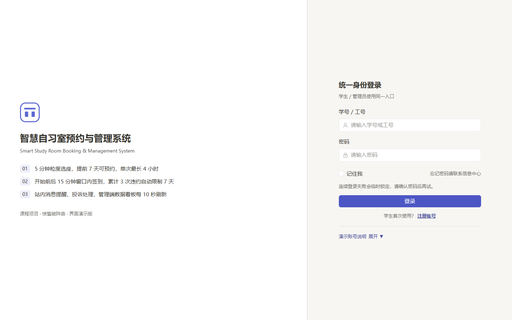

*图 1　登录页：左侧展示系统定位与核心规则，右侧为统一身份入口。*

### 4.2 登录与注册

**登录页**

- 学生与管理员共用入口，使用“学号/工号 + 密码”登录。
- 支持“记住我”（只缓存学号，令牌仍由 store 管理）、注册入口、演示账号说明。
- 连续失败会临时锁定，页面直接提示规则。

**注册页**

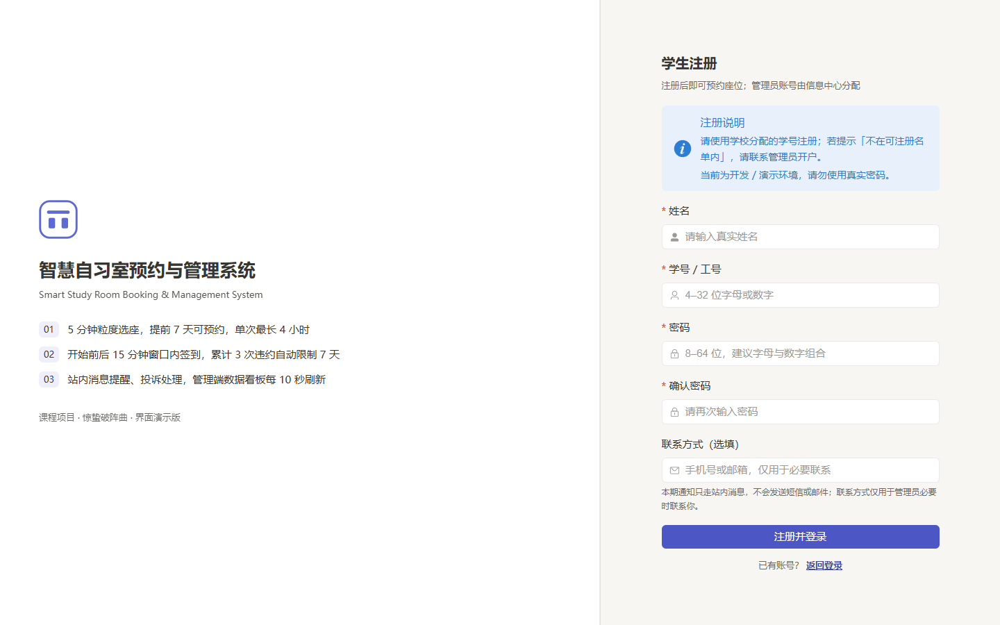

*图 2　学生自助注册：姓名、学号、密码、确认密码、可选联系方式。*

- 只开放学生角色；注册成功直接登录。
- 前端校验与后端 `RegisterRequest` 约束一致（姓名 2–50 字、学号 4–32 位、密码 8–64 位等）。

### 4.3 学生端

#### 4.3.1 首页

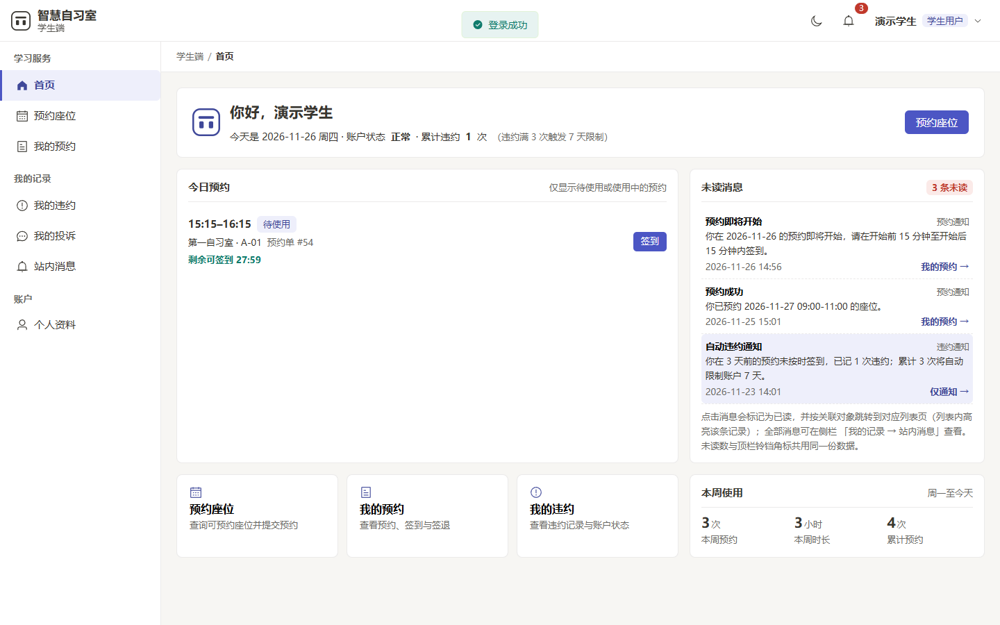

*图 3　学生首页：今日预约、签到倒计时、未读消息与快捷入口。*

- 顶部问候区显示账户状态与累计违约次数（“违约满 3 次触发 7 天限制”）。
- 「今日预约」展示待使用/使用中的预约、座位号与剩余可签到时间，可直接签到。
- 右侧未读消息按类型区分，点击可跳转到对应记录。
- 底部提供预约、我的预约、我的违约快捷卡片与本周使用统计。

#### 4.3.2 预约座位

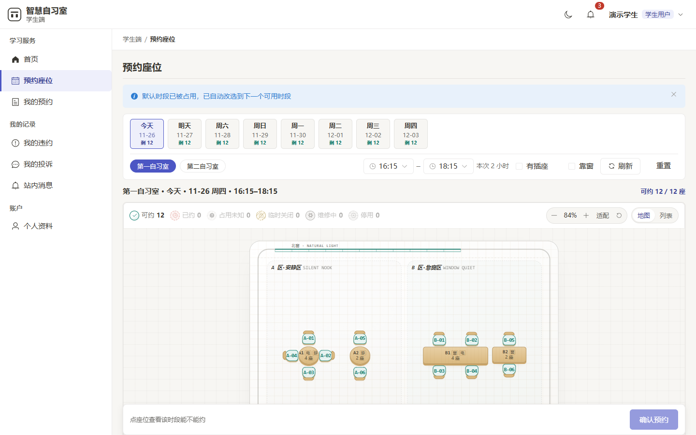

*图 4　预约座位：日期条、5 分钟时段、座位地图与筛选。*

- 日期条展示今天起 7 天，并实时显示该时段剩余座位数。
- 时段选择按 5 分钟步进；开始/结束时间改变后自动重新查询可用座位。
- 支持自习室切换、座位地图/列表视图、类型/插座/靠窗筛选、缩放与适配。
- 座位状态区分“可约、已被预约、占用暂不显示、临时关闭、维修中、停用”；点击座位查看详情。
- 底部操作条展示已选座位、时段与状态；冲突时给出原因或“替我改选时段”。

#### 4.3.3 我的预约

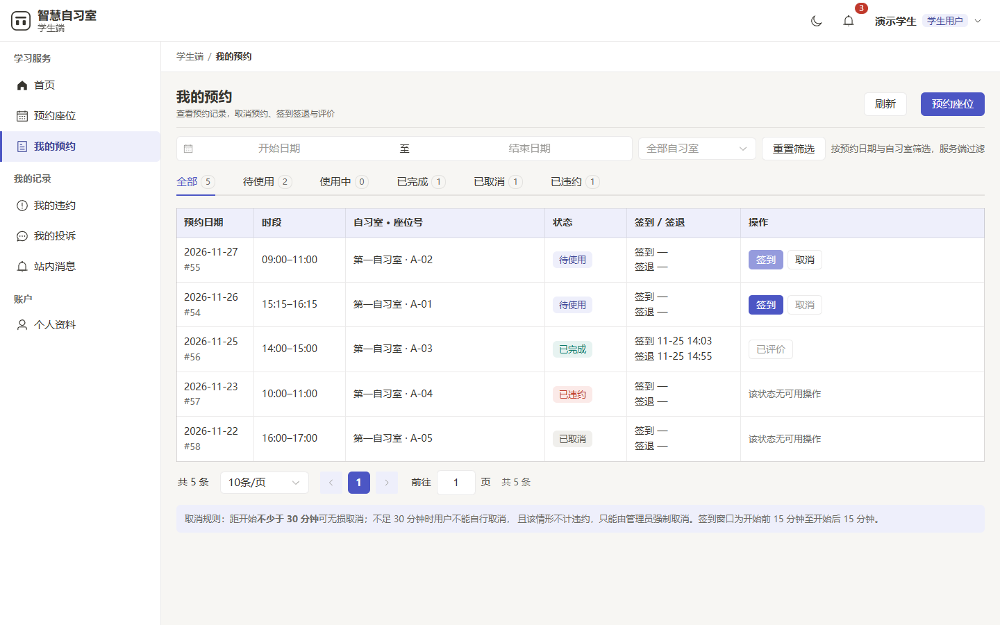

*图 5　我的预约：状态页签、筛选、签到/签退/取消/评价操作。*

- 页签按状态分组并显示数量；支持日期范围与自习室筛选，分页在服务端完成。
- 待使用可签到/取消；使用中可签退；已完成且未评价可评价。
- 表格显示签到/签退时间；底部提示取消规则（开始前 30 分钟）与签到窗口。

#### 4.3.4 我的违约

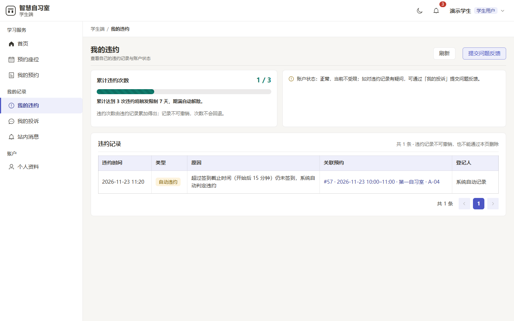

*图 6　我的违约：违约记录、来源与累计次数。*

- 展示违约时间、预约单、违约类型（自动/手动）、原因与操作者。
- 顶部展示累计有效违约次数与账户状态；受限时显示预计解除时间。

#### 4.3.5 站内消息

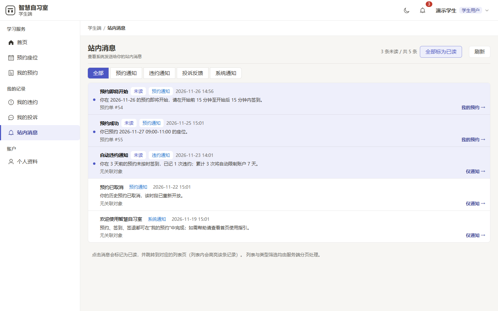

*图 7　站内消息：未读数、类型筛选、按关联对象跳转。*

- 未读数与顶部铃铛共用同一 store，避免多处数字不一致。
- 支持全部/预约通知/违约通知/投诉反馈/系统通知筛选、全部标为已读、分页。

#### 4.3.6 我的投诉

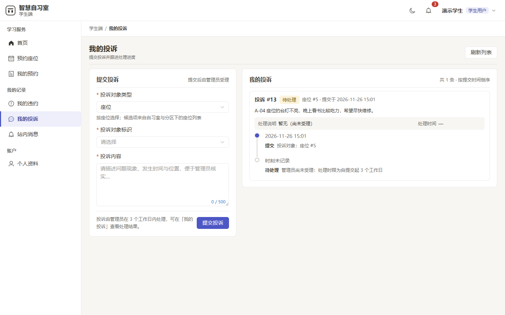

*图 8　我的投诉：提交投诉、查看处理进度与反馈。*

- 投诉对象支持座位/自习室/预约单/用户；提交后进入“待处理”。
- 列表展示状态、处理说明、处理时间；已处理可确认关闭。

#### 4.3.7 个人资料

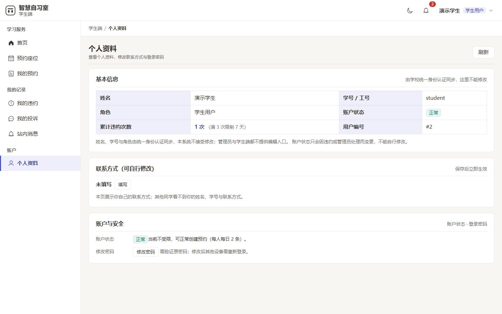

*图 9　个人资料：身份信息只读，联系方式与密码可修改。*

- 姓名、学号、角色、账户状态只读；联系方式与密码可修改。
- 修改密码后旧 JWT 因 `token_version` 递增立即失效。

### 4.4 管理端

#### 4.4.1 数据看板

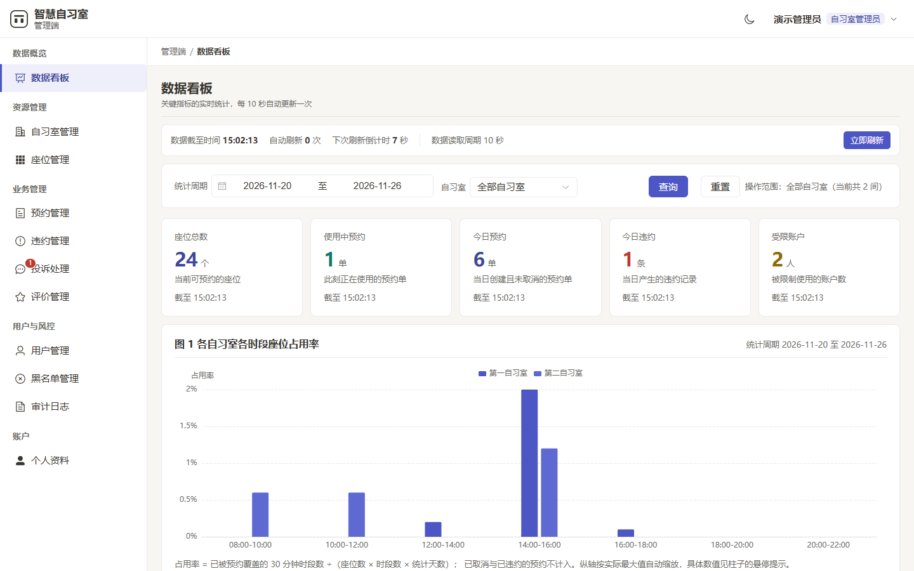

*图 10　数据看板：5 个指标、占用率、趋势与违约 Top N，10 秒刷新。*

- 顶部状态条显示“数据截至时间、自动刷新次数、下次刷新倒计时、读取周期”。
- 支持统计周期与自习室筛选；关键指标包括座位总数、使用中预约、今日预约、今日违约、受限账户。
- 图表：各自习室各时段占用率（30 分钟统计块）、每日预约/违约趋势、违约 Top N。
- 页面切到后台暂停刷新，切回立即读取；失败保留上一次数据并标注截至时间。

#### 4.4.2 自习室管理

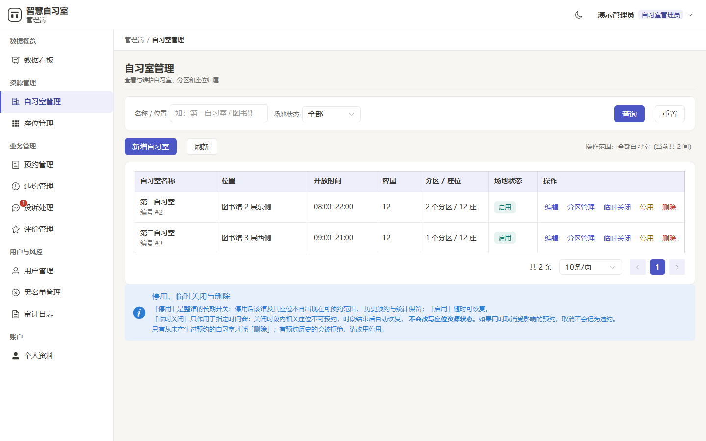

*图 11　自习室管理：房间、分区、座位归属与临时关闭入口。*

- 支持新增/编辑/停用/删除自习室、分区管理、查看容量。
- 有历史预约的自习室不能物理删除，须用“停用”保留关联对象。

#### 4.4.3 临时关闭：影响清单与二次确认

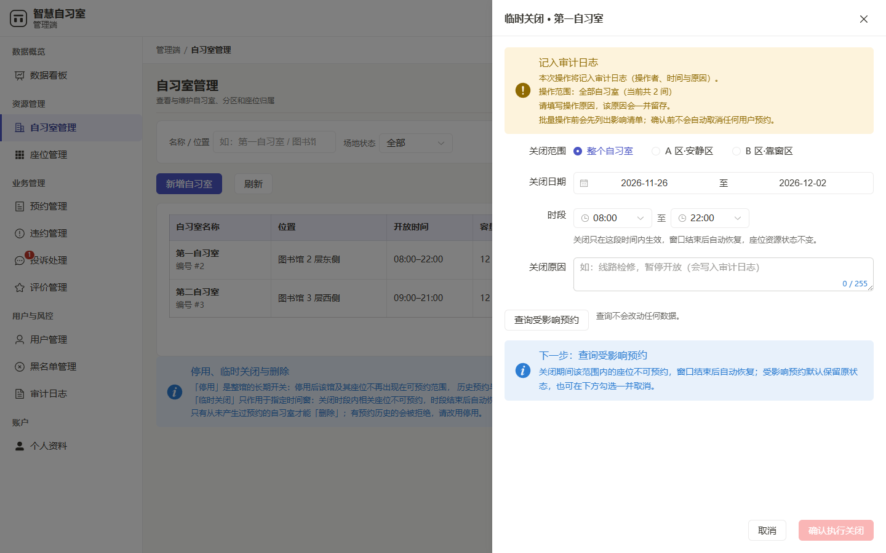

*图 12　临时关闭抽屉：关闭范围、时间窗、原因与审计提示。*

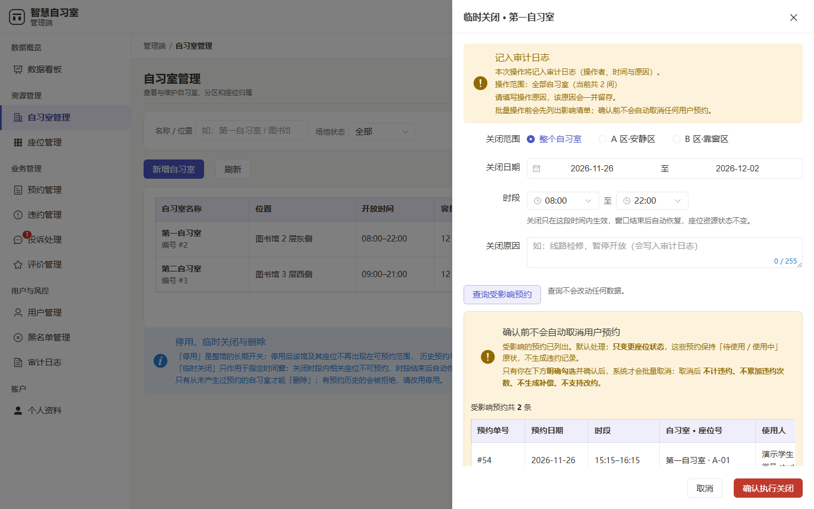

*图 13　查询受影响预约后展示清单；确认前不会自动取消任何预约。*

- 关闭只作用于 `[start_at, end_at)` 时间窗，窗口结束自动恢复，座位资源状态不变。
- 查询影响清单是只读操作；确认时服务端会复核清单是否变化，变化则要求重新查询。
- 默认保留受影响预约；只有勾选“一并取消”才会批量取消，且不计违约。

#### 4.4.4 座位管理

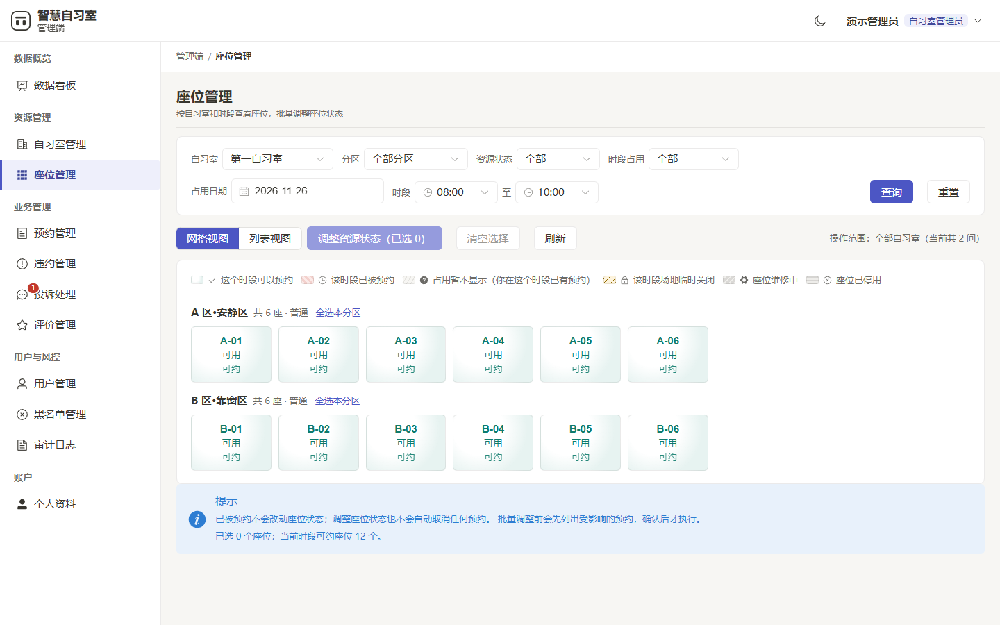

*图 14　座位管理：网格/列表视图、资源状态与时段占用分列展示。*

- 筛选条件包括自习室、分区、资源状态、时段占用、日期与时段。
- 资源状态（可用/维修中/停用）与“该时段是否被预约”分开展示，避免把预约状态写成资源状态。
- 支持批量调整资源状态；调整前展示受影响的冲突预约，确认后才执行。

#### 4.4.5 预约管理

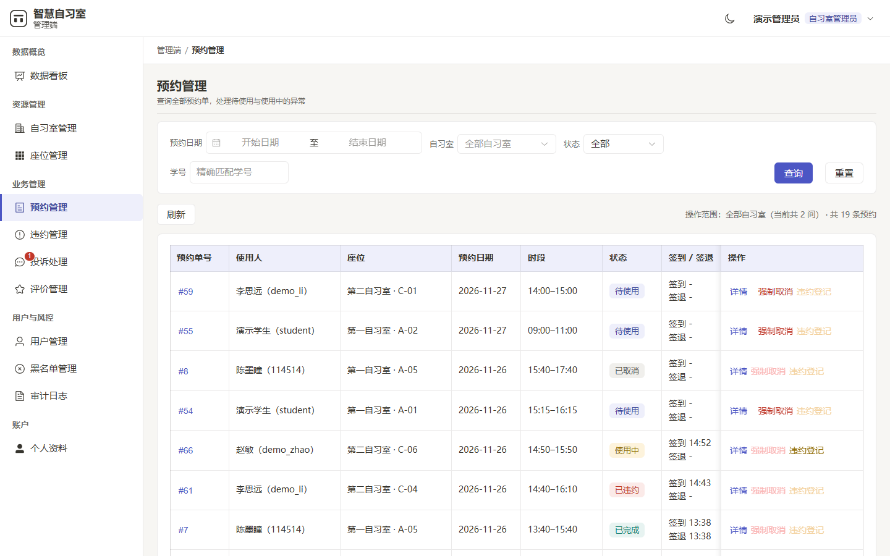

*图 15　预约管理：全量筛选、详情、强制取消与手动违约登记。*

- 支持日期、自习室、状态、学号筛选。
- 强制取消仅适用于“待使用”，不产生违约；手动违约仅适用于“使用中”，必须填写原因并记入审计。
- 两个操作按状态互斥，详情抽屉内直接写明区别。

#### 4.4.6 投诉处理

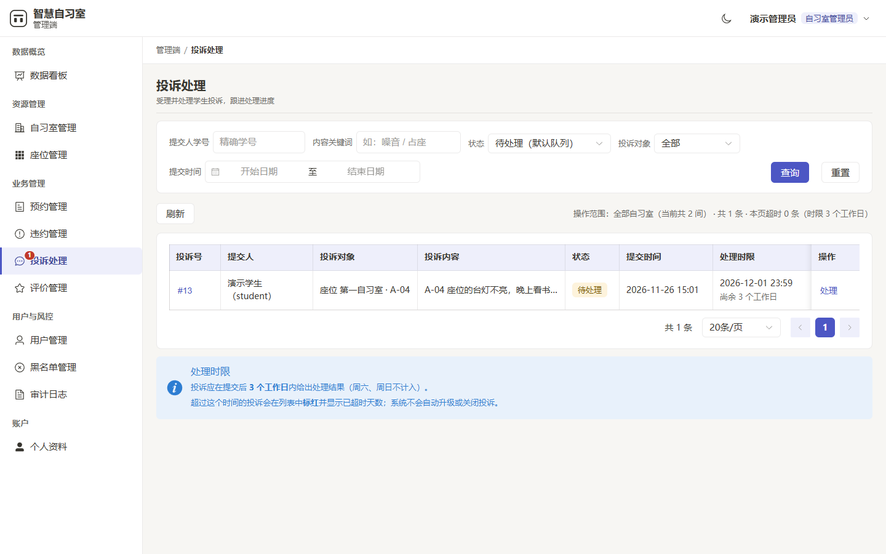

*图 16　投诉处理：默认待处理队列、处理时限与处理入口。*

- 默认进入“待处理”队列，支持状态、对象类型、提交时间、学号、关键词筛选。
- 状态流转：待处理 → 处理中 → 已处理；待处理可直接驳回；已处理由投诉人确认或超时关闭。
- 超过 3 个工作日未处理的记录整行标红并显示超时天数。

#### 4.4.7 评价管理

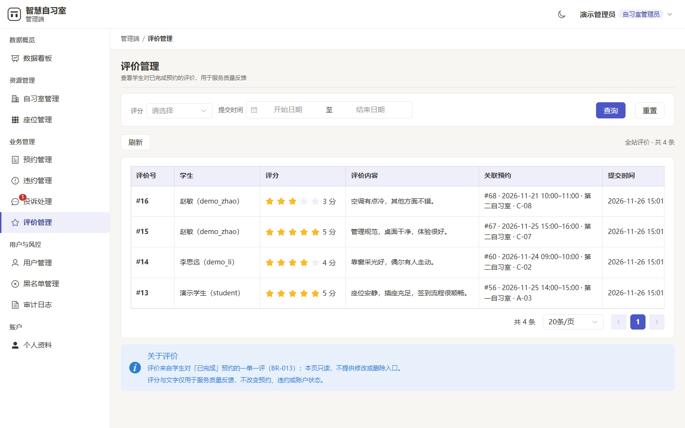

*图 17　评价管理：按评分与日期查看学生对已完成预约的评价。*

- 只读页面，不修改评价内容，也不改变预约/违约/账户状态。
- 评价由学生在“已完成”预约上提交，一单一评。

#### 4.4.8 用户管理

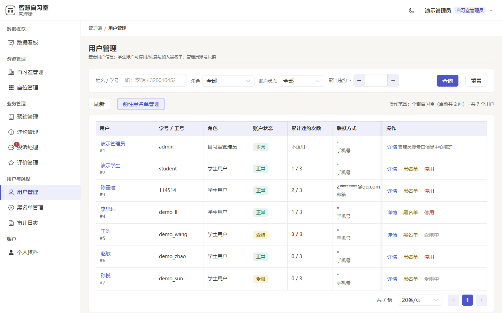

*图 18　用户管理：学生账户可停用/恢复与加入黑名单，管理员账户只读。*

- 支持按姓名/学号、角色、账户状态、违约次数筛选。
- 管理员不能修改姓名、学号、口令，也不能代改联系方式。
- 手机号/邮箱在服务端脱敏后返回。

#### 4.4.9 黑名单管理

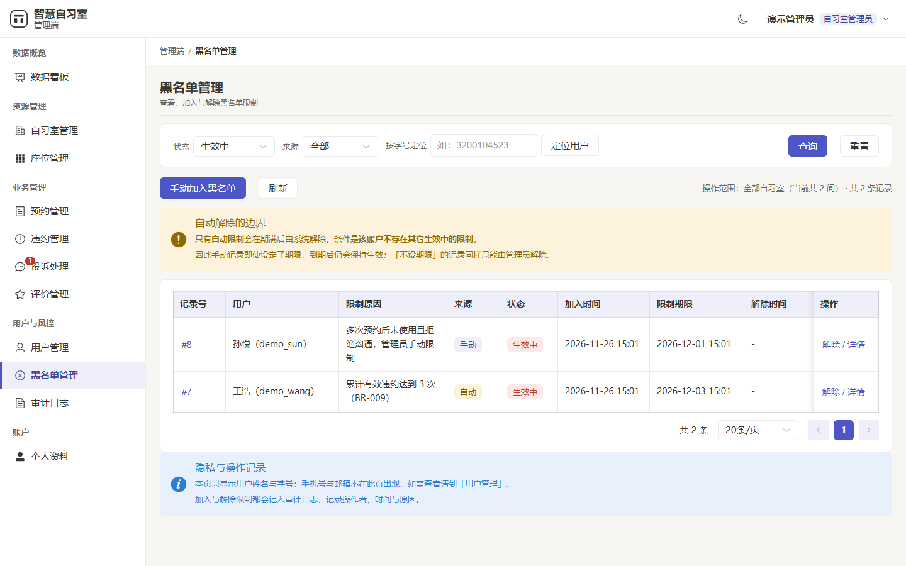

*图 19　黑名单管理：自动/手动来源、期限、状态与解除入口。*

- 自动限制：累计违约达到 3 次，7 天后自动解除。
- 手动限制：管理员填写原因与期限；到期后不会自动解除，必须管理员操作。
- 同一用户最多一条有效限制；加入/解除均写审计。

#### 4.4.10 审计日志

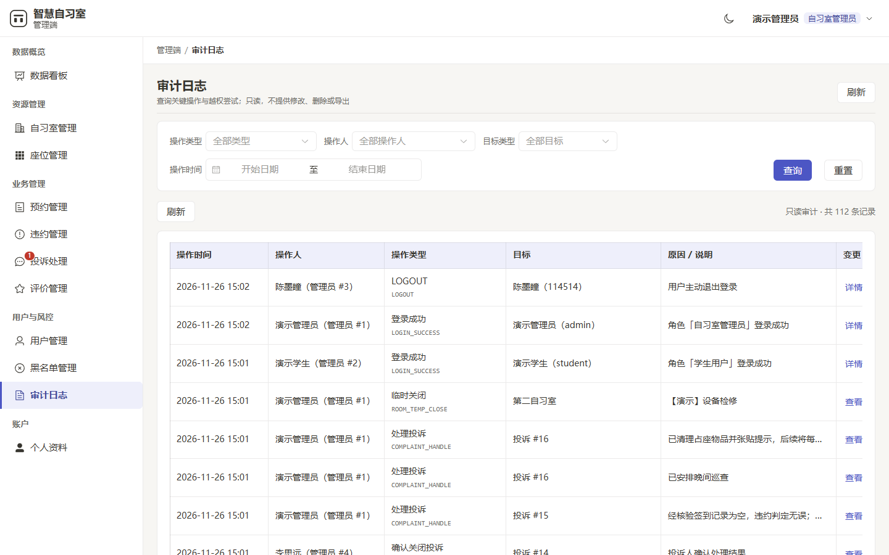

*图 20　审计日志：按操作类型、操作人、目标与日期查询；只读。*

- 记录登录、账户、资源、预约、违约、投诉、黑名单等关键操作与越权尝试。
- 只追加、不修改、不删除；不提供导出（FR-033 已排除）。

### 4.5 通用交互与状态

- **加载/空/失败**：列表与详情均提供骨架/加载态、空状态、失败重试；看板失败时保留旧数据。
- **抽屉优先**：详情、批量操作、表单使用抽屉或对话框，避免多层弹窗。
- **分页与筛选**：除特别说明外均由服务端分页，筛选条件变化后回到第一页。
- **响应式**：座位地图支持缩放/适配，侧栏在小屏下折叠；表格支持横向滚动。
- **可访问性**：关键按钮与筛选区提供 `aria-label`，状态不只靠颜色区分。
- **主题**：支持浅色/暗色切换，首屏防闪。

---

## 5. 演示与运行

```bash
# 1. 启动（Windows，仓库根目录）
start.bat

# 2. 生成/重置 8～10 分钟演示数据
reset-demo.bat
# 或 cd backend && python -m scripts.seed_demo_data --reset

# 3. 停止
stop.bat
```

| 地址 | 说明 |
|---|---|
| <http://127.0.0.1:5173> | 前端页面 |
| <http://127.0.0.1:8000/docs> | Swagger API 文档 |
| <http://127.0.0.1:8000/health> | 后端健康检查 |

演示账号：`student / student123`、`admin / admin123`；扩展账号 `demo_li`、`demo_wang`、
`demo_zhao`、`demo_sun` 密码均为 `demo1234`。完整演示步骤见 [`演示脚本-10分钟.md`](演示脚本-10分钟.md)。

---

## 6. 已知边界与后续演进

| 项目 | 当前状态 |
|---|---|
| 部署 | 提供 Windows `start.bat`；Docker/Nginx 配置尚未入库 |
| 调度 | 每个后端进程都会启动 APScheduler；多 worker 部署需拆分为单调度进程 |
| CI/CD | 尚未接入 GitHub Actions |
| 管理端消息 | 无独立站内消息页，铃铛入口隐藏 |
| 管理员角色 | 系统管理员本版无业务权限，全局参数配置未实现 |
| 审计保留 | 无自动归档/清理任务，保留时间由数据库运维策略决定 |
| 前端包体 | Element Plus 全量引入，可改按需引入 |
| 本期排除 | 违约申诉（FR-024）、记录导出（FR-033）、支付、候补、代预约、门禁/人脸识别 |

---

## 附录 A　页面与路由

| 路由 | 页面 | 角色 |
|---|---|---|
| `/login`、`/register` | 登录、注册 | 公开 |
| `/student/home` | 首页 | 学生 |
| `/student/booking` | 预约座位 | 学生 |
| `/student/reservations` | 我的预约 | 学生 |
| `/student/violations` | 我的违约 | 学生 |
| `/student/complaints` | 我的投诉 | 学生 |
| `/student/messages` | 站内消息 | 学生 |
| `/student/profile` | 个人资料 | 学生 |
| `/admin/dashboard` | 数据看板 | 自习室管理员 |
| `/admin/rooms` | 自习室管理 | 自习室管理员 |
| `/admin/seats` | 座位管理 | 自习室管理员 |
| `/admin/reservations` | 预约管理 | 自习室管理员 |
| `/admin/violations` | 违约记录管理 | 自习室管理员 |
| `/admin/complaints` | 投诉处理 | 自习室管理员 |
| `/admin/reviews` | 评价管理 | 自习室管理员 |
| `/admin/users` | 用户管理 | 自习室管理员 |
| `/admin/blacklist` | 黑名单管理 | 自习室管理员 |
| `/admin/audit` | 审计日志 | 自习室管理员 |
| `/admin/profile` | 个人资料 | 两种管理员 |
| `/admin/notice` | 系统管理员提示 | 两种管理员 |

## 附录 B　关键参数

| 参数 | 默认值 |
|---|---:|
| 预约粒度 | 5 分钟 |
| 最多提前 | 7 天 |
| 单次最长 | 4 小时 |
| 每人每日上限 | 2 条 |
| 签到窗口 | 开始前 15 分钟 ~ 开始后 15 分钟 |
| 无损取消 | 开始前 30 分钟 |
| 违约阈值 / 限制期限 | 3 次 / 7 天 |
| 看板读取周期 / 统计块 | 10 秒 / 30 分钟 |
| 登录失败锁定 | 15 分钟内 5 次 → 锁定 15 分钟 |
| JWT 有效期 | 120 分钟 |

## 附录 C　相关文档

| 文档 | 用途 |
|---|---|
| [`design/软件设计文档.md`](design/软件设计文档.md) | 架构、接口、表结构、关键流程设计 |
| [`系统使用说明.md`](系统使用说明.md) | 启动、配置、数据库与排障 |
| [`演示脚本-10分钟.md`](演示脚本-10分钟.md) | 课堂演示分步脚本与数据说明 |
| [`数据库表结构说明.md`](数据库表结构说明.md) | 表、字段、索引与约束 |
| [`测试报告-阶段4.md`](测试报告-阶段4.md)、[`白盒测试报告.md`](白盒测试报告.md) | 测试结果与问题记录 |
